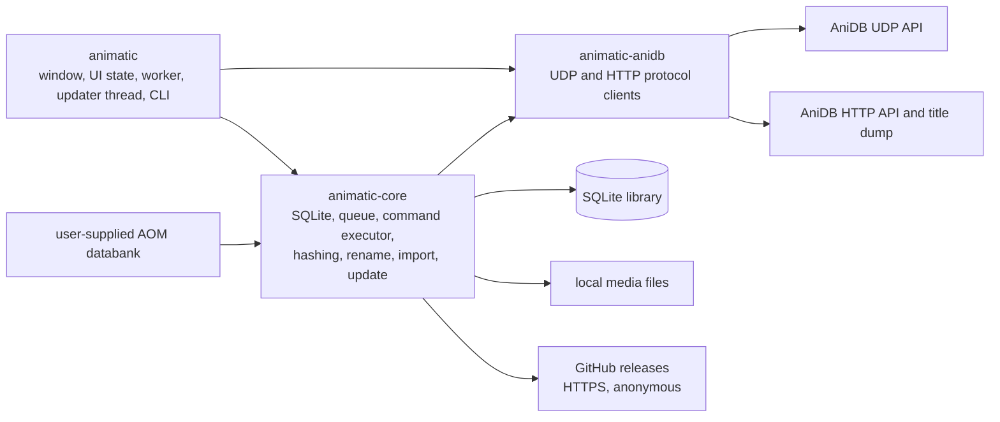
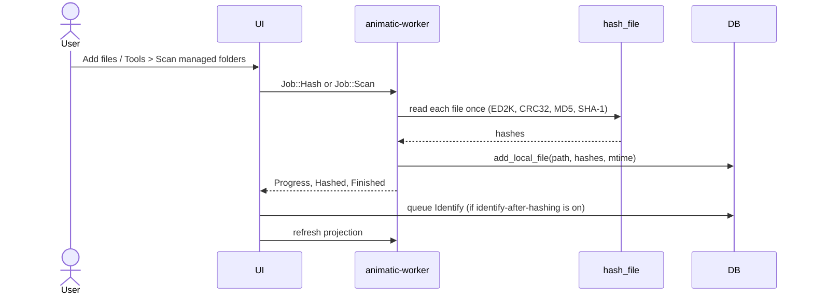
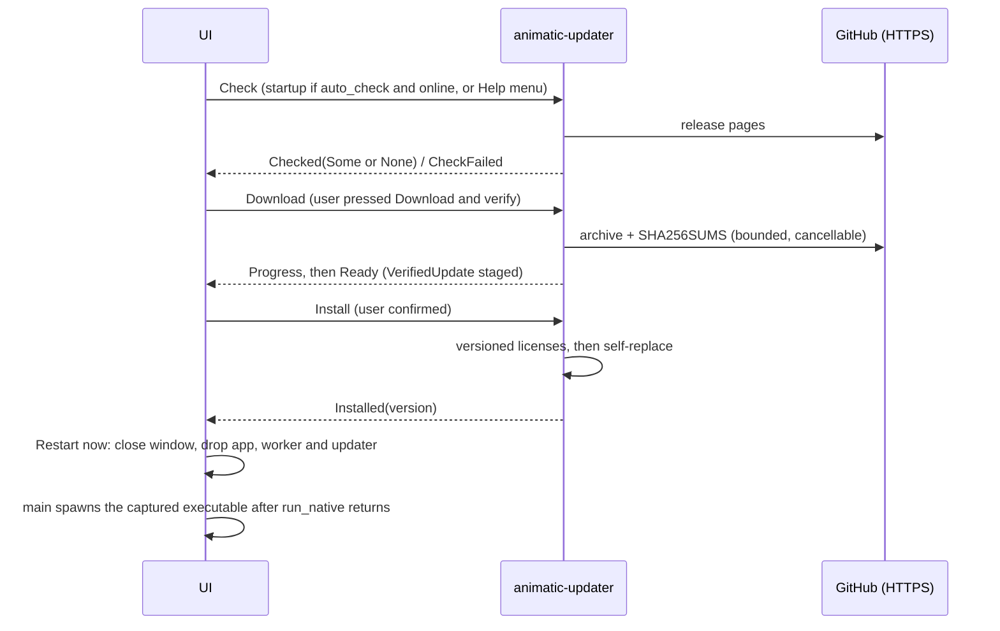

# Animatic architecture

Animatic is a native desktop application built from three Rust crates. This page explains the
dependency graph, the threads, the data flows and the guarantees the code actually provides.
Table-level and protocol-level detail lives in [Storage and network contracts](storage-and-network.md);
user-visible behavior is in the [wiki](https://github.com/RetroHazard/animatic/wiki); desktop reachability of each
capability is in [Feature parity](https://github.com/RetroHazard/animatic/wiki/Feature-Parity).

## Crate graph



| Crate | Depends on | Does not depend on |
|---|---|---|
| `animatic-anidb` | no workspace crate | `animatic-core`, SQLite, the UI |
| `animatic-core` | `animatic-anidb` (path dependency) | the UI crate |
| `animatic` | `animatic-core`, `animatic-anidb` | n/a |

`animatic-anidb` is storage-free: it parses and sends protocol messages and returns typed
records. `animatic-core` consumes those typed records (`store`), embeds two of its types
(`MylistEdit`, `FileRef`) in the persisted command payloads, and runs commands against live
clients in [`sync::execute`](../crates/animatic-core/src/sync.rs). The `animatic` crate only
constructs the clients (from `AnidbSettings`, in `worker.rs`) and decides when to run the queue.

Because `Command` payloads are stored as JSON, the serde shape of `Command`, `MylistEdit` and
`FileRef` is part of the on-disk format. Adding variants or optional fields is safe; renaming or
removing them turns old queue rows into blocked "unreadable queued command" rows.

## Responsibilities

### `animatic-core`

| Module | Responsibility |
|---|---|
| `db` | Connection setup (WAL), idempotent schema creation, `command_queue` upgrade, `write_tx`, cooldown storage in `meta` |
| `store` | Transactional application of API records, local hash/path writes, title dump spool and merge |
| `library` | Read queries, display types and `LibraryProjection` snapshots with search keys |
| `sync` | `Command`, queue operations (`impl Db`), edit coalescing, overlays, `CommandError`, `execute` |
| `hash` | One-pass ED2K (red/blue), CRC32, MD5, SHA-1; hash-export template expansion |
| `file_manager` | Side-effect-free scan planning, hash-and-register, `move_file`, missing-record removal |
| `legacy` | Databank discovery, page decryption, record decoding, per-collection import |
| `rename` | Pattern parser/evaluator, database-backed `A`/`E`/`F`/`G`/`H`/`M` objects, path planning |
| `settings` | Serializable settings, load-with-recovery, atomic save, AOM XML settings import |
| `stats` | Library aggregation and XML/INI rendering |
| `external` | Argument-vector parsing and external player/AVDump launching (no shell) |
| `format` | Size, date, duration and count formatting |
| `update` | GitHub release discovery (`UpdateClient`), CalVer comparison, bounded download, `SHA256SUMS` verification, staging in a temporary directory, versioned license files and `self-replace` install (`VerifiedUpdate`); own `UpdateError`, no AniDB code or cooldowns |
| `error` | Crate-wide `Error`/`Result` (the update module has its own) |

### `animatic-anidb`

`udp` (session, pacing, encryption, compression, tag matching), `commands` (typed UDP requests
and strict reply decoding), `http` (anime XML, title dump streaming, image download), `error`
(`AnidbError` and its retry classification). Both AniDB APIs require a registered client name.

### `animatic`

`main.rs` (paths, environment, CLI flags, window, restart after `run_native`), `app.rs` (egui state, pages, dialogs,
projection bookkeeping, the Software updates window), `worker.rs` (jobs, events, queue runs, projection thread, updater thread).

## Runtime model

| Thread | Database connection | Work |
|---|---|---|
| UI (main) | One `Db` opened in `AnimaticApp::new`, busy timeout 1.5 s | Rendering; small outbox writes (`queue_push`, `queue_edit_mylist`, clear, retry); rename apply; hash-export file write; settings save |
| `animatic-worker` | A fresh `Db::open` per job (hashing: per file) | `Job::Hash`, `Scan`, `ImportLegacy`, `ImportLegacySettings`, `ProcessQueue`, `QueueFullUpdate` |
| `animatic-projection` | One cached connection | `Job::LoadLibrary` (newest queued request wins) and `Job::ExportStatistics` |
| `animatic-updater` | none | Update check, download-and-verify and install (see [Updater thread](#updater-thread)); never opens the library database |
| hash helpers | none | Three short-lived threads per hashed file (ED2K; MD5; SHA-1 + CRC32); the calling thread reads the file once in 4 MiB blocks |

The UI sends `Job`s over an unbounded crossbeam channel and drains `Event`s every frame.
`Worker::submit` routes `LoadLibrary` and `ExportStatistics` to the projection thread so a long
queue run or hash never delays a refresh. `cancel` and `pause` are shared atomics checked
cooperatively: per 4 MiB block while hashing, between planned actions in a scan, between
commands in a queue run, and between import steps. A cancel request applies to the job running
when it is made and is cleared only when the next job starts.

Dropping `Worker` (application exit) sets the shutdown and cancel flags, sends `Stop`, and joins
only the projection thread, so accepted statistics exports finish. The network thread is not
joined: it can be inside an exchange of up to the 20 s UDP timeout (or the 60 s HTTP budget) and
is simply abandoned at process exit. The updater thread is the exception described below: its
network work is cancelled on drop, and an install in progress is joined.

SQLite is the shared state. WAL mode lets the projection thread and the UI read while the worker
writes; only one writer proceeds at a time. Writers that read-modify-write use
`Db::write_tx` (`BEGIN IMMEDIATE`, nested use through a savepoint). When the UI hits a busy
database, a queued command is held in memory and shown as "NOT saved yet" (up to 1000, retried
every 500 ms, one final 5 s attempt at exit); commands still unsaved after that are lost and logged. A
failed mylist edit is not deferred: it reports the error and nothing changes.

## Principal data flows

### Local file ingestion



A scan is started by the user; there is no scheduler. Each newly hashed file can then queue an `Identify`, carrying a MyList add when the matching folder has auto-add (sent only when the queue is run). `plan_scan` is read-only and returns
`ScanAction`s (`Hash`, `Rehash`, `RemoveMissing`); the worker executes them. The modification
time recorded in `local_file.mtime` is read *after* hashing, so a file changed during hashing
can be stored with a newer mtime than the content that was hashed. A path is unique in
`local_file`; identical content at several paths shares one `local_hash` row.

Missing-file removal needs an explicit matching manager with `auto_remove`, an affirmative
`NotFound` for the file, and a successful directory-metadata check of the manager root made
afterwards. Unreachable roots and other filesystem errors keep records. The check and the later
deletion are separate steps, so this is a conservative plan, not an atomic guarantee against a
volume disconnecting in between. Removal deletes only `local_file`/`local_hash` rows; Animatic
never deletes media files and does not use a recycle bin.

### AniDB synchronization

```mermaid
sequenceDiagram
    actor User
    participant UI
    participant DB
    participant Worker as animatic-worker
    participant Exec as core::sync::execute
    participant Net as animatic-anidb clients
    User->>UI: Edit MyList / identify file
    UI->>DB: persist command (queue_edit_mylist / queue_push)
    User->>UI: Synchronize now / Run command queue
    UI->>Worker: Job::ProcessQueue(AnidbSettings)
    Worker->>DB: refuse while offline or in cooldown
    Worker->>Net: build UdpClient and HttpClient from settings
    loop until empty, cancelled, blocked or cooling down
        Worker->>DB: queue_peek (lowest priority, oldest id)
        Worker->>Exec: execute(id, command, db, udp, http)
        Exec->>Net: typed request
        Net-->>Exec: typed reply or AnidbError
        Exec->>DB: apply reply (FILE and MyList replies atomically; see guarantees)
        Worker->>DB: queue_remove(id) or record failure
    end
    Worker->>Net: LOGOUT
```

The queue runs only when the user asks (the Queue page or Tools menu); nothing starts it
automatically. Offline mode leaves the queue untouched. Execution is **at-least-once**: a
command is removed after its reply has been applied, so a crash in between replays it. Replays
are safe by construction (edits are idempotent, an add that finds the entry returns the existing
entry, a delete of a missing entry counts as done). A UDP timeout is also retried once inside
`UdpClient::request`, and a timeout does not prove the server ignored the packet.

Failure handling is a closed set of outcomes (see the tables in
[Storage and network contracts](storage-and-network.md#failure-classes-and-cooldowns)): fatal
errors stop the run (ban cooldown, or every runnable row blocked until credentials or client
version are corrected); transient errors persist a cooldown and stop the run; permanent errors
block only the affected command and the run continues. Counted failures stop at five attempts.
The persisted cooldown is checked before any transport exists, so it also holds after a restart,
and "Retry failed" only unblocks rows: it cannot bypass an active cooldown.

### MyList edits and optimistic state

`Db::queue_edit_mylist` runs in one `BEGIN IMMEDIATE` transaction: it merges the entry's
outstanding edits (including blocked ones) with the new edit in chronological order, deletes
them, inserts one row with a **fresh AUTOINCREMENT id**, and applies the merged edit to the local
`mylist` row. Because ids are never reused, an acknowledgement for a superseded in-flight command
cannot delete newer intent. When AniDB data is written (`store_api_mylist`, FILE replies) the
*readable* queued edits of that `lid` are overlaid on top first, so a stale reply cannot revert a newer
local change; a missing-entry reply (explicit "not in MyList" in a FILE reply, `MYLIST` 321,
or a delete) removes the local `mylist` row only if no newer command targets the entry. Hashing
and identifying therefore never delete media files, but an `Identify` that learns of explicit
absence can remove a stale local MyList row.
Details and limits: [queue semantics](storage-and-network.md#outbox-command-queue).

The UI additionally keeps a short-lived in-memory overlay for the edited row, discarded once a
projection requested after the write arrives. "Clear queue" deletes every row, blocked ones
included, but does **not** revert optimistic local changes already applied to `mylist`.

### Library projections

`LibraryProjection::load` reads every table the UI shows inside one deferred read transaction
(a consistent WAL snapshot) on the projection thread and returns an owned, immutable snapshot
with prebuilt lower-case search keys. The UI allows one request in flight, coalesces further
changes into a dirty flag, and applies a snapshot whole. Projections older than the latest
`Blocked` or `Cooldown` event cannot overwrite that status. Tables render visible rows only. A
snapshot still materializes the whole library; storage queries are not paged.

### Title dump

`HttpClient::titles_dump` streams the gzip dump through `read_titles_dump`, which enforces the
`TitlesLimits` and validates the XML structure and gzip trailer. Rows go to a private temporary
SQLite spool; only after the whole document validated does `Db::import_title_dump` merge them in
one `BEGIN IMMEDIATE` transaction together with the `titles_dump_date` timestamp. The library
database is neither written nor locked while the network is read. It is a public title list, not
an account download: there is no full-MyList bootstrap, no resume and no external checksum.
Limits and exact semantics are in [Title dump](storage-and-network.md#title-dump).

### Legacy migration

1. `find_databank` accepts a `kowai` directory or an install directory containing one.
2. For each present collection (fixed order, lookup tables first) the encrypted pages are
   decrypted to a plaintext SQLite copy in a temporary directory (the desktop uses a folder named
   `import-temp` next to the database; the command-line example uses the output path with its
   extension replaced by `import-temp`, so `library.sqlite3` gives `library.import-temp`).
3. The copy is attached and imported in **one transaction per collection** with
   `INSERT OR REPLACE` keyed by the legacy ids. A failing collection rolls back, is recorded in
   `ImportReport::skipped`/`warnings`, and the import continues; committed collections stay.
4. Derived columns are recomputed and `legacy_import_*` metadata is stored.

The source databank is only read. The plaintext copy is deleted after each collection when its
merge succeeds, fails and rolls back, or the import is cancelled before the merge. Any other
failure (an error while decrypting, `ATTACH`, `COMMIT` or `DETACH`) returns immediately without
deleting that copy, and a crash leaves it too, so **plaintext of your library can remain after
any failed import**. The temporary folder is not private to the importer and can already hold
unrelated files: never delete the whole folder blindly. Inspect it and remove only the files you
recognize as importer output (the decrypted copies are named `<collection>.sqlite`, for example
`mylist.sqlite`).

Cancellation is checked while decrypting and before each collection is merged, not inside the
final transaction or the derived-data step. A cancel requested late can therefore still end in a
successful import, and a large collection decrypts to completion before the cancel is noticed.
The import is designed for a new database: nothing merges with pre-existing rows that share ids,
and the desktop does not check that the database is empty (`Db::is_empty` exists but has no
caller in the application crates).

### Legacy settings migration

**File > Import AOM settings...** submits `Job::ImportLegacySettings`; the worker parses the
XML and returns a typed event. The UI keeps the candidate pending behind a review window that
reports counts and a generic credential warning, never values. While it is open, worker
submissions are gated. Apply forces offline mode and **saves before activating**; a save
failure keeps both the active settings and the candidate. Cancel or a parse failure changes
nothing. The XML is only read. The candidate is built on top of `Settings::default()`, not of
the current settings, so a value the XML does not mention reverts to its default when applied
(review the result before going online).

### Settings persistence

`Settings::save` writes `settings.json.tmp`, flushes it with `sync_all`, copies a still-valid
previous primary to `settings.json.bak` (through its own `.bak.tmp` and a rename), then renames
the temporary file over the primary. A failed write leaves the previous primary in place, but a
failure of the backup rotation is ignored, so the primary can be replaced while the `.bak` is
stale or absent. The parent directory is not synced. The `.bak` holds the *previous* valid
settings, so it can retain credentials that were since changed or removed. Credentials are
stored as plain text in both files. Two Animatic processes sharing one settings file are
unsupported: they share the `.tmp` names, so saves can fail or cross-write rather than follow a
clean last-writer-wins rule. `load_with_recovery` reads the backup only when the primary is missing or invalid,
forces offline mode, and the UI then blocks the exit-time autosave until an explicit Save. On a
normal exit the application otherwise saves the current in-memory settings (Options edits are
live), so the file can change without pressing Save. See
the [settings reference](https://github.com/RetroHazard/animatic/wiki/Settings-Reference) for fields.

### Updater thread

Checking, downloading and installing an Animatic update run on a dedicated `Updater` thread
(`animatic-updater` in `worker.rs`) with its own job channel (`UpdateJob::{Check, Download,
Install}`), its own cancel flag and its own typed `UpdateEvent`s, **not** on `animatic-worker`.
Reasons: a queue run can last hours and must not delay an update check, and the normal worker
clears its shared `cancel` flag at the start of every job, which would silently un-cancel an
update download. `UpdateEvent`s are separate from the normal `Started`/`Progress`/`Finished`
`Event`s because those drive the status-bar activity and trigger a library refresh. The UI owns
the `Updater` next to the `Worker`; update jobs never pass through `Worker::submit`.



Rules the code relies on:

- **One operation at a time.** The UI tracks a single update state (idle, checking, available,
  downloading, ready, installing, installed); buttons that would start a second operation are
  disabled. Install requests are additionally serialized behind an in-process guard, and
  across Animatic processes by an OS advisory lock (`File::try_lock`) on an empty
  `.animatic-update.lock` file in the install directory, so two instances can never install
  at once. The kernel releases the lock if a process crashes; the empty file may remain and is
  harmless. There are no PIDs, retries or elevation. Nothing starts automatically except the startup check.
- **No install/shutdown race.** Dropping the `Updater` cancels a check or download through the
  update cancel flag, discards queued jobs and **waits** for the thread, so a running install is
  never interrupted and the process never exits halfway through the executable swap (an install
  that has not started does not start). Cancel is checked per downloaded chunk and never applied
  inside `self-replace`. Once an install succeeded, or the replacement was entered and failed
  (`UpdateError::install_attempted()`), the process stops checking, downloading, installing and
  restarting by itself until the user restarts Animatic manually, because the executable on disk
  no longer matches the running process (or may be damaged). An install refused before the
  replacement (another installer, a different file on disk) leaves the process unchanged and the
  user must download again.
- **Install gating.** Install and restart are disabled (`update_blocker`) while the worker has
  queued or running jobs or the activity is busy, an AOM import or imported-settings review is
  pending, deferred (unsaved) commands exist, or the install location is unknown; restart is also
  disabled while recovered settings are unsaved. The UI checks the worker's real state
  (`Worker::is_idle`), not just the events it has already processed.
- **Executable identity.** `main` calls `InstallationTarget::capture()` first thing at startup,
  before any swap (after a Windows self-replace the live path can differ). It records the path and
  the OS file identity of the running executable; `install` re-validates it before and after taking
  the install lock and refuses when the file at that path is not the same file, so a second
  instance cannot replace an executable another instance already replaced. Without a captured
  target, updates are disabled.
- **Restart after teardown.** **Restart now** saves the settings first (a failed save keeps the
  application open), sets a shared `AtomicBool` and asks egui to close the window. On the way out the
  app stops and joins the idle main worker thread (`Worker::stop_and_join`), so its database
  connection is closed. `main` spawns the new process only after `run_native` has returned, i.e.
  after the app, its database connection, the worker and the updater have been dropped, so two
  processes never share the database or settings files. The child receives the current
  `--database FILE` (absolute) and nothing else (never media files or `--full-update`), inherits the
  environment, and gets `ANIMATIC_SETTINGS` as the absolute path in use when it was set. A failed spawn is reported as an error telling the
  user to start Animatic manually; there is no retry.
- **Scope of an install.** Only the executable is replaced; versioned license files are added next
  to it. Profiles, database, settings, backups, queue and media are untouched, and the canonical
  `LICENSE`, `THIRD-PARTY-NOTICES.html`, README, changelog and docs of the original archive remain.
- **No AniDB coupling.** The update path uses no AniDB client, spacing or cooldown, and its failures
  never enter the command queue. Only the startup check consults AniDB *settings* (offline,
  recovery) to decide whether to contact GitHub automatically.

### Rename

`rename::plan::plan` compiles and evaluates the pattern against database-backed objects and
returns a `Plan`; `Plan::can_apply` is false for errors, warnings, or no target. Nothing in
planning touches the filesystem. Applying is one file at a time on the **UI thread**:
`file_manager::move_file` and then the path update. Language reference:
[Rename language](https://github.com/RetroHazard/animatic/wiki/Rename-Language).

## What the code guarantees, and what it does not

| Area | Guaranteed | Not guaranteed |
|---|---|---|
| Outbox edits | Edit merge, queue row and optimistic local row commit together or not at all; ids never reused | Delivery exactly once (at-least-once); that AniDB accepted a UDP packet whose reply was lost |
| API reply application | FILE multi-table writes and MyList reply overlays are atomic, also when nested in a caller's transaction (`write_tx` savepoint) | Atomicity of `store_episode_info`, `store_group_info`, `store_anime_info`, `add_local_file` (separate statements); `store_anime_xml` is one transaction but must not be nested |
| Title dump | Invalid, truncated or over-limit dumps leave titles and timestamp unchanged | Resume, external checksum, protection against a *valid* but wrong dump |
| Durability | SQLite WAL consistency | `synchronous=NORMAL`: the newest commits can be lost after an OS crash or power loss |
| `move_file` | The database path changes only after `fs::rename` succeeded; an existing destination is refused first | See below |
| Settings file | The previous primary survives a failed write; the `.bak` is only taken from a valid primary | A current backup: rotation failures are ignored, so a new primary can succeed while `.bak` is stale or absent. `.bak` may retain old or removed credentials. Directory-entry durability. Encryption (plain text). Concurrent saves from two processes (shared temp files: errors or cross-writes, not last-writer-wins) |
| Updates | Only a stable, published, strictly newer CalVer release of `RetroHazard/animatic` is offered; downloads are size-limited and cancellable; the staged executable came from an archive whose SHA-256 matched `SHA256SUMS`; nothing is downloaded or installed without a click; no library data or credentials leave the machine | Authenticity (archives and checksums are unsigned, from the same release); rollback; atomic power-loss safety of the OS swap (leftover dot-files are never auto-deleted); that the install folder is writable; Linux runtime verification |
| Statistics and hash export | Hash export uses the UI's loaded projection; statistics run on the projection thread | Atomic replace: both use `fs::write` (truncate then write) on the destination. `library_stats` is several separate queries, not one read transaction, so concurrent writes can be mixed into one report, and a failed scalar total is reported as 0 |
| Hashing | One read pass; cancel/pause per 4 MiB block | Detecting a file that changes while it is read |
| Local-record removal | Only after affirmative absence under a reachable manager root | Atomic against a disconnect between planning and execution |

`file_manager::move_file(db, local_id, old, new)`:

- Returns early when `old == new`; refuses when `new` exists; creates missing parent
  directories (and does not remove them if the rename then fails); calls `std::fs::rename`;
  updates `local_file.path` last.
- The existence check and the rename are separate calls, so a file created at the destination
  in between **can be silently overwritten** by the rename (on Windows and on Linux alike), not
  merely cause a collision error. There is no copy-and-delete fallback: a move across volumes
  fails with an I/O error, leaving file and record unchanged. No checksum is computed before or
  after.
- If the rename succeeds and the database update then fails, the file is at the new path while
  the record still names the old one; the next scan sees the old path as missing and the new one
  as unknown. There is no rollback.
- [INFERENCE: untested] On case-insensitive filesystems a case-only rename is refused because
  `new.exists()` is true for the same file.
- Only the local file and its `local_file` row change; AniDB MyList `storage` text is not touched.

## Build and release automation

Release automation is outside the runtime: it never changes application code. `ci.yml`
(pull requests targeting `main`, `main` pushes and manual runs; reusable through `workflow_call`) runs a quality job first, plans which checks a change needs,
then builds, lints and tests the workspace with `--locked` on
`ubuntu-22.04` and `windows-latest`. `scripts/release.py` (Python 3.11+, standard library only)
keeps the workspace version, the internal dependency pins, `Cargo.lock`'s local crate entries
and `CHANGELOG.md` consistent, extracts release notes, builds the Windows ZIP and Linux tar.gz
archives from an explicit binary plus the licence, a generated `THIRD-PARTY-NOTICES.html` (`cargo-about`), README, changelog and the `wiki/` user guide (as `docs/*.md`), and writes
`SHA256SUMS`. `release-prepare.yml`, `auto-release.yml` and `release.yml` orchestrate it:
preparation opens a reviewed, `release`-labelled pull request, and merging it makes Release tag
the merge commit `vVERSION` and publish the GitHub Release. `wiki.yml` mirrors `wiki/` to the
GitHub wiki whenever a `main` push changes it, using `scripts/ci.py wiki`.
Archives carry no database, settings, media or credentials. Contracts, permissions and
procedure: [Releases](releases.md). The in-app updater consumes the published form of this output
(archive names, folder layout and `SHA256SUMS` format are an API: change them together with
`update.rs`; see [In-app updates](releases.md#in-app-updates)).

## State rules

- egui state lives on the UI thread; caches are disposable, SQLite is authoritative.
- Settings are explicit serializable data, not globals.
- External processes receive parsed argument vectors, never shell strings.
- Credentials and API keys must not be logged, copied into tests or committed.

## Compatibility policy

Compatibility targets user-visible behavior and data migration, not Delphi implementation
artifacts. Animatic deliberately replaces retired metadata-change commands with AniDB's web
editors, Windows-only COM/shell integration with CLI and file pickers, MDI tabs and custom trees
with fixed views, and unreachable or developer-only AOM dialogs with nothing. See
[Feature parity](https://github.com/RetroHazard/animatic/wiki/Feature-Parity).

## Extending the system

Worked examples with real signatures, including a compilable offline snippet, are in
[Extension recipes](storage-and-network.md#extension-recipes). Checklist:

| Change | Steps |
|---|---|
| New persistent field or table | New table: add `CREATE TABLE IF NOT EXISTS` to `schema.sql`. New column on an existing table: also add an idempotent migration in `db::init` *before* the schema script (the script cannot add columns). Update store writes, library reads and import mapping; test an existing database and a new one |
| New AniDB command | Typed request/reply in `animatic-anidb::commands`; a `Command` variant in `core::sync` (`describe`, `priority`, `mylist_lid` when it targets an entry) and an arm in `sync::execute`; reply application in `store` using `write_tx` and pending-intent overlays; UI producer; tests with local fixtures, never production AniDB |
| New background operation | `Job` and `Event` in `worker.rs`; keep blocking work off `app.rs`; define progress, cancellation and failure events; reload only affected projections; exercise the real UI path |
| New setting | Field with `#[serde(default)]` in `settings.rs`; a runtime consumer; an entry in the [settings reference](https://github.com/RetroHazard/animatic/wiki/Settings-Reference). A persisted field with no consumer must be documented as stored-only. `AOM import` builds on `Settings::default()`, so a preference AOM does not know (like `updates`) must be carried over in `keep_preferences_unknown_to_legacy` |

## Security and privacy

Settings contain AniDB credentials and an optional API key in plain text; libraries and
statistics reveal viewing habits and filesystem layout. Keep runtime data outside the repository,
out of logs and out of tests, and preserve the `.gitignore` protections. The UDP protocol is
not TLS: see [Transport security](storage-and-network.md#transport-security). The update check and
download contact GitHub over HTTPS with the client's IP address and the `Animatic/VERSION`
`User-Agent`, no credentials or library data, and install only after an explicit confirmation;
release archives are checksummed but unsigned (see
[GitHub update transport](storage-and-network.md#github-update-transport)).

Migration crypto constants are format-interoperability material, not credentials. Legacy tests
build records and pages from explicit synthetic values; encoded dumps or ciphertext copied from
a real databank are private artifacts and must never be used as fixtures.

## Source anchors

Where each workflow described in the [wiki](https://github.com/RetroHazard/animatic/wiki) is
implemented. Line numbers are for this tree and may drift; search for the function name.

| Topic | Anchor |
|---|---|
| Pages and menus | `crates/animatic/src/app.rs`: `Page::ALL`, `top_bar`, `navigation`, `dashboard`, `mylist_page`, `anime_page`, `search_page`, `hashed_page`, `groups_page`, `genres_page`, `queue_page`, `log_page`, `anime_detail_window`, `settings_window`, `bottom_bar` |
| Search filters | `app.rs`: `filter_anime`, `filter_search`, `matches_anime`, `aid_query`; `library.rs`: `SearchKeys`, `LibraryProjection::assemble` |
| Hash events, identify-after-hash | `app.rs`: `process_events`; `worker.rs`: `Job::Hash`, `Job::Scan` |
| Queue, merge, retry, clear | `crates/animatic-core/src/sync.rs`: `queue_edit_mylist`, `coalesce_edits`, `queue_peek`, `queue_retry_failed`, `queue_clear`, `execute`; `worker.rs`: `process_queue`, `fail_command` |
| Error classes and cooldowns | `crates/animatic-anidb/src/error.rs`; `udp.rs` reply mapping |
| Scan rules | `crates/animatic-core/src/file_manager.rs`: `plan_scan`, `move_file`; `settings.rs`: `FileManagerSettings::matching_manager_for` |
| Rename | `crates/animatic-core/src/rename/plan.rs`, `rename/mod.rs` (`target_path`), `app.rs`: `preview_rename`, `rename_window`, `pattern_editor_ui` |
| Exports | `crates/animatic-core/src/stats.rs`; `hash.rs`: `Hashes::export`; `app.rs`: `export_statistics`, `export_hashes` |
| External tools | `crates/animatic-core/src/external.rs` |
| Migration | `crates/animatic-core/src/legacy/{crypto,blob,import}.rs`, `settings.rs`: `import_legacy_settings`, `app.rs`: `legacy_settings_review_window` |
| Settings load/save/recovery | `settings.rs`: `load_with_recovery`, `save`; `app.rs`: `SettingsGuard`, `on_exit` |
| Updates | `crates/animatic-core/src/update.rs`: `UpdateClient`, `ReleaseInfo`, `VerifiedUpdate`; `worker.rs`: `Updater`, `UpdateJob`, `UpdateEvent`; `app.rs`: the Software updates window (`update_window`), `update_blocker`, `restart_now`; `main.rs`: executable capture and restart after `run_native` |
