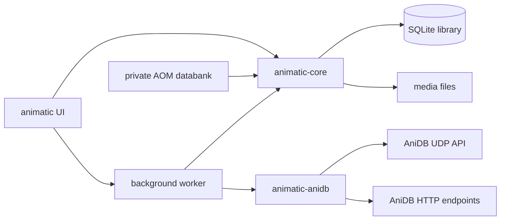
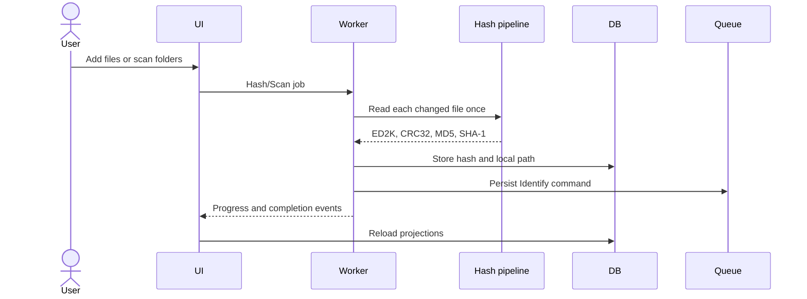
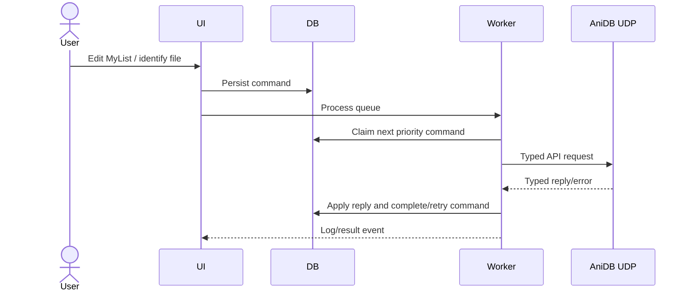

# Animatic architecture

## System overview

Animatic is a native desktop application split into three Rust crates so that protocol, domain/storage, and presentation concerns remain independent.

`animatic-core` does not depend on the UI or API transport crate. `animatic-anidb` does not own application storage. The executable coordinates both.

## Crates

### `animatic-core`

| Module | Responsibility |
|---|---|
| `db` | Connection setup and version-1 schema creation |
| `store` | Mutating persistence operations and imported/API record application |
| `library` | Read models and library projections consumed by the UI |
| `sync` | Serializable durable command types, queue ordering, and local MyList edits |
| `hash` | Single-pass ED2K-red, CRC32, MD5, and SHA-1 hashing; legacy export expansion |
| `legacy` | Databank discovery, page decryption, record decoding, and transactional import |
| `rename` | AOM-compatible parser, evaluator, values, database-backed objects, and path planning |
| `file_manager` | Managed-folder scanning and new/changed/missing-file plans |
| `settings` | Version-tolerant JSON settings and UTF-16 AOM settings import |
| `stats` | Library aggregation and XML/INI rendering |
| `external` | Safe argument parsing and external player/AVDump launching |
| `format` | Stable consumer-facing size, date, duration, and count formatting |

The SQLite schema is in `crates/animatic-core/src/db/schema.sql`. It stores AniDB metadata, titles, episodes, files, relationships, reviews, MyList state, local hashes/paths, metadata, and the persistent command queue.

### `animatic-anidb`

- `udp`: session lifecycle, authentication, optional encrypted sessions, compression, packet spacing, response parsing, and automatic re-authentication.
- `commands`: typed command parameters and typed reply decoding.
- `http`: anime documents, title dumps, and image downloads.
- `error`: transport/protocol-specific failures.

Both AniDB APIs require a registered client identifier. Automated tests use local parsing/crypto fixtures and must not contact production AniDB.

### `animatic`

- `main.rs`: platform data/config paths, environment overrides, CLI compatibility, and native window creation.
- `app.rs`: egui state, navigation, cached read models, menus/dialogs, detail views, settings, and user actions.
- `worker.rs`: long-running jobs and progress/result events.

The application currently exposes overview, MyList, anime, advanced search, hashed files, groups, genres, queue, and activity views.

## Runtime paths

`directories::ProjectDirs::from("net", "AniDB", "Animatic")` selects normal platform paths.

- Database default: data directory plus `animatic.sqlite3`.
- Settings default: config directory plus `settings.json`.
- `ANIMATIC_DB` overrides the database.
- `ANIMATIC_SETTINGS` overrides settings.
- `--database FILE`/`-d` selects a database for that process.
- `--full-update` requests a full refresh path.
- Other file arguments enter the hashing workflow.

Legacy `/database`, `/fullupdate`, `/utf8`, and `/ucs2` arguments are accepted where applicable for handoff compatibility.

## Principal data flows

### Local file ingestion

File-manager policy decides extension acceptance, recursive traversal, automatic hashing, AniDB identification, MyList defaults, and removal handling. A local path references a deduplicated hash record.

### AniDB synchronization

Offline work remains in `command_queue`. Queue processing must be restart-safe and duplicate-aware. The UDP client owns authentication and flood control; callers must not bypass it with raw sockets.

### Legacy migration

1. Locate either a selected `kowai` directory or an install directory containing it.
2. Detect supported encrypted page formats per collection.
3. Decrypt into temporary files outside the source databank.
4. Decode typed legacy records.
5. Apply records to the modern schema per collection and report progress.
6. Record migration metadata in the Animatic database.
7. Remove temporary plaintext material.

The source databank is read-only. Import cancellation and errors must leave source files untouched. Private migration inputs and outputs never belong in Git.

### Rename workflow

The rename engine preprocesses patterns, parses the legacy expression language, evaluates database-backed `A`, `E`, `F`, `G`, `H`, and `M` objects, validates path components, and generates a preview. Applying a preview uses safe filesystem operations; an empty/invalid target is an error, not a silent fallback.

## State and concurrency

- egui/application state is confined to the UI thread.
- Worker commands and events cross `crossbeam-channel` boundaries.
- Pause and cancellation are cooperative for long-running hash/import work.
- UI caches are disposable; persisted SQLite state remains authoritative.
- Settings are explicit serializable data, not hidden globals.
- External processes receive parsed argument vectors rather than shell command strings.

## Compatibility policy

Compatibility targets user-visible behavior and data migration, not Delphi implementation artifacts. Animatic deliberately replaces:

- retired metadata-change commands with current AniDB web editors;
- Windows-only COM/shell extension behavior with normal CLI/file-picker workflows;
- duplicated MDI tabs and custom tree controls with fixed modern views;
- unreachable/developer-only AOM dialogs with no equivalent UI.

See `feature-parity.md` for the workflow-level mapping.

## Extending the system

### New persistent field or record

1. Add an idempotent schema migration or compatible column/table creation.
2. Update store writes and library read models.
3. Update import/API mapping when relevant.
4. Exercise an existing database as well as a new database.
5. Add a behavioral test around the consumer-visible result.

### New AniDB command

1. Add typed request/reply support in `animatic-anidb`.
2. Add a serializable durable command in `animatic-core::sync` if user work must survive restart.
3. Implement queue execution and reply application in the worker.
4. Expose the action in the UI and show actionable errors.
5. Test encoding, reply parsing, queue persistence, and state application without production network access.

### New background operation

1. Add a `Job` and typed `Event` in `worker.rs`.
2. Keep blocking work out of `app.rs` update/render paths.
3. Define progress, cancellation, and failure behavior.
4. Reload only affected UI projections after completion.
5. Smoke the actual UI path.

## Security and privacy considerations

Settings contain AniDB credentials and API keys. They are runtime data and must never be logged, embedded in diagnostics, copied into tests, or committed. Statistics and library databases also reveal personal viewing and filesystem information. Preserve `.gitignore` protections and use temporary paths for all local verification.

The migration crypto constants are format interoperability material, not user credentials. Do not replace them with data copied from a user installation.
