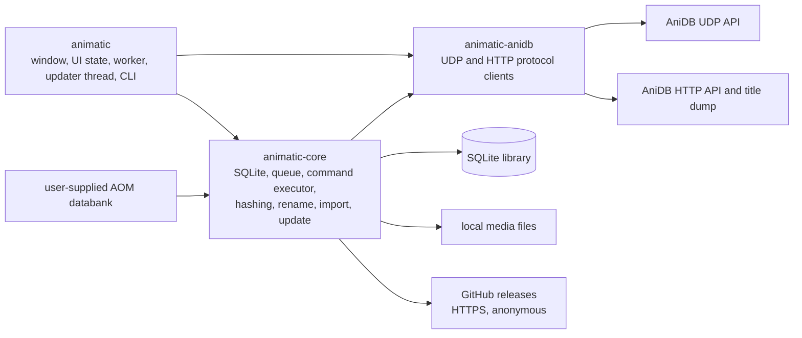
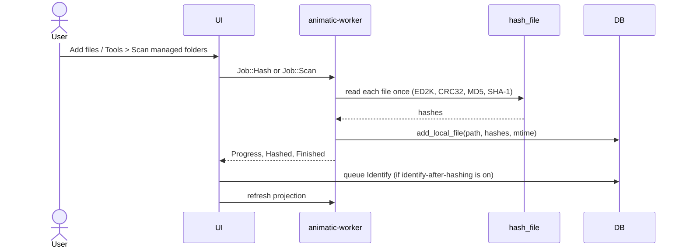
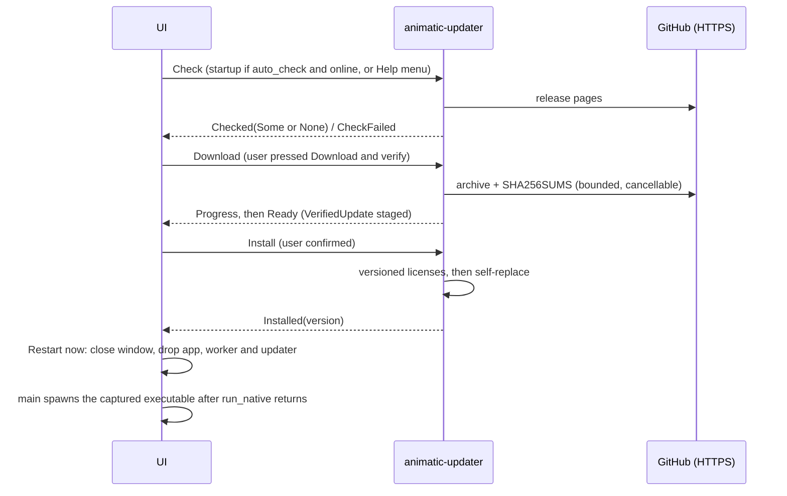

# Animatic architecture

Animatic is a native desktop application built from three Rust crates. This page explains the
dependency graph, the threads, the data flows and the guarantees the code actually provides.
Table-level and protocol-level detail lives in [Storage and network contracts](storage-and-network.md);
user-visible behavior is in the [wiki](https://github.com/RetroHazard/animatic/wiki); desktop reachability of each
capability is in [Feature parity](https://github.com/RetroHazard/animatic/wiki/Feature-Parity).

## Crate graph



| Crate | Depends on | Does not depend on |
|---|---|---|
| `animatic-anidb` | no workspace crate | `animatic-core`, SQLite, the UI |
| `animatic-core` | `animatic-anidb` (path dependency) | the UI crate |
| `animatic` | `animatic-core`, `animatic-anidb` | n/a |

`animatic-anidb` is storage-free: it parses and sends protocol messages and returns typed
records. `animatic-core` consumes those typed records (`store`), embeds two of its types
(`MylistEdit`, `FileRef`) in the persisted command payloads, and runs commands against live
clients in [`sync::execute`](../crates/animatic-core/src/sync.rs). The `animatic` crate only
constructs the clients (from `AnidbSettings`, in `worker.rs`) and decides when to run the queue.

Because `Command` payloads are stored as JSON, the serde shape of `Command`, `MylistEdit` and
`FileRef` is part of the on-disk format. Adding variants or optional fields is safe; renaming or
removing them turns old queue rows into blocked "unreadable queued command" rows.

## Responsibilities

### `animatic-core`

| Module | Responsibility |
|---|---|
| `db` | Connection setup (WAL), idempotent schema creation, `command_queue` upgrade, `write_tx`, cooldown storage in `meta` |
| `limits` | Saved AniDB limit state: the `LimitStore` over `meta` (send times, `AUTH` backoff step) behind the process-wide spacing, and the attempt-based request guards (title dump once a day, minimum age per anime and per known file) |
| `store` | Transactional application of API records, local hash/path writes, title dump spool and merge |
| `library` | Read queries, display types and `LibraryProjection` snapshots with search keys |
| `sync` | `Command`, queue operations (`impl Db`), edit coalescing, overlays, `CommandError`, `execute` |
| `hash` | One-pass ED2K (red/blue), CRC32, MD5, SHA-1; hash-export template expansion |
| `file_manager` | Side-effect-free scan planning, hash-and-register, `move_file` (same-volume rename or verified cross-volume copy), missing-record removal |
| `legacy` | Databank discovery, page decryption, record decoding, per-collection import |
| `rename` | Pattern parser/evaluator, database-backed `A`/`E`/`F`/`G`/`H`/`M` objects, path planning (`plan`, `plan_local_file`, `plan_batch`) |
| `settings` | Serializable settings, load-with-recovery, atomic save, AOM XML settings import |
| `atomic` | `write_atomic`: temporary file in the target folder, flush, rename; used by the statistics and hash exports |
| `stats` | Library aggregation (one read transaction) and XML/INI rendering |
| `maintenance` | Online backup, restore validation and file swap, integrity/foreign-key check, `VACUUM`; blocking file work for the worker and the restore thread |
| `external` | Argument-vector parsing and external player/AVDump launching (no shell) |
| `format` | Size, date, duration and count formatting |
| `update` | GitHub release discovery (`UpdateClient`), CalVer comparison, bounded download, `SHA256SUMS` verification, staging in a temporary directory, versioned license files and `self-replace` install (`VerifiedUpdate`); own `UpdateError`, no AniDB code or cooldowns |
| `instance` | Single-instance handoff: loopback listener, token and lock file next to the database; `start` decides forward, claim or standalone (see [Single instance and the file-menu entry](#single-instance-and-the-file-menu-entry)) |
| `shell_integration` | Per-user "Hash with Animatic" entry: `ShellIntegration` over the Windows registry (`HKCU`, via `winreg`) or a Linux desktop file, ownership marker, injectable location for tests |
| `error` | Crate-wide `Error`/`Result` (the update module has its own) |

### `animatic-anidb`

`udp` (session, encryption, compression, tag matching, no silent port fallback), `commands` (typed
UDP requests and strict reply decoding), `http` (anime XML, title dump streaming, image
download), `limits` (the process-wide `Limits`: UDP and HTTP spacing shared by every client,
send times saved before each request, `AUTH` backoff; plus the `Clock` and `LimitStore` seams),
`error` (`AnidbError` and its retry classification), `testing` (loopback fixtures and a manual
clock behind the `test-support` feature). Both AniDB APIs require a registered client name.

### `animatic`

`main.rs` (paths, environment, CLI flags, window, restart after `run_native`), `app.rs` (egui state, pages, dialogs,
projection bookkeeping, the Software updates window), `worker.rs` (jobs, events, queue runs, projection thread, updater thread), `scheduler.rs` (scheduled folder scans).
The Options row for the file-menu entry is `app/shell_menu.rs`.

## Runtime model

| Thread | Database connection | Work |
|---|---|---|
| UI (main) | One `Db` opened in `AnimaticApp::new`, busy timeout 1.5 s | Rendering; small outbox writes (`queue_push`, `queue_edit_mylist`, clear, retry); one-row request-guard reads before queueing a title dump or an anime refresh; the one-file rename preview (point reads of the local database); settings save |
| `animatic-worker` | A fresh `Db::open` per job (hashing: per file); the shared limiter's `DbLimitStore` opens a short one for each request it saves a send time for | `Job::Hash`, `Scan`, `ImportLegacy`, `ImportLegacySettings`, `ProcessQueue`, `QueueFullUpdate`, `RenameFiles` (rename apply, including cross-volume copies), `BackupLibrary`, `ValidateBackup`, `CheckLibrary` (read-only connection), `CompactLibrary` |
| `animatic-projection` | One cached connection | `Job::LoadLibrary` (newest queued request wins), `Job::ExportStatistics`, `Job::ExportHashes` and `Job::PlanRenames` (batch rename planning, answered by `Event::RenamesPlanned`) |
| `animatic-scheduler` | none | Decides when a folder scan is due (`scheduler::Schedule`, polled once a second) and submits the ordinary `Job::Scan`; see [Scheduled folder scans](#scheduled-folder-scans) |
| `animatic-restore` | Opens the library only to checkpoint and copy it | One-shot per confirmed restore, started after the worker and projection threads are joined and the UI connection is closed; see [Library backup, restore, check and compaction](#library-backup-restore-check-and-compaction) |
| `animatic-updater` | none | Update check, download-and-verify and install (see [Updater thread](#updater-thread)); never opens the library database |
| `animatic-instance` and per-connection threads | none | Accept forwarded media paths from other launches and queue them for the UI (see [Single instance and the file-menu entry](#single-instance-and-the-file-menu-entry)); only exists while this process owns the lock |
| `animatic-shell` | none | One-shot per Options open or save: reads, registers or removes the file-menu entry |
| hash helpers | none | Three short-lived threads per hashed file (ED2K; MD5; SHA-1 + CRC32); the calling thread reads the file once in 4 MiB blocks |

The UI sends `Job`s over an unbounded crossbeam channel and drains `Event`s every frame.
`Worker::submit` routes `LoadLibrary`, `ExportStatistics` and `ExportHashes` to the projection thread so a long
queue run or hash never delays a refresh. `cancel` and `pause` are shared atomics checked
cooperatively: per 4 MiB block while hashing, between planned actions in a scan, between
commands in a queue run, and between import steps. A cancel request applies to the job running
when it is made and is cleared only when the next job starts.

Dropping `Worker` (application exit) sets the shutdown and cancel flags, sends `Stop`, and joins
only the projection thread, so accepted statistics and hash exports finish. The network thread is not
joined: it can be inside an exchange of up to the 20 s UDP timeout (or the 60 s HTTP budget) and
is simply abandoned at process exit. The updater thread is the exception described below: its
network work is cancelled on drop, and an install in progress is joined.

SQLite is the shared state. WAL mode lets the projection thread and the UI read while the worker
writes; only one writer proceeds at a time. Writers that read-modify-write use
`Db::write_tx` (`BEGIN IMMEDIATE`, nested use through a savepoint). When the UI hits a busy
database, a queued command is held in memory and shown as "NOT saved yet" (up to 1000, retried
every 500 ms, one final 5 s attempt at exit); commands still unsaved after that are lost and logged. A
failed mylist edit is not deferred: it reports the error and nothing changes.

### Scheduled folder scans

`scheduler.rs` holds the timing and the thread of the optional scan at start and the interval scan
(`file_managers.scan_at_start`, `scheduled_scan`, `scan_interval_minutes`). `Schedule` is pure
state driven by explicit `Instant`s (tests control the clock): it is due on a requested start
scan or when the interval elapsed, stays due while the scan cannot start (reported once as
`Event::Info`), and counts the next interval from the actual submission. The thread owns a
`Schedule`, reads the settings and the UI's blocking state from a shared `ScanControl`, and starts
a scan only through `worker::submit_if_idle`: one atomic `pending 0 -> 1` claim, so it never
queues behind or between other jobs and a manual scan cannot slip in between check and submit.
`AnimaticApp::sync_scan_schedule` (every frame, `scan_blocker`) publishes the settings and holds
the scan back while a restore, an import or its confirmation, a settings review, the recovery
notice or unsaved deferred commands are open or pending; while Options is open the published
settings stay as they were. A scan is local (it never contacts AniDB), so Work offline does not
gate it; identify-after-hashing still only queues commands. `Worker::close` drops the thread's
stop channel and joins it, so stopping the application ends the scheduler within one poll and
cancels a running scan at the next file.

Inside a scan, `file_manager::settle_scan` applies `action_delay_ms` after planning: a file whose
modification time is younger than the delay is deferred, the other candidates are re-stat'ed after
one wait of the delay (once for the whole scan, cancellable) and deferred when size or
modification time changed. Deferred files are not recorded, so the next scan plans them again.
`sleep_time_ms` is a cancellable pause between two hashed files of one scan.

## Principal data flows

### Local file ingestion



A scan is started by the user, at application start or by the interval timer (see [Scheduled folder scans](#scheduled-folder-scans)). Each newly hashed file can then queue an `Identify`, carrying a MyList add when the matching folder has auto-add (sent only when the queue is run). `plan_scan` is read-only and returns
`ScanAction`s (`Hash`, `Rehash`, `RemoveMissing`); the worker executes them. The modification
time recorded in `local_file.mtime` is read *after* hashing, so a file changed during hashing
can be stored with a newer mtime than the content that was hashed. A path is unique in
`local_file`; identical content at several paths shares one `local_hash` row.

Missing-file removal needs an explicit matching manager with `auto_remove`, an affirmative
`NotFound` for the file, and a successful directory-metadata check of the manager root made
afterwards. Unreachable roots and other filesystem errors keep records. The check and the later
deletion are separate steps, so this is a conservative plan, not an atomic guarantee against a
volume disconnecting in between. Removal deletes only `local_file`/`local_hash` rows; scans,
hashing and removal never delete media files and nothing uses a recycle bin. The one media
file deletion is the source of a verified cross-volume rename (see
[Rename](#rename)).

### AniDB synchronization

```mermaid
sequenceDiagram
    actor User
    participant UI
    participant DB
    participant Worker as animatic-worker
    participant Exec as core::sync::execute
    participant Net as animatic-anidb clients
    User->>UI: Edit MyList / identify file
    UI->>DB: persist command (queue_edit_mylist / queue_push)
    User->>UI: Synchronize now / Run command queue
    UI->>Worker: Job::ProcessQueue(AnidbSettings)
    Worker->>DB: refuse while offline or in cooldown
    Worker->>Net: build UdpClient and HttpClient from settings, over the worker's one shared Limits
    loop until empty, cancelled, blocked or cooling down
        Worker->>DB: queue_peek (lowest priority, oldest id)
        Worker->>Exec: execute(id, command, db, udp, http)
        Exec->>Net: typed request
        Net-->>Exec: typed reply or AnidbError
        Exec->>DB: apply reply (FILE and MyList replies atomically; see guarantees)
        Worker->>DB: queue_remove(id) or record failure
    end
    Worker->>Net: LOGOUT
```

The queue runs only when the user asks (the Queue page or Tools menu); nothing starts it
automatically. Offline mode leaves the queue untouched. Execution is **at-least-once**: a
command is removed after its reply has been applied, so a crash in between replays it. Replays
are safe by construction (edits are idempotent, an add that finds the entry returns the existing
entry, a delete of a missing entry counts as done). A UDP timeout is also retried once inside
`UdpClient::request`, and a timeout does not prove the server ignored the packet.

Failure handling is a closed set of outcomes (see the tables in
[Storage and network contracts](storage-and-network.md#failure-classes-and-cooldowns)): fatal
errors stop the run (ban cooldown, or every runnable row blocked until credentials or client
version are corrected); transient errors persist a cooldown and stop the run; permanent errors
block only the affected command and the run continues. Counted failures stop at five attempts.
The persisted cooldown is checked before any transport exists, so it also holds after a restart,
and "Retry failed" only unblocks rows: it cannot bypass an active cooldown.

AniDB's limits hold across runs and restarts. The worker creates one `Limits` (UDP and HTTP
spacing) when it starts and lends it to the clients of every run, so repeated runs share one
burst allowance; each send time is saved in `meta` before the request leaves, so a restart
keeps the spacing. Request guards count attempts: the title dump (24 h), an anime (24 h) and a
known file (7 days) are not requested again inside their window, even after a failed or
interrupted request. The executor completes such a command as `Outcome::Skipped`, the full update
leaves it out, and the UI refuses the click and says when it is allowed
([Request guards](storage-and-network.md#request-guards)).

### MyList edits and optimistic state

`Db::queue_edit_mylist` runs in one `BEGIN IMMEDIATE` transaction: it merges the entry's
outstanding edits (including blocked ones) with the new edit in chronological order, deletes
them, inserts one row with a **fresh AUTOINCREMENT id**, and applies the merged edit to the local
`mylist` row. Because ids are never reused, an acknowledgement for a superseded in-flight command
cannot delete newer intent. When AniDB data is written (`store_api_mylist`, FILE replies) the
*readable* queued edits of that `lid` are overlaid on top first, so a stale reply cannot revert a newer
local change; a missing-entry reply (explicit "not in MyList" in a FILE reply, `MYLIST` 321,
or a delete) removes the local `mylist` row only if no newer command targets the entry. Hashing
and identifying therefore never delete media files, but an `Identify` that learns of explicit
absence can remove a stale local MyList row.
Details and limits: [queue semantics](storage-and-network.md#outbox-command-queue).

The UI additionally keeps a short-lived in-memory overlay for the edited row, discarded once a
projection requested after the write arrives. "Clear queue" deletes every row, blocked ones
included, but does **not** revert optimistic local changes already applied to `mylist`.

Adds, removals and refreshes use the plain queue (`queue_command`, with the same deferral when the
database is busy). A `MylistAdd` for a file id or hash has no `lid` yet, so no local `mylist` row
exists before AniDB answers; `LibraryProjection` derives `LocalFile::mylist_add_pending` from the
queue snapshot so **Hashed files** shows `Add queued`. A removal never touches the `mylist` row
until `execute` has AniDB's `MYLISTDEL` reply (`mylist_deleted_on_anidb`, which keeps the row when
newer intent was queued after the delete); `LibraryProjection::mylist_pending` (from
`pending_by_lid`) shows `Edit queued`, `Removal queued` and the `blocked` forms on **My list**. The
latest `MYLISTSTATS` result is stored in `meta.mylist_stats` with its arrival time and exposed as
`LibraryProjection::account_stats`; the Overview labels it as AniDB account figures, apart from
the local counts.

### Library projections

`LibraryProjection::load` reads every table the UI shows inside one deferred read transaction
(a consistent WAL snapshot) on the projection thread and returns an owned, immutable snapshot
with prebuilt lower-case search keys. The UI allows one request in flight, coalesces further
changes into a dirty flag, and applies a snapshot whole. Projections older than the latest
`Blocked` or `Cooldown` event cannot overwrite that status. Tables render visible rows only. A
snapshot still materializes the whole library; storage queries are not paged.

### Title dump

`HttpClient::titles_dump` streams the gzip dump through `read_titles_dump`, which enforces the
`TitlesLimits` and validates the XML structure and gzip trailer. Rows go to a private temporary
SQLite spool; only after the whole document validated does `Db::import_title_dump` merge them in
one `BEGIN IMMEDIATE` transaction together with the `titles_dump_date` timestamp. The library
database is neither written nor locked while the network is read. The attempt time that keeps
the dump to once a day is saved before the request, outside that transaction, so a failed
download counts too. It is a public title list, not an account download: there is no
full-MyList bootstrap, no resume and no external checksum.
Limits and exact semantics are in [Title dump](storage-and-network.md#title-dump).

### Legacy migration

1. `find_databank` accepts a `kowai` directory or an install directory containing one.
2. **File > Import AOM databank...** submits `Job::ImportLegacy { source, temp_root, confirmed }`.
   The worker calls `open_for_legacy_import`: when the database is not empty (`Db::is_empty`:
   no anime, MyList entry or local file) and the job is not `confirmed`, nothing is written and
   the job answers `Event::LegacyImportNeedsConfirmation`. The UI thread never inspects the
   database for this (rule 1); it shows the **Import into a database that has data?** dialog,
   where **Continue** resubmits the job with `confirmed: true` and **Cancel** drops it. Deciding
   inside the job keeps the database read off the UI thread and makes the decision and the
   import see the same database. An empty database imports directly.
3. `import_databank` creates an `ImportWorkdir` below `temp_root` (the desktop and the example pass
   `legacy::workdir::default_temp_root()`, the system temporary directory; tests pass their own):
   a directory named `animatic-legacy-import-<random>` (`tempfile`, private to the user on Unix)
   whose marker file `.animatic-legacy-import` is created, and exclusively locked, **before** any
   decrypted byte is written. No work folder is created when the source has no collection files.
4. For each present collection (fixed order, lookup tables first) the encrypted pages are
   decrypted to a plaintext SQLite copy inside that folder.
5. The copy is attached and imported in **one transaction per collection** with
   `INSERT OR REPLACE` keyed by the legacy ids. A failing collection rolls back, is recorded in
   `ImportReport::skipped`/`warnings` (the worker logs each warning as an error line), and the
   import continues; committed collections stay.
6. Derived columns are recomputed and `legacy_import_*` metadata is stored.

The source databank is only read (rule 6). The plaintext copy is deleted after each collection,
and `import_databank` detaches the legacy copy and removes the whole work folder however it ends
(success, a decryption error or any other `?` exit, cancel); the `Drop` of `ImportWorkdir`
covers a panic. A removal failure after success is added to `ImportReport::warnings`. Only a
crash, a kill or a power loss can leave the folder behind.

**Leftover folders.** The exclusive lock on the marker file is held while the import runs and is
released by the operating system when the process ends, however it ends, so a folder whose
marker can be locked belongs to no running import (this process or another Animatic). At startup
`AnimaticApp::new` submits `Job::FindLegacyLeftovers`; `find_leftover_workdirs` returns only real
directories directly below the temporary root whose name has the prefix, that hold a regular marker
file, and whose marker can be locked. Symbolic links never qualify and an unreadable or locked
marker keeps the folder. A non-empty result becomes `Event::LegacyLeftovers` and the **Leftover
import files** notice; **Remove** submits `Job::RemoveLegacyLeftovers`, and
`remove_leftover_workdirs` re-checks each folder (parent equal to the temporary root, prefix,
marker, unlocked) before `remove_dir_all`, reporting the rest as kept
(`Kept leftover import folder <path>: <reason>`). Unmarked folders, other files in the temporary
directory and anything outside it are never touched; an `import-temp` folder created by an older
version carries no marker and is not offered.

Cancellation is checked while decrypting and before each collection is merged, not inside the
final transaction or the derived-data step. A cancel requested late can therefore still end in a
successful import, and a large collection decrypts to completion before the cancel is noticed.
The import still replaces rows that share ids; the confirmation exists because of that. The
`import-legacy` example does not ask, since it writes the file the caller names.

### Library backup, restore, check and compaction

The four menu actions share the rules of the rest of the application: pickers and confirmation
dialogs run on the UI thread, everything that touches the database or copies files does not
(rules 1, 3 and 16), and none of them starts while the worker is busy, an import or the
settings-import review is open, or a restore is in progress (`library_task_blocker`; restore
also needs an empty `deferred` list, since unsaved commands would be lost or land in the wrong
library).

- **File > Back up library...** → `Job::BackupLibrary { dest }` → `Event::LibraryBackedUp`. The
  worker opens its own `Db` and runs `maintenance::backup_to`: SQLite's online backup API from
  the live connection into `.animatic-copy-*.tmp` beside `dest`, journal mode `DELETE` so the
  copy is one file, then a rename over `dest`. Writing over the library file (or its `-wal`/`-shm`)
  is refused.
- **File > Restore library...** → `Job::ValidateBackup { source }` → `Event::RestoreCandidate`
  (or `Event::Error`; nothing changes). `maintenance::validate_backup` opens the file
  read-only, requires `PRAGMA integrity_check` to be `ok`, the tables `meta`, `anime`, `mylist`,
  `local_file`, `local_hash` and `command_queue`, and `meta.schema_version` not above
  `SCHEMA_VERSION`; it removes `-wal`/`-shm` files that opening created next to a source. After the
  user confirms, `AnimaticApp::begin_restore` re-checks the blockers, then
  `Worker::stop_and_join` stops the worker and the projection thread, the UI's `Db` is replaced
  by an in-memory placeholder (closing its connection) and `worker::spawn_restore` runs
  `maintenance::restore_database` on an `animatic-restore` thread: validate again, copy the source
  into `<db>.restore-staging` with the backup API (validated once more), keep the current
  database as `<db>.before-restore-YYYYMMDD-HHMMSS` (checkpoint, then a byte copy of the file and,
  if it still has content, its `-wal`), remove the old `-wal`/`-shm` and rename the staging file
  over the database. A modal window covers the UI meanwhile. `finish_restore` then reopens the
  `Db`, spawns a new `Worker` and resets every projection; if the reopen fails the only choice
  left is **Quit** (`RestoreStage::Broken`), never working on the placeholder. `on_exit` waits for
  a running restore thread.
- **Tools > Check library** → `Job::CheckLibrary` → `Event::LibraryChecked`:
  `maintenance::check_file` on a separate read-only connection runs `PRAGMA integrity_check`
  (which includes `quick_check`) and, if that is clean, `PRAGMA foreign_key_check`. At most 100
  findings are kept. A failure produces an error that points to **Restore library** and names the
  latest backup of the session. Nothing is repaired.
- **Tools > Compact library...** → confirmation → `Job::CompactLibrary` →
  `Event::LibraryCompacted`: `maintenance::compact` runs `VACUUM` with `temp_store=FILE`
  (the connections otherwise use memory) and truncates the WAL.

### Legacy settings migration

**File > Import AOM settings...** submits `Job::ImportLegacySettings`; the worker parses the
XML and returns a typed event. The UI keeps the candidate pending behind a review window that
reports counts and a generic credential warning, never values. While it is open, worker
submissions are gated. Apply forces offline mode and **saves before activating**; a save
failure keeps both the active settings and the candidate. Cancel or a parse failure changes
nothing. The XML is only read. The candidate is built on top of `Settings::default()`, not of
the current settings, so a value the XML does not mention reverts to its default when applied
(review the result before going online).

### Settings persistence

`Settings::save(path, &Credentials)` first runs the credential fields through the keystore
(`secrets.rs`, below), then writes `settings.json.tmp`, flushes it with `sync_all`, copies a
still-valid previous primary to `settings.json.bak` (through its own `.bak.tmp` and a rename), then
renames the temporary file over the primary. A failed write leaves the previous primary in place,
but a failure of the backup rotation is ignored, so the primary can be replaced while the `.bak` is
stale or absent. The parent directory is not synced. The `.bak` holds the *previous* valid
settings; its credentials are blanked in the copy when the keystore now holds them (the migration
of an older plain-text file), and otherwise it can retain credentials that were since changed or
removed. Two Animatic processes sharing one settings file are
unsupported: they share the `.tmp` names, so saves can fail or cross-write rather than follow a
clean last-writer-wins rule. `load_with_recovery` reads the backup only when the primary is missing or invalid,
forces offline mode, and the UI then blocks the exit-time autosave until an explicit Save. On a
normal exit the application otherwise saves the current in-memory settings (Options edits are
live), so the file can change without pressing Save. See
the [settings reference](https://github.com/RetroHazard/animatic/wiki/Settings-Reference) for fields.

### Credentials and the system keystore

`secrets.rs` keeps `anidb.password`, `anidb.api_key` and `avdump.key` (`secrets::FIELDS`) out of
the settings file. `SecretStore` is a flat account-to-secret trait with two implementations:
`OsSecretStore` (Windows Credential Manager through `windows-native-keyring-store`, Linux Secret
Service through `zbus-secret-service-keyring-store`, both on `keyring-core`, built directly so no
global default store exists) and `MemorySecretStore` for tests, which never reach the real keystore.
`Credentials` wraps one store, or a recorded reason why none is available
(`Credentials::system()` opens the OS store once at startup; `main.rs` hands it to the app in
`Startup`). Accounts are `<digest of the absolute, normalized settings path>/<field>` under service
`animatic`, so `ANIMATIC_SETTINGS` profiles do not collide.

* **Save.** `Credentials::seal` writes each non-empty secret to the keystore and deletes the entry
  of an empty one; on full success the document written to disk has empty strings and
  `secrets_in_keystore: true`. On any failure, or without a keystore, the document keeps every
  value, so a secret is never lost, and the returned `CredentialStorage::SettingsFile { reason }`
  becomes the Options notice. Entries whose read failed at load are never deleted by an empty
  field. The backup copy of a previous primary that still holds plaintext is blanked on
  success.
* **Load.** `load_with_recovery(path)` stays file-only (rule 17: offline, no secret values in
  errors). `Settings::load_with_credentials` additionally *reads* the keystore for empty credential
  fields when `secrets_in_keystore` is set; values present in the file win. It never writes, so
  recovery from a backup writes nothing to the keystore until an explicit Save.
* **App.** The app keeps the last `CredentialStorage` and shows its notice under the AniDB
  section of Options. Every save call site goes through `AnimaticApp::write_settings`; applying
  an AOM settings import (rule 12) uses the same `Settings::save`. Keystore calls run on the
  UI thread with the file write; a Linux keystore that prompts to unlock can pause the window.

### Updater thread

Checking, downloading and installing an Animatic update run on a dedicated `Updater` thread
(`animatic-updater` in `worker.rs`) with its own job channel (`UpdateJob::{Check, Download,
Install}`), its own cancel flag and its own typed `UpdateEvent`s, **not** on `animatic-worker`.
Reasons: a queue run can last hours and must not delay an update check, and the normal worker
clears its shared `cancel` flag at the start of every job, which would silently un-cancel an
update download. `UpdateEvent`s are separate from the normal `Started`/`Progress`/`Finished`
`Event`s because those drive the status-bar activity and trigger a library refresh. The UI owns
the `Updater` next to the `Worker`; update jobs never pass through `Worker::submit`.



Rules the code relies on:

- **One operation at a time.** The UI tracks a single update state (idle, checking, available,
  downloading, ready, installing, installed); buttons that would start a second operation are
  disabled. Install requests are additionally serialized behind an in-process guard, and
  across Animatic processes by an OS advisory lock (`File::try_lock`) on an empty
  `.animatic-update.lock` file in the install directory, so two instances can never install
  at once. The kernel releases the lock if a process crashes; the empty file may remain and is
  harmless. There are no PIDs, retries or elevation. Nothing starts automatically except the startup check.
- **No install/shutdown race.** Dropping the `Updater` cancels a check or download through the
  update cancel flag, discards queued jobs and **waits** for the thread, so a running install is
  never interrupted and the process never exits halfway through the executable swap (an install
  that has not started does not start). Cancel is checked per downloaded chunk and never applied
  inside `self-replace`. Once an install succeeded, or the replacement was entered and failed
  (`UpdateError::install_attempted()`), the process stops checking, downloading, installing and
  restarting by itself until the user restarts Animatic manually, because the executable on disk
  no longer matches the running process (or may be damaged). An install refused before the
  replacement (another installer, a different file on disk) leaves the process unchanged and the
  user must download again.
- **Install gating.** Install and restart are disabled (`update_blocker`) while the worker has
  queued or running jobs or the activity is busy, an AOM import or imported-settings review is
  pending, deferred (unsaved) commands exist, or the install location is unknown; restart is also
  disabled while recovered settings are unsaved. The UI checks the worker's real state
  (`Worker::is_idle`), not just the events it has already processed.
- **Executable identity.** `main` calls `InstallationTarget::capture()` first thing at startup,
  before any swap (after a Windows self-replace the live path can differ). It records the path and
  the OS file identity of the running executable; `install` re-validates it before and after taking
  the install lock and refuses when the file at that path is not the same file, so a second
  instance cannot replace an executable another instance already replaced. Without a captured
  target, updates are disabled.
- **Restart after teardown.** **Restart now** saves the settings first (a failed save keeps the
  application open), sets a shared `AtomicBool` and asks egui to close the window. On the way out the
  app stops and joins the idle main worker thread (`Worker::stop_and_join`), so its database
  connection is closed. `main` spawns the new process only after `run_native` has returned, i.e.
  after the app, its database connection, the worker and the updater have been dropped, so two
  processes never share the database or settings files. The child receives the current
  `--database FILE` (absolute) and nothing else (never media files or `--full-update`), inherits the
  environment, and gets `ANIMATIC_SETTINGS` as the absolute path in use when it was set. A failed spawn is reported as an error telling the
  user to start Animatic manually; there is no retry.
- **Scope of an install.** Only the executable is replaced; versioned license files are added next
  to it. Profiles, database, settings, backups, queue and media are untouched, and the canonical
  `LICENSE`, `THIRD-PARTY-NOTICES.html`, README, changelog and docs of the original archive remain.
- **No AniDB coupling.** The update path uses no AniDB client, spacing or cooldown, and its failures
  never enter the command queue. Only the startup check consults AniDB *settings* (offline,
  recovery) to decide whether to contact GitHub automatically.

### Single instance and the file-menu entry

**Handoff** (`instance.rs`, started from `main.rs` after the arguments and the database path are
known, so `--help` creates nothing). `instance::start(db, files)` canonicalizes the database path
and uses `<database>.instance` as the lock. A live lock for the same database with files to give
means *forward*: the files (made absolute, because this process has another working directory)
are sent to `127.0.0.1:<port>` as one JSON line with the lock's random token, the primary queues
them and answers `ok`, and `main` returns. A lock whose port refuses connections, or that cannot be
parsed, is stale and is replaced. Otherwise the process binds a random loopback port, creates the
lock with `create_new` (the loser of a simultaneous start re-reads the winner's lock and
forwards) and keeps the `Primary` alive; dropping it stops the listener and deletes the lock if it
still carries its token. Any failure degrades to a normal start (`Launch::Standalone`); a launch
without files, or with `--full-update`, never forwards. The UI receives batches through
`Incoming`, requests a repaint from the listener thread, hashes them with `Job::Hash` exactly
like command-line files (held back while an AOM settings review blocks the worker) and asks the
window to restore and focus itself. `main.rs` drops the `Primary` before relaunching after an
update, or the new process would forward to the old one.

**File-menu entry** (`shell_integration.rs`). The `integrate_into_shell` setting is only the
user's choice; the system is changed by the Options **Save options** path alone
(`apply_shell_integration` on a `animatic-shell` thread), never by loading settings, the exit
save or an AOM import. Options shows the entry's real state from a read on opening. Every entry
is marked (registry value `AnimaticManaged`, desktop line `X-Animatic-Managed=true`); register and
unregister refuse to touch an unmarked entry of the same name. Platform code sits behind
`ShellIntegration` (rule 10): the registry side is `cfg(windows)` and the desktop-file side is
plain filesystem code that the tests drive in a temporary directory on both platforms, while the
registry tests use a temporary `HKCU` subkey.

### Rename

`rename::plan::plan` compiles and evaluates the pattern against database-backed objects and
returns a `Plan`; `Plan::can_apply` is false for errors, warnings, or no target. Nothing in
planning changes the filesystem. `plan_local_file` plans one identified file from the database;
`plan_batch` plans a list of `Candidate`s in order and additionally blocks a row whose target
path already exists on disk or is already claimed by an earlier row of the batch (it only reads
metadata).

- **Single file.** **Hashed files → Rename…** previews one file (the point reads of the local
  database run on the UI thread) and, on confirmation, submits `Job::RenameFiles` with one item.
- **Batch.** Selecting files on **Hashed files** (the selection **Add to MyList…** shares) and **Rename N selected…** sends
  `Job::PlanRenames { request, pattern, files }` to the **projection thread** (it never waits
  behind a long hashing or queue job). `Event::RenamesPlanned` opens the **Batch rename** window
  with one line per file. One confirmation submits only the rows with `can_apply()` as
  `Job::RenameFiles`; blocked rows are listed and skipped. There is no automatic rename (rule
  19).
- **Apply** runs on the worker. For every item `file_manager::move_file` moves the file and
  records the path; the worker reports `Event::Renamed` or `Event::RenameFailed` per file, then
  `Event::RenameSummary`. The activity bar's **Cancel** stops before the next file and during a
  copy. Cross-volume behaviour is in [the guarantees](#what-the-code-guarantees-and-what-it-does-not).

Language reference: [Rename language](https://github.com/RetroHazard/animatic/wiki/Rename-Language).

## What the code guarantees, and what it does not

| Area | Guaranteed | Not guaranteed |
|---|---|---|
| Outbox edits | Edit merge, queue row and optimistic local row commit together or not at all; ids never reused | Delivery exactly once (at-least-once); that AniDB accepted a UDP packet whose reply was lost |
| API reply application | FILE multi-table writes and MyList reply overlays are atomic, also when nested in a caller's transaction (`write_tx` savepoint) | Atomicity of `store_episode_info`, `store_group_info`, `store_anime_info`, `add_local_file` (separate statements); `store_anime_xml` is one transaction but must not be nested |
| Title dump | Invalid, truncated or over-limit dumps leave titles and timestamp unchanged | Resume, external checksum, protection against a *valid* but wrong dump |
| Durability | SQLite WAL consistency | `synchronous=NORMAL`: the newest commits can be lost after an OS crash or power loss |
| Library backup and restore | A backup is a consistent snapshot, written to a temporary file and renamed into place; a restore validates the file twice, keeps a byte-for-byte copy of the replaced library and swaps the database file with one rename, after removing the old `-wal`/`-shm`, so the database path is the old or the new library; a refused file changes nothing | That the restored queue matches what AniDB already received; settings (not part of the database); a crash between removing the old `-wal` and the rename (the kept copy is then the way back); automatic or rolling backups; repair |
| `move_file` | The library never points at a missing file and the only copy is never deleted. Same volume: one `rename`, then the path update (undone if the update fails). A rename that fails because the volumes differ (`ErrorKind::CrossesDevices`: `EXDEV` / `ERROR_NOT_SAME_DEVICE`) falls back to copy → verify → swap → record → remove the source; any failure or cancel before the swap deletes the temporary copy and changes nothing. An existing destination is never replaced | See below |
| Settings file | The previous primary survives a failed write; the `.bak` is only taken from a valid primary; a secret is never blanked in the file unless the keystore accepted it | A current backup: rotation failures are ignored, so a new primary can succeed while `.bak` is stale or absent. In the plain-text fallback `.bak` may retain old or removed credentials. Directory-entry durability. Encryption of the file itself; the keystore's own protection (it guards against copied files, not code running as the user). Concurrent saves from two processes (shared temp files: errors or cross-writes, not last-writer-wins) |
| Updates | Only a stable, published, strictly newer CalVer release of `RetroHazard/animatic` is offered; downloads are size-limited and cancellable; the staged executable came from an archive whose SHA-256 matched `SHA256SUMS`; nothing is downloaded or installed without a click; no library data or credentials leave the machine | Authenticity (archives and checksums are unsigned, from the same release); rollback; atomic power-loss safety of the OS swap (leftover dot-files are never auto-deleted); that the install folder is writable; Linux runtime verification |
| Statistics and hash export | Both run on the projection thread (the UI only opens the file dialog) and replace the target through `atomic::write_atomic`: a uniquely named temporary file in the target folder, flushed with `sync_all`, then renamed over the target; on any failure the temporary file is removed and the previous target stays. `Db::library_stats` reads every figure in one read transaction and returns an error, never zeros, when a query fails. `Db::export_local_hashes` reads the hashed files from the database, not the UI projection | Directory-entry durability (the parent folder is not synced), so a power loss right after the rename can still lose the new file; a crash between create and rename can leave a hidden `.<name>.<pid>.<n>.tmp` file. `Settings::save` keeps its own tmp+rename sequence (it must rotate the backup between writing and renaming) and does not use the helper |
| Hashing | One read pass; cancel/pause per 4 MiB block; scans hold back files still being written (`settle_scan`) | Detecting a file that changes while it is read (Add files and command-line paths hash at once) |
| Local-record removal | Only after affirmative absence under a reachable manager root | Atomic against a disconnect between planning and execution |

`file_manager::move_file(db, local_id, old, new, control)` (`move_file_with` injects the rename step
so tests force the cross-volume path on one volume):

- Returns early when `old == new`. It refuses when the library no longer records `old` for
  `local_id`, when `new` exists (including a dangling link), and creates missing parent
  directories (kept if the move then fails).
- **Same volume:** `std::fs::rename`, then `local_file.path` is updated; if that update fails the
  rename is reverted (best effort) so the record does not name a missing file.
- **Cross volume:** the stored hash must exist and the source size must equal the stored size
  (otherwise "hash it again"). The file is copied in 4 MiB blocks (cancel and pause honoured,
  progress reported over copy plus verification) to a hidden `.animatic-move-*.tmp` file in the
  target folder, with the source's modification time (a different one would make the next scan
  rehash the file) and permissions, flushed with `sync_all`. The copy's size is compared, then
  it is **re-hashed in one pass with the library's ED2K variant and compared with the stored
  ED2K and size**. This extra read of the whole file is deliberate: it is the only proof that
  the copy is the file the library knows. Only then is the temporary file renamed into place
  with `persist_noclobber` (no replacement of a file that appeared in the meantime), the
  database updated, and the source removed. If the database update fails the new copy is
  removed again; if the source cannot be removed the move still succeeds, the library points at
  the verified copy and `MoveOutcome::source_left` says so (the old file is an extra copy).
- Cancellation is checked while copying and verifying, not during the final swap. A crash
  during the copy can leave a hidden `.animatic-move-*.tmp` file; the source and the record are
  untouched, and a scan ignores it (hidden, not a media extension).
- The check for an existing target and the same-volume `rename` are separate calls, so a file
  created at the destination in between can still be replaced by a same-volume rename (on
  Windows and on Linux alike); only the cross-volume swap is no-clobber.
- [INFERENCE: untested] On case-insensitive filesystems a case-only rename is refused because
  the target "exists" (it is the same file).
- Only the local file and its `local_file` row change; AniDB MyList `storage` text is not touched.

## Build and release automation

Release automation is outside the runtime: it never changes application code. `ci.yml`
(pull requests targeting `main`, `main` pushes and manual runs; reusable through `workflow_call`) runs a quality job first, plans which checks a change needs,
then builds, lints and tests the workspace with `--locked` on
`ubuntu-22.04` and `windows-latest`. `scripts/release.py` (Python 3.11+, standard library only)
keeps the workspace version, the internal dependency pins, `Cargo.lock`'s local crate entries
and `CHANGELOG.md` consistent, extracts release notes, builds the Windows ZIP and Linux tar.gz
archives from an explicit binary plus the licence, a generated `THIRD-PARTY-NOTICES.html` (`cargo-about`), README, changelog and the `wiki/` user guide (as `docs/*.md`), and writes
`SHA256SUMS`. `release-prepare.yml`, `auto-release.yml` and `release.yml` orchestrate it:
preparation opens a reviewed, `release`-labelled pull request, and merging it makes Release tag
the merge commit `vVERSION` and publish the GitHub Release. `wiki.yml` mirrors `wiki/` to the
GitHub wiki whenever a `main` push changes it, using `scripts/ci.py wiki`.
Archives carry no database, settings, media or credentials. Contracts, permissions and
procedure: [Releases](releases.md). The in-app updater consumes the published form of this output
(archive names, folder layout and `SHA256SUMS` format are an API: change them together with
`update.rs`; see [In-app updates](releases.md#in-app-updates)).

## State rules

- egui state lives on the UI thread; caches are disposable, SQLite is authoritative.
- Settings are explicit serializable data, not globals.
- External processes receive parsed argument vectors, never shell strings.
- Credentials and API keys must not be logged, copied into tests or committed.

## Compatibility policy

Compatibility targets user-visible behavior and data migration, not Delphi implementation
artifacts. Animatic deliberately replaces retired metadata-change commands with AniDB's web
editors, Windows-only COM/shell integration with CLI and file pickers, MDI tabs and custom trees
with fixed views, and unreachable or developer-only AOM dialogs with nothing. See
[Feature parity](https://github.com/RetroHazard/animatic/wiki/Feature-Parity).

## Extending the system

Worked examples with real signatures, including a compilable offline snippet, are in
[Extension recipes](storage-and-network.md#extension-recipes). Checklist:

| Change | Steps |
|---|---|
| New persistent field or table | New table: add `CREATE TABLE IF NOT EXISTS` to `schema.sql`. New column on an existing table: also add an idempotent migration in `db::init` *before* the schema script (the script cannot add columns). Update store writes, library reads and import mapping; test an existing database and a new one |
| New AniDB command | Typed request/reply in `animatic-anidb::commands`; a `Command` variant in `core::sync` (`describe`, `priority`, `mylist_lid` when it targets an entry) and an arm in `sync::execute`; reply application in `store` using `write_tx` and pending-intent overlays; UI producer; tests with local fixtures, never production AniDB |
| New background operation | `Job` and `Event` in `worker.rs`; keep blocking work off `app.rs`; define progress, cancellation and failure events; reload only affected projections; exercise the real UI path |
| New setting | Field with `#[serde(default)]` in `settings.rs`; a runtime consumer; an entry in the [settings reference](https://github.com/RetroHazard/animatic/wiki/Settings-Reference). A persisted field with no consumer must be documented as stored-only. `AOM import` builds on `Settings::default()`, so a preference AOM does not know (like `updates`) must be carried over in `keep_preferences_unknown_to_legacy` |

## Security and privacy

Settings keep AniDB credentials and the API keys in the operating-system keystore, or in plain
text in the settings file when none is available (shown in Options); libraries and
statistics reveal viewing habits and filesystem layout. Keep runtime data outside the repository,
out of logs and out of tests, and preserve the `.gitignore` protections. The UDP protocol is
not TLS: see [Transport security](storage-and-network.md#transport-security). The update check and
download contact GitHub over HTTPS with the client's IP address and the `Animatic/VERSION`
`User-Agent`, no credentials or library data, and install only after an explicit confirmation;
release archives are checksummed but unsigned (see
[GitHub update transport](storage-and-network.md#github-update-transport)).

Migration crypto constants are format-interoperability material, not credentials. Legacy tests
build records and pages from explicit synthetic values; encoded dumps or ciphertext copied from
a real databank are private artifacts and must never be used as fixtures.

## Source anchors

Where each workflow described in the [wiki](https://github.com/RetroHazard/animatic/wiki) is
implemented. Line numbers are for this tree and may drift; search for the function name.

| Topic | Anchor |
|---|---|
| Pages and menus | `crates/animatic/src/app.rs`: `Page::ALL`, `top_bar`, `navigation`, `dashboard`, `mylist_page`, `anime_page`, `search_page`, `hashed_page`, `groups_page`, `genres_page`, `queue_page`, `log_page`, `anime_detail_window`, `settings_window`, `bottom_bar` |
| MyList editor, add, remove, refresh, account figures | `crates/animatic/src/app/mylist_editor.rs`: `MylistForm::build`, `mylist_toolbar`, `entry_editor_window`, `open_add_dialog`/`add_window`, `remove_window`, `click_selection`, `account_figures`; `library.rs`: `pending_by_lid`, `mark_pending_adds`; `store.rs`: `store_mylist_stats`, `mylist_stats_snapshot` |
| Search filters | `app.rs`: `filter_anime`, `filter_search`, `matches_anime`, `aid_query`; `library.rs`: `SearchKeys`, `LibraryProjection::assemble` |
| Hash events, identify-after-hash | `app.rs`: `process_events`; `worker.rs`: `Job::Hash`, `Job::Scan` |
| Queue, merge, retry, clear | `crates/animatic-core/src/sync.rs`: `queue_edit_mylist`, `coalesce_edits`, `queue_peek`, `queue_retry_failed`, `queue_clear`, `execute`; `worker.rs`: `process_queue`, `fail_command` |
| Error classes and cooldowns | `crates/animatic-anidb/src/error.rs`; `udp.rs` reply mapping |
| Request spacing, request guards, `AUTH` backoff | `crates/animatic-anidb/src/limits.rs` (`Limits`, constants); `crates/animatic-core/src/limits.rs` (`DbLimitStore`, guards); `sync::execute`; `worker.rs`: `Network`, `queue_full_update`; `app.rs`: `queue_titles_dump`, `queue_anime_refresh` |
| Scan rules | `crates/animatic-core/src/file_manager.rs`: `plan_scan`, `move_file`; `settings.rs`: `FileManagerSettings::matching_manager_for` |
| Rename | `crates/animatic-core/src/rename/plan.rs` (`plan`, `plan_local_file`, `plan_batch`), `rename/mod.rs` (`target_path`), `file_manager.rs`: `move_file`, `move_file_with`; `worker.rs`: `Job::{RenameFiles, PlanRenames}`, `run_renames`, `plan_renames`; `app.rs`: `preview_rename`, `rename_window`, `prepare_batch_rename`, `batch_rename_window`, `pattern_editor_ui` |
| Exports | `crates/animatic-core/src/stats.rs`; `atomic.rs`: `write_atomic`; `library.rs`: `Db::export_local_hashes`; `hash.rs`: `Hashes::export`; `app.rs`: `export_statistics`, `export_hashes` (pick the file, submit the job); `worker.rs`: `Job::ExportStatistics`, `Job::ExportHashes`, `run_projections` |
| External tools | `crates/animatic-core/src/external.rs` |
| Migration | `crates/animatic-core/src/legacy/{crypto,blob,import,workdir}.rs`, `settings.rs`: `import_legacy_settings`, `worker.rs`: `open_for_legacy_import`, `Job::{ImportLegacy, FindLegacyLeftovers, RemoveLegacyLeftovers}`, `app.rs`: `legacy_import_confirm_window`, `leftover_import_window`, `legacy_settings_review_window` |
| Settings load/save/recovery | `settings.rs`: `load_with_recovery`, `save`; `app.rs`: `SettingsGuard`, `on_exit` |
| Library backup, restore, check, compaction | `crates/animatic-core/src/maintenance.rs`: `backup_to`, `validate_backup`, `restore_database`, `check_file`, `compact`; `worker.rs`: `Job::{BackupLibrary, ValidateBackup, CheckLibrary, CompactLibrary}`, `spawn_restore`; `app.rs`: `RestoreStage`, `begin_restore`, `finish_restore`, `restore_window`, `library_task_blocker` |
| Updates | `crates/animatic-core/src/update.rs`: `UpdateClient`, `ReleaseInfo`, `VerifiedUpdate`; `worker.rs`: `Updater`, `UpdateJob`, `UpdateEvent`; `app.rs`: the Software updates window (`update_window`), `update_blocker`, `restart_now`; `main.rs`: executable capture and restart after `run_native` |
| Single instance, file-menu entry | `crates/animatic-core/src/instance.rs`: `start`, `Primary`, `Incoming`; `shell_integration.rs`: `ShellIntegration`, `Status`; `crates/animatic/src/app/shell_menu.rs`; `app.rs`: `process_handoff`, `apply_shell_integration`; `main.rs`: `instance::start` |
