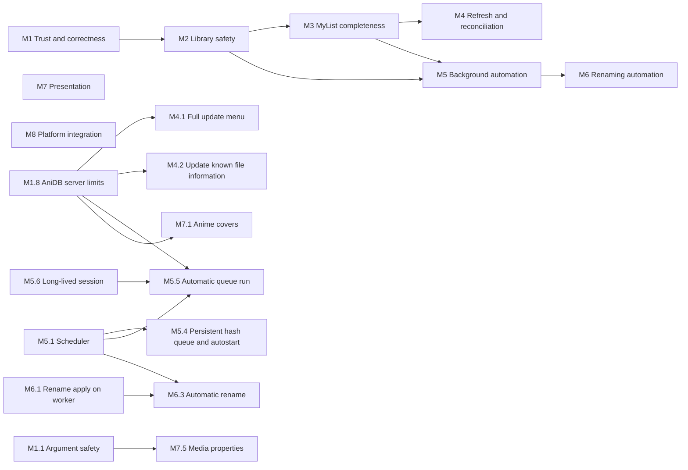

# Animatic roadmap

This is the build-out plan for the features that are still missing. It is derived from the
[Feature parity](https://github.com/RetroHazard/animatic/wiki/Feature-Parity) page (source:
[`wiki/Feature-Parity.md`](../wiki/Feature-Parity.md)), and each item was checked against the code
at `e71452c`. The roadmap is a plan, not a capability claim: until an item ships, the parity
page and the [settings reference](https://github.com/RetroHazard/animatic/wiki/Settings-Reference)
stay authoritative about what Animatic does.

## How to use it

- Work milestones roughly in order. Items inside a milestone are independent unless
  **Depends** says otherwise. One item is roughly one pull request.
- Before starting an item, re-check its **Builds on** facts. Symbols are named instead of line
  numbers, because line numbers go stale.
- The constraints cite rules from [AGENTS.md](../AGENTS.md#architectural-rules). An item that
  changes a rule (M6.3 changes rule 19) amends that rule in the same pull request.
- When an item ships, set its status to **Done (#N)** and, in the same pull request, update
  the Feature parity row, the settings reference, the affected wiki pages and `CHANGELOG.md`.
  Remove a stored-only field from the parity list once something reads it.
- Statuses: **Planned**, **Decision needed** (blocked on a maintainer choice, listed under
  [Decisions](#decisions)), **Research** (blocked on facts that are not in the repository),
  **In progress**, **Done (#N)**.

## Ordering principle

Trust before breadth, and breadth before automation. This follows the
[forum audit](aom-forum-audit.md#first-reliability-tranche-from-the-top-25): fix places where
Animatic silently does less than it appears to or could get a user banned (M1), make the
library recoverable (M2), finish the explicit manual workflows (M3, M4), and only then add
background and destructive automation on top of them (M5, M6). Presentation and platform
integration (M7, M8) do not block the rest, except where they send requests to AniDB.

**AniDB server limits are a hard requirement for every item.** A client that exceeds them gets
its users temporarily banned. Every new request path goes through the shared limits from M1.8,
and no item may add a request that bypasses them.

## Overview

| Item | Title | Status |
|---|---|---|
| M1.1 | Player and AVDump argument safety | Done |
| M1.2 | Atomic, off-thread exports | Done |
| M1.3 | One-snapshot statistics | Done |
| M1.4 | Disable controls whose feature is not built yet | Done |
| M1.5 | Legacy import target and leftovers | Done |
| M1.6 | Remove unused dependencies | Done |
| M1.7 | Linux runtime and production AniDB verification | Partial: Linux tests and a WSLg run done; production AniDB check needs a maintainer with a registered client |
| M1.8 | Honour AniDB server limits across runs and restarts | Done |
| M2.1 | Database backup | Done |
| M2.2 | Database restore | Done |
| M2.3 | Integrity check and maintenance | Done |
| M3.1 | Edit storage, source, other and view date | Done |
| M3.2 | Add files to MyList | Done |
| M3.3 | Delete MyList entries | Done |
| M3.4 | Refresh an entry, episode or group | Done |
| M3.5 | Keep and show MyList statistics | Done |
| M4.1 | Full update menu action | Done |
| M4.2 | Update known file information | Done |
| M4.3 | Full-account MyList import through MyList export | Done (export file layout unverified against a real AniDB export) |
| M5.1 | Scheduler for folder scans | Done |
| M5.2 | Settle delay for files being written | Done |
| M5.3 | `exclude_system` and `clear_empty_folders` | Done |
| M5.4 | Persistent hash queue and autostart | Done |
| M5.5 | Opt-in automatic queue run | Done |
| M5.6 | Long-lived session: keep-alive and idle logout | Done |
| M6.1 | Rename apply on the worker, cross-volume moves | Done |
| M6.2 | Batch rename | Done |
| M6.3 | Opt-in automatic rename per managed folder | Done |
| M7.1 | Anime covers | Done |
| M7.2 | Saved window, columns and sorting | Done |
| M7.3 | Status row colours and system theme | Done |
| M7.4 | Player open and enqueue actions | Done |
| M7.5 | Opt-in media properties through `ffprobe` | Done |
| M8.1 | Credentials in the operating-system keystore | Done |
| M8.2 | Shell integration (user toggle) and single-instance handoff | Done |
| M8.3 | System tray, best effort | Done |
| M8.4 | Client version field | Done |

## M1 Trust and correctness

These are small, independent fixes for places where the application does less than its
controls or exports suggest, or where it could exceed AniDB's limits.

### M1.1 Player and AVDump argument safety

- **Problem:** `external::launch` substitutes placeholders into the template text and only then
  splits it with `shell_words`. A space or quote inside a path, `{user}` or `{key}` can split
  the value or inject extra arguments.
- **Change:** split the template first, then substitute inside each argument. Keep the existing
  rule that a `play` template without a path placeholder appends the path as one argument.
- **Acceptance:** tests with paths and values containing spaces, quotes and `--option`-like text
  each arrive as exactly one argument; existing templates keep working.
- **Constraints:** rule 10 (identical on Windows and Linux).

### M1.2 Atomic, off-thread exports

- **Problem:** **Export hashes** builds and writes its file on the UI thread with `fs::write`.
  The statistics export writes in place, so a crash can leave a truncated file.
- **Change:** move the hash export to a worker or projection job. Write both exports to a
  temporary file in the target folder and rename it over the target, following the
  `Settings::save` pattern.
- **Acceptance:** neither export touches the UI thread; a failed write leaves the previous file
  intact.
- **Constraints:** rules 1 and 16.

### M1.3 One-snapshot statistics

- **Problem:** `stats.rs` computes its figures with separate queries, and a failed scalar
  counts as 0. A failed or concurrent read can therefore produce wrong totals silently.
- **Change:** read all figures inside one read transaction and propagate query errors.
- **Acceptance:** a test that injects a failing query gets an error instead of zeros. This is
  also groundwork for the "difference in stats" research lead.
- **Depends:** none. M3.5 reuses this when it compares local figures with AniDB's.

### M1.4 Disable controls whose feature is not built yet

- **Problem:** five Options controls are AOM settings carried over so that the AOM settings
  import keeps them, but no code reads them yet. Ticking one does nothing, and the UI does not
  say so.

  | Control | Setting | Built by |
  |---|---|---|
  | Update known file information | `anidb.update_file_information` | M4.2 |
  | Start hashing automatically | `hashing.autostart` | M5.4 |
  | Auto rename (per managed folder) | `file_managers.managers[].auto_rename` | M6.3 |
  | Use status colors | `ui.colored_rows` | M7.3 |
  | Player Name | `players[].name` | M7.4 |

- **Change:** keep the stored values, because the AOM import must round-trip them. Disable each
  control and show "Not active yet" with the planned behavior in its tooltip. The item that
  builds the feature enables the control again.
- **Acceptance:** every enabled control in Options changes behavior.
- **Decided:** disabled until implemented, not hidden, so imported AOM values stay visible.

### M1.5 Legacy import target and leftovers

- **Problem:** the importer uses `INSERT OR REPLACE`, so importing into a non-empty database
  overwrites rows that share ids. Decrypted temporary copies can also survive a crash.
- **Change:** before importing into a non-empty database (`Db::is_empty`, currently core only),
  ask the user to confirm or to choose a new database file. Create the temporary files in a
  marked, Animatic-owned subfolder, and on the next start offer to remove only that marked
  subfolder.
- **Acceptance:** a synthetic import into a populated database requires confirmation. The
  cleanup offer never touches files outside the marked subfolder.
- **Constraints:** rule 6 (the source stays read-only); privacy (decrypted data).

### M1.6 Remove unused dependencies

- **Problem:** the application crate declares `image` and `trash`, but no code uses them.
- **Change:** remove both. M7.1 and M5.3 add a dependency back if they need it.
- **Acceptance:** the build and the license notices no longer contain them.

### M1.7 Linux runtime and production AniDB verification

- **Problem:** CI builds and tests on Linux, but nobody has run the application on Linux or
  synchronized with the production AniDB service.
- **Change:** run the [native UI verification](development.md#native-ui-verification) steps on a
  Linux desktop and record the result. Separately, a maintainer with a registered client runs
  one manual synchronization (login, FILE, MYLISTADD on a test entry, logout) and records the
  outcome without private data.
- **Acceptance:** the verification sections of the parity page and the audit name what was
  exercised. Automated tests never contact AniDB.
- **Depends:** M1.8, so the production check runs under the final limits.

### M1.8 Honour AniDB server limits across runs and restarts

- **Problem:** today's limits apply only within one client instance and one run.
  - The UDP `Pacer` (2 s between the first five packets of a burst, then 4 s) belongs to each
    `UdpClient`, and `HttpClient::pace` (2 s) to each `HttpClient`. `process_queue` builds new
    clients for every run, so repeated **Synchronize now** clicks restart the burst allowance,
    and every run logs in and out again.
  - `HttpClient::titles_dump`, `image` and `get_bytes` are not paced at all.
  - Nothing limits the title dump: `meta.titles_dump_date` is written but never read, and
    every full update queues another `TitlesDump`.
  - Nothing enforces the "do not refetch an anime more than once a day" etiquette that
    [storage and network](storage-and-network.md#http-api) already records: `FetchAnime` has no
    age check, even though `anime.fetched` exists.
  - The bind falls back to a random local port when the configured one is busy, which risks
    AniDB's port-churn ban.
  - A `504` reply (client version banned) is handled as a 30-minute ban instead of blocking
    until the client version changes, and an `AUTH` without reply gets a flat cooldown instead
    of AniDB's escalating backoff.
  - Full updates re-query every known file, although AniDB asks clients to cache file data for
    extended periods.
- **Rules:** recorded with sources on 2026-11-06 in
  [AniDB server limits](storage-and-network.md#anidb-server-limits), which also lists where the
  code stands.
- **Change:**
  - One process-wide UDP limiter and one HTTP limiter, owned by the worker and shared by every
    client instance, persisting the last send time in `meta` so a restart cannot reset the
    spacing.
  - The HTTP limiter covers every HTTP request, including the title dump and images.
  - Request guards count *requests*, not successful imports. `titles_dump_date` and
    `anime.fetched` record only success, so a failed or truncated download could otherwise be
    repeated within the day. Before sending, durably record a last-attempt time: a new `meta`
    key for the title dump and a per-anime attempt time (an idempotent column or table). The
    guards read those attempt times; the success markers keep their current meaning.
  - A title-dump guard on that attempt time: **Download anime titles**, full updates and
    transient-failure retries skip the dump inside the minimum interval and say when it is next
    allowed.
  - A minimum age per anime on its attempt time (at least one day, per the HTTP API rule). An
    explicit refresh from the detail window is also refused inside that age and shows when it
    becomes available.
  - A minimum age per file for `FetchFile` on files AniDB already knew. The length is a design
    choice (AniDB only says "extended periods"); start conservative, for example seven days.
  - No silent port fallback: a busy local port is an error that names the setting.
  - `504` blocks the queue like an outdated client; `AUTH` without reply backs off 30 s, 2 min,
    5 min, 10 min, 30 min, then 2 h, persisted like other cooldowns.
  - All limits are named constants with a link to the recorded rule.
- **Acceptance:** loopback tests with a controllable clock: two consecutive queue runs keep
  the long-term spacing; a restart keeps it; a second title dump and a too-early anime fetch
  are refused without any request. A failed, truncated or invalid title dump, and a crash or
  restart right after the request was sent, still block a repeat inside the interval; the same
  holds for a failed anime fetch.
- **Constraints:** rules 8 and 15; the GitHub update transport stays separate (rule 20).

## M2 Library safety

The audit lists local-cache failure as a high-value lead, and nothing user-facing exists today.

### M2.1 Database backup

- **Change:** add **File > Back up library...**, which runs SQLite's online backup API on the
  worker into a user-chosen file. Optionally keep a rolling backup before risky jobs: legacy
  import, restore, and bulk MyList changes.
- **Acceptance:** a backup taken while the queue holds commands opens as a valid database with
  the same queue contents.
- **Constraints:** rules 1, 3 and 16.

### M2.2 Database restore

- **Change:** add **File > Restore library...**. It validates the chosen file (schema version,
  `PRAGMA integrity_check`), stops the worker and projection threads, backs up the current
  database next to it, swaps the files and reopens.
- **Acceptance:** a restore of a corrupt or foreign file is refused with the current library
  intact; a successful restore shows the restored queue and settings.
- **Depends:** M2.1.

### M2.3 Integrity check and maintenance

- **Change:** add **Tools > Check library** (`PRAGMA integrity_check`, `quick_check` and foreign
  keys) and an optional compaction (`VACUUM`) as worker jobs. Offer the latest backup when a
  check fails.
- **Acceptance:** a synthetic corrupted page is reported, never silently "repaired".

## M3 MyList completeness

The commands already exist in the core: `Command::{MylistAdd, MylistDelete, MylistRefresh,
FetchEpisode, FetchGroup}`, all with executor arms, and `MylistEdit`, which carries
storage/source/other/viewdate. `Db::queue_edit_mylist` already merges these fields. These
items expose the commands in the desktop application.

### M3.1 Edit storage, source, other and view date

- **Change:** add an entry editor (detail panel or dialog) to **My list** with the four fields,
  including the "checked empty means clear" semantics that the folder policy already uses.
- **Acceptance:** edits survive a restart, merge with a pending state or watched edit, and a
  stale acknowledgement does not undo a newer edit.
- **Constraints:** rules 4, 13 and 14.

### M3.2 Add files to MyList

- **Change:** add **Add to MyList...** for selected identified files on **Hashed files**, with
  state, watched and the text fields. It queues `MylistAdd` with `FileRef::Fid` (or a hash
  for unidentified files).
- **Acceptance:** an add is visible optimistically, survives a restart, and reconciles with the
  FILE/MYLIST reply.
- **Constraints:** rules 4, 13 and 14.

### M3.3 Delete MyList entries

- **Change:** add **Remove from MyList** with confirmation. It queues `MylistDelete`, removes the
  local row only after AniDB acknowledges, and never deletes media files.
- **Acceptance:** while a delete is queued, new edits of that entry are refused with an
  explanation; an edit queued after the delete has left the queue keeps the row. A failed delete
  stays blocked and visible (rule 15).

### M3.4 Refresh an entry, episode or group

- **Change:** add **Refresh** actions that queue `MylistRefresh`, `FetchEpisode` and `FetchGroup`
  from **My list**, the anime detail episode table and **Groups**.
- **Acceptance:** the refreshed data replaces the cached rows and keeps pending local intent.
- **Depends:** M1.8 for any minimum age the rules require.

### M3.5 Keep and show MyList statistics

- **Problem:** **Fetch mylist statistics** only logs the result (`Outcome::Stats`).
- **Change:** store the latest result with its timestamp (in `meta` or a small table) and show
  it on **Overview** next to the local figures, labelled as different populations.
- **Depends:** M1.3.

## M4 Refresh and reconciliation

### M4.1 Full update menu action

- **Change:** add **Tools > Full update...**, which reuses `Job::QueueFullUpdate`. A
  confirmation shows how many commands it would queue after the M1.8 guards have removed the
  title dump and anime that are too recent.
- **Acceptance:** it behaves exactly like `--full-update`, and nothing is sent until the queue
  runs.
- **Depends:** M1.8.

### M4.2 Update known file information

- **Change:** give `update_file_information` ("Update known file information") a meaning: when a
  file that is already identified is hashed again, queue a `FetchFile` to refresh its AniDB
  record. The maintainer confirmed this matches AOM's behavior. AniDB asks clients to query
  only files it did not know last time, so the refresh is subject to the M1.8 per-file minimum
  age and the option stays off by default.
- **Acceptance:** with the option off, re-hashing a known file sends nothing; with it on, it
  queues one refresh, and none while a recent one exists.
- **Depends:** M1.8 and M1.4.

### M4.3 Full-account MyList import through MyList export

- **Research result:** no API route returns a whole MyList (see
  [AniDB server limits](storage-and-network.md#anidb-server-limits)). Walking it with `MYLIST`
  is the bulk extraction AniDB forbids, and `mylistsummary` needs the main password and has no
  file data. The supported route is MyList export, which AniDB prepares asynchronously and the
  user downloads from the web export page.
- **Change:**
  - **Tools > Request MyList export**: a user-initiated UDP `MYLISTEXPORT template=xml-plain-new`
    through the queue, never scheduled. `318` (already queued) is reported, not retried; the
    dialog explains that AniDB may take up to 24 h and announces completion as an AniDB message.
  - **File > Import MyList export...**: reads the downloaded file locally, streamed and bounded
    like the title dump (rule 18), and merges it into the library.
- **Before building:** check the `xml-plain-new` format against AniDB's published example and
  write synthetic fixtures from it; confirm the download really has no API (it is documented
  only as a web page).
- **Design constraints:**
  - Only a complete, validated export may establish absence; a partial or malformed one never
    deletes local rows (rule 14).
  - Pending local intent wins over the export (rules 13 and 14).
  - Nothing walks the MyList entry by entry.
- **Acceptance:** importing a synthetic export into an empty database reproduces its MyList, a
  second import changes nothing, and a truncated file changes nothing.

## M5 Background automation

All background work is opt-in, off by default, respects **Work offline**, cooldowns and busy
activity, and runs on the worker (rules 1, 2, 8 and 15).

### M5.1 Scheduler for folder scans

- **Change:** add a worker-side timer that submits `Job::Scan` at a configurable interval
  (off by default) and on start. Prefer polling over filesystem watchers: it is simpler, works
  the same on Windows and Linux, and works on network drives. A watcher (`notify`) can come
  later as an optimization.
- **Acceptance:** a scheduled scan never overlaps a running job, a manual scan or an import
  review (rule 12), and stopping the application cancels it.
- **Constraints:** rules 1, 10 and 11.

### M5.2 Settle delay for files being written

- **Change:** give `action_delay_ms` a meaning: hash a discovered file only once its size and
  modification time have been unchanged for that long. `sleep_time_ms` paces between files.
- **Acceptance:** a file that is still growing during a scan is deferred to the next scan.

### M5.3 `exclude_system` and `clear_empty_folders`

- **Change:**
  - `exclude_system` skips files with the Windows system attribute. On Linux it is a documented
    no-op, isolated behind a platform abstraction.
  - `clear_empty_folders` removes only folders that Animatic's own moves emptied, beneath the
    manager root, and only when they are truly empty. It never deletes recursively.
- **Acceptance:** tests on both platforms; a folder containing a hidden file is kept.
- **Constraints:** rules 10 and 11.

### M5.4 Persistent hash queue and autostart

- **Change:** add an idempotently created `hash_queue` table. **Add files**, command-line paths
  and scans enqueue into it; the worker drains it. `hashing.autostart` resumes the queue on
  start. Drop the `priority` setting unless a cross-platform thread-priority abstraction is
  worth adding.
- **Acceptance:** files queued before a crash or quit are hashed after a restart, without
  duplicates.
- **Depends:** M5.1 for automatic draining.
- **Constraints:** rules 3 and 5 (one read per file).

### M5.5 Opt-in automatic queue run

- **Decided:** opt-in, off by default.
- **Change:** when enabled, run the AniDB queue after new commands arrive and at an interval,
  with flood spacing, cooldowns and blocked states unchanged. MyList deletes stay manual:
  an automatic run leaves them queued until the user runs the queue.
- **Acceptance:** with the option off nothing is sent without a click; with it on, a burst of
  new commands never sends faster than the M1.8 limits, and an active cooldown stops it.
- **Depends:** M1.8, M5.1 and M5.6.

### M5.6 Long-lived session: keep-alive and idle logout

- **Problem:** `process_queue` builds a new `UdpClient` for each run, so every run logs in and
  out, and `UdpClient::ping` and `idle_logout_minutes` have nothing to act on.
- **Change:** keep one session across queue runs while automatic runs are on. AniDB expires a
  session after 35 idle minutes: send a command at least every 30 minutes to keep it, use `PING`
  for NAT keep-alive only when the reported port differs and no more often than the router
  timeout requires, honor `idle_logout_minutes`, and log out on exit.
- **Constraints:** rule 8 (session recovery, encryption, spacing).
- **Depends:** M1.8.

## M6 Renaming automation

### M6.1 Rename apply on the worker, cross-volume moves

- **Problem:** apply calls `file_manager::move_file`, which is a plain `fs::rename` invoked from
  the UI path. It fails across volumes.
- **Change:** run apply as a worker job. On a cross-device error, copy to a temporary name on
  the target volume, verify it (size, then the stored ED2K by re-hashing the copy), rename it
  into place, update the database, and only then remove the source.
- **Acceptance:** an interrupted move never leaves the library pointing at a missing file, and
  it never deletes the only copy.
- **Constraints:** rules 1, 7 and 19.

### M6.2 Batch rename

- **Change:** add a multi-select preview on **Hashed files** with per-file diagnostics, and one
  explicit confirmation that applies only the valid rows through M6.1.
- **Depends:** M6.1.

### M6.3 Opt-in automatic rename per managed folder

- **Decided:** opt-in per managed folder, off by default. The pull request amends rule 19
  ("automatic rename stays unimplemented and never implicit") to "opt-in per folder, never on by
  default, never implicit".
- **Change:** after identification, rename files in folders with `auto_rename` on through M6.1.
  Collisions are skipped and logged, never overwritten. A dry-run mode logs the planned renames
  without moving anything, and the first enable of a folder shows that dry run.
- **Depends:** M5.1, M6.1 and M1.4.

## M7 Presentation

### M7.1 Anime covers

- **Decided:** retrieve covers, strictly within AniDB's usage conditions for its image servers.
- **Builds on:** the `anime.picname` column, which is already stored, `HttpClient::image`, the
  image server that `AUTH` returns, and the `image_server` setting.
- **Conditions** (see [AniDB server limits](storage-and-network.md#anidb-server-limits)): AniDB
  does not own the artwork and grants no licence, so covers are cached locally for personal
  display only and never redistributed or re-hosted. No image rate is published, so requests use
  the API pacing, on demand only, never a bulk crawl. Use the host `AUTH` returns, and send no
  `Referer`.
- **Change:** fetch a cover only when the detail window opens, through the M1.8 HTTP limiter,
  into an on-disk cache. Picture names are immutable, so a cached cover is never downloaded
  again; a new `picname` means a new file. Decode off the UI thread; skip fetching when offline
  or banned.
- **Constraints:** rules 1, 8 and 16.
- **Depends:** M1.8.

### M7.2 Saved window, columns and sorting

- **Change:** restore the window size and maximized state (`window`, `maximized`), and the
  per-table column widths, visibility and sort order (`columns`) in `DataTable`. Save them with
  the normal settings save.
- **Constraints:** rule 17 (recovery mode skips autosave).

### M7.3 Status row colours and system theme

- **Change:** apply `colored_rows`/`colors` to the table rows by status (CRC mismatch, unknown,
  watched, in MyList), with accessible defaults. Make `Theme::System` follow the operating
  system theme.
- **Acceptance:** colour is never the only signal, because each status also has a text or icon
  cue.

### M7.4 Player open and enqueue actions

- **Change:** expose `PlayerAction::Open` and `Enqueue` as file actions for players that define
  them. Use the player **Name** in the player chooser.
- **Depends:** M1.1.

### M7.5 Opt-in media properties through `ffprobe`

- **Decided:** opt-in, using the external `ffprobe` tool from FFmpeg, which the app can install
  with one click. The feature stays disabled until `ffprobe` is available.
- **Change:**
  - Detection: a configured path, then `PATH`. Options shows the detected version.
  - One-click install: a confirmed, anonymous, size-limited download of a pinned build for the
    platform into Animatic's data folder, verified by SHA-256 before use, without elevation.
    Only `ffprobe` and its license files are kept. On Linux, a distribution-packaged `ffprobe`
    on `PATH` is preferred when present.
  - Extraction: after hashing, a separate worker job runs `ffprobe` (argument vector, no shell,
    timeout, bounded output, JSON) and stores duration, resolution, codecs and bitrates in a new,
    idempotently created table. The hash export's media tokens, which today produce constants,
    use these values.
- **Research first:** which distributor and build to pin (FFmpeg builds are LGPL or GPL;
  downloading at the user's request is not bundling, but the license must be shown), where its
  checksums come from, and how a pinned version is updated.
- **Constraints:** rules 1, 5 (`ffprobe` reads container headers, not a second full pass) and 10;
  download safety in the spirit of rule 20 (explicit, confirmed, no elevation, nothing sent but
  the request).
- **Depends:** M1.1.

## M8 Platform integration

Each of these items is platform-specific and goes behind a cross-platform abstraction (rule 10).

### M8.1 Credentials in the operating-system keystore

- **Decided:** keystore with a visible fallback.
- **Change:** keep the password and API keys in the Windows Credential Manager or the Linux
  Secret Service (for example the `keyring` crate). When no keystore is available, fall back to
  the settings file and say so in Options. Migrate existing plaintext values on the first save.
- **Constraints:** rules 12 and 17 (load and recovery never expose secret values).

### M8.2 Shell integration (user toggle) and single-instance handoff

- **Decided:** implement it, controlled by a user toggle that is off by default.
- **Change:**
  - `integrate_into_shell` becomes an Options toggle. Saving it on registers "Hash with
    Animatic" for the current user (a per-user Windows registry entry, a Linux `.desktop`
    action); saving it off removes only the entries Animatic created. Options shows whether the
    registration is actually present.
  - Importing AOM settings never registers anything; only the Options toggle does.
  - A launch with paths forwards them to an already running instance that uses the same
    database instead of opening a second window; with a different `--database` it starts
    normally.
- **Acceptance:** toggling on and off leaves the user's shell configuration exactly as it was
  before; no elevation is needed on either platform.

### M8.3 System tray, best effort

- **Decided:** best effort.
- **Change:** minimize to tray and show a tray menu where the platform supports it (Windows
  notification area; Linux StatusNotifierItem/AppIndicator). Where no tray is available, the
  minimize-to-tray option is disabled with an explanation, so the window can never be hidden
  without a way back.

### M8.4 Client version field

- **Change:** add the `client_version` field to the AniDB section of Options next to **Client
  name**, validated as a positive integer. Release version bumps never change it.

## Decisions

| Decision | Outcome |
|---|---|
| M5.5 automatic queue run | Decided: opt-in, off by default; MyList deletes stay manual |
| M6.3 automatic rename | Decided: opt-in per managed folder, with a dry run; rule 19 amended in that pull request |
| M8.1 credentials | Decided: operating-system keystore with a visible fallback |
| M8.3 tray | Decided: best effort; disabled where the platform has no tray |
| M7.5 media properties | Decided: opt-in through `ffprobe`, one-click install, disabled until available |
| M1.8 server limits | Decided: a hard requirement for every request path; rules recorded 2026-11-06 |
| M7.1 covers | Decided: retrieve on demand, cache permanently, personal display only, never re-hosted |
| M4.3 full MyList download | Decided: user-requested MyList export plus a local file import; no entry-by-entry walk |
| M1.4 inactive controls | Decided: disabled with "Not active yet" until implemented |
| M8.2 shell integration | Decided: implement, behind a user toggle that is off by default |
| M4.2 meaning | Decided: confirmed as re-querying AniDB when a known file is hashed again |

## Not planned

- Retired AniDB protocols (TCP `ADDANIMEDATA`/`ADDEP`). The web editors replace them (rule 9).
- The ED2K-blue variant in the desktop application, unless a user workflow needs it.
- Unattended or scheduled updates, prerelease channels, signing claims, installers and rollback
  (rule 20).
- The deliberate non-ports listed on the parity page: the object inspector, unreachable AOM
  dialogs, splash screens, MDI layouts and COM shell extensions.
