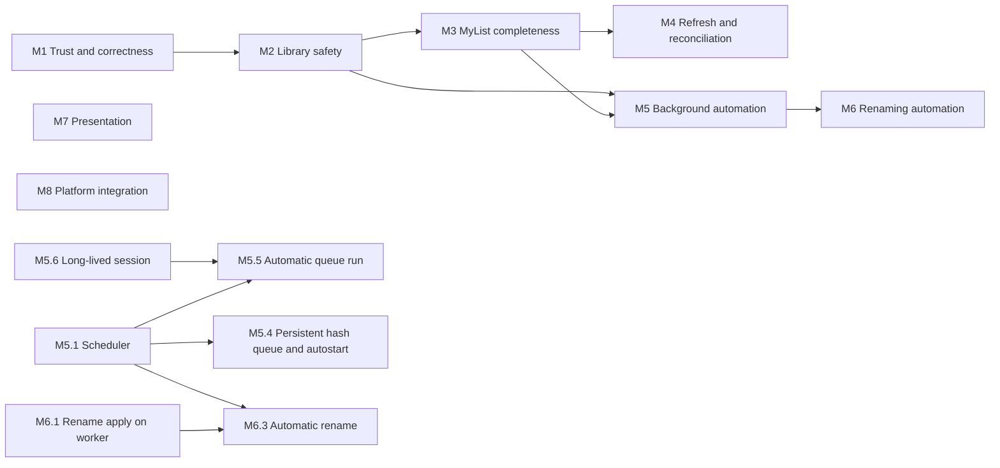

# Animatic roadmap

This is the build-out plan for the features that are still missing. It is derived from the
[Feature parity](https://github.com/RetroHazard/animatic/wiki/Feature-Parity) page (source:
[`wiki/Feature-Parity.md`](../wiki/Feature-Parity.md)), and each item was checked against the code
at `e71452c`. The roadmap is a plan, not a capability claim: until an item ships, the parity
page and the [settings reference](https://github.com/RetroHazard/animatic/wiki/Settings-Reference)
stay authoritative about what Animatic does.

## How to use it

- Work milestones roughly in order. Items inside a milestone are independent unless
  **Depends** says otherwise. One item is roughly one pull request.
- Before starting an item, re-check its **Builds on** facts. Symbols are named instead of line
  numbers, because line numbers go stale.
- The constraints cite rules from [AGENTS.md](../AGENTS.md#architectural-rules). An item that
  needs a rule changed (for example M6.3 and rule 19) needs an explicit maintainer decision
  first; amend the rule in the same pull request.
- When an item ships, set its status to **Done (#N)** and, in the same pull request, update
  the Feature parity row, the settings reference, the affected wiki pages and `CHANGELOG.md`.
  Remove a stored-only field from the parity list once something reads it.
- Statuses: **Planned**, **Decision needed** (blocked on a maintainer choice, listed under
  [Open decisions](#open-decisions)), **Research** (blocked on facts that are not in the
  repository), **In progress**, **Done (#N)**.

## Ordering principle

Trust before breadth, and breadth before automation. This follows the
[forum audit](aom-forum-audit.md#first-reliability-tranche-from-the-top-25): fix places where
Animatic silently does less than it appears to (M1), make the library recoverable (M2), finish
the explicit manual workflows (M3, M4), and only then add background and destructive automation
on top of them (M5, M6). Presentation and platform integration (M7, M8) do not block anything.

## Overview

| Item | Title | Status |
|---|---|---|
| M1.1 | Player and AVDump argument safety | Planned |
| M1.2 | Atomic, off-thread exports | Planned |
| M1.3 | One-snapshot statistics | Planned |
| M1.4 | Truthful Options controls | Decision needed |
| M1.5 | Legacy import target and leftovers | Planned |
| M1.6 | Remove unused dependencies | Planned |
| M1.7 | Linux runtime and production AniDB verification | Planned |
| M2.1 | Database backup | Planned |
| M2.2 | Database restore | Planned |
| M2.3 | Integrity check and maintenance | Planned |
| M3.1 | Edit storage, source, other and view date | Planned |
| M3.2 | Add files to MyList | Planned |
| M3.3 | Delete MyList entries | Planned |
| M3.4 | Refresh an entry, episode or group | Planned |
| M3.5 | Keep and show MyList statistics | Planned |
| M4.1 | Full update menu action | Planned |
| M4.2 | Per-anime refresh throttle | Planned |
| M4.3 | Full-account MyList bootstrap and reconciliation | Research |
| M5.1 | Scheduler for folder scans | Planned |
| M5.2 | Settle delay for files being written | Planned |
| M5.3 | `exclude_system` and `clear_empty_folders` | Planned |
| M5.4 | Persistent hash queue and autostart | Planned |
| M5.5 | Automatic queue run | Decision needed |
| M5.6 | Long-lived session: keep-alive and idle logout | Planned |
| M6.1 | Rename apply on the worker, cross-volume moves | Planned |
| M6.2 | Batch rename | Planned |
| M6.3 | Automatic rename per managed folder | Decision needed |
| M7.1 | Anime covers | Planned |
| M7.2 | Saved window, columns and sorting | Planned |
| M7.3 | Status row colours and system theme | Planned |
| M7.4 | Player open and enqueue actions | Planned |
| M7.5 | Media properties | Research |
| M8.1 | Credentials in the operating-system keystore | Decision needed |
| M8.2 | Shell integration and single-instance handoff | Decision needed |
| M8.3 | System tray | Decision needed |
| M8.4 | Client version field | Planned |

## M1 Trust and correctness

These are small, independent fixes for places where the application does less than its
controls or exports suggest.

### M1.1 Player and AVDump argument safety

- **Problem:** `external::launch` substitutes placeholders into the template text and only then
  splits it with `shell_words`. A space or quote inside a path, `{user}` or `{key}` can split
  the value or inject extra arguments.
- **Change:** split the template first, then substitute inside each argument. Keep the existing
  rule that a `play` template without a path placeholder appends the path as one argument.
- **Acceptance:** tests with paths and values containing spaces, quotes and `--option`-like text
  each arrive as exactly one argument; existing templates keep working.
- **Constraints:** rule 10 (identical on Windows and Linux).

### M1.2 Atomic, off-thread exports

- **Problem:** **Export hashes** builds and writes its file on the UI thread with `fs::write`.
  The statistics export writes in place, so a crash can leave a truncated file.
- **Change:** move the hash export to a worker or projection job. Write both exports to a
  temporary file in the target folder and rename it over the target, following the
  `Settings::save` pattern.
- **Acceptance:** neither export touches the UI thread; a failed write leaves the previous file
  intact.
- **Constraints:** rules 1 and 16.

### M1.3 One-snapshot statistics

- **Problem:** `stats.rs` computes its figures with separate queries, and a failed scalar
  counts as 0. A failed or concurrent read can therefore produce wrong totals silently.
- **Change:** read all figures inside one read transaction and propagate query errors.
- **Acceptance:** a test that injects a failing query gets an error instead of zeros. This is
  also groundwork for the "difference in stats" research lead.
- **Depends:** none. M3.5 reuses this when it compares local figures with AniDB's.

### M1.4 Truthful Options controls

- **Problem:** some Options checkboxes change only a stored value: `update_file_information`,
  `hashing.autostart`, per-folder `auto_rename`, `colored_rows` and the player **Name** field.
- **Change:** keep the stored values, because the AOM import must round-trip them. Disable each
  such control and show "Stored for AOM compatibility; not active yet" until its roadmap item
  ships. Each later item re-enables its own control.
- **Acceptance:** every enabled control in Options changes behavior.
- **Decision needed:** whether to disable these controls or hide them (see
  [Open decisions](#open-decisions)).

### M1.5 Legacy import target and leftovers

- **Problem:** the importer uses `INSERT OR REPLACE`, so importing into a non-empty database
  overwrites rows that share ids. Decrypted temporary copies can also survive a crash.
- **Change:** before importing into a non-empty database (`Db::is_empty`, currently core only),
  ask the user to confirm or to choose a new database file. Create the temporary files in a
  marked, Animatic-owned subfolder, and on the next start offer to remove only that marked
  subfolder.
- **Acceptance:** a synthetic import into a populated database requires confirmation. The
  cleanup offer never touches files outside the marked subfolder.
- **Constraints:** rule 6 (the source stays read-only); privacy (decrypted data).

### M1.6 Remove unused dependencies

- **Problem:** the application crate declares `image` and `trash`, but no code uses them.
- **Change:** remove both. M7.1 and M5.3 add a dependency back if they need it.
- **Acceptance:** the build and the license notices no longer contain them.

### M1.7 Linux runtime and production AniDB verification

- **Problem:** CI builds and tests on Linux, but nobody has run the application on Linux or
  synchronized with the production AniDB service.
- **Change:** run the [native UI verification](development.md#native-ui-verification) steps on a Linux
  desktop and record the result. Separately, a maintainer with a registered client runs one
  manual synchronization (login, FILE, MYLISTADD on a test entry, logout) and records the
  outcome without private data.
- **Acceptance:** the verification sections of the parity page and the audit name what was
  exercised. Automated tests never contact AniDB.

## M2 Library safety

The audit lists local-cache failure as a high-value lead, and nothing user-facing exists today.

### M2.1 Database backup

- **Change:** add **File > Back up library...**, which runs SQLite's online backup API on the
  worker into a user-chosen file. Optionally keep a rolling backup before risky jobs: legacy
  import, restore, and bulk MyList changes.
- **Acceptance:** a backup taken while the queue holds commands opens as a valid database with
  the same queue contents.
- **Constraints:** rules 1, 3 and 16.

### M2.2 Database restore

- **Change:** add **File > Restore library...**. It validates the chosen file (schema version,
  `PRAGMA integrity_check`), stops the worker and projection threads, backs up the current
  database next to it, swaps the files and reopens.
- **Acceptance:** a restore of a corrupt or foreign file is refused with the current library
  intact; a successful restore shows the restored queue and settings.
- **Depends:** M2.1.

### M2.3 Integrity check and maintenance

- **Change:** add **Tools > Check library** (`PRAGMA integrity_check`, `quick_check` and foreign
  keys) and an optional compaction (`VACUUM`) as worker jobs. Offer the latest backup when a
  check fails.
- **Acceptance:** a synthetic corrupted page is reported, never silently "repaired".

## M3 MyList completeness

The commands already exist in the core: `Command::{MylistAdd, MylistDelete, MylistRefresh,
FetchEpisode, FetchGroup}`, all with executor arms, and `MylistEdit`, which carries
storage/source/other/viewdate. `Db::queue_edit_mylist` already merges these fields. These
items expose the commands in the desktop application.

### M3.1 Edit storage, source, other and view date

- **Change:** add an entry editor (detail panel or dialog) to **My list** with the four fields,
  including the "checked empty means clear" semantics that the folder policy already uses.
- **Acceptance:** edits survive a restart, merge with a pending state or watched edit, and a
  stale acknowledgement does not undo a newer edit.
- **Constraints:** rules 4, 13 and 14.

### M3.2 Add files to MyList

- **Change:** add **Add to MyList...** for selected identified files on **Hashed files**, with
  state, watched and the text fields. It queues `MylistAdd` with `FileRef::Fid` (or a hash
  for unidentified files).
- **Acceptance:** an add is visible optimistically, survives a restart, and reconciles with the
  FILE/MYLIST reply.
- **Constraints:** rules 4, 13 and 14.

### M3.3 Delete MyList entries

- **Change:** add **Remove from MyList** with confirmation. It queues `MylistDelete`, removes the
  local row only after AniDB acknowledges, and never deletes media files.
- **Acceptance:** an edit queued after the delete wins in queue order; a failed delete stays
  blocked and visible (rule 15).

### M3.4 Refresh an entry, episode or group

- **Change:** add **Refresh** actions that queue `MylistRefresh`, `FetchEpisode` and `FetchGroup`
  from **My list**, the anime detail episode table and **Groups**.
- **Acceptance:** the refreshed data replaces the cached rows and keeps pending local intent.

### M3.5 Keep and show MyList statistics

- **Problem:** **Fetch mylist statistics** only logs the result (`Outcome::Stats`).
- **Change:** store the latest result with its timestamp (in `meta` or a small table) and show
  it on **Overview** next to the local figures, labelled as different populations.
- **Depends:** M1.3.

## M4 Refresh and reconciliation

### M4.1 Full update menu action

- **Change:** add **Tools > Full update...**, which reuses `Job::QueueFullUpdate`. A
  confirmation shows how many commands it would queue.
- **Acceptance:** it behaves exactly like `--full-update`, and nothing is sent until the queue
  runs.

### M4.2 Per-anime refresh throttle

- **Change:** skip `FetchAnime` for anime whose `anime.fetched` is newer than a configurable age
  (default at least one day; AniDB's HTTP API documentation asks clients to cache replies and not
  repeat a request within a day, so re-check the current wording first), unless the user
  explicitly asks for a refresh from the detail window.
- **Acceptance:** two full updates in a row queue no duplicate anime fetches.
- **Constraints:** rule 8.

### M4.3 Full-account MyList bootstrap and reconciliation

- **Research first:** the transport has only per-entry `MYLIST`, plus `MYLISTADD`, `MYLISTDEL`
  and `MYLISTSTATS`. Find out which *maintained* AniDB route returns a whole MyList, its usage
  policy and its format, and how it authenticates. Record the answer in
  [storage and network](storage-and-network.md) before writing code.
- **Design constraints:**
  - Only a complete, validated listing may establish absence; a partial or malformed one never
    deletes local rows (rule 14).
  - Pending local intent wins over the listing (rules 13 and 14).
  - The import is streamed and bounded in the same way as the title dump (rule 18).
- **Acceptance:** after a bootstrap on an empty database, the local MyList matches a synthetic
  listing, and a second run changes nothing.

## M5 Background automation

All background work stays opt-in, respects **Work offline**, cooldowns and busy activity, and
runs on the worker (rules 1, 2, 8 and 15).

### M5.1 Scheduler for folder scans

- **Change:** add a worker-side timer that submits `Job::Scan` at a configurable interval
  (off by default) and on start. Prefer polling over filesystem watchers: it is simpler, works
  the same on Windows and Linux, and works on network drives. A watcher (`notify`) can come
  later as an optimization.
- **Acceptance:** a scheduled scan never overlaps a running job, a manual scan or an import
  review (rule 12), and stopping the application cancels it.
- **Constraints:** rules 1, 10 and 11.

### M5.2 Settle delay for files being written

- **Change:** give `action_delay_ms` a meaning: hash a discovered file only once its size and
  modification time have been unchanged for that long. `sleep_time_ms` paces between files.
- **Acceptance:** a file that is still growing during a scan is deferred to the next scan.

### M5.3 `exclude_system` and `clear_empty_folders`

- **Change:**
  - `exclude_system` skips files with the Windows system attribute. On Linux it is a documented
    no-op, isolated behind a platform abstraction.
  - `clear_empty_folders` removes only folders that Animatic's own moves emptied, beneath the
    manager root, and only when they are truly empty. It never deletes recursively.
- **Acceptance:** tests on both platforms; a folder containing a hidden file is kept.
- **Constraints:** rules 10 and 11.

### M5.4 Persistent hash queue and autostart

- **Change:** add an idempotently created `hash_queue` table. **Add files**, command-line paths
  and scans enqueue into it; the worker drains it. `hashing.autostart` resumes the queue on
  start. Drop the `priority` setting unless a cross-platform thread-priority abstraction is
  worth adding.
- **Acceptance:** files queued before a crash or quit are hashed after a restart, without
  duplicates.
- **Depends:** M5.1 for automatic draining.
- **Constraints:** rules 3 and 5 (one read per file).

### M5.5 Automatic queue run

- **Change:** an opt-in setting runs the AniDB queue after new commands arrive and at an
  interval, with flood spacing, cooldowns and blocked states unchanged.
- **Decision needed:** whether the default should stay manual (recommended) and whether
  automatic runs may perform MyList deletes.
- **Depends:** M5.1 and M5.6.

### M5.6 Long-lived session: keep-alive and idle logout

- **Problem:** `process_queue` builds a new `UdpClient` for each run, so `UdpClient::ping` and
  `idle_logout_minutes` have nothing to act on.
- **Change:** keep one session across queue runs while automatic runs are on. Use `PING` for
  NAT keep-alive, honor `idle_logout_minutes`, and log out on exit.
- **Constraints:** rule 8 (session recovery, encryption, spacing).

## M6 Renaming automation

### M6.1 Rename apply on the worker, cross-volume moves

- **Problem:** apply calls `file_manager::move_file`, which is a plain `fs::rename` invoked from
  the UI path. It fails across volumes.
- **Change:** run apply as a worker job. On a cross-device error, copy to a temporary name on
  the target volume, verify it (size, then the stored ED2K by re-hashing the copy), rename it
  into place, update the database, and only then remove the source.
- **Acceptance:** an interrupted move never leaves the library pointing at a missing file, and
  it never deletes the only copy.
- **Constraints:** rules 1, 7 and 19.

### M6.2 Batch rename

- **Change:** add a multi-select preview on **Hashed files** with per-file diagnostics, and one
  explicit confirmation that applies only the valid rows through M6.1.
- **Depends:** M6.1.

### M6.3 Automatic rename per managed folder

- **Decision needed:** rule 19 currently says automatic rename stays unimplemented. Enabling it
  needs an explicit maintainer decision and an amended rule (opt-in per folder, never on by
  default, never implicit).
- **Change:** after identification, rename files in folders with `auto_rename` on through M6.1.
  Collisions are skipped and logged, never overwritten. Add a dry-run mode that only logs the
  planned renames.
- **Depends:** M5.1, M6.1 and M1.4.

## M7 Presentation

### M7.1 Anime covers

- **Builds on:** the `anime.picname` column, which is already stored, `HttpClient::image`, and
  the `image_server` setting.
- **Change:** fetch covers on demand on the worker into a bounded cache folder, decode them off
  the UI thread, and show them in the anime detail window. Covers are skipped when offline.
- **Research:** the AniDB image CDN's usage policy and pacing.
- **Constraints:** rules 1, 8 and 16.

### M7.2 Saved window, columns and sorting

- **Change:** restore the window size and maximized state (`window`, `maximized`), and the
  per-table column widths, visibility and sort order (`columns`) in `DataTable`. Save them with
  the normal settings save.
- **Constraints:** rule 17 (recovery mode skips autosave).

### M7.3 Status row colours and system theme

- **Change:** apply `colored_rows`/`colors` to the table rows by status (CRC mismatch, unknown,
  watched, in MyList), with accessible defaults. Make `Theme::System` follow the operating
  system theme.
- **Acceptance:** colour is never the only signal, because each status also has a text or icon
  cue.

### M7.4 Player open and enqueue actions

- **Change:** expose `PlayerAction::Open` and `Enqueue` as file actions for players that define
  them. Use the player **Name** in the player chooser.
- **Depends:** M1.1.

### M7.5 Media properties

- **Research:** decide between parsing container headers (Matroska, MP4) in-process and calling
  an external tool such as `ffprobe` through the existing external-tool launcher.
- **Change:** store the duration, resolution, codecs and bitrates per file, and fill the hash
  export's media tokens, which currently produce constants.
- **Constraints:** rule 5. Header parsing reads only the container headers and must not add a
  second full read.

## M8 Platform integration

Each of these items is platform-specific (rule 10) and needs a maintainer decision before work
starts.

### M8.1 Credentials in the operating-system keystore

- **Change:** keep the password and API keys in the Windows Credential Manager or the Linux
  Secret Service (for example the `keyring` crate), with an explicit, visible fallback to the
  settings file when no keystore exists.
- **Constraints:** rules 12 and 17 (load and recovery never expose secret values).

### M8.2 Shell integration and single-instance handoff

- **Change:** register "Hash with Animatic" (a per-user Windows registry entry and a Linux
  `.desktop` action), and forward the paths to an already running instance instead of opening a
  second one. This gives `integrate_into_shell` a meaning.

### M8.3 System tray

- **Change:** minimize to tray and show a tray menu. Tray support on Linux desktops is
  inconsistent, so this may become a deliberate non-port.

### M8.4 Client version field

- **Change:** add the `client_version` field to the AniDB section of Options next to **Client
  name**, validated as a positive integer. Release version bumps never change it.

## Open decisions

| Decision | Options | Recommendation |
|---|---|---|
| M1.4: stored-only controls | Disable with a note, or hide | Disable with a note, so imported AOM values stay visible |
| M5.5: automatic queue run | Manual only, or an opt-in automatic run | Opt-in automatic run, manual by default, deletes always manual |
| M6.3: automatic rename | Keep forbidden (rule 19), or opt-in per folder | Opt-in per folder with dry run, after M6.1 has shipped |
| M8.1: keystore | Keystore with fallback, or settings file only | Keystore with a visible fallback |
| M8.2 / M8.3: shell integration and tray | Build, or declare deliberate non-ports | Build M8.2; decide M8.3 after a Linux runtime check (M1.7) |

## Not planned

- Retired AniDB protocols (TCP `ADDANIMEDATA`/`ADDEP`). The web editors replace them (rule 9).
- The ED2K-blue variant in the desktop application, unless a user workflow needs it.
- Unattended or scheduled updates, prerelease channels, signing claims, installers and rollback
  (rule 20).
- The deliberate non-ports listed on the parity page: the object inspector, unreachable AOM
  dialogs, splash screens, MDI layouts and COM shell extensions.
