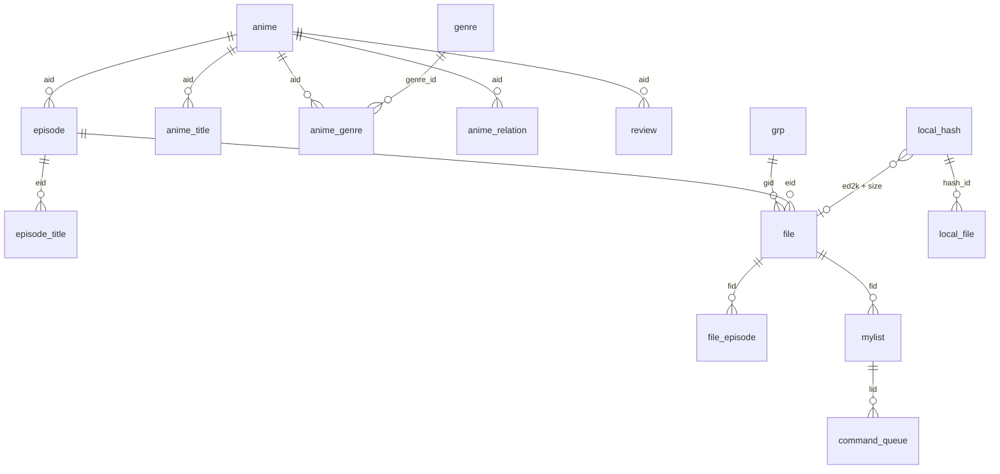

# Storage and network contracts

Reference for the SQLite schema, the persistent AniDB command queue, the UDP and HTTP
protocol handling, the title dump import, the GitHub update transport, and the public Rust API of
`animatic-core` and `animatic-anidb`. For the big picture and thread model read
[Architecture](architecture.md)
first. Source of truth: [`schema.sql`](../crates/animatic-core/src/db/schema.sql),
[`db/mod.rs`](../crates/animatic-core/src/db/mod.rs),
[`sync.rs`](../crates/animatic-core/src/sync.rs),
[`store.rs`](../crates/animatic-core/src/store.rs) and the
[`animatic-anidb`](../crates/animatic-anidb/src/lib.rs) modules. Generated item documentation:
`cargo doc --workspace --no-deps`.

Examples use only synthetic values. Nothing here requires or should be run against production
AniDB with unregistered client credentials.

## Database

### Files, connections and pragmas

- One SQLite file (default `animatic.sqlite3`, see [Data locations](https://github.com/RetroHazard/animatic/wiki/Data-Locations)) plus
  the WAL side files `<name>-wal` and `<name>-shm` while it is open. Copy or back up the main
  file only with the application closed, or copy all three together; recent commits can still be
  in the WAL.
- `Db::open(path)` creates missing parent directories, opens read-write/create with a 30 s busy
  timeout, and sets `journal_mode=WAL`, `synchronous=NORMAL`, `temp_store=MEMORY`,
  `cache_size=-65536` (64 MiB). It then upgrades and creates the schema (below). The desktop UI
  lowers its own connection's busy timeout to 1.5 s.
- `Db::memory()` runs the same initialization on an in-memory database (tests, previews) and
  does not record `schema_version`.
- A `Db` wraps one `rusqlite::Connection` opened without SQLite's internal mutex: each thread
  opens its own. WAL permits concurrent readers with one writer.
- `schema.sql` starts with `PRAGMA foreign_keys = OFF` and **declares no foreign keys**. All
  relations below are conventions maintained by application code, so orphans are possible
  (for example a `file` row whose `aid` has no `anime` row yet; the code creates stub `anime`
  rows on demand).
- With `synchronous=NORMAL` in WAL mode, a commit can be lost after an operating-system crash
  or power failure; the database stays consistent.

### Schema evolution

`Db::open` runs `init`: first `migrate_command_queue`, then the whole of `schema.sql`.

- Every table and index uses `CREATE TABLE/INDEX IF NOT EXISTS`, so new tables and indexes
  appear in old databases automatically and repeated opens are harmless.
- That script **cannot add a column to an existing table.** The only structural upgrade
  implemented is the command-queue rebuild: if `command_queue` lacks `blocked` or `lid`, or its
  DDL lacks `AUTOINCREMENT`, it is rebuilt inside `BEGIN IMMEDIATE`: indexes dropped, table
  renamed to `command_queue_old`, new table created from `schema.sql`, rows copied with their
  ids, tries and errors, `lid` recomputed from the payload, priorities `>= 10` (the removed
  "demote on failure" rule) reset to the command's own priority, old table dropped. A concurrent
  opener that finds the work already done does nothing.
- `SCHEMA_VERSION` is `1`. `meta.schema_version` is written once when absent and is **never
  compared**: opening a database written by a newer Animatic is not detected or refused.
- Adding a column to an existing table needs a new, idempotent step in `db::init` that runs
  before the schema script (recipe below).

### Metadata keys (`meta`)

| Key | Value | Written by | Read by |
|---|---|---|---|
| `schema_version` | `1` | `Db::open` when absent | nothing |
| `sync_cooldown` | `<until epoch seconds>\n<reason>` | worker (`set_sync_cooldown`) | `Db::sync_cooldown` |
| `titles_dump_date` | epoch seconds of the last successful dump import | `import_title_dump` | nothing in the application |
| `legacy_import_source`, `legacy_import_date` | databank path, epoch seconds | legacy import | nothing in the application |
| `legacy_dump_date` | largest dump-date tag found in the databank (`legacy_dump_date_tmp` is a transient staging key) | legacy import | nothing in the application |

An unreadable `sync_cooldown` value (no newline, non-numeric time, empty) is ignored and never
locks syncing; a database *error* while reading it aborts the queue run instead.

### Tables

"Soft" means the relation exists only in code. Dates are Unix seconds unless noted.

| Table | Purpose | Key and uniqueness | Indexes | Writers | Notes |
|---|---|---|---|---|---|
| `meta` | Key/value settings of the database | PK `key` | | `Db::set_meta` | See above |
| `category` | Lookup names (`kind` = `cat`, `lang`, `qual`, `type`, `vcodec`, `acodec`, `res`, `sub`) | PK `(kind, id)` | | Legacy import; `category_or_insert` adds unknown `qual`/`type` names from FILE replies with `max(id)+1` | An empty name maps to id 1 |
| `anime` | One row per anime | PK `aid` | | FILE replies, title dump (stub rows), HTTP anime XML, legacy | `fetched` is set only by a full HTTP record and means "has a full record"; `episodes = 0` means unknown/ongoing; ratings are stored x100 |
| `anime_title` | Titles per anime | PK `id` (rowid, **not** AUTOINCREMENT); no unique constraint on `(aid, name, lang)` | `aid`; `name COLLATE NOCASE` | FILE replies, dump merge, HTTP XML (replaces all titles of the anime when the document has titles), legacy | Uniqueness of `(aid,name,lang)` is enforced by code. `type`: 1 main, 2 synonym, 3 short, 4 official, 5 card, 6 kana |
| `episode` | Episodes | PK `eid` | `aid` | FILE replies, HTTP XML, EPISODE replies, legacy | `length` in minutes; `type`: 1 regular, 2 special, 3 credit, 4 trailer, 5 parody, 6 other |
| `episode_title` | Episode titles | PK `id` | `eid` | Same as episodes | One row per `(eid, lang)` by code (update, else insert) |
| `grp` | Release groups | PK `gid` | | FILE replies (name, short), GROUP replies, legacy | Named `grp` because `group` is reserved |
| `file` | AniDB file records | PK `fid` | `aid`; `eid`; `gid`; `(ed2k, size)` | FILE replies, legacy | `ed2k`/hashes stored lowercase from replies. Not unique on `(ed2k,size)`; the library join picks the non-deprecated row with the highest `fid` |
| `file_episode` | Extra episodes a file covers beyond `file.eid` | PK `id` | `fid`; `eid` | FILE replies (delete-then-insert per `fid`), legacy | |
| `file_relation` | File-to-file relations | PK `id` | `fid` | Legacy import only | Nothing in the repository reads it |
| `genre` | Genre/tag names | PK `id` | | Legacy genres; HTTP tags with id `100000 + tag id` | Tags and legacy genres share the table |
| `anime_genre` | Anime-to-genre links with weight | PK `id` | `aid`; `genre_id` | Legacy; HTTP tags (rewrites rows with `genre_id >= 100000`) | No unique `(aid, genre_id)` |
| `anime_relation` | Anime-to-anime relations | PK `id` | `aid` | Legacy; HTTP XML (replaces the anime's relations) | `type` ids in `library::relation_id`; unknown names map to 100 |
| `review` | Legacy review text | PK `id` | `aid` | Legacy import only | Read by the anime detail window |
| `mylist` | The user's MyList entries | PK `lid` (AniDB's list id) | `fid`; `aid`; `eid` | API replies (with pending edits overlaid), optimistic local edits, legacy | `viewed` is derived (`viewdate != 0`) for API data; `state`: 0 unknown, 1 HDD, 2 CD, 3 deleted, 4 remote. No unique `fid`: lookups by `fid` take the lowest `lid` |
| `local_hash` | Hashes of local content | PK `id`; **UNIQUE `(ed2k, size)`** | | `add_local_file` (upsert); legacy | Hashing fills only `ed2k, size, crc32, md5, sha1`; the media columns (`fps`, `video_*`, `audio_*`) are populated only by legacy import |
| `local_file` | Paths of hashed files | PK `id`; **UNIQUE index on `path`** (exact text) | `hash_id` | `add_local_file` (upsert by path), `move_local_file`, legacy | `hash_id` softly references `local_hash.id`. `mtime` = modification time read after hashing. `remove_local_file` also deletes `local_hash` rows left without any path. Scan comparisons use a normalized key (slashes, and lower case on Windows) while the index is exact text |
| `command_queue` | Persistent outbox of AniDB commands | PK `id` **AUTOINCREMENT** | `(blocked, priority, id)`; `lid`; `payload` | `sync.rs` queue operations, migration | See below |

Key relations (all soft):



A local file is linked to AniDB data **by content**: `local_hash(ed2k,size)` joins `file(ed2k,size)`,
and a `mylist` row joins through `file.fid`. A renamed or moved file therefore stays identified.

### Atomicity inside the database

`Db::write_tx` is `pub(crate)`: it starts `BEGIN IMMEDIATE` (taking the write lock up front, so a
read-modify-write cannot be interleaved by another connection and never fails by upgrading a
read lock), joins an enclosing transaction through a savepoint, and rolls back on error. Code
outside `animatic-core` that needs a multi-statement unit of work must use `Db::conn()` with its
own transaction.

| Operation | Atomic unit |
|---|---|
| `queue_push`, `queue_push_many`, `queue_edit_mylist`, `queue_retry_failed` | One `write_tx` |
| `store_file_info` (FILE reply: file, extra episodes, anime stub, titles, episode, group, mylist) | One `write_tx` |
| `store_api_mylist` (read file ids, overlay pending edits, upsert) | One `write_tx` |
| `apply_edit_locally`, `mylist_deleted_on_anidb`, missing-entry deletion | One `write_tx` |
| `import_title_dump` merge | One `BEGIN IMMEDIATE` transaction |
| `store_anime_xml` | One *deferred* transaction (`unchecked_transaction`); it does not join a caller's transaction |
| `store_episode_info`, `store_group_info`, `store_anime_info`, `add_local_file`, `queue_remove`, `queue_failed`, `queue_block*` | Individual statements; no multi-statement atomicity |
| Legacy import | One transaction **per collection** |

## Outbox command queue

AniDB work that must survive restarts and offline periods is a row in `command_queue`:

| Column | Meaning |
|---|---|
| `id` | AUTOINCREMENT; never reused. Used as the generation of a command |
| `created` | Epoch seconds |
| `priority` | `Command::priority()` at insert time (lower runs first) |
| `payload` | JSON of `Command` (serde, externally tagged) |
| `tries` | Counted failed attempts |
| `last_error` | Most recent failure or deferral text |
| `blocked` | `1` = skipped until retried |
| `lid` | Target MyList entry of add/edit/delete commands, for pending-intent lookups |

Payload shapes (synthetic values):

```json
{"FetchAnime":{"aid":1}}
"MylistStats"
{"MylistEdit":{"lid":1,"edit":{"state":null,"viewed":true,"viewdate":1700000000,"storage":null,"source":null,"other":null}}}
```

A `null` field means "leave unchanged"; an empty string means "clear". Both states survive
serialization.

### Commands, priorities and reachability

Order of execution is `ORDER BY priority, id` over rows with `blocked = 0`.

| Command | Prio | Transport and reply | Local effect | Enqueued by the desktop UI |
|---|---|---|---|---|
| `MylistAdd {file, edit}` | 0 | UDP (`FILE` for a hash reference), `MYLISTADD` | Stores the new entry; if present already, applies the edit | No |
| `MylistEdit {lid, edit}` | 0 | UDP `MYLISTADD edit=1` | `apply_edit_locally`; missing entry blocks the edit | Yes: My list state/watched |
| `MylistDelete {lid}` | 0 | UDP `MYLISTDEL` (211, or 411 = already gone) | Deletes the local entry unless newer intent exists | No |
| `Identify {size, ed2k, add}` | 1 | UDP `FILE` by hash; optional `MYLISTADD` by `fid` | `store_file_info`; mylist entry stored | Yes: after hashing, if enabled |
| `FetchFile {fid}` | 2 | UDP `FILE` by fid | `store_file_info` | Only through `--full-update` |
| `FetchEpisode {eid}` | 2 | UDP `EPISODE` | `store_episode_info` | No |
| `FetchGroup {gid}` | 2 | UDP `GROUP` | `store_group_info` | No |
| `FetchAnime {aid}` | 3 | HTTP anime XML | `store_anime_xml` | Yes: detail "Refresh"; full update |
| `MylistStats` | 3 | UDP `MYLISTSTATS` | None stored; summary is logged only | Yes: Tools menu |
| `TitlesDump` | 3 | HTTPS title dump | Spool then merge | Yes: Tools menu; full update |
| `MylistRefresh {lid}` | 4 | UDP `MYLIST` | Stores entry, or deletes it if AniDB says it is gone and no local intent is queued | No |

"No" means no desktop path exists today; the capability is available to library callers and to
the tests. See [Feature parity](https://github.com/RetroHazard/animatic/wiki/Feature-Parity).

### Enqueue rules

- `queue_push(&Command) -> Result<i64>` returns the new id, or **0** when an identical payload
  is already queued (blocked rows count). Duplicates are therefore not errors.
- `MylistEdit` is never inserted directly: `queue_edit_mylist(lid, &MylistEdit)` merges all
  outstanding edits of `lid` (blocked and failed ones too) with the new one, oldest first, in
  one `write_tx`, deletes them and inserts a single row with a fresh id (keeping the highest
  `tries` and the last error), then applies the merged edit to the local `mylist` row. Merge
  rules: unset fields keep the older value; `Some("")` is a real value; `viewed = false` drops
  `viewdate`; `viewed = true` without a date is stamped with the time of the edit, not of
  delivery. It returns 0 when the entry has a pending delete or the merged edit is empty.
- `MylistDelete` removes the entry's queued edits (an edit already in flight just finishes)
  and refuses a second delete. After a delete is queued, new edits for that `lid` return 0.
- `queue_push_many` inserts a batch in one transaction and returns how many were added.
- `queue_clear` deletes every row, blocked and unreadable ones included, and does not revert
  optimistic changes already applied to `mylist`.

### States and transitions

| State | Columns | Desktop label | Runnable | How it ends |
|---|---|---|---|---|
| Pending | `blocked=0`, `tries=0` | Pending | yes | Success deletes the row |
| Retrying | `blocked=0`, `0 < tries < 5` | `N retries` | yes | Success; or the fifth counted failure blocks it |
| Deferred | `blocked=0`, `last_error` set, `tries` unchanged | Pending (error shown) | yes, subject to cooldown | A later success |
| Blocked | `blocked=1` | Blocked | no | `queue_retry_failed` (resets `blocked` and `tries`), or clear |
| Unreadable | `payload` does not deserialize | Blocked, "Unreadable queued command: ..." | no | Retry unblocks it, but the next `queue_peek` blocks it again with the parse error |

- `queue_peek` returns `(id, Command, tries)`; a row it cannot deserialize is blocked with
  `unreadable queued command: <serde error>` (logged as a warning) and skipped. **A payload this
  version cannot read is never deleted automatically**, so downgrading, or a removed variant,
  keeps the user's work visible. It cannot be merged or overlaid, though: a MyList edit stored
  in such a row does not protect the entry's field values from being overwritten by remote data.
  Only the `lid` column is still visible to `mylist_has_pending_intent` (and so to the
  delete/absence guards), and only when that column was recorded for the row.
- `queue_failed` adds one try and blocks when tries reach `MAX_QUEUE_TRIES = 5`;
  `queue_deferred` records an error without counting; `queue_block` adds a try and blocks
  immediately; `queue_block_all` blocks every runnable row without counting.
- `queue_retry_failed` merges multiple edits of one entry into the newest before unblocking, so
  an old blocked edit cannot overwrite a newer one, and returns how many rows were blocked.
- `queue_list` returns every row, runnable first (`ORDER BY blocked, priority, id`); the Queue
  page shows it from the library projection.

### Generation guards

Because `id` is never reused:

- `queue_remove(id)` after a reply deletes only that exact command. A superseded or cleared
  command's acknowledgement removes nothing newer.
- `apply_edit_locally` re-applies queued newer edits (overlay) on top of an acknowledged one in
  the same transaction.
- A "no such entry" reply to `MylistEdit` blocks the edit (with an actionable message) only
  while that row still exists; a superseded edit is reported as superseded.
- After `MYLISTDEL`, the local entry is deleted only if no command with a *higher id* targets
  it. After a `MylistRefresh` that finds the entry missing, deletion is skipped while any
  command still targets it. `FILE` replies that explicitly report "not in MyList" remove stale
  local entries except those with queued intent.
- Delivery is at-least-once (see [Architecture](architecture.md#anidb-synchronization)).

## Failure classes and cooldowns

`CommandError { message, transient, fatal, retry_after, counts_attempt }` is produced from
`AnidbError` (`animatic_anidb::error`) or from core `Error`. Constants:
`BAN_COOLDOWN = 30 min`, `TRANSIENT_COOLDOWN = 60 s`, `MAX_QUEUE_TRIES = 5`.

| Error | Transient | Fatal | Retry after | Counts as attempt |
|---|---|---|---|---|
| `Network`, `Timeout` | yes | no | 60 s | no |
| `Http` (5xx, malformed HTTP) | yes | no | 60 s | **yes** |
| `ServerUnavailable(d)` (local backoff, HTTP 429 = 30 min) | yes | no | `d` | no |
| `ServerError(604)` | yes | no | 60 s | no |
| `ServerError(600)` | yes | no | 30 min | **yes** |
| `ServerError(601, 602, other)` | yes | no | 30 min | no |
| `Banned` | no | yes | 30 min | no |
| `Auth`, `ClientOutdated` | no | yes | none | no |
| `IllegalInput`, `UnknownCommand`, `Unexpected`, `Protocol`, `Xml` | no | no | none | yes |
| core `Error::Io` / `Error::Db` | yes | no | 60 s | yes |
| other core `Error` (settings, JSON, legacy, rename, ...) | no | no | none | yes |

What the worker does with each class (`fail_command` in
[`worker.rs`](../crates/animatic/src/worker.rs)):

| Class | Action | Run continues |
|---|---|---|
| Fatal with a duration (ban) | `queue_deferred` (no try), persist cooldown | no |
| Fatal without duration (credentials, outdated client) | `queue_block_all`: every runnable row blocked until corrected; "Blocked" event | no |
| Transient, counted | `queue_failed` (+1 try, blocks at 5), persist cooldown (default 60 s) | no |
| Transient, not counted | `queue_deferred`, persist cooldown | no |
| Permanent (not transient, not fatal) | `queue_block` (+1 try, blocked), "Blocked" event | **yes**, next command |

Cooldown mechanics:

- Stored as `meta.sync_cooldown` = `<until>\n<reason>`; `until` is rounded up to whole seconds.
- `process_queue` checks it *before* constructing any client and refuses to run (and publishes
  a `Cooldown` event) while it is in the future. It therefore survives restarts and applies to
  "Synchronize now" and "Run command queue" alike; "Retry failed" only unblocks rows.
- Offline mode (`anidb.offline`) is checked first and leaves the queue untouched.
- Inside one `UdpClient`, a server-error reply also arms an in-memory backoff (600/601/602:
  30 min, 604: 60 s) during which `ServerUnavailable` is returned without sending a packet, and
  a ban reply latches the client so it sends nothing further. Each queue run builds new clients,
  which is why the persistent cooldown exists.
- A fresh cooldown does not take the maximum with an existing one; runs do not start while one
  is active, so none exists to compare.
- Recovery: wait out the cooldown; correct credentials/client name/version in the Options
  window or settings file; use **Retry failed**; discard hopeless rows with **Clear queue**.
  See [Troubleshooting](https://github.com/RetroHazard/animatic/wiki/Troubleshooting).

## AniDB server limits

These are the rules AniDB publishes for clients, collected on 2026-11-06 by reading the pages
with a browser (plain HTTP clients get 403). A client that breaks them gets its users banned,
so every request path must follow them; the roadmap item
[M1.8](roadmap.md#m18-honour-anidb-server-limits-across-runs-and-restarts) closes the gaps listed
at the end. Entries marked *(not documented)* have no official text and are design choices.

Sources: [UDP API definition](https://wiki.anidb.net/UDP_API_Definition) (spec 0.03.730,
protover 3), [HTTP API definition](https://wiki.anidb.net/HTTP_API_Definition),
[API overview and dumps](https://wiki.anidb.net/API), [MyList export](https://wiki.anidb.net/MyList_export)
and the [AniDB policy](https://anidb.net/policy) (last updated 2025-12-31).

**Policy.** AniDB data is CC BY-NC-SA 4.0: no commercial use. Scraping the site or the API is
forbidden, and so is using the API to "download" AniDB in bulk; software must use the API only
and must not flood it. The export tool must not be abused.

**UDP API**

| Rule | Value |
|---|---|
| Server | `api.anidb.net:9000`, configurable rather than hard-coded |
| Local port | One fixed port above 1024, reused; many different source ports from one IP within about an hour causes an IP ban |
| Rate | At most one packet per 2 s, enforced after the first 5; at most one per 4 s over an extended period. Dropped over-limit packets still count, and continuing leads to a permanent ban |
| Bans | Usually about 30 min; triggered by rate, port churn, repeated `AUTH` failures or too many connections |
| Registration | `client` lowercase letters, 4 to 16 characters; `clientver` an integer starting at 1, raised per client release; `protover=3` |
| Session | Expires after 35 min idle; send a command at least every 30 min to keep it, and `LOGOUT` when idling longer. Do not `AUTH`/`LOGOUT` around every command |
| NAT | `AUTH ... nat=1`; when the reported port differs from the local one, `PING` within the router timeout (5 to 15 min), no more often than needed |
| `AUTH` without reply | Back off 30 s, 2 min, 5 min, 10 min, 30 min, then up to 2 to 4 h |
| Replies | `601` maintenance: wait at least 30 min. `506` invalid session: re-`AUTH` (also after an IP or port change). `504`: this client version is banned |
| NOTIFY | At most once per 20 min |
| Caching | Cache file, episode, anime and group data for extended periods; on rescans query only files AniDB did not know last time |

**HTTP API.** Registered `client` and `clientver` on every request; at most one request per 2 s;
requesting the same dataset more than once a day can lead to a ban, so cache heavily. Errors and
bans arrive as XML bodies (`<error>Banned</error>`), not HTTP status codes. Replies are always
gzip.

**Title dump.** `anime-titles.xml.gz` is regenerated daily and must not be requested more than
once per day. Send a client-identifying `User-Agent` (third-party reports, *unofficial*).

**Images.** No rate limit or download rules are published. `AUTH ... imgserver=1` returns the
image host, which should be used instead of a fixed one; pictures are bare file names
(`picname`) under `https://<host>/images/main/`. Observed, not documented: the files are served
as immutable for a year, and a foreign `Referer` gets 404. AniDB does not own the artwork and
shows it under fair use, which grants a client no licence: cache covers locally for personal
display, never redistribute or re-host them, fetch each file once on demand and never crawl in
bulk; pace image requests like API requests *(not documented)*.

**Whole MyList.** No API route returns a complete MyList. UDP `MYLIST` returns one entry or one
anime, and walking the list with it is the bulk extraction the rules forbid. HTTP
`mylistsummary` needs the main password and has no file-level data. The supported route is
**MyList export**: UDP `MYLISTEXPORT template=<name>` (or the web export page) queues one export
at a time (`217` queued, `318` already queued, `317` unknown template, `cancel=1` → `218`); it
can take up to 24 h, completion is announced as an AniDB message, and the file is downloaded
from the web export page (no documented API for fetching it). Request it only when the user asks,
never on a schedule. `xml-plain-new` is the template meant for building a local database.

**Where Animatic stands (code at `e71452c`).**

| Rule | Status |
|---|---|
| 2 s / 4 s UDP spacing | Within one `UdpClient` only; each queue run builds a new client, so the burst allowance restarts every run |
| No `AUTH`/`LOGOUT` per command | Per queue run, not per command; a session is not kept across runs |
| Fixed local port | Uses `anidb.local_port` (default 29456), but **falls back to a random port** when binding fails, which risks port-churn bans |
| `504` | Treated as a 30-minute ban; it should block until the client version changes |
| `AUTH` no-reply backoff | A flat transient cooldown, not the escalating schedule |
| HTTP one request per 2 s | Only `anime()` is paced, per client instance; title dump, images and `get_bytes` are not |
| Same dataset once a day | Not enforced: no age check on `FetchAnime`; full updates re-query every known file |
| Title dump once a day | Not enforced: `titles_dump_date` is written but never read |
| `User-Agent` | Sent: `Animatic/VERSION` |
| `nat=1`, `comp=1`, `imgserver=1` | Sent on `AUTH`; `PING` exists but is unused |

## UDP API

Implementation: [`udp.rs`](../crates/animatic-anidb/src/udp.rs) and
[`commands.rs`](../crates/animatic-anidb/src/commands.rs). Protocol version 3. Default server
`api.anidb.net:9000` (`DEFAULT_SERVER`); the application passes `anidb.udp_server`.

**Socket.** One UDP socket per client. The server name is resolved once and the first IPv4
address is used (IPv6 is ignored). The socket binds `0.0.0.0:local_port` (default setting
`29456`) and falls back to an ephemeral port if that fails. Datagrams from any other source IP
are ignored while waiting; the source port is not checked.

**Request format.** `COMMAND key=value&key=value`, values escaped (`&` becomes `&amp;`, line
breaks become `<br />`), plus `&tag=tN` (counter 1-9999 cycling) on every packet. Replies:
`[tag ]CODE message` followed by `|`-separated data lines; `<br />` becomes a newline and a
backtick becomes an apostrophe. A reply with the wrong tag is dropped as a stale answer; an
untagged reply is accepted. A reply whose code is not three digits is a `Protocol` error.

**Flood spacing (client side).** Before every packet the client sleeps so that consecutive
packets are at least 2 s apart for the first five of a burst and 4 s apart afterwards; the burst
counter resets after 10 idle minutes. `AUTH`, `ENCRYPT`, `LOGOUT` and `PING` are paced too.

**Timeouts and reply absence.** Each exchange waits up to `Config.timeout` (default 20 s) for the
matching reply, then returns `AnidbError::Timeout`. `request` retries a timed-out attempt once.
The server may have processed a packet whose reply was lost, so an outbox command can reach AniDB
twice; replay is designed to be harmless (see the transition notes above).

**Authentication.** `AUTH user, pass, protover=3, client, clientver, nat=1, comp=1, enc=UTF8,
imgserver=1`. Requires a non-empty client name, username and password, otherwise an `Auth` error
is returned locally without any packet. 200/201 return the session key (first word of the
message; empty is a `Protocol` error) and the image server (first data line); 201 sets
`new_version_available`. 500 is wrong credentials, 505 illegal input or unregistered client
(both `Auth`); anything else is `Unexpected`. `LOGOUT` is sent at the end of each queue run.

**Authenticated requests.** `request(cmd, params)` logs in when there is no session, appends
`s=<session>`, and on 501/506 (login required, invalid session) drops the session and cipher and
retries once. 502 becomes `Auth("access denied")`, 505 `IllegalInput`.

**Global reply classes.** 504, 510, 555 → `Banned` (510 is deliberately treated as a ban: no
automatic retry); 503 → `ClientOutdated`; 598 → `UnknownCommand`; 600, 601, 602, 604 →
`ServerError` plus backoff (above).

**Compression.** `comp=1` is requested. A reply whose first two bytes are `00 00` is inflated
(zlib, else raw deflate) after decryption.

**Commands and reply parsing.** "Absence" is accepted only from the explicit "no such" code;
every other unexpected code, short record or non-numeric identifier is an error and must never
be read as absence.

| Command | Success | Explicit absence | Strictness |
|---|---|---|---|
| `FILE` (by `size`+`ed2k`, or `fid`; masks `fmask=7FF8FFF9FE`, `amask=F0FCFCC1`) | 220 | 320 → `None` | Too few fields, non-positive `fid`/`aid`/`eid`, bad numeric column → `Protocol`; 322 (several matches) → `Protocol`. The `lid` column: `0` = explicitly not in MyList (`mylist_absent`); empty/omitted = unknown, never deletes |
| `MYLISTADD` | 210 (positive `lid` line); 310 existing entry; 311 edited (optional positive count) | 320 no such file; 411 no such entry | 310 record needs 12 fields with positive `lid`/`eid`/`aid` |
| `MYLISTDEL` | 211 (count, default 1) | 411 → 0 deleted (treated as done) | |
| `MYLIST` | 221, same 12-field record | 321 → `None` | Malformed 221 is `Protocol`, never "removed" |
| `EPISODE` | 240 (>= 10 fields) | 340 | Numbers parsed leniently (bad value becomes 0) |
| `GROUP` | 250 (>= 11 fields) | 350 | Lenient numbers |
| `MYLISTSTATS` | 222 | none | Missing/non-numeric fields become 0 |
| `ANIME` (wrapper exists; not used by `execute`) | 230 | 330 | |
| `PING nat=1` (wrapper exists; unused) | 300 | | |

`set_config` closes the socket when the server or port changes and drops the session (and
clears a ban latch) when credentials, key, client name or version change.

## HTTP API

Implementation: [`http.rs`](../crates/animatic-anidb/src/http.rs). `HttpClient::new(client,
client_version)` builds one `ureq` agent with a **60 s global timeout** (covering connect,
headers and body) and user agent `Animatic/<version>`.

| Item | Value |
|---|---|
| Anime documents | `GET http://api.anidb.net:9001/httpapi?request=anime&client=<name>&clientver=<n>&protover=1&aid=<id>` (`HTTP_API`; **plain HTTP**, not TLS) |
| Credentials | None are sent; only the client name and version. The name is inserted into the URL without percent-encoding, so use a plain ASCII identifier |
| Pacing | `anime()` sleeps to keep 2 s between its requests (per client instance). `titles_dump`, `image` and `get_bytes` are not paced |
| Anime body limit | 32 MiB; gzip is decoded transparently and `decode_maybe_gzip` handles bodies still compressed |
| Title dump | `GET https://anidb.net/api/anime-titles.xml.gz` (`TITLES_DUMP`), TLS via `ureq`'s default rustls setup |
| Images | `GET https://<image_server>/images/main/<picname>` (default `cdn.anidb.net`), 16 MiB limit. **No caller uses `HttpClient::image`** and the desktop shows no pictures; the `anidb.image_server` setting is stored only |
| Daily-limit etiquette | AniDB asks clients not to request the same dataset more than once a day (see [AniDB server limits](#anidb-server-limits)). The code does not enforce this (a full update queues one `FetchAnime` per anime id found among the identified hashed local files, but there is no age check) |

Error mapping (`transport_error`, `api_error`): HTTP 403 → `Banned`; 429 →
`ServerUnavailable(30 min)`; other 5xx → `Http` (counted); other 4xx and redirect loops →
`Protocol`; DNS/connect/TLS/body I/O → `Network`; timeouts → `Timeout`; body over the limit →
`Protocol`. Inside the XML, `<error>` with code 500 or a "banned" message → `Banned`; code 302
or a message mentioning the client → `Auth`; any other `<error>`, a truncated document, or a
reply without an `<anime>` element → `Xml` (permanent: the command is blocked). Reply
absence is never inferred: a document that does not parse as an anime record is an error.

`store_anime_xml` applies the record in one transaction and replaces, per anime, titles,
relations and `100000+` tag links when the document supplies them.

## Title dump

`Command::TitlesDump` → `HttpClient::titles_dump(&TitlesLimits, sink)` →
`read_titles_dump(source, limits, out)` → `Db::import_title_dump`. It imports the **public anime
title list** into `anime` and `anime_title`. It does not touch MyList, files, episodes or the
command queue, and it is not an account download.

| Limit (`TitlesLimits::default()`) | Value |
|---|---|
| Compressed bytes accepted | 32 MiB |
| Decompressed XML bytes | 128 MiB |
| `<anime>` elements | 250,000 |
| `<title>` elements | 2,000,000 |
| Bytes per title text | 2,048 |
| `type` / `xml:lang` attribute length | 32 bytes (fixed) |

Exceeding any limit rejects the whole dump with `Protocol`.

**Validation** (all must hold before `Ok`): input is gzip (detected by magic; plain XML is also
accepted); the root is `<animetitles>`; every `<anime>` has a positive, unique `aid` and at least
one `<title>`; every title has non-empty `type`, `xml:lang` and text; no DOCTYPE; an XML
declaration only at the very start (a UTF-8 BOM is skipped); `--` inside comments is rejected;
only predefined entities and character references; nothing but whitespace, comments and
processing instructions outside the root; at least one title in total. For gzip, the decoder
must reach end of stream, which verifies the single member's CRC-32 and length trailer, and no
bytes may follow it. Animatic compares against no externally published checksum.

**Spool and merge.** Titles stream, in constant memory, into a private temporary SQLite
database (empty file name; `journal_mode=OFF`, `synchronous=OFF`, 8 MiB cache) that is
discarded when its connection closes, also after errors or panics. The library database is
not written, locked or even opened for writing while the network is read, however long the
download takes. Only when `read` returned `Ok` does the merge run in one `BEGIN IMMEDIATE`
transaction that also stores `titles_dump_date`:

1. Insert a stub `anime` row for unknown `aid`s.
2. If `anime.fetched = 0` (no full HTTP record), delete that anime's titles and insert the dump's
   titles. If a full record exists, keep its titles and add only missing `(aid, name, lang)` rows.
3. Count inserted rows in `TitleImport.added`. For anime without a full record every dump title
   is re-inserted, so `added` is **not** a count of previously unknown titles.

A bad CRC, truncation, a limit violation, late-invalid XML, a sink error or a merge error rolls
back and leaves titles and the timestamp unchanged. The merge holds the write lock for time
proportional to the dump, during which other connections wait up to their busy timeout.

**Not provided:** resume of an interrupted download (the whole 60 s budget applies and the
dump is rejected on any failure), conditional requests, protection against a valid but wrong
dump, cancellation inside the dump (cancel acts between commands), and any full-MyList
bootstrap. MyList rows come only from legacy import, FILE replies for identified local files,
`MYLISTADD` results, and the (non-desktop) `MylistRefresh`.

## GitHub update transport

Implementation: [`update.rs`](../crates/animatic-core/src/update.rs) in `animatic-core`. This is a
separate transport from AniDB: it has its own `UpdateClient`, its own `UpdateError`/`Result`, no
AniDB flood spacing, no AniDB session and no cooldown. A failed update request never touches the
command queue, `meta` cooldown keys or the AniDB clients, and an AniDB ban never blocks an update
check. Product flow: [Updating Animatic](https://github.com/RetroHazard/animatic/wiki/Updating-Animatic); settings:
[`updates.auto_check`](https://github.com/RetroHazard/animatic/wiki/Settings-Reference#updates).

**Endpoints and identity.** Only the repository `RetroHazard/animatic`, only HTTPS, only to
`api.github.com` (the release listing) and `github.com` (assets and release pages). Redirects are
followed manually (at most 5) and only to the exact hosts `github.com`, `api.github.com`,
`release-assets.githubusercontent.com` and `objects.githubusercontent.com`, over HTTPS on the default port;
anything else is refused. Requests are anonymous: no token, cookie, credential or library data
is sent, and there is no credential configuration. GitHub therefore receives the client's IP address and the `User-Agent` `Animatic/VERSION` (the
running version). Unauthenticated GitHub API use is rate limited per IP address; HTTP 403 or 429 is
reported as a rate-limit error (`UpdateError::RateLimited`) and is not retried automatically.

**Unavailable feed.** HTTP 404 on any request is `UpdateError::NotFound`: the release data was not
found. For an anonymous client this is also how GitHub answers for a repository or releases that are
not publicly readable, so it is reported as an error and **never** as "up to date". An accessible list
that holds nothing newer or compatible is `Ok(None)`, which the desktop shows as "Animatic is up to
date." Visibility of the repository is a maintainer-side setting that this documentation does not
assert.

**Release selection (`UpdateClient::check`).** It reads the release listing
(`/repos/RetroHazard/animatic/releases?per_page=30&page=N`, up to 100 pages, then an explicit error) and
trusts neither API order nor the "latest" shortcut:

1. Skip drafts, releases flagged prerelease, tags containing `-` and tags that are not `v` + a valid CalVer version.
2. Choose the **highest CalVer** among the rest, wherever it appears in the pages.
3. Offer it only if it is strictly greater than the running version (`current_version`). An equal or
   lower version, or no stable release, yields `Ok(None)`: no downgrade, no repeat. A 404 or other
   access failure is an error, never `Ok(None)` (see above).
4. Validate that release: the platform archive `animatic-vVERSION-windows-x86_64.zip` or
   `animatic-vVERSION-linux-x86_64.tar.gz` and `SHA256SUMS` must be present, fully uploaded, non-empty,
   within their size limit, with `browser_download_url` exactly
   `https://github.com/RetroHazard/animatic/releases/download/TAG/NAME`, and the release page must be
   `https://github.com/RetroHazard/animatic/releases/tag/TAG`. If the highest stable release fails this,
   the check reports `UpdateError::IncompleteRelease`; it **never falls back** to an older release.

The public `ReleaseInfo` fields are `version`, `tag`, `page_url` and `archive_size`; the validated asset
details stay private. CalVer is `YYYY.M.PATCH` with year 2000-9999, month 1-12 and no leading zeros, with
an optional Cargo-compatible prerelease suffix, ordered like SemVer. `Platform::current()` is `Some` only
for `x86_64` Windows or Linux; any other target is unsupported.

**Bounded download (`UpdateClient::download`).** Responses are streamed in 64 KiB chunks with a hard byte
limit and the caller's cancel flag is checked between chunks. A short or oversized body is an error.
Timeouts: resolve and connect 15 s each, send 30 s, response header 30 s, each read 30 s, and total
deadlines of 60 s for one metadata page, 60 s for `SHA256SUMS` and 30 minutes for the archive.

| Object | Limit |
|---|---|
| Release metadata (JSON), per page | 1 MiB |
| `SHA256SUMS` | 64 KiB |
| Archive | 256 MiB |
| Extracted executable | 512 MiB |
| Each license/notices (and other bundled document) entry | 8 MiB |
| All declared entry sizes of one archive | 640 MiB |
| Entries in one archive | 128 |

`SHA256SUMS` must hold the standard `sha256sum` form `<64 lowercase hex>  <filename>` (two spaces) with
exactly one line for the expected archive. The archive's SHA-256 is computed while streaming and must
equal it; when GitHub's asset `digest` (`sha256:...`) is listed it must agree as well. Only then is the
archive opened. It must have the single expected root folder (the archive stem); the executable
(`animatic[.exe]`; on Linux it must carry an executable mode), `LICENSE` and `THIRD-PARTY-NOTICES.html` are
extracted into a private temporary directory owned by the returned `VerifiedUpdate`; `README.md`,
`CHANGELOG.md` and `docs/*.md` entries are only admitted by name, type and declared size: their content
is never read, extracted or CRC-checked (the archive-level SHA-256 is the only integrity check); any other entry,
link, duplicate or path escaping the folder rejects the archive. `progress` receives bytes done and total.
Dropping a `VerifiedUpdate` deletes the staged files. The checksum is an integrity check against
corruption and mismatched files, **not** an authenticity check: `SHA256SUMS` comes from the same
unsigned release.

**Install (`VerifiedUpdate::install(self, &InstallationTarget)`).** `InstallationTarget::capture()` records
the running executable's path and OS file identity once, early in `main`, before anything can replace
it. An install then runs in this order, and stops at the first failure:

1. Re-validate that the file at the captured path is still the same file (so a second instance started
   from an executable that another instance already replaced refuses, and a different file is never
   replaced). A missing, moved or foreign file is `UpdateError::Refused`.
2. Take an advisory OS lock (`File::try_lock`) on an empty `.animatic-update.lock` file in the install
   folder (`UpdateError::Busy` if another installer holds it; no PID file, retry loop or elevation; the
   kernel drops the lock when a process dies, and the empty file is always left behind and is harmless).
   Re-validate the identity under the lock. An unwritable folder is `UpdateError::NotWritable`; there is
   no privilege escalation.
3. Re-verify the staged files' hashes.
4. Write `LICENSE-vVERSION` and `THIRD-PARTY-NOTICES-vVERSION.html` beside the executable, additively:
   never over a different existing file or a symlink; an identical existing file is accepted.
5. **Windows only:** create a recovery copy of the current executable next to it,
   `.animatic-recovery-RANDOM.exe` (dot-prefixed, created exclusively).
6. Replace the executable through the maintained [`self-replace`](https://crates.io/crates/self-replace)
   crate (Unix: a single atomic rename; Windows: the old executable is moved aside and removed after
   exit).

On success the recovery copy is removed. If step 6 fails, `UpdateError::Replace` is returned (its
`install_attempted()` is true). `self-replace` is **not transactional** on Windows, so the failure path
is best effort: if nothing exists at the original path, the previous executable is restored from the
recovery copy without overwriting anything (a file another writer put there is never overwritten), and
the recovery copy is **kept** in every failure case; if restoring fails, the error tells the user to
copy it back manually. Atomicity against power loss or a crash is not promised, and leftover dot-prefixed
files (`.animatic-recovery-*`, `.animatic-restore-*`, or `self-replace`'s own temporary files) are
never deleted automatically. After an `install_attempted()` error the caller must neither retry nor
restart by itself. Failures in steps 1-4 happen before the executable is touched; the versioned license
files placed in step 4 may remain after a later failure and are harmless. The staged files live in the
temporary directory until the `VerifiedUpdate` is dropped.

The desktop About window prefers the versioned license files for the running version. The updater thread
owns the install, so a quit waits for it (see [Architecture](architecture.md#updater-thread)).

**Tests.** Automated tests use synthetic archives and loopback servers only; they never contact GitHub or
AniDB, and the real `self-replace` is exercised only through a throwaway helper child process, never by
replacing the test harness executable.

## Transport security

- **UDP is not TLS.** With no `anidb.api_key`, the `AUTH` datagram, including username and
  password, is sent unencrypted. With a key, `ENCRYPT user=<name>&type=1` (username in clear)
  returns 209 with a salt; the session key is `MD5(api_key + salt)` and each 16-byte block is
  encrypted independently with AES-128 (no IV, so identical blocks produce identical
  ciphertext) using padding bytes equal to the pad length. There is no message authentication
  and no server authentication; a reply is accepted if its source IP matches the server's (the
  port is not checked), and an untagged reply is accepted too, so spoofing is not excluded. Treat the
  UDP channel as confidential only against passive observers.
- **The HTTP anime API is plain HTTP.** It carries the client name/version and returns public
  metadata, no credentials.
- **GitHub update traffic uses HTTPS only**, with the same rustls defaults and no pinning, and is
  anonymous (no credentials of any kind); it integrity-checks the archive with `SHA256SUMS` but is not
  signed (see [GitHub update transport](#github-update-transport)).
- **Title dump and images use HTTPS** with `ureq`'s default rustls configuration; there is no
  pinning.
- **At rest**, the username, password and API key are plain text in `settings.json` and its
  `.bak` copy; the database holds viewing history and local paths. Neither is encrypted.
- Automated tests use local fixtures only. Never contact AniDB with fabricated or unregistered
  client credentials.

## Public API map

Both crates are workspace libraries (version inherited from the workspace, MIT) with `pub mod` layouts below. Rust
API stability across releases is not promised; the persisted JSON shapes and the schema are the
durable contracts.

### `animatic-core`

| Module | Principal public items |
|---|---|
| `db` | `SCHEMA_VERSION`; `Db::{open(&Path), memory(), path(), conn(), conn_mut(), meta(&str), set_meta(&str,&str), meta_i64(&str), sync_cooldown() -> Result<Option<(i64, String)>>, set_sync_cooldown(i64, &str), clear_sync_cooldown(), is_empty()}` |
| `sync` | `Command`, `Outcome`, `QueueEntry`, `CommandError`, `MAX_QUEUE_TRIES`, `manager_mylist_edit(&FileManager) -> MylistEdit`, `apply_edit_locally(&Db, i64, &MylistEdit)`, `execute(queue_id: i64, &Command, &Db, &mut UdpClient, &mut HttpClient) -> Result<Outcome, CommandError>`; on `Db`: `queue_push(&Command) -> Result<i64>`, `queue_push_many(&[Command]) -> Result<usize>`, `queue_edit_mylist(i64, &MylistEdit) -> Result<i64>`, `overlay_pending_mylist(&mut MylistEntry)`, `mylist_has_pending_intent(i64) -> Result<bool>`, `queue_peek() -> Result<Option<(i64, Command, i64)>>`, `queue_remove(i64)`, `queue_failed(i64, &str)`, `queue_deferred(i64, &str)`, `queue_block(i64, &str)`, `queue_block_all(&str) -> Result<usize>`, `queue_retry_failed() -> Result<usize>`, `queue_len()`, `queue_blocked_len()`, `queue_list() -> Result<Vec<QueueEntry>>`, `queue_clear()` |
| `store` | `TITLES_DUMP_DATE_KEY`, `TitleImport { titles, added }`; on `Db`: `store_file_info(&FileInfo)`, `store_api_mylist(&MylistEntry)` (anidb type), `upsert_mylist(&library::MylistEntry)`, `delete_mylist(i64)`, `store_anime_xml(&AnimeXml)`, `store_anime_info`, `store_episode_info`, `store_group_info`, `import_title_dump::<E>(read)`, `add_local_file(&str, &Hashes, i64) -> Result<i64>`, `remove_local_file`, `clear_local_files`, `move_local_file(i64, &str)`, `local_file_id_by_path(&str)` |
| `library` | Display types (`Anime`, `Episode`, `FileRec`, `Group`, `MylistEntry`, `MylistItem`, `LocalFile`, `Review`, `AnimeDetail`), `LibraryProjection::load(&Db) -> Result<LibraryProjection>`, `LibrarySummary`, `SearchKeys`, name/id helpers (`anime_type_name`, `title_kind_id`, `relation_id`, ...); read queries on `Db` (`all_anime`, `anime`, `anime_detail`, `mylist_entry`, `mylist_items`, `local_files`, `file`, `group`, `genres`, ...) |
| `hash` | `hash_file(&Path, Ed2kVariant, Control) -> Result<Hashes>`, `hash_bytes(&[u8], Ed2kVariant) -> Hashes`, `Control { cancel: &AtomicBool, pause: &AtomicBool, progress: &mut dyn FnMut(u64, u64) }`, `Hashes::{ed2k_link, export}`, `Ed2k`, `Ed2kVariant::{Red, Blue}`, `ED2K_CHUNK` |
| `file_manager` | `plan_scan(&Db, &FileManagerSettings, &str) -> Result<Vec<ScanAction>>`, `ScanAction::{Hash, Rehash, RemoveMissing}`, `hash_and_register(&Db, &Path, Ed2kVariant, &AtomicBool, &AtomicBool, &mut dyn FnMut(u64, u64)) -> Result<(i64, Hashes)>`, `move_file(&Db, i64, &Path, &Path)`, `remove_missing(&Db, i64)`, `extension_set(&str)`, `manager_for_path` |
| `legacy` | `import::{import_databank(&mut Db, &Path, &Path, Progress) -> Result<ImportReport>, find_databank, is_databank, LEGACY_FILES}`, `crypto::{Decryptor, Codec, decrypt_file}`, `blob::{Record, parse}` |
| `rename` | `Pattern::compile(&str)`, `evaluate(&Pattern, &Bindings, &dyn DataSource) -> Result<Evaluation, EvalError>`, `target_path(&Path, &str, &str)`, `plan::{plan, classify, check_pattern, Plan, PatternKind}`, `objects::{bindings_for_file(&Db, i64, &str, &str), DbSource, ...}`, `eval::{Evaluator, Object, DataSource}`, `value::Value`, `parser` |
| `settings` | `Settings::{load_with_recovery(&Path) -> Result<SettingsLoad>, save(&self, &Path), backup_path(&Path), keep_preferences_unknown_to_legacy(&mut self, &Settings)}`, `import_legacy_settings(&Path) -> Result<Settings>`, `AnidbSettings`, `FileManager(Settings)`, `HashingSettings`, `Player`, `AvdumpSettings`, `StatWhoreSettings`, `UiSettings`, `UpdateSettings { auto_check }`, `DEFAULT_RENAME_PATTERN` |
| `atomic` | `write_atomic(&Path, &[u8]) -> io::Result<()>`, `write_atomic_with(&Path, FnOnce(&mut File) -> io::Result<()>)`: temporary file in the target folder, flush, rename over the target, remove the temporary file on failure (the parent folder must exist) |
| `stats` | `Db::library_stats() -> Result<LibraryStats>` (one read transaction; a failed query is an error, never 0), `LibraryStats::{render(&self, &str, StatFormat) -> String, write(&self, &Path, &str, StatFormat)}` (atomic replace; creates missing parent folders) |
| `library` (hash export) | `Db::local_hashes_export_text(&str, bool) -> Result<(String, usize)>`, `Db::export_local_hashes(&Path, &str, bool) -> Result<usize>` (atomic replace) |
| `external` | `launch_player(&Player, PlayerAction, &Path) -> Result<Child>`, `launch_avdump(&AvdumpSettings, &Path, &str, u16) -> Result<Child>`, `PlayerAction::{Open, Play, Enqueue}` |
| `update` | `Platform::{Windows, Linux, current() -> Option<Platform>}`, `UpdateClient::{new() -> Result<Self>, check(&self, &str, Platform, &AtomicBool) -> Result<Option<ReleaseInfo>>, download(&self, &ReleaseInfo, &AtomicBool, &mut dyn FnMut(u64, u64)) -> Result<VerifiedUpdate>}`, `ReleaseInfo { version, tag, page_url, archive_size }`, `InstallationTarget::capture() -> Result<Self>`, `VerifiedUpdate::{version(), sha256(), install(self, &InstallationTarget) -> Result<String>}`, `UpdateError` (with `install_attempted()`), `Result<T, E = UpdateError>` (its own error type, independent of `Error`) |
| `format`, `error` | Formatting helpers (`now()`, `size_short`, `date`, ...); `Error`, `Result<T, E = Error>` (re-exported at the crate root) |

### `animatic-anidb`

| Module | Principal public items |
|---|---|
| `udp` | `UdpClient::{new(Config), config(), set_config(Config), is_logged_in(), banned_reason(), auth(), logout(), request(&str, &[(&str, String)]) -> Result<Response>, ping()}`, public fields `image_server`, `new_version_available`; `Config { server, local_port, client, client_version, username, password, api_key: Option<String>, timeout }` (`Default`: `api.anidb.net:9000`, port 0, version 1, 20 s); `Response::{parse, fields}`, `escape`, `unescape`, `split_fields`, `DEFAULT_SERVER`, `PROTOVER` |
| `commands` | `file_by_hash(&mut UdpClient, u64, &str)`, `file_by_fid`, `anime`, `episode`, `group`, `mylist_add(&mut UdpClient, &FileRef, &MylistEdit, edit_existing: bool) -> Result<MylistAddResult>`, `mylist_del`, `mylist`, `mylist_stats`; types `FileRef::{Fid, Hash{size, ed2k}, Lid}`, `MylistEdit` (all-`Option` fields, `Default`), `MylistEntry`, `FileInfo`, `AnimeInfo`, `EpisodeInfo`, `GroupInfo`, `MylistStats`, `MylistAddResult`, `EpNo` |
| `http` | `HttpClient::{new, anime(i64) -> Result<AnimeXml>, titles_dump::<E>(&TitlesLimits, sink), image(&str, &str), get_bytes(&str, u64)}`, `read_titles_dump::<R, E>(R, &TitlesLimits, sink) -> Result<usize, E>`, `parse_anime_xml(&str)`, `decode_maybe_gzip(&[u8])`, `TitlesLimits`, `DumpTitle { aid, kind, lang, name }`, `AnimeXml`, `HTTP_API`, `TITLES_DUMP`, `DEFAULT_IMAGE_SERVER` |
| `error` | `AnidbError` with `is_transient()`, `is_fatal()`, `retry_after()`; `BAN_COOLDOWN`, `TRANSIENT_COOLDOWN`; `Result<T, E = AnidbError>` |

`animatic-core` depends on `animatic-anidb`; library users typically add both as path (or git)
dependencies, because persisted `MylistEdit`/`FileRef` values come from `animatic_anidb::commands`.

## Extension recipes

### Recipe 1: offline outbox and optimistic state (compilable)

A synthetic in-memory database; no network. Requires `animatic-core` and `animatic-anidb`.

```rust
use animatic_anidb::commands::MylistEdit;
use animatic_core::Result;
use animatic_core::db::Db;
use animatic_core::library::MylistEntry;
use animatic_core::sync::Command;

fn main() -> Result<()> {
    let db = Db::memory()?;
    let entry = MylistEntry { lid: 1, fid: 10, eid: 20, aid: 30, ..Default::default() };
    db.upsert_mylist(&entry)?;

    // Two edits of one entry collapse into a single row with a fresh id.
    let watched = MylistEdit { viewed: Some(true), ..Default::default() };
    let first = db.queue_edit_mylist(1, &watched)?;
    let shelf = MylistEdit { storage: Some("synthetic shelf".into()), ..Default::default() };
    let second = db.queue_edit_mylist(1, &shelf)?;
    assert!(second > first);
    assert_eq!(db.queue_len()?, 1);

    // The local row changed optimistically, in the same transaction as the outbox row.
    let local = db.mylist_entry(1)?.expect("entry exists");
    assert!(local.viewed);
    assert_eq!(local.storage.as_deref(), Some("synthetic shelf"));

    // A stale copy of the entry (e.g. from an older reply) gets the pending edits laid over it.
    let mut stale = MylistEntry { lid: 1, fid: 10, eid: 20, aid: 30, ..Default::default() };
    db.overlay_pending_mylist(&mut stale)?;
    assert!(stale.viewed);

    // The next runnable command is the merged edit.
    let (id, command, tries) = db.queue_peek()?.expect("one runnable command");
    assert_eq!((id, tries), (second, 0));
    let Command::MylistEdit { lid, edit } = command else { panic!("expected an edit") };
    assert_eq!(lid, 1);
    assert_eq!(edit.viewed, Some(true));
    assert_eq!(edit.storage.as_deref(), Some("synthetic shelf"));

    // A permanent failure blocks it; an explicit retry makes it runnable again.
    db.queue_block(id, "synthetic permanent failure")?;
    assert!(db.queue_peek()?.is_none());
    assert!(db.queue_list()?[0].blocked);
    assert_eq!(db.queue_retry_failed()?, 1);
    assert!(db.queue_peek()?.is_some());
    Ok(())
}
```

### Recipe 2: import a title list offline (compilable)

Streams a synthetic dump through the real validator and spool/merge path.

```rust
use animatic_anidb::http::{TitlesLimits, read_titles_dump};
use animatic_core::db::Db;
use animatic_core::store::TITLES_DUMP_DATE_KEY;
use animatic_core::sync::CommandError;

fn main() -> Result<(), CommandError> {
    let xml = r#"<?xml version="1.0" encoding="UTF-8"?>
<animetitles>
<anime aid="1">
<title type="main" xml:lang="x-jat">Synthetic Show</title>
<title type="official" xml:lang="en">Synthetic Show English</title>
</anime>
</animetitles>"#;
    let db = Db::memory()?;
    let limits = TitlesLimits::default();
    let import = db.import_title_dump::<CommandError>(|sink| {
        read_titles_dump(xml.as_bytes(), &limits, sink)
    })?;
    assert_eq!((import.titles, import.added), (2, 2));
    assert_eq!(db.all_anime()?.len(), 1);
    assert_eq!(db.anime_title_lang(1, "en")?.as_deref(), Some("Synthetic Show English"));
    assert!(db.meta(TITLES_DUMP_DATE_KEY)?.is_some());
    Ok(())
}
```

`CommandError` is used only because it implements `From` for both `animatic_core::Error` and
`animatic_anidb::AnidbError`; any error type with both conversions works.

### Recipe 3: running the queue (use the worker; do not re-implement it)

There is deliberately no stand-alone replacement loop in this guide. A correct queue run is more
than "peek, execute, remove": it must honor offline mode and the persisted cooldown, convert
every failure into the right queue state, and stop or continue accordingly. That policy lives in
[`process_queue` and `fail_command`](../crates/animatic/src/worker.rs) in the `animatic` crate,
which is not a library API. An alternative executor that skips any step can hammer AniDB, lose
or duplicate work, or turn a recoverable outage into blocked commands.

What `process_queue(db_path, AnidbSettings, events, cancel)` does, in order:

1. If `AnidbSettings.offline` is set, report and return; the queue is untouched.
2. `Db::open`, then `Db::sync_cooldown()`. An active cooldown (or a database error reading it)
   ends the run before any network client exists.
3. Build `UdpClient` from `animatic_anidb::udp::Config` (server, local port, client name and
   version, username, password, optional API key) and `HttpClient::new(client, version)` from
   the settings.
4. Loop until cancelled: `Db::queue_peek()` yields `(id, Command, tries)`, lowest priority
   then oldest first; none left ends the run.
5. Call [`sync::execute`](../crates/animatic-core/src/sync.rs)`(id, &command, &db, &mut udp,
   &mut http)`. On `Ok(Outcome)` acknowledge with `Db::queue_remove(id)`; if that write fails,
   report it and stop the run rather than continue.
6. On `Err(CommandError)` apply the single failure policy in `fail_command`, exactly the table in
   [Failure classes and cooldowns](#failure-classes-and-cooldowns): ban defers the command and
   persists a 30-minute cooldown; rejected credentials or an outdated client block every
   runnable row; transient errors count (`queue_failed`) or do not count (`queue_deferred`),
   persist a cooldown and stop; permanent errors `queue_block` that command and continue. If
   even recording the failure fails, the run stops.
7. At the end, `UdpClient::logout()`.

For your own front end, reuse these library pieces rather than the loop: `Db::queue_*` for
state, `sync_cooldown`/`set_sync_cooldown` for pauses, `sync::execute` for execution, and the
`CommandError` fields (`fatal`, `transient`, `retry_after`, `counts_attempt`) to classify. Port
the whole policy above, including the offline check and the cooldown, and test it against local
fixtures like the UDP fixture in the `worker.rs` tests. Never run it with fabricated or
unregistered client credentials against production AniDB.


### Recipe 4: add a new AniDB UDP command

1. **Protocol** (`animatic-anidb/src/commands.rs`): model it on `episode`/`group`: call
   `c.request("NAME", &[("key", value)])`, `match resp.code`, return `Ok(Some(..))` only for
   the documented success code and `Ok(None)` only for the explicit "no such" code; short
   records or non-numeric identifiers are `AnidbError::Protocol`; everything else is
   `Unexpected`. Add parsing tests from synthetic reply strings.
2. **Queue** (`animatic-core/src/sync.rs`): add a `Command` variant, then the `match` arms in
   `describe`, `priority` (and `uses_http`, `mylist_lid` when relevant). Keep existing variant
   and field names: renaming turns stored rows into unreadable blocked rows.
3. **Execution**: add an arm to `sync::execute` calling your command and a `store_*` function
   in `store.rs` that uses `write_tx`, and that overlays pending intent
   (`overlay_pending_mylist`) whenever it writes MyList data.
4. **Failures**: classification is automatic through `AnidbError`; add a new `AnidbError` variant
   only when none fits and update `is_transient`, `is_fatal`, `retry_after` and the table above.
5. **UI**: enqueue through `AnimaticApp::queue_command` (deferral when the database is busy) and
   show the outcome; update [Feature parity](https://github.com/RetroHazard/animatic/wiki/Feature-Parity).
6. **Tests**: queue persistence, reply parsing and state application with local fixtures (see the
   UDP fixture in `worker.rs` tests); never the production API.

### Recipe 5: add a column to an existing table

```rust
// db/mod.rs, called from init() before execute_batch(SCHEMA)
fn migrate_example_column(conn: &Connection) -> Result<()> {
    let table_exists: i64 = conn.query_row(
        "SELECT count(*) FROM sqlite_master WHERE type = 'table' AND name = 'anime'",
        [],
        |r| r.get(0),
    )?;
    if table_exists == 0 {
        return Ok(()); // new database: schema.sql creates it with the column
    }
    let has_column: i64 = conn.query_row(
        "SELECT count(*) FROM pragma_table_info('anime') WHERE name = 'example'",
        [],
        |r| r.get(0),
    )?;
    if has_column == 0 {
        conn.execute_batch("ALTER TABLE anime ADD COLUMN example TEXT")?;
    }
    Ok(())
}
```

Add the column to the `CREATE TABLE` in `schema.sql` as well, update `store` writes and `library`
reads, and test both an old database (created from the previous DDL) and a new one. Run the
step inside a `BEGIN IMMEDIATE` as `migrate_command_queue` does if more than one statement is
needed, because several processes may open the database at once.

### Recipe 6: add a background job to the desktop

Add a `Job` variant and a typed `Event` in `worker.rs`; run blocking work in the worker or
projection thread with its own `Db`; report `Started`/`Progress`/`Finished` or an error event;
poll `cancel`/`pause` between units of work; reload only affected projections when the event
arrives. Do not perform the work in `app.rs` update/render code.
