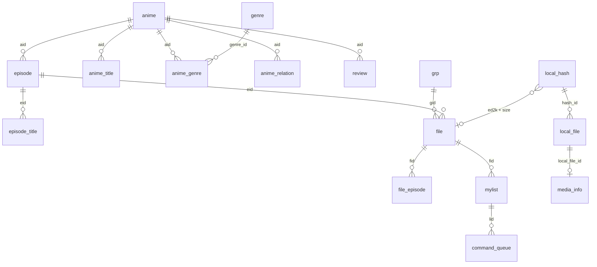

# Storage and network contracts

Reference for the SQLite schema, the persistent AniDB command queue, the UDP and HTTP
protocol handling, the title dump import, the GitHub update transport, and the public Rust API of
`animatic-core` and `animatic-anidb`. For the big picture and thread model read
[Architecture](architecture.md)
first. Source of truth: [`schema.sql`](../crates/animatic-core/src/db/schema.sql),
[`db/mod.rs`](../crates/animatic-core/src/db/mod.rs),
[`sync.rs`](../crates/animatic-core/src/sync.rs),
[`store.rs`](../crates/animatic-core/src/store.rs),
[`limits.rs`](../crates/animatic-core/src/limits.rs) and the
[`animatic-anidb`](../crates/animatic-anidb/src/lib.rs) modules. Generated item documentation:
`cargo doc --workspace --no-deps`.

Examples use only synthetic values. Nothing here requires or should be run against production
AniDB with unregistered client credentials.

## Database

### Files, connections and pragmas

- One SQLite file (default `animatic.sqlite3`, see [Data locations](https://github.com/RetroHazard/animatic/wiki/Data-Locations)) plus
  the WAL side files `<name>-wal` and `<name>-shm` while it is open. Copy or back up the main
  file only with the application closed, or copy all three together; recent commits can still be
  in the WAL.
  The desktop offers a consistent copy while running: **File > Back up library...** (see
  [Backup, restore and maintenance](#backup-restore-and-maintenance)).
- `Db::open(path)` creates missing parent directories, opens read-write/create with a 30 s busy
  timeout, and sets `journal_mode=WAL`, `synchronous=NORMAL`, `temp_store=MEMORY`,
  `cache_size=-65536` (64 MiB). It then upgrades and creates the schema (below). The desktop UI
  lowers its own connection's busy timeout to 1.5 s.
- `Db::memory()` runs the same initialization on an in-memory database (tests, previews) and
  does not record `schema_version`.
- A `Db` wraps one `rusqlite::Connection` opened without SQLite's internal mutex: each thread
  opens its own. WAL permits concurrent readers with one writer.
- `schema.sql` starts with `PRAGMA foreign_keys = OFF` and **declares no foreign keys**. All
  relations below are conventions maintained by application code, so orphans are possible
  (for example a `file` row whose `aid` has no `anime` row yet; the code creates stub `anime`
  rows on demand).
- With `synchronous=NORMAL` in WAL mode, a commit can be lost after an operating-system crash
  or power failure; the database stays consistent.

### Schema evolution

`Db::open` runs `init`: first `migrate_command_queue`, then the whole of `schema.sql`.

- Every table and index uses `CREATE TABLE/INDEX IF NOT EXISTS`, so new tables and indexes
  appear in old databases automatically and repeated opens are harmless.
- That script **cannot add a column to an existing table.** The only structural upgrade
  implemented is the command-queue rebuild: if `command_queue` lacks `blocked` or `lid`, or its
  DDL lacks `AUTOINCREMENT`, it is rebuilt inside `BEGIN IMMEDIATE`: indexes dropped, table
  renamed to `command_queue_old`, new table created from `schema.sql`, rows copied with their
  ids, tries and errors, `lid` recomputed from the payload, priorities `>= 10` (the removed
  "demote on failure" rule) reset to the command's own priority, old table dropped. A concurrent
  opener that finds the work already done does nothing.
- `SCHEMA_VERSION` is `1`. `meta.schema_version` is written once when absent and is **never
  compared**: opening a database written by a newer Animatic is not detected or refused.
- Adding a column to an existing table needs a new, idempotent step in `db::init` that runs
  before the schema script (recipe below).

### Metadata keys (`meta`)

| Key | Value | Written by | Read by |
|---|---|---|---|
| `schema_version` | `1` | `Db::open` when absent | nothing |
| `sync_cooldown` | `<until epoch seconds>\n<reason>` | worker (`set_sync_cooldown`) | `Db::sync_cooldown` |
| `titles_dump_date` | epoch seconds of the last **successful** dump import | `import_title_dump` | the title dump guard, as a lower bound only (see [Request guards](#request-guards)) |
| `titles_dump_attempt` | epoch seconds of the last **attempt** to download the dump, saved before the request is sent, whether or not it succeeded | `sync::execute` (`Db::record_titles_dump_attempt`) | `Db::titles_dump_next_allowed` |
| `udp_last_send_ms`, `http_last_send_ms` | epoch **milliseconds** of the last UDP packet / HTTP request, saved before sending | `animatic_core::limits::DbLimitStore` for the process-wide limiter | the same store, once per process, when the first request of that protocol is made |
| `auth_backoff_step` | consecutive `AUTH` attempts without a reply (1 to 6); `0` after a successful login | `DbLimitStore` | `DbLimitStore` |
| `image_server` | the image host (bare host name, optional port) the last successful `AUTH` announced; anything else is never saved | the worker after a queue run (`Db::remember_image_server`) | cover requests (`Db::image_server`), which prefer it to `anidb.image_server` |
| `mylist_stats` | JSON `{"fetched": <epoch seconds>, "stats": {…MylistStats fields…}}`: the latest `MYLISTSTATS` result with its arrival time (`StoredMylistStats`) | `Db::store_mylist_stats` (the `MylistStats` executor arm), replacing the previous value | `Db::mylist_stats_snapshot` (an unreadable value reads as absent), `LibraryProjection::account_stats`, Overview "AniDB account figures" |
| `legacy_import_source`, `legacy_import_date` | databank path, epoch seconds | legacy import | nothing in the application |
| `legacy_dump_date` | largest dump-date tag found in the databank (`legacy_dump_date_tmp` is a transient staging key) | legacy import | nothing in the application |

An unreadable `sync_cooldown` value (no newline, non-numeric time, empty) is ignored and never
locks syncing; a database *error* while reading it aborts the queue run instead. The same holds
for the saved attempt and send times above: a damaged value counts as none, while a database
error while reading or writing them stops the request (nothing is sent without a saved send
time).

### Tables

"Soft" means the relation exists only in code. Dates are Unix seconds unless noted.

| Table | Purpose | Key and uniqueness | Indexes | Writers | Notes |
|---|---|---|---|---|---|
| `meta` | Key/value settings of the database | PK `key` | | `Db::set_meta` | See above |
| `category` | Lookup names (`kind` = `cat`, `lang`, `qual`, `type`, `vcodec`, `acodec`, `res`, `sub`) | PK `(kind, id)` | | Legacy import; `category_or_insert` adds unknown `qual`/`type` names from FILE replies with `max(id)+1` | An empty name maps to id 1 |
| `anime` | One row per anime | PK `aid` | | FILE replies, title dump (stub rows), HTTP anime XML, legacy | `fetched` is set only by a full HTTP record and means "has a full record" (success only; attempts are in `request_attempt`); `episodes = 0` means unknown/ongoing; ratings are stored x100 |
| `anime_title` | Titles per anime | PK `id` (rowid, **not** AUTOINCREMENT); no unique constraint on `(aid, name, lang)` | `aid`; `name COLLATE NOCASE` | FILE replies, dump merge, HTTP XML (replaces all titles of the anime when the document has titles), legacy | Uniqueness of `(aid,name,lang)` is enforced by code. `type`: 1 main, 2 synonym, 3 short, 4 official, 5 card, 6 kana |
| `episode` | Episodes | PK `eid` | `aid` | FILE replies, HTTP XML, EPISODE replies, legacy | `length` in minutes; `type`: 1 regular, 2 special, 3 credit, 4 trailer, 5 parody, 6 other |
| `episode_title` | Episode titles | PK `id` | `eid` | Same as episodes | One row per `(eid, lang)` by code (update, else insert) |
| `grp` | Release groups | PK `gid` | | FILE replies (name, short), GROUP replies, legacy | Named `grp` because `group` is reserved |
| `file` | AniDB file records | PK `fid` | `aid`; `eid`; `gid`; `(ed2k, size)` | FILE replies, legacy | `ed2k`/hashes stored lowercase from replies. Not unique on `(ed2k,size)`; the library join picks the non-deprecated row with the highest `fid` |
| `file_episode` | Extra episodes a file covers beyond `file.eid` | PK `id` | `fid`; `eid` | FILE replies (delete-then-insert per `fid`), legacy | |
| `file_relation` | File-to-file relations | PK `id` | `fid` | Legacy import only | Nothing in the repository reads it |
| `genre` | Genre/tag names | PK `id` | | Legacy genres; HTTP tags with id `100000 + tag id` | Tags and legacy genres share the table |
| `anime_genre` | Anime-to-genre links with weight | PK `id` | `aid`; `genre_id` | Legacy; HTTP tags (rewrites rows with `genre_id >= 100000`) | No unique `(aid, genre_id)` |
| `anime_relation` | Anime-to-anime relations | PK `id` | `aid` | Legacy; HTTP XML (replaces the anime's relations) | `type` ids in `library::relation_id`; unknown names map to 100 |
| `review` | Legacy review text | PK `id` | `aid` | Legacy import only | Read by the anime detail window |
| `mylist` | The user's MyList entries | PK `lid` (AniDB's list id) | `fid`; `aid`; `eid` | API replies (with pending edits overlaid), optimistic local edits, legacy | `viewed` is derived (`viewdate != 0`) for API data; `state`: 0 unknown, 1 HDD, 2 CD, 3 deleted, 4 remote. No unique `fid`: lookups by `fid` take the lowest `lid` |
| `local_hash` | Hashes of local content | PK `id`; **UNIQUE `(ed2k, size)`** | | `add_local_file` (upsert); legacy | Hashing fills only `ed2k, size, crc32, md5, sha1`; the media columns (`fps`, `video_*`, `audio_*`) are populated only by legacy import |
| `local_file` | Paths of hashed files | PK `id`; **UNIQUE index on `path`** (exact text) | `hash_id` | `add_local_file` (upsert by path), `move_local_file`, legacy | `hash_id` softly references `local_hash.id`. `mtime` = modification time read after hashing. `remove_local_file` also deletes `local_hash` rows left without any path. Scan comparisons use a normalized key (slashes, and lower case on Windows) while the index is exact text |
| `media_info` | Media properties read through `ffprobe` (opt-in), one row per probed local file | PK `local_file_id` (soft reference to `local_file.id`; no foreign key, so the integrity check cannot trip over an orphan) | | `Db::set_media_info` (from `media::read_files`); `remove_local_file` and `clear_local_files` delete rows with their file | `hash_id` records the content that was probed; every read joins `local_file` on `id` **and** `hash_id`, so a re-hash to other content hides the old figures until the file is probed again. `length` seconds, `video_bitrate`/`audio_bitrate` kbit/s. A row with all value columns `NULL` records a probe `ffprobe` refused, so it is not repeated; failures that say nothing about the file (missing file, timeout, `ffprobe` not startable) save nothing. Created with `CREATE TABLE IF NOT EXISTS`; the legacy media columns of `local_hash` stay as imported and are not written |
| `command_queue` | Persistent outbox of AniDB commands | PK `id` **AUTOINCREMENT** | `(blocked, priority, id)`; `lid`; `payload` | `sync.rs` queue operations, migration | See below |
| `request_attempt` | When a request for one record was last **sent** to AniDB, successful or not | PK `(kind, id)`; `kind` is `anime` (`id` = `aid`, HTTP record), `file` (`id` = `fid`, UDP `FILE`), `cover` (`id` = `aid`, the cover download) or `export` (`id` = `0`, UDP `MYLISTEXPORT`); `attempted` = epoch seconds | | `sync::execute` and `covers::download_cover` through `Db::record_request_attempt`, before the request | Created by the idempotent schema script, so existing databases gain it on the next open and lose nothing. See [Request guards](#request-guards) |
| `hash_queue` | Files waiting to be hashed, so a quit or crash loses none (roadmap M5.4) | PK `id` **AUTOINCREMENT**; **UNIQUE `key`** (canonical path: resolved, `\\?\` prefix removed) | `(state, id)` | `Db::hash_queue_enqueue` (Add files, command line, handoff, scan), `hash_queue_remove` after the result is stored, `hash_queue_fail`, `hash_queue_retry_failed`, `hash_queue_clear` | `path` is the absolute path as given and is what is hashed and recorded in `local_file`; `source` is `add-files`, `command-line`, `scan` or `handoff`; `state` is `queued` or `failed` (with `reason`). Drained oldest `id` first; a failed row is skipped until retried, re-queued by adding the file again, or cleared. Created by the idempotent schema script, so existing databases gain it on the next open. See the [persistent hash queue](architecture.md#persistent-hash-queue) |

Key relations (all soft):



A local file is linked to AniDB data **by content**: `local_hash(ed2k,size)` joins `file(ed2k,size)`,
and a `mylist` row joins through `file.fid`. A renamed or moved file therefore stays identified.

### Atomicity inside the database

`Db::write_tx` is `pub(crate)`: it starts `BEGIN IMMEDIATE` (taking the write lock up front, so a
read-modify-write cannot be interleaved by another connection and never fails by upgrading a
read lock), joins an enclosing transaction through a savepoint, and rolls back on error. Code
outside `animatic-core` that needs a multi-statement unit of work must use `Db::conn()` with its
own transaction.

| Operation | Atomic unit |
|---|---|
| `queue_push`, `queue_push_many`, `queue_edit_mylist`, `queue_retry_failed` | One `write_tx` |
| `store_file_info` (FILE reply: file, extra episodes, anime stub, titles, episode, group, mylist) | One `write_tx` |
| `store_api_mylist` (read file ids, overlay pending edits, upsert) | One `write_tx` |
| `apply_edit_locally`, `mylist_deleted_on_anidb`, missing-entry deletion | One `write_tx` |
| `import_title_dump` merge | One `BEGIN IMMEDIATE` transaction |
| `store_anime_xml` | One *deferred* transaction (`unchecked_transaction`); it does not join a caller's transaction |
| `store_episode_info`, `store_group_info`, `store_anime_info`, `add_local_file`, `queue_remove`, `queue_failed`, `queue_block*` | Individual statements; no multi-statement atomicity |
| Legacy import | One transaction **per collection** |

### Backup, restore and maintenance

`animatic_core::maintenance` holds the blocking operations behind **File > Back up library...**,
**File > Restore library...**, **Tools > Check library** and **Tools > Compact library...**.

- **Backup**: `backup_to(&Db, &Path)` uses SQLite's online backup API (256 pages per step, 2 ms
  pause) from the live connection into a temporary file in the destination folder, sets
  `journal_mode=DELETE` on the copy and renames it over the destination, so a failed backup leaves
  no partial file and the copy has no `-wal`/`-shm`. It refuses the library file itself and its
  `-wal`, `-shm` and `-journal` names. Writers during the copy only make the backup API restart;
  the copy is always a consistent snapshot. The `rusqlite` `backup` feature is enabled.
- **Validation**: `validate_backup(&Path)` returns `BackupInfo` (schema version, size, counts of
  `anime`, `mylist`, `local_file`, `command_queue`) or an error that says why the file is
  refused: unreadable or failing `integrity_check`, a missing required table
  (`meta`, `anime`, `mylist`, `local_file`, `local_hash`, `command_queue`; later tables are created on
  open), a missing or newer `meta.schema_version`. A source in WAL mode makes SQLite create `-wal`
  and `-shm` files; they are removed again when they did not exist before.
- **Restore**: `restore_database(&Path, &Path) -> Result<RestoreOutcome>` requires that no
  connection to the database is open. Order: refuse the library itself, validate the source, copy
  it to `<db>.restore-staging` (backup API) and validate that copy, keep the current database as
  `<db>.before-restore-YYYYMMDD-HHMMSS[-N]` (checkpoint with `TRUNCATE`, then a byte copy of the
  file, plus `<name>-wal` when a non-empty `-wal` is left), remove the old `-wal` and `-shm`, rename
  the staging file over the database. Any failure before the rename leaves the database
  file untouched and removes the staging file; a failure to keep the copy aborts the restore.
- **Check**: `check_file(&Path) -> IntegrityReport` opens read-only, runs `PRAGMA integrity_check`
  (findings, capped at 100; an unreadable file is a finding) and, when that is clean, `PRAGMA
  foreign_key_check`. The schema declares no foreign keys, so the second check is a guard for
  databases from other sources. It never writes.
- **Compaction**: `compact(&Db) -> CompactReport` runs `VACUUM` with `temp_store=FILE`, then
  `wal_checkpoint(TRUNCATE)`; sizes are `page_count * page_size`.

## Outbox command queue

AniDB work that must survive restarts and offline periods is a row in `command_queue`:

| Column | Meaning |
|---|---|
| `id` | AUTOINCREMENT; never reused. Used as the generation of a command |
| `created` | Epoch seconds |
| `priority` | `Command::priority()` at insert time (lower runs first) |
| `payload` | JSON of `Command` (serde, externally tagged) |
| `tries` | Counted failed attempts |
| `last_error` | Most recent failure or deferral text |
| `blocked` | `1` = skipped until retried |
| `lid` | Target MyList entry of add/edit/delete commands, for pending-intent lookups |

Payload shapes (synthetic values):

```json
{"FetchAnime":{"aid":1}}
"MylistStats"
"MylistExport"
{"MylistEdit":{"lid":1,"edit":{"state":null,"viewed":true,"viewdate":1700000000,"storage":null,"source":null,"other":null}}}
{"MylistAdd":{"file":{"Hash":{"size":1234,"ed2k":"00112233445566778899aabbccddeeff"}},"edit":{"state":1,"viewed":null,"viewdate":null,"storage":"","source":null,"other":null}}}
```

A `null` field means "leave unchanged"; an empty string means "clear". Both states survive
serialization.

### Commands, priorities and reachability

Order of execution is `ORDER BY priority, id` over rows with `blocked = 0`.

| Command | Prio | Transport and reply | Local effect | Enqueued by the desktop UI |
|---|---|---|---|---|
| `MylistAdd {file, edit}` | 0 | UDP (`FILE` for a hash reference), `MYLISTADD` | Stores the new entry; if present already, applies the edit | Yes: Hashed files "Add to MyList…" (`FileRef::Fid` for an identified file, `FileRef::Hash` otherwise) |
| `MylistEdit {lid, edit}` | 0 | UDP `MYLISTADD edit=1` | `apply_edit_locally`; missing entry blocks the edit | Yes: My list state/watched, "Edit…" (state, watched, view date, storage, source, other) |
| `MylistDelete {lid}` | 0 | UDP `MYLISTDEL` (211, or 411 = already gone) | Deletes the local entry only after the reply, and not when newer intent exists | Yes: My list "Remove from MyList…" (after confirmation) |
| `Identify {size, ed2k, add}` | 1 | UDP `FILE` by hash; optional `MYLISTADD` by `fid` | `store_file_info`; mylist entry stored | Yes: after hashing an unidentified file, if enabled (and for an identified file only when its folder adds to MyList) |
| `FetchFile {fid}` | 2 | UDP `FILE` by fid | `store_file_info` | Yes: full update (Tools menu or `--full-update`); re-hashing an identified file with `anidb.update_file_information` |
| `FetchEpisode {eid}` | 2 | UDP `EPISODE` | `store_episode_info` | Yes: the episode "Refresh" button of the anime detail window |
| `FetchGroup {gid}` | 2 | UDP `GROUP` | `store_group_info` | Yes: Groups "Refresh" |
| `FetchAnime {aid}` | 3 | HTTP anime XML | `store_anime_xml` | Yes: detail "Refresh"; full update |
| `MylistStats` | 3 | UDP `MYLISTSTATS` | Stored in `meta.mylist_stats` with the arrival time; the summary is also logged | Yes: Tools menu |
| `TitlesDump` | 3 | HTTPS title dump | Spool then merge | Yes: Tools menu; full update |
| `MylistRefresh {lid}` | 4 | UDP `MYLIST` | Stores entry (queued edits overlaid), or deletes it if AniDB says it is gone and no local intent is queued | Yes: My list "Refresh entry" |
| `MylistExport` | 3 | UDP `MYLISTEXPORT template=xml-plain-new` (217 queued, 318 already queued) | None; the file is imported separately. Guarded: once per 24 h | Yes: Tools → Request MyList export… (never scheduled, never by a full update) |
| `MylistExportCancel` | 3 | UDP `MYLISTEXPORT cancel=1` (218, 319) | None | Yes: the same dialog's Cancel pending export |

Every command can be queued from the desktop application. See
[Feature parity](https://github.com/RetroHazard/animatic/wiki/Feature-Parity).

### Enqueue rules

- `queue_push(&Command) -> Result<i64>` returns the new id, or **0** when an identical payload
  is already queued (blocked rows count). Duplicates are therefore not errors.
- `MylistEdit` is never inserted directly: `queue_edit_mylist(lid, &MylistEdit)` merges all
  outstanding edits of `lid` (blocked and failed ones too) with the new one, oldest first, in
  one `write_tx`, deletes them and inserts a single row with a fresh id (keeping the highest
  `tries` and the last error), then applies the merged edit to the local `mylist` row. Merge
  rules: unset fields keep the older value; `Some("")` is a real value; `viewed = false` drops
  `viewdate`; `viewed = true` without a date is stamped with the time of the edit, not of
  delivery. It returns 0 when the entry has a pending delete or the merged edit is empty.
- `MylistDelete` removes the entry's queued edits (an edit already in flight just finishes)
  and refuses a second delete. After a delete is queued, new edits for that `lid` return 0. The
  local `mylist` row is deleted only by the executor after AniDB's `MYLISTDEL` reply, in one
  transaction with the check that nothing was queued for the `lid` after the delete's id; a
  blocked delete leaves the row in place and visible in the queue.
- `MylistAdd` with `FileRef::Fid`/`FileRef::Hash` has no `lid` (the entry does not exist yet),
  so it is a plain duplicate-checked insert and no local `mylist` row is written before AniDB
  answers; the projection marks the matching hashed files (`LocalFile::mylist_add_pending`,
  from the queue snapshot) so the desktop shows `Add queued`. `store_added_entry` writes the
  row from the reply, or the existing entry is refreshed and the edit applied.
- `queue_push_many` inserts a batch in one transaction and returns how many were added.
- `queue_clear` deletes every row, blocked and unreadable ones included, and does not revert
  optimistic changes already applied to `mylist`.

### States and transitions

| State | Columns | Desktop label | Runnable | How it ends |
|---|---|---|---|---|
| Pending | `blocked=0`, `tries=0` | Pending | yes | Success deletes the row |
| Retrying | `blocked=0`, `0 < tries < 5` | `N retries` | yes | Success; or the fifth counted failure blocks it |
| Deferred | `blocked=0`, `last_error` set, `tries` unchanged | Pending (error shown) | yes, subject to cooldown | A later success |
| Blocked | `blocked=1` | Blocked | no | `queue_retry_failed` (resets `blocked` and `tries`), or clear |
| Unreadable | `payload` does not deserialize | Blocked, "Unreadable queued command: ..." | no | Retry unblocks it, but the next `queue_peek` blocks it again with the parse error |

- `queue_peek` returns `(id, Command, tries)`; a row it cannot deserialize is blocked with
  `unreadable queued command: <serde error>` (logged as a warning) and skipped. **A payload this
  version cannot read is never deleted automatically**, so downgrading, or a removed variant,
  keeps the user's work visible. It cannot be merged or overlaid, though: a MyList edit stored
  in such a row does not protect the entry's field values from being overwritten by remote data.
  Only the `lid` column is still visible to `mylist_has_pending_intent` (and so to the
  delete/absence guards), and only when that column was recorded for the row.
- `queue_failed` adds one try and blocks when tries reach `MAX_QUEUE_TRIES = 5`;
  `queue_deferred` records an error without counting; `queue_block` adds a try and blocks
  immediately; `queue_block_all` blocks every runnable row without counting.
- `queue_retry_failed` merges multiple edits of one entry into the newest before unblocking, so
  an old blocked edit cannot overwrite a newer one, and returns how many rows were blocked.
- `queue_list` returns every row, runnable first (`ORDER BY blocked, priority, id`); the Queue
  page shows it from the library projection.

### Generation guards

Because `id` is never reused:

- `queue_remove(id)` after a reply deletes only that exact command. A superseded or cleared
  command's acknowledgement removes nothing newer.
- `apply_edit_locally` re-applies queued newer edits (overlay) on top of an acknowledged one in
  the same transaction.
- A "no such entry" reply to `MylistEdit` blocks the edit (with an actionable message) only
  while that row still exists; a superseded edit is reported as superseded.
- After `MYLISTDEL`, the local entry is deleted only if no command with a *higher id* targets
  it. After a `MylistRefresh` that finds the entry missing, deletion is skipped while any
  command still targets it. `FILE` replies that explicitly report "not in MyList" remove stale
  local entries except those with queued intent.
- Delivery is at-least-once (see [Architecture](architecture.md#anidb-synchronization)).

## Failure classes and cooldowns

`CommandError { message, transient, fatal, retry_after, counts_attempt }` is produced from
`AnidbError` (`animatic_anidb::error`) or from core `Error`. Constants:
`BAN_COOLDOWN = 30 min`, `TRANSIENT_COOLDOWN = 60 s`, `MAX_QUEUE_TRIES = 5`. The request limits
(spacing, daily guards, `AUTH` backoff) are constants of their own, listed in
[Where each limit lives](#where-each-limit-lives).

| Error | Transient | Fatal | Retry after | Counts as attempt |
|---|---|---|---|---|
| `Network`, `Timeout`, `Storage` (the send time could not be saved, so nothing was sent) | yes | no | 60 s | no |
| `AuthTimeout(d)` (an `AUTH`, or the `ENCRYPT` before it, got no reply) | yes | no | `d`: 30 s, 2 min, 5 min, 10 min, 30 min, then 2 h, persisted and reset by a successful `AUTH` | no |
| `Http` (5xx, malformed HTTP) | yes | no | 60 s | **yes** |
| `ServerUnavailable(d)` (local backoff, HTTP 429 = 30 min) | yes | no | `d` | no |
| `ServerError(604)` | yes | no | 60 s | no |
| `ServerError(600)` | yes | no | 30 min | **yes** |
| `ServerError(601, 602, other)` | yes | no | 30 min | no |
| `Banned` | no | yes | 30 min | no |
| `Auth`, `ClientOutdated` (503), `ClientBanned` (504) | no | yes | none | no |
| `IllegalInput`, `UnknownCommand`, `Unexpected`, `Protocol`, `Xml` | no | no | none | yes |
| core `Error::Io` / `Error::Db` | yes | no | 60 s | yes |
| other core `Error` (settings, JSON, legacy, rename, ...) | no | no | none | yes |

What the worker does with each class (`fail_command` in
[`worker.rs`](../crates/animatic/src/worker.rs)):

| Class | Action | Run continues |
|---|---|---|
| Fatal with a duration (ban) | `queue_deferred` (no try), persist cooldown | no |
| Fatal without duration (credentials, outdated or banned client) | `queue_block_all`: every runnable row blocked until corrected; "Blocked" event | no |
| Transient, counted | `queue_failed` (+1 try, blocks at 5), persist cooldown (default 60 s) | no |
| Transient, not counted | `queue_deferred`, persist cooldown | no |
| Permanent (not transient, not fatal) | `queue_block` (+1 try, blocked), "Blocked" event | **yes**, next command |

Cooldown mechanics:

- Stored as `meta.sync_cooldown` = `<until>\n<reason>`; `until` is rounded up to whole seconds.
- `process_queue` checks it *before* constructing any client and refuses to run (and publishes
  a `Cooldown` event) while it is in the future. It therefore survives restarts and applies to
  "Synchronize now" and "Run command queue" alike; "Retry failed" only unblocks rows.
- Offline mode (`anidb.offline`) is checked first and leaves the queue untouched.
- Inside one `UdpClient`, a server-error reply also arms an in-memory backoff (600/601/602:
  30 min, 604: 60 s) during which `ServerUnavailable` is returned without sending a packet, and
  a ban reply (510, 555) latches the client so it sends nothing further. Each queue run builds
  new clients, which is why the persistent cooldown exists.
- `504` is not a timed ban: the client name and version are banned, so it blocks every runnable
  row like an outdated client (`503`) until they are corrected, and sets no cooldown.
- An `AUTH` without a reply escalates instead of using the flat 60 s: the `AuthTimeout`
  duration comes from `meta.auth_backoff_step`, so the next try is allowed 30 s, 2 min, 5 min,
  10 min, 30 min and from then on 2 h after the unanswered `AUTH`. It is stored as an ordinary
  `sync_cooldown`, survives restarts, and a successful login resets the step. The command that
  needed the login is deferred and counts no attempt.
- A command that a request guard skips ([Request guards](#request-guards)) finishes as
  `Outcome::Skipped`: it is removed from the queue and logged, with no failure, no counted
  attempt and no cooldown.
- A fresh cooldown does not take the maximum with an existing one; runs do not start while one
  is active, so none exists to compare.
- Recovery: wait out the cooldown; correct credentials/client name/version in the Options
  window or settings file; use **Retry failed**; discard hopeless rows with **Clear queue**.
  See [Troubleshooting](https://github.com/RetroHazard/animatic/wiki/Troubleshooting).

## AniDB server limits

These are the rules AniDB publishes for clients, collected on 2026-11-06 by reading the pages
with a browser (plain HTTP clients get 403). A client that breaks them gets its users banned,
so every request path must follow them; the roadmap item
[M1.8](roadmap.md#m18-honour-anidb-server-limits-across-runs-and-restarts) made the limits
hold across runs and restarts, and *Where Animatic stands* below says what each rule maps to.
Entries marked *(not documented)* have no official text and are design choices.

Sources: [UDP API definition](https://wiki.anidb.net/UDP_API_Definition) (spec 0.03.730,
protover 3), [HTTP API definition](https://wiki.anidb.net/HTTP_API_Definition),
[API overview and dumps](https://wiki.anidb.net/API), [MyList export](https://wiki.anidb.net/MyList_export)
and the [AniDB policy](https://anidb.net/policy) (last updated 2025-12-31).

**Policy.** AniDB data is CC BY-NC-SA 4.0: no commercial use. Scraping the site or the API is
forbidden, and so is using the API to "download" AniDB in bulk; software must use the API only
and must not flood it. The export tool must not be abused.

**UDP API**

| Rule | Value |
|---|---|
| Server | `api.anidb.net:9000`, configurable rather than hard-coded |
| Local port | One fixed port above 1024, reused; many different source ports from one IP within about an hour causes an IP ban |
| Rate | At most one packet per 2 s, enforced after the first 5; at most one per 4 s over an extended period. Dropped over-limit packets still count, and continuing leads to a permanent ban |
| Bans | Usually about 30 min; triggered by rate, port churn, repeated `AUTH` failures or too many connections |
| Registration | `client` lowercase letters, 4 to 16 characters; `clientver` an integer starting at 1, raised per client release; `protover=3` |
| Session | Expires after 35 min idle; send a command at least every 30 min to keep it, and `LOGOUT` when idling longer. Do not `AUTH`/`LOGOUT` around every command |
| NAT | `AUTH ... nat=1`; when the reported port differs from the local one, `PING` within the router timeout (5 to 15 min), no more often than needed |
| `AUTH` without reply | Back off 30 s, 2 min, 5 min, 10 min, 30 min, then up to 2 to 4 h |
| Replies | `601` maintenance: wait at least 30 min. `506` invalid session: re-`AUTH` (also after an IP or port change). `504`: this client version is banned |
| NOTIFY | At most once per 20 min |
| Caching | Cache file, episode, anime and group data for extended periods; on rescans query only files AniDB did not know last time |

**HTTP API.** Registered `client` and `clientver` on every request; at most one request per 2 s;
requesting the same dataset more than once a day can lead to a ban, so cache heavily. Errors and
bans arrive as XML bodies (`<error>Banned</error>`), not HTTP status codes. Replies are always
gzip.

**Title dump.** `anime-titles.xml.gz` is regenerated daily and must not be requested more than
once per day. Send a client-identifying `User-Agent` (third-party reports, *unofficial*).

**Images.** No rate limit or download rules are published. `AUTH ... imgserver=1` returns the
image host, which should be used instead of a fixed one; pictures are bare file names
(`picname`) under `https://<host>/images/main/`. Observed, not documented: the files are served
as immutable for a year, and a foreign `Referer` gets 404. AniDB does not own the artwork and
shows it under fair use, which grants a client no licence: cache covers locally for personal
display, never redistribute or re-host them, fetch each file once on demand and never crawl in
bulk; pace image requests like API requests *(not documented)*.

**Whole MyList.** No API route returns a complete MyList. UDP `MYLIST` returns one entry or one
anime, and walking the list with it is the bulk extraction the rules forbid. HTTP
`mylistsummary` needs the main password and has no file-level data. The supported route is
**MyList export**: UDP `MYLISTEXPORT template=<name>` (or the web export page) queues one export
at a time (`217` queued, `318` already queued, `317` unknown template, `cancel=1` → `218`); it
can take up to 24 h, completion is announced as an AniDB message, and the file is downloaded
from the web export page (no documented API for fetching it). Request it only when the user asks,
never on a schedule. `xml-plain-new` is the template meant for building a local database.
Animatic implements both halves (see [MyList export import](#mylist-export-import)).

**Where Animatic stands.**

| Rule | Status |
|---|---|
| 2 s / 4 s UDP spacing | **Process-wide**: one `Limits` owned by the worker serves every `UdpClient` of every queue run, and each packet's send time is saved in `meta.udp_last_send_ms` *before* it is sent. After a restart the burst size is unknown, so the next packet keeps the 4 s spacing from the saved time |
| No `AUTH`/`LOGOUT` per command | Per queue run, not per command; a session is not kept across runs |
| Fixed local port | Uses `anidb.local_port` (default 29456) and **never another port**: a port that cannot be bound is an error that names the setting, and nothing is sent. Port `0` (a new OS-chosen port for every client) exists for tests only |
| `504` | Fatal like an outdated client: every runnable row is blocked with "this AniDB client version is banned" until the client name and version are corrected; no timed ban |
| `AUTH` no-reply backoff | Escalating and persisted: 30 s, 2 min, 5 min, 10 min, 30 min, then 2 h; a successful login resets it |
| HTTP one request per 2 s | **Process-wide** for every HTTP request (anime records, title dump, images, `get_bytes`); the send time is saved in `meta.http_last_send_ms` before sending |
| Same dataset once a day | Enforced by a saved attempt time per anime (24 h) and per known file (7 days, a design choice); see [Request guards](#request-guards) |
| Title dump once a day | Enforced by a saved attempt time (24 h); **Download anime titles**, full updates and queued retries skip it inside the window and say when it is next allowed |
| MyList export | Only on the user's request (**Tools → Request MyList export…**), never scheduled and never part of a full update; once per 24 h by a saved attempt; the file is imported locally from the web download (see [MyList export import](#mylist-export-import)) |
| `User-Agent` | Sent: `Animatic/VERSION` |
| `nat=1`, `comp=1`, `imgserver=1` | Sent on `AUTH`; `PING` exists but is unused |
| Images: on demand only, no crawl, no redistribution | **Anime covers.** A cover is requested only when the anime detail window opens on an anime whose picture is not on disk, one file per request, and a cached cover is never requested again (a new `picname` is a new file). Covers are kept in `<data folder>/covers/` for the user's own display and are never exported, backed up, uploaded or re-hosted. See [Anime covers](#anime-covers) |
| Image host from `AUTH` | The host of the last login is saved in `meta.image_server` and used for covers; `anidb.image_server` is the fallback until one login has happened |
| Image pacing | Image requests share the HTTP limiter (2 s between any two HTTP requests of the process, covers included) and a failed cover is not retried within `COVER_MIN_AGE`. They never go out offline, while a ban or cooldown is active, or when cover downloads are switched off (`anidb.download_covers`) |
| No `Referer` | None is sent (`ureq` adds none) |

### Where each limit lives

Every limit is a named constant whose doc comment links the rule above.

| Constant | Value | Defined in |
|---|---|---|
| `UDP_BURST_PACKETS`, `UDP_BURST_SPACING`, `UDP_SUSTAINED_SPACING` | 5 packets at 2 s, then 4 s | [`animatic_anidb::limits`](../crates/animatic-anidb/src/limits.rs) |
| `UDP_BURST_RESET` | 10 min of idle time restarts the burst allowance *(not documented)* | same |
| `HTTP_SPACING` | 2 s between any two HTTP requests | same |
| `AUTH_BACKOFF` | 30 s, 2 min, 5 min, 10 min, 30 min, 2 h (the last repeats) | same |
| `TITLES_DUMP_MIN_INTERVAL` | 24 h from the last attempt | [`animatic_core::limits`](../crates/animatic-core/src/limits.rs) |
| `ANIME_MIN_AGE` | 24 h from the last attempt, per anime | same |
| `KNOWN_FILE_MIN_AGE` | 7 days from the last attempt, per file; a design choice, because AniDB only says "extended periods" | same |
| `COVER_MIN_AGE` | 1 hour from the last attempt, per anime; a design choice (AniDB publishes no image rules). It only spaces out retries after a failure: a cover that arrived is cached and never requested again | same |
| `MYLIST_EXPORT_MIN_INTERVAL` | 24 h from the last attempt; a design choice: AniDB queues one export at a time and asks that the export tool is not abused | same |
| `BAN_COOLDOWN`, `TRANSIENT_COOLDOWN` | 30 min, 60 s | [`animatic_anidb::error`](../crates/animatic-anidb/src/error.rs) |

### Request guards

A guard stops a request from being repeated too soon. It counts **attempts, not successes**, so
a failed, truncated or invalid download cannot be repeated inside the interval either.

- **Order.** `sync::execute` checks the guard first. A request that is allowed saves its
  attempt time (`meta.titles_dump_attempt`, or a `request_attempt` row) *before* anything is
  sent, then sends. A failure, a crash right after sending, or a restart therefore cannot allow
  a repeat. What is saved is durable against a process crash; like every commit with
  `synchronous=NORMAL` it can still be lost in an operating-system crash or a power failure.
- **What counts as an attempt.** Any request that was sent, whatever came back. Things that
  happen before a request exists are not attempts: an empty client name (`HttpClient::check_client`),
  a `FILE` request whose login failed first (`UdpClient::ensure_login` runs before the attempt
  is saved), and the local spool of the title dump failing to start. A guard refusal is not an
  attempt either.
- **Minimum ages.** Title dump 24 h; one anime 24 h; one known file (`FetchFile`) 7 days; one
  anime's cover 1 hour (retries only, see [Anime covers](#anime-covers)); the MyList export 24 h
  (account-wide, one row).
  `titles_dump_date` and `anime.fetched` keep recording only successes; for databases from
  before attempts were saved, a success also counts as an attempt (the later of the two is
  used). A saved time in the future (the clock was set back) is treated as now, so a guard
  never blocks for longer than one interval, and a damaged value counts as none.
- **Where it applies.**
  - *Queue executor*: a queued `TitlesDump`, `FetchAnime` or `FetchFile` inside its window is
    completed as `Outcome::Skipped` (removed from the queue, logged with the time it is allowed
    again, not counted as a failure). This also covers a transient retry: the failed attempt
    already started the window.
  - *Full update* (`--full-update`, `Job::QueueFullUpdate`): leaves out the title dump and every
    anime and file still inside its window, and reports how many it left out.
  - *Desktop*: **Download anime titles** and the anime detail **Refresh from AniDB** check the
    guard when clicked, queue nothing inside the window and log when the request becomes
    available. The executor checks again when the command runs.
  - *MyList export*: `Command::MylistExport` is guarded like a known file (`request_attempt`
    kind `export`, id `0`, 24 h, saved after the login and before the packet); the dialog's
    **Request export** checks the guard when clicked and queued commands inside the window
    complete as skipped. See [MyList export import](#mylist-export-import).
- **Not guarded.** Hash lookups (`Identify`), `FetchEpisode`, `FetchGroup`, the cancellation of a
  MyList export and the other UDP commands have no age guard; they are only subject to the
  shared spacing.

### Anime covers

The anime detail window shows the picture named by `anime.picname`. Code:
[`covers.rs`](../crates/animatic-core/src/covers.rs) (cache and decision),
[`worker/covers.rs`](../crates/animatic/src/worker/covers.rs) (the cover thread and decoding) and
[`app/covers.rs`](../crates/animatic/src/app/covers.rs) (the window).

- **Terms.** AniDB owns none of the artwork and grants no licence (see *Images* in
  [AniDB server limits](#anidb-server-limits)), so a cover is kept for the user's own display
  only. It is never exported, included in a library backup, uploaded or re-hosted, and the
  cache folder is not part of the library.
- **On demand.** The window asks the cover thread when it opens on an anime (once per picture
  name while the answer is kept). Nothing walks the library; opening 30 anime in a row asks for
  30 covers, and when requests queue up the thread skips the downloads that a newer request has
  replaced (`CoverOutcome::Superseded`), so only the cover the user stopped on is fetched.
- **Cache.** `covers/<picname>` next to the database (the data folder of the default profile;
  beside the file given by `ANIMATIC_DB` otherwise). `picname` must be a bare file name
  (`validate_picname`: letters, digits, `.`, `-`, `_`; no leading, trailing or doubled dot; no
  Windows device name; at most 100 bytes), so it can neither leave the folder nor change the
  request path. The file is written atomically (`atomic::write_atomic`, temporary dot-file in
  the same folder, flush, rename) and only after it decoded as a picture. A cached cover is
  shown whatever the settings, the network state or a ban say, and is never requested again; a
  new `picname` is a new file and the old one stays. A cached file that does not decode is
  removed and fetched again (inside the retry guard).
- **Host.** `https://<host>/images/main/<picname>`: the host the last `AUTH` announced
  (`meta.image_server`, saved after a queue run, validated as a plain host name), else the
  `anidb.image_server` setting. No `Referer` is sent.
- **Order of checks** (`plan_cover`): valid name; cached; `anidb.download_covers` on; not
  offline; no active `sync_cooldown` (ban); the per-anime attempt guard `RequestKind::Cover`
  (`COVER_MIN_AGE`, saved *before* sending, so a failure cannot be repeated at once). Then the
  request takes a slot from the worker's one `Limits`, the same limiter the queue uses.
- **Failures.** A ban or rate limit (`Banned`, `ServerUnavailable`) sets the shared
  `sync_cooldown` like any other ban. A 404, a network error, a body over 16 MiB, or bytes that
  do not decode as JPEG, PNG, WebP or GIF show "Cover not downloaded" with the reason and cache
  nothing.
- **Decoding** runs on the cover thread with `image` (only the `gif`, `jpeg`, `png` and `webp`
  decoders): at most 16384 px per side and 256 MiB of memory, scaled down to 1024 px for the
  texture. The UI thread only uploads the finished pixels (rule 1).

## UDP API

Implementation: [`udp.rs`](../crates/animatic-anidb/src/udp.rs) and
[`commands.rs`](../crates/animatic-anidb/src/commands.rs). Protocol version 3. Default server
`api.anidb.net:9000` (`DEFAULT_SERVER`); the application passes `anidb.udp_server`.

**Socket.** One UDP socket per client. The server name is resolved once and the first IPv4
address is used (IPv6 is ignored). The socket binds `0.0.0.0:local_port` (default setting
`29456`) and **never falls back to another port**: if the bind fails, the exchange returns a
`Network` error that names `anidb.local_port` and nothing is sent (many different source ports
from one address get it banned). The socket is opened before the packet takes its send slot, so
a bind failure uses up no spacing. `local_port = 0` asks the operating system for a port, a
different one for every client; only tests use it. Datagrams from any other source IP are
ignored while waiting; the source port is not checked.

**Request format.** `COMMAND key=value&key=value`, values escaped (`&` becomes `&amp;`, line
breaks become `<br />`), plus `&tag=tN` (counter 1-9999 cycling) on every packet. Replies:
`[tag ]CODE message` followed by `|`-separated data lines; `<br />` becomes a newline and a
backtick becomes an apostrophe. A reply with the wrong tag is dropped as a stale answer; an
untagged reply is accepted. A reply whose code is not three digits is a `Protocol` error.

**Flood spacing (client side).** Spacing belongs to the process, not to a client: the
application's worker creates one [`Limits`](../crates/animatic-anidb/src/limits.rs) and every
`UdpClient` (one per queue run) takes its send slots from it. Before every packet `wait_udp`
sleeps so that consecutive packets are at least 2 s apart for the first five of a burst and 4 s
apart afterwards; the burst counter resets after 10 idle minutes. `AUTH`, `ENCRYPT`, `LOGOUT`
and `PING` are paced too. The send time is saved in `meta.udp_last_send_ms` through
`animatic_core::limits::DbLimitStore` *before* the packet is sent. A new process reads it on
its first packet and, because the burst size is not saved, assumes the burst allowance is used
up: its first packet is at least 4 s after the saved time (unless more than 10 minutes have
passed). If the send time cannot be saved, no packet is sent (`Storage` error, 60 s cooldown).
Time only matters through the injectable `Clock`, so tests drive the spacing with a manual
clock and no waiting.

**Timeouts and reply absence.** Each exchange waits up to `Config.timeout` (default 20 s) for the
matching reply, then returns `AnidbError::Timeout`. `request` retries a timed-out attempt once.
The server may have processed a packet whose reply was lost, so an outbox command can reach AniDB
twice; replay is designed to be harmless (see the transition notes above).

**Authentication.** `AUTH user, pass, protover=3, client, clientver, nat=1, comp=1, enc=UTF8,
imgserver=1`. Requires a non-empty client name, username and password, otherwise an `Auth` error
is returned locally without any packet. 200/201 return the session key (first word of the
message; empty is a `Protocol` error) and the image server (first data line); 201 sets
`new_version_available`. 500 is wrong credentials, 505 illegal input or unregistered client
(both `Auth`); anything else is `Unexpected`. `LOGOUT` is sent at the end of each queue run.
An `AUTH` (or the `ENCRYPT` before it) that gets no reply is not retried inside the run: it
returns `AuthTimeout(wait)` with the next step of the escalating backoff, 30 s, 2 min, 5 min,
10 min, 30 min, then 2 h, kept in `meta.auth_backoff_step` so it survives restarts and is reset
by the next successful `AUTH`.

**Authenticated requests.** `request(cmd, params)` logs in when there is no session, appends
`s=<session>`, and on 501/506 (login required, invalid session) drops the session and cipher and
retries once. 502 becomes `Auth("access denied")`, 505 `IllegalInput`.

**Global reply classes.** 510, 555 → `Banned` (510 is deliberately treated as a ban: no
automatic retry); 503 → `ClientOutdated`; 504 → `ClientBanned` (the client name and version are
banned: a fatal error that needs a correction, never a timed ban); 598 → `UnknownCommand`;
600, 601, 602, 604 → `ServerError` plus backoff (above).

**Compression.** `comp=1` is requested. A reply whose first two bytes are `00 00` is inflated
(zlib, else raw deflate) after decryption.

**Commands and reply parsing.** "Absence" is accepted only from the explicit "no such" code;
every other unexpected code, short record or non-numeric identifier is an error and must never
be read as absence.

| Command | Success | Explicit absence | Strictness |
|---|---|---|---|
| `FILE` (by `size`+`ed2k`, or `fid`; masks `fmask=7FF8FFF9FE`, `amask=F0FCFCC1`) | 220 | 320 → `None` | Too few fields, non-positive `fid`/`aid`/`eid`, bad numeric column → `Protocol`; 322 (several matches) → `Protocol`. The `lid` column: `0` = explicitly not in MyList (`mylist_absent`); empty/omitted = unknown, never deletes |
| `MYLISTADD` | 210 (positive `lid` line); 310 existing entry; 311 edited (optional positive count) | 320 no such file; 411 no such entry | 310 record needs 12 fields with positive `lid`/`eid`/`aid` |
| `MYLISTDEL` | 211 (count, default 1) | 411 → 0 deleted (treated as done) | |
| `MYLIST` | 221, same 12-field record | 321 → `None` | Malformed 221 is `Protocol`, never "removed" |
| `EPISODE` | 240 (>= 10 fields) | 340 | Numbers parsed leniently (bad value becomes 0) |
| `GROUP` | 250 (>= 11 fields) | 350 | Lenient numbers |
| `MYLISTSTATS` | 222 | none | Missing/non-numeric fields become 0 |
| `MYLISTEXPORT` (`template=xml-plain-new`, or `cancel=1`) | 217 queued; 318 already queued (reported); 218 cancelled; 319 nothing to cancel | none | 317 (unknown template) and every other code → `Unexpected`, permanent for the command. See [MyList export import](#mylist-export-import) |
| `ANIME` (wrapper exists; not used by `execute`) | 230 | 330 | |
| `PING nat=1` (wrapper exists; unused) | 300 | | |

`set_config` closes the socket when the server or port changes and drops the session (and
clears a ban latch) when credentials, key, client name or version change.

## HTTP API

Implementation: [`http.rs`](../crates/animatic-anidb/src/http.rs). `HttpClient::new(client,
client_version, limits)` builds one `ureq` agent with a **60 s global timeout** (covering connect,
headers and body) and user agent `Animatic/<version>`; `limits` is the process-wide
[`Limits`](../crates/animatic-anidb/src/limits.rs) shared with every other client.

| Item | Value |
|---|---|
| Anime documents | `GET http://api.anidb.net:9001/httpapi?request=anime&client=<name>&clientver=<n>&protover=1&aid=<id>` (`HTTP_API`; **plain HTTP**, not TLS) |
| Credentials | None are sent; only the client name and version. The name is inserted into the URL without percent-encoding, so use a plain ASCII identifier |
| Pacing | **Every** request (`anime()`, `titles_dump`, `image`, `get_bytes`) first takes a send slot from the shared `Limits`: at least 2 s after the previous HTTP request of the process, whichever client sent it. The send time is saved in `meta.http_last_send_ms` before sending, so a restart cannot shorten the gap, and a send time that cannot be saved stops the request |
| Anime body limit | 32 MiB; gzip is decoded transparently and `decode_maybe_gzip` handles bodies still compressed |
| Title dump | `GET https://anidb.net/api/anime-titles.xml.gz` (`TITLES_DUMP`), TLS via `ureq`'s default rustls setup |
| Images | `GET https://<image_server>/images/main/<picname>` (the host the last `AUTH` announced, else `anidb.image_server`, default `cdn.anidb.net`), 16 MiB limit, no `Referer`. Used only by the anime detail window through the cover thread, see [Anime covers](#anime-covers); `image()` rejects a picture name that is not a bare file name and a host that is not a plain host name before anything is sent |
| Daily-limit etiquette | AniDB asks clients not to request the same dataset more than once a day (see [AniDB server limits](#anidb-server-limits)). Enforced by the [request guards](#request-guards): an anime is not requested again within 24 h of the last attempt, by the executor, the full update and the detail window |

Error mapping (`transport_error`, `api_error`): HTTP 403 → `Banned`; 429 →
`ServerUnavailable(30 min)`; other 5xx → `Http` (counted); other 4xx and redirect loops →
`Protocol`; DNS/connect/TLS/body I/O → `Network`; timeouts → `Timeout`; body over the limit →
`Protocol`. Inside the XML, `<error>` with code 500 or a "banned" message → `Banned`; code 302
or a message mentioning the client → `Auth`; any other `<error>`, a truncated document, or a
reply without an `<anime>` element → `Xml` (permanent: the command is blocked). Reply
absence is never inferred: a document that does not parse as an anime record is an error.

`store_anime_xml` applies the record in one transaction and replaces, per anime, titles,
relations and `100000+` tag links when the document supplies them.

## Title dump

`Command::TitlesDump` → `HttpClient::titles_dump(&TitlesLimits, sink)` →
`read_titles_dump(source, limits, out)` → `Db::import_title_dump`. It imports the **public anime
title list** into `anime` and `anime_title`. It does not touch MyList, files, episodes or the
command queue, and it is not an account download.

**Once a day.** The dump is requested at most once per 24 h, counted from the last *attempt*
(`meta.titles_dump_attempt`, saved right before the request and after the local spool exists),
not from the last success (`meta.titles_dump_date`): a failed, truncated or invalid download, a
crash and a restart all still block a repeat inside the day. **Download anime titles**,
`--full-update` and a retry of a transiently failed `TitlesDump` all skip it inside the window;
the user is told when the next download is allowed, and a queued `TitlesDump` that reaches
execution inside the window completes as skipped (removed, not a failure). See
[Request guards](#request-guards).

| Limit (`TitlesLimits::default()`) | Value |
|---|---|
| Compressed bytes accepted | 32 MiB |
| Decompressed XML bytes | 128 MiB |
| `<anime>` elements | 250,000 |
| `<title>` elements | 2,000,000 |
| Bytes per title text | 2,048 |
| `type` / `xml:lang` attribute length | 32 bytes (fixed) |

Exceeding any limit rejects the whole dump with `Protocol`.

**Validation** (all must hold before `Ok`): input is gzip (detected by magic; plain XML is also
accepted); the root is `<animetitles>`; every `<anime>` has a positive, unique `aid` and at least
one `<title>`; every title has non-empty `type`, `xml:lang` and text; no DOCTYPE; an XML
declaration only at the very start (a UTF-8 BOM is skipped); `--` inside comments is rejected;
only predefined entities and character references; nothing but whitespace, comments and
processing instructions outside the root; at least one title in total. For gzip, the decoder
must reach end of stream, which verifies the single member's CRC-32 and length trailer, and no
bytes may follow it. Animatic compares against no externally published checksum.

**Spool and merge.** Titles stream, in constant memory, into a private temporary SQLite
database (empty file name; `journal_mode=OFF`, `synchronous=OFF`, 8 MiB cache) that is
discarded when its connection closes, also after errors or panics. The library database is
not written, locked or even opened for writing while the network is read, however long the
download takes. Only when `read` returned `Ok` does the merge run in one `BEGIN IMMEDIATE`
transaction that also stores `titles_dump_date`:

1. Insert a stub `anime` row for unknown `aid`s.
2. If `anime.fetched = 0` (no full HTTP record), delete that anime's titles and insert the dump's
   titles. If a full record exists, keep its titles and add only missing `(aid, name, lang)` rows.
3. Count inserted rows in `TitleImport.added`. For anime without a full record every dump title
   is re-inserted, so `added` is **not** a count of previously unknown titles.

A bad CRC, truncation, a limit violation, late-invalid XML, a sink error or a merge error rolls
back and leaves titles and the timestamp unchanged. The merge holds the write lock for time
proportional to the dump, during which other connections wait up to their busy timeout.

**Not provided:** resume of an interrupted download (the whole 60 s budget applies and the
dump is rejected on any failure), conditional requests, protection against a valid but wrong
dump and cancellation inside the dump (cancel acts between commands). The dump is not a MyList
download: MyList rows come from legacy import, FILE replies for identified local files,
`MYLISTADD` results, the (non-desktop) `MylistRefresh` and the
[MyList export import](#mylist-export-import).

## MyList export import

The only full-account MyList path (no API returns a whole MyList; walking it with `MYLIST` is
the bulk extraction AniDB forbids, see [AniDB server limits](#anidb-server-limits)). It has two
independent halves, both started by the user and never scheduled:

1. **Request** (`Command::MylistExport`, **Tools → Request MyList export…**): UDP
   `MYLISTEXPORT template=xml-plain-new`, queued like any other command (sent only when the
   command queue runs, through the shared UDP limiter). AniDB prepares the export for up to 24 h
   and announces it as an AniDB message; the file is downloaded from the web export page
   `https://anidb.net/perl-bin/animedb.pl?show=export`, for which AniDB documents no API. The
   dialog can open that page in the browser (a link the user follows, not a request Animatic
   sends). **Cancel pending export** queues `Command::MylistExportCancel`
   (`MYLISTEXPORT cancel=1`).
2. **Import** (**File → Import MyList export…**, `Job::ImportMylistExport` on the worker,
   `Db::import_mylist_export`): reads the downloaded file locally. Nothing in the import touches
   the network.

| Reply | Meaning | Handling |
|---|---|---|
| `217` | Export queued | Success: `MyList export requested…`, removed from the queue |
| `318` | An export is already queued or being prepared | **Reported, not retried and not an error**: the command completes as `Outcome::Skipped` (`A MyList export is already queued on AniDB…`), the queue continues |
| `317` | Unknown template | `AnidbError::Unexpected(317, …)`: permanent, only this command is blocked (visible with the reason), the queue continues |
| `218` / `319` (`cancel=1`) | Export cancelled / nothing queued or processing | Success / `Outcome::Skipped` |
| any other code | Unexpected | `AnidbError::Unexpected`: permanent for the command; the global classes (ban, outdated client, server error) apply as for every command |

**Request guard.** At most one request per 24 hours, counted from the last *attempt*
(`request_attempt` row `kind = 'export'`, `id = 0`, saved after the login and before the packet,
like the known-file guard; `RequestKind::MylistExport`, `MYLIST_EXPORT_MIN_INTERVAL`). Inside the
window the dialog's **Request export** is disabled and says when a new request is allowed, and
a queued command completes as skipped. A login that fails sends no export request and is no
attempt. The cancel request is not guarded (it only undoes a request) but is paced like every
packet. Cancelling does not clear the attempt.

### Reading the file

`animatic_core::mylist_export::read_export` streams the file like the title dump
([rule 18](../AGENTS.md#architectural-rules)): bounded while it is read, validated completely and
spooled into a private temporary SQLite database with the library untouched, then merged in one
`BEGIN IMMEDIATE` transaction. The container is told from the content, not the extension:

| Container | Handling |
|---|---|
| `.tgz` / `.tar.gz` (gzip around a tar) | Every regular `.xml` entry is a document; other regular entries (for example a readme) are skipped; links and special files are refused. The gzip checksum is verified by reading to the end |
| `.tar` | Likewise, without compression |
| `.zip` | Every `.xml` entry is a document (stored or deflated; encrypted entries and links are refused) |
| `.xml.gz` | A single gzip member holding one document; nothing may follow it |
| `.xml` | One document (a UTF-8 byte order mark is skipped) |

| Limit (`ExportLimits::default()`) | Value |
|---|---|
| File on disk | 256 MiB (also enforced while reading) |
| Decoded bytes over all documents | 1 GiB |
| Container entries | 100,000 |
| Anime | 250,000 |
| Episodes per anime / files per anime | 20,000 / 100,000 |
| `<file>` elements in all | 5,000,000 |
| Bytes per text value or attribute | 2,048 |
| Bytes between two `<` (a text node or tag) | 1 MiB |
| Element depth | 24 |

Any limit, a truncated or damaged container, a document that is not well formed, the wrong root,
a DOCTYPE, an encoding other than UTF-8 or any value that fails validation rejects the **whole**
file with a message naming the problem; nothing is written. Cancelling during the read or the
merge likewise leaves the library unchanged.

**Accepted structure.** [INFERENCE: the element names follow what third-party parsers of AniDB's
XML export read; Animatic's authors may not download AniDB's example files, so the layout has not
been checked against a file AniDB produced for `xml-plain-new`. A file that differs is rejected
with the first element that is missing or invalid, never half-imported.] A document is `<mylist>`
with `<anime>` children, or a single `<anime>` as the root (the per-anime documents of the full
template). Elements that are not listed are skipped with their content; an element the importer
reads must appear at most once in its parent (`<episode>` and `<file>` may repeat).

| Element | Content |
|---|---|
| `anime/id` | Required, positive, unique over the whole export |
| `anime/name`, `year`, `type` | Optional text; `type` is mapped like the HTTP API's type names |
| `anime/count` | Optional attributes `eps`, `specials` (numbers) |
| `anime/startdate`, `enddate` | `dd.mm.yyyy`, as text or in a `<long>` child; empty, `-` or a value with `?` mean unknown |
| `anime/episodes/episode` | Attributes `id` (positive, unique) and `number` (`12`, `S1`, `C2`, `T3`, `P1`, `O4`) |
| `episode/aired` | `dd.mm.yyyy hh:mm` (UTC) or a date; unknown as above |
| `episode/length`, `name`, `name_romaji`, `name_kanji` | Minutes; titles (English, romaji, kanji) |
| `episode/files/file` | Attributes `id` (file id) and **`lid`** (the MyList entry id), both positive. A file of several episodes is listed under each and must be identical |
| `file/size_plain` | Bytes; `0` is a generic file. A file with a size needs a `hash_ed2k` |
| `file/group` | Attribute `id` (0 = none); the text is the group name |
| `file/filetype`, `hash_crc`, `hash_md5`, `hash_sha1`, `hash_tth` | Extension; lowercase or uppercase hex of 8, 32 and 40 digits, TTH up to 64 alphanumerics |
| `file/hash_ed2k/key` | 32 hex digits |
| `file/mystate` | Attribute `id`: the MyList state |
| `file/state/iswatched` | `0`/`1`/`true`/`false` |
| `file/viewdate`, `mydate` | When it was watched / added, `dd.mm.yyyy hh:mm` (UTC) as text or in `<long>`; empty or `-` is none |
| `file/storage` | Text |

An anime without any file (a wishlist row) is counted and not imported; an export without any
file is an error.

### Merge rules

Run in one write transaction after the whole file was validated.

- **Absence is never established.** MyList rows the export does not list are **kept** and only
  counted (`not in the export` in the log line): the export is a snapshot that may be a day old,
  and an entry added since would otherwise be deleted. Removing local rows stays the job of the
  acknowledged removal and of `Refresh entry`.
- **Pending local intent wins** (rules 13 and 14). An entry with any queued add, edit or removal
  (blocked rows included) is not touched at all and counted as kept. The queue itself is not
  read-modified.
- **Richer local data is kept.** Anime, episode, file and group rows are created when missing;
  an existing row only gets blank or zero fields filled (year, counts, dates, titles when there
  are none, hashes, file type, group name). Nothing is replaced with a sparser value, `updated`
  and `fetched` are not touched (an imported anime is still eligible for its full refresh), and
  a file that exists locally keeps its episode links. A file of several episodes gets
  `file_episode` rows only when it is new.
- **MyList rows.** A new entry takes the export's values. An existing entry (same `lid`, same
  file) takes the export's state, watched flag and view date, and a date added or storage text
  when the export has one; it keeps its ids and everything the export leaves out. An entry the
  library holds for another file is left alone and counted as a conflict.
- **Idempotent.** Importing the same file again writes the same values: no table changes.

## GitHub update transport

Implementation: [`update.rs`](../crates/animatic-core/src/update.rs) in `animatic-core`. This is a
separate transport from AniDB: it has its own `UpdateClient`, its own `UpdateError`/`Result`, no
AniDB flood spacing, no AniDB session and no cooldown. A failed update request never touches the
command queue, `meta` cooldown keys or the AniDB clients, and an AniDB ban never blocks an update
check. Product flow: [Updating Animatic](https://github.com/RetroHazard/animatic/wiki/Updating-Animatic); settings:
[`updates.auto_check`](https://github.com/RetroHazard/animatic/wiki/Settings-Reference#updates).

**Endpoints and identity.** Only the repository `RetroHazard/animatic`, only HTTPS, only to
`api.github.com` (the release listing) and `github.com` (assets and release pages). Redirects are
followed manually (at most 5) and only to the exact hosts `github.com`, `api.github.com`,
`release-assets.githubusercontent.com` and `objects.githubusercontent.com`, over HTTPS on the default port;
anything else is refused. Requests are anonymous: no token, cookie, credential or library data
is sent, and there is no credential configuration. GitHub therefore receives the client's IP address and the `User-Agent` `Animatic/VERSION` (the
running version). Unauthenticated GitHub API use is rate limited per IP address; HTTP 403 or 429 is
reported as a rate-limit error (`UpdateError::RateLimited`) and is not retried automatically.

**Unavailable feed.** HTTP 404 on any request is `UpdateError::NotFound`: the release data was not
found. For an anonymous client this is also how GitHub answers for a repository or releases that are
not publicly readable, so it is reported as an error and **never** as "up to date". An accessible list
that holds nothing newer or compatible is `Ok(None)`, which the desktop shows as "Animatic is up to
date." Visibility of the repository is a maintainer-side setting that this documentation does not
assert.

**Release selection (`UpdateClient::check`).** It reads the release listing
(`/repos/RetroHazard/animatic/releases?per_page=30&page=N`, up to 100 pages, then an explicit error) and
trusts neither API order nor the "latest" shortcut:

1. Skip drafts, releases flagged prerelease, tags containing `-` and tags that are not `v` + a valid CalVer version.
2. Choose the **highest CalVer** among the rest, wherever it appears in the pages.
3. Offer it only if it is strictly greater than the running version (`current_version`). An equal or
   lower version, or no stable release, yields `Ok(None)`: no downgrade, no repeat. A 404 or other
   access failure is an error, never `Ok(None)` (see above).
4. Validate that release: the platform archive `animatic-vVERSION-windows-x86_64.zip` or
   `animatic-vVERSION-linux-x86_64.tar.gz` and `SHA256SUMS` must be present, fully uploaded, non-empty,
   within their size limit, with `browser_download_url` exactly
   `https://github.com/RetroHazard/animatic/releases/download/TAG/NAME`, and the release page must be
   `https://github.com/RetroHazard/animatic/releases/tag/TAG`. If the highest stable release fails this,
   the check reports `UpdateError::IncompleteRelease`; it **never falls back** to an older release.

The public `ReleaseInfo` fields are `version`, `tag`, `page_url` and `archive_size`; the validated asset
details stay private. CalVer is `YYYY.M.PATCH` with year 2000-9999, month 1-12 and no leading zeros, with
an optional Cargo-compatible prerelease suffix, ordered like SemVer. `Platform::current()` is `Some` only
for `x86_64` Windows or Linux; any other target is unsupported.

**Bounded download (`UpdateClient::download`).** Responses are streamed in 64 KiB chunks with a hard byte
limit and the caller's cancel flag is checked between chunks. A short or oversized body is an error.
Timeouts: resolve and connect 15 s each, send 30 s, response header 30 s, each read 30 s, and total
deadlines of 60 s for one metadata page, 60 s for `SHA256SUMS` and 30 minutes for the archive.

| Object | Limit |
|---|---|
| Release metadata (JSON), per page | 1 MiB |
| `SHA256SUMS` | 64 KiB |
| Archive | 256 MiB |
| Extracted executable | 512 MiB |
| Each license/notices (and other bundled document) entry | 8 MiB |
| All declared entry sizes of one archive | 640 MiB |
| Entries in one archive | 128 |

`SHA256SUMS` must hold the standard `sha256sum` form `<64 lowercase hex>  <filename>` (two spaces) with
exactly one line for the expected archive. The archive's SHA-256 is computed while streaming and must
equal it; when GitHub's asset `digest` (`sha256:...`) is listed it must agree as well. Only then is the
archive opened. It must have the single expected root folder (the archive stem); the executable
(`animatic[.exe]`; on Linux it must carry an executable mode), `LICENSE` and `THIRD-PARTY-NOTICES.html` are
extracted into a private temporary directory owned by the returned `VerifiedUpdate`; `README.md`,
`CHANGELOG.md` and `docs/*.md` entries are only admitted by name, type and declared size: their content
is never read, extracted or CRC-checked (the archive-level SHA-256 is the only integrity check); any other entry,
link, duplicate or path escaping the folder rejects the archive. `progress` receives bytes done and total.
Dropping a `VerifiedUpdate` deletes the staged files. The checksum is an integrity check against
corruption and mismatched files, **not** an authenticity check: `SHA256SUMS` comes from the same
unsigned release.

**Install (`VerifiedUpdate::install(self, &InstallationTarget)`).** `InstallationTarget::capture()` records
the running executable's path and OS file identity once, early in `main`, before anything can replace
it. An install then runs in this order, and stops at the first failure:

1. Re-validate that the file at the captured path is still the same file (so a second instance started
   from an executable that another instance already replaced refuses, and a different file is never
   replaced). A missing, moved or foreign file is `UpdateError::Refused`.
2. Take an advisory OS lock (`File::try_lock`) on an empty `.animatic-update.lock` file in the install
   folder (`UpdateError::Busy` if another installer holds it; no PID file, retry loop or elevation; the
   kernel drops the lock when a process dies, and the empty file is always left behind and is harmless).
   Re-validate the identity under the lock. An unwritable folder is `UpdateError::NotWritable`; there is
   no privilege escalation.
3. Re-verify the staged files' hashes.
4. Write `LICENSE-vVERSION` and `THIRD-PARTY-NOTICES-vVERSION.html` beside the executable, additively:
   never over a different existing file or a symlink; an identical existing file is accepted.
5. **Windows only:** create a recovery copy of the current executable next to it,
   `.animatic-recovery-RANDOM.exe` (dot-prefixed, created exclusively).
6. Replace the executable through the maintained [`self-replace`](https://crates.io/crates/self-replace)
   crate (Unix: a single atomic rename; Windows: the old executable is moved aside and removed after
   exit).

On success the recovery copy is removed. If step 6 fails, `UpdateError::Replace` is returned (its
`install_attempted()` is true). `self-replace` is **not transactional** on Windows, so the failure path
is best effort: if nothing exists at the original path, the previous executable is restored from the
recovery copy without overwriting anything (a file another writer put there is never overwritten), and
the recovery copy is **kept** in every failure case; if restoring fails, the error tells the user to
copy it back manually. Atomicity against power loss or a crash is not promised, and leftover dot-prefixed
files (`.animatic-recovery-*`, `.animatic-restore-*`, or `self-replace`'s own temporary files) are
never deleted automatically. After an `install_attempted()` error the caller must neither retry nor
restart by itself. Failures in steps 1-4 happen before the executable is touched; the versioned license
files placed in step 4 may remain after a later failure and are harmless. The staged files live in the
temporary directory until the `VerifiedUpdate` is dropped.

The desktop About window prefers the versioned license files for the running version. The updater thread
owns the install, so a quit waits for it (see [Architecture](architecture.md#updater-thread)).

**Tests.** Automated tests use synthetic archives and loopback servers only; they never contact GitHub or
AniDB, and the real `self-replace` is exercised only through a throwaway helper child process, never by
replacing the test harness executable.

## ffprobe download transport

Implementation: [`media/install.rs`](../crates/animatic-core/src/media/install.rs) in `animatic-core`;
detection and probing in `media/tool.rs`, `media/probe.rs` and `media/store.rs`. Product flow:
[External tools](https://github.com/RetroHazard/animatic/wiki/External-Tools#media-properties-ffprobe).
Like the update transport it is **separate from AniDB**: its own `Installer` and `MediaError`, no
AniDB spacing, session or cooldown, and no effect on the command queue. It runs on its own thread
of the desktop (`MediaTools`, `crates/animatic/src/media.rs`), only after the user confirmed the
dialog that shows the build, the size, the license and the source.

**What is downloaded.** One pinned asset per platform, by exact URL, from the BtbN
[FFmpeg-Builds](https://github.com/BtbN/FFmpeg-Builds) project on GitHub: the **LGPL**, static
build of the FFmpeg 9.0 branch (`n9.0.2-39-g7adfbe40dc`) from the release
`autobuild-2026-10-31-12-59`. The project keeps the last build of each month for two years
(its retention policy: daily builds for 14 days, month-end builds for two years), which is why a
month-end build is pinned and a daily or the floating `latest` build is not. The LGPL variant
contains no GPL-only libraries (no x264/x265); the license shipped in the archive is the GNU LGPL
version 3, and `ffprobe -version` reports `--enable-version3` without `--enable-gpl`.

| | Windows x86-64 | Linux x86-64 |
|---|---|---|
| Asset | `ffmpeg-n9.0.2-39-g7adfbe40dc-win64-lgpl-9.0.zip` | `ffmpeg-n9.0.2-39-g7adfbe40dc-linux64-lgpl-9.0.tar.xz` |
| Size | 168,715,328 bytes | 136,027,168 bytes |
| SHA-256 | `9d37c564e0d01c18cde184a079fa6ef04d7d2783ada41da81d04165cc8f1a650` | `6046d6731b26f58887e953561551d254a6eec9fbca4100dfeab56e19af8328d5` |
| Entries kept | `<root>/bin/ffprobe.exe`, `<root>/LICENSE.txt` | `<root>/bin/ffprobe`, `<root>/LICENSE.txt` |

The size and SHA-256 are the constants `WINDOWS_X64` and `LINUX_X64` in `media/install.rs`. They
were read from the release's `checksums.sha256` asset and cross-checked against GitHub's own
`digest` field of each asset, and both assets were downloaded once by hand and hashed (the
checksums matched). The checksums come from the same publisher as the files, so they prove the
download is the pinned file, not who built it; the archive is not signed.

**Transport.** Only HTTPS, only to `github.com` (the asset URL), with redirects followed manually
(at most 5) and only to the exact hosts `github.com`, `release-assets.githubusercontent.com` and
`objects.githubusercontent.com` on the default port. Requests are anonymous `GET`s: no token,
cookie, credential or library data; the server sees the IP address and `Animatic/VERSION`.
Time limits: 15 s resolve and connect, 30 s per read, 30 minutes for the whole download. Size
limits: the pinned size must not exceed 256 MiB, a declared length different from the pinned size
is refused before any byte is read, and a body longer or shorter than the pinned size is refused.
The offline setting (`anidb.offline`) does not apply: this is an explicit action, not AniDB traffic.

**Verify, extract, install.** The archive is streamed into a private staging folder
(`tools/.ffprobe-install-*`, same volume as the destination) and hashed on the way. The SHA-256
must match before it is opened (`MediaError::Checksum` discards the file). Extraction looks only
for the two exact entry names, requires regular files (no links), bounds them (256 MiB for
`ffprobe`, 1 MiB for the license; 1 GiB of decompressed xz data and 20,000 entries are read at
most), skips every other entry without writing it, and checks that the executable starts with the
platform's magic bytes (`MZ` or `\x7fELF`). Linux builds are `tar.xz`; the xz stream is decoded by
the pure-Rust `lzma-rs` crate on a helper thread (about 15 s for the real archive). The two files
then replace the ones in `<data folder>/tools/ffprobe/` by rename (`ffprobe[.exe]`,
`LICENSE-ffmpeg.txt`); an existing install is not touched on any earlier failure. Nothing is
executed before that, and nothing needs elevation. The worker finally runs `ffprobe -version` on
the installed file and reports the install only if that works.

**Probing.** `ffprobe` is started directly, without a shell, as
`ffprobe -v error -protocol_whitelist file -print_format json -show_format -show_streams -i <absolute path>`
with no standard input, at most 4 MiB of output, 60 seconds per file, and the job's cancel flag
killing the process. The protocol whitelist keeps a playlist file from making `ffprobe` open
network locations. The file is read by `ffprobe` for its container headers and index, not in a
second full pass (rule 5), and never during the hash read.

**Detection order.** The *ffprobe path* of `media.ffprobe_path`, then Animatic's own copy and
`PATH` (own copy first on Windows; `PATH` first on Linux so a distribution package wins). A
candidate must answer `-version` with `ffprobe version …` within 15 seconds. Relative `PATH`
entries are ignored.

**Tests.** Loopback servers and synthetic zip and tar.xz archives only; a stand-in `ffprobe`
(a shell script, or a batch file on Windows) and the test binary itself as a child process for
timeouts and output limits. No test contacts GitHub or AniDB and none needs a real `ffprobe`.

## Transport security

- **UDP is not TLS.** With no `anidb.api_key`, the `AUTH` datagram, including username and
  password, is sent unencrypted. With a key, `ENCRYPT user=<name>&type=1` (username in clear)
  returns 209 with a salt; the session key is `MD5(api_key + salt)` and each 16-byte block is
  encrypted independently with AES-128 (no IV, so identical blocks produce identical
  ciphertext) using padding bytes equal to the pad length. There is no message authentication
  and no server authentication; a reply is accepted if its source IP matches the server's (the
  port is not checked), and an untagged reply is accepted too, so spoofing is not excluded. Treat the
  UDP channel as confidential only against passive observers.
- **The HTTP anime API is plain HTTP.** It carries the client name/version and returns public
  metadata, no credentials.
- **GitHub update traffic uses HTTPS only**, with the same rustls defaults and no pinning, and is
  anonymous (no credentials of any kind); it integrity-checks the archive with `SHA256SUMS` but is not
  signed (see [GitHub update transport](#github-update-transport)).
- **Title dump and images use HTTPS** with `ureq`'s default rustls configuration; there is no
  pinning.
- **At rest**, the password, the UDP API key and the AVDump key are kept in the operating-system
  keystore (Windows Credential Manager, Linux Secret Service; service `animatic`, account
  `<path digest>/<field>`), and `settings.json` and its `.bak` hold empty strings plus
  `secrets_in_keystore: true`. Only when no keystore is available, or a write to it fails, are
  they plain text in those two files; Options says so, and the next save retries. The keystore
  does not stop code running as the same user from reading the entries. The username is always
  in `settings.json`; the database holds viewing history and local paths. The database and the
  settings file are not otherwise encrypted. The credential flow is described in
  [Architecture](architecture.md#credentials-and-the-system-keystore).
- **The ffprobe download uses HTTPS only**, with the same rustls defaults and no pinning, is
  anonymous, and is integrity-checked against a pinned SHA-256 and size; it is not signed (see
  [ffprobe download transport](#ffprobe-download-transport)).
- Automated tests use local fixtures only. Never contact AniDB with fabricated or unregistered
  client credentials.

## Public API map

Both crates are workspace libraries (version inherited from the workspace, MIT) with `pub mod` layouts below. Rust
API stability across releases is not promised; the persisted JSON shapes and the schema are the
durable contracts.

### `animatic-core`

| Module | Principal public items |
|---|---|
| `db` | `SCHEMA_VERSION`; `Db::{open(&Path), memory(), path(), conn(), conn_mut(), meta(&str), set_meta(&str,&str), meta_i64(&str), sync_cooldown() -> Result<Option<(i64, String)>>, set_sync_cooldown(i64, &str), clear_sync_cooldown(), is_empty()}` |
| `sync` | `Command`, `Outcome`, `QueueEntry`, `CommandError`, `MAX_QUEUE_TRIES`, `manager_mylist_edit(&FileManager) -> MylistEdit`, `apply_edit_locally(&Db, i64, &MylistEdit)`, `execute(queue_id: i64, &Command, &Db, &mut UdpClient, &mut HttpClient) -> Result<Outcome, CommandError>`; on `Db`: `queue_push(&Command) -> Result<i64>`, `queue_push_many(&[Command]) -> Result<usize>`, `queue_edit_mylist(i64, &MylistEdit) -> Result<i64>`, `overlay_pending_mylist(&mut MylistEntry)`, `mylist_has_pending_intent(i64) -> Result<bool>`, `queue_peek() -> Result<Option<(i64, Command, i64)>>`, `queue_remove(i64)`, `queue_failed(i64, &str)`, `queue_deferred(i64, &str)`, `queue_block(i64, &str)`, `queue_block_all(&str) -> Result<usize>`, `queue_retry_failed() -> Result<usize>`, `queue_len()`, `queue_blocked_len()`, `queue_list() -> Result<Vec<QueueEntry>>`, `queue_clear()` |
| `store` | `TITLES_DUMP_DATE_KEY`, `MYLIST_STATS_KEY`, `StoredMylistStats { fetched, stats }`, `TitleImport { titles, added }`; on `Db`: `store_file_info(&FileInfo)`, `store_api_mylist(&MylistEntry)` (anidb type), `upsert_mylist(&library::MylistEntry)`, `delete_mylist(i64)`, `store_mylist_stats(&MylistStats, i64)`, `mylist_stats_snapshot() -> Result<Option<StoredMylistStats>>`, `store_anime_xml(&AnimeXml)`, `store_anime_info`, `store_episode_info`, `store_group_info`, `import_title_dump::<E>(read)`, `add_local_file(&str, &Hashes, i64) -> Result<i64>`, `remove_local_file`, `clear_local_files`, `move_local_file(i64, &str)`, `local_file_id_by_path(&str)` |
| `library` | Display types (`Anime`, `Episode`, `FileRec`, `Group`, `MylistEntry`, `MylistItem`, `LocalFile` (with `mylist_add_pending`), `MylistPending`, `Review`, `AnimeDetail`), `LibraryProjection::load(&Db) -> Result<LibraryProjection>` (including `account_stats` and `mylist_pending`), `pending_by_lid(&[QueueEntry])`, `LibrarySummary`, `SearchKeys`, name/id helpers (`anime_type_name`, `title_kind_id`, `relation_id`, ...); read queries on `Db` (`all_anime`, `anime`, `anime_detail`, `mylist_entry`, `mylist_items`, `local_files`, `file`, `group`, `genres`, ...) |
| `limits` | `TITLES_DUMP_MIN_INTERVAL`, `ANIME_MIN_AGE`, `KNOWN_FILE_MIN_AGE`, `COVER_MIN_AGE`, `MYLIST_EXPORT_MIN_INTERVAL`, `MYLIST_EXPORT_ID`, the `meta` key names, `RequestKind::{Anime, File, Cover, MylistExport}`, `DbLimitStore` (the `LimitStore` over `meta`), `open_limits(&Path) -> Arc<Limits>`, `open_limits_with_clock`, message helpers (`titles_dump_wait_message`, `anime_wait_message`, `file_wait_message`, `mylist_export_wait_message`); on `Db`: `titles_dump_next_allowed(now) -> Result<Option<i64>>`, `record_titles_dump_attempt(i64)`, `request_next_allowed(RequestKind, i64, now) -> Result<Option<i64>>`, `record_request_attempt(RequestKind, i64, i64)`, `request_last_attempt`, `recent_requests(RequestKind, now) -> Result<HashSet<i64>>` |
| `covers` | `COVERS_DIR`, `IMAGE_SERVER_KEY`, `covers_dir(&Path)`, `cover_path`, `cached_cover`, `store_cover` (atomic), `discard_cover`, `plan_cover(&Db, &Path, &CoverRequest, now) -> Result<CoverPlan>`, `download_cover(&Db, &Path, &mut HttpClient, aid, picname, host, readable) -> Result<Downloaded, CoverError>`, `CoverPlan::{Cached, Download, Skip(CoverSkip)}`; on `Db`: `image_server()`, `remember_image_server(&str)` |
| `mylist_export` | `ExportLimits`, `read_export(&Path, &ExportLimits, &AtomicBool, sink) -> Result<Totals>`, `AnimeRecord`/`EpisodeRecord`/`FileRecord`, `ImportReport::describe()`; on `Db`: `import_mylist_export(&Path, &ExportLimits, &AtomicBool) -> Result<ImportReport>`, `mylist_export_next_allowed(now) -> Result<Option<i64>>` |
| `hash` | `hash_file(&Path, Ed2kVariant, Control) -> Result<Hashes>`, `hash_bytes(&[u8], Ed2kVariant) -> Hashes`, `Control { cancel: &AtomicBool, pause: &AtomicBool, progress: &mut dyn FnMut(u64, u64) }`, `Hashes::{ed2k_link, export}`, `Ed2k`, `Ed2kVariant::{Red, Blue}`, `ED2K_CHUNK` |
| `file_manager` | `plan_scan(&Db, &FileManagerSettings, &str) -> Result<Vec<ScanAction>>` (skips entries with the Windows system attribute when `exclude_system`; no effect elsewhere), `ScanAction::{Hash, Rehash, RemoveMissing}`, `hash_and_register(&Db, &Path, Ed2kVariant, &AtomicBool, &AtomicBool, &mut dyn FnMut(u64, u64)) -> Result<(i64, Hashes)>`, `move_file(&Db, i64, &Path, &Path, MoveControl) -> Result<MoveOutcome>` (same-volume rename, or copy → verify against the stored ED2K → swap → record → remove the source when the rename fails with `CrossesDevices`), `move_file_with(.., &dyn Fn(&Path, &Path) -> io::Result<()>)` (injected rename step), `MoveControl { cancel, pause, progress: &mut dyn FnMut(u64, u64) }`, `MoveMethod::{Renamed, Copied}`, `MoveOutcome { method, source_left }`, `clear_emptied_folders(&FileManagerSettings, &Path) -> ClearedFolders { removed, errors }` (`clear_empty_folders`: removes the folders an Animatic move emptied, strictly below the matching manager root, only while completely empty), `remove_missing(&Db, i64)`, `extension_set(&str)`, `manager_for_path`; `Db::local_file_record(i64) -> Result<Option<(String, Hashes)>>` |
| `legacy` | `import::{import_databank(&mut Db, &Path, &Path, Progress) -> Result<ImportReport>, find_databank, is_databank, LEGACY_FILES}`, `crypto::{Decryptor, Codec, decrypt_file}`, `blob::{Record, parse}` |
| `rename` | `Pattern::compile(&str)`, `evaluate(&Pattern, &Bindings, &dyn DataSource) -> Result<Evaluation, EvalError>`, `target_path(&Path, &str, &str)`, `plan::{plan, plan_local_file(&Db, &str, i64, &Path, &str) -> Plan, plan_batch(&Db, &str, &[Candidate]) -> Vec<BatchRow>, Candidate, BatchRow, classify, check_pattern, Plan, PatternKind}`, `objects::{bindings_for_file(&Db, i64, &str, &str), DbSource, ...}`, `eval::{Evaluator, Object, DataSource}`, `value::Value`, `parser` |
| `settings` | `Settings::{load_with_recovery(&Path) -> Result<SettingsLoad>, save(&self, &Path), backup_path(&Path), keep_preferences_unknown_to_legacy(&mut self, &Settings)}`, `import_legacy_settings(&Path) -> Result<Settings>`, `parse_client_version(&str) -> Result<u32, &'static str>` (a whole number of 1 or more), `AnidbSettings`, `FileManager(Settings)`, `HashingSettings`, `Player`, `AvdumpSettings`, `StatWhoreSettings`, `UiSettings`, `ColumnState`, `SortDirection`, `ColorSlot`, `SlotColor`, `UpdateSettings { auto_check }`, `DEFAULT_RENAME_PATTERN` |
| `ui_state` | `placement_from_saved(Option<[f32; 4]>) -> WindowPlacement`, `window_to_save(position, size) -> Option<[f32; 4]>`, `column_id`, `merge_columns`, `ensure_layout`, `sort_of`, `cycle_sort`, `set_column_visible`, `row_colors(colored_rows, &colors, ColorSlot) -> Option<RowColors>`, `readable_text`, `contrast_ratio`, `local_file_slot`, `anime_slot`, `mylist_slot`, `MIN_WINDOW_SIZE`, `DEFAULT_WINDOW_SIZE`, `MIN_COLUMN_WIDTH` |
| `atomic` | `write_atomic(&Path, &[u8]) -> io::Result<()>`, `write_atomic_with(&Path, FnOnce(&mut File) -> io::Result<()>)`: temporary file in the target folder, flush, rename over the target, remove the temporary file on failure (the parent folder must exist) |
| `stats` | `Db::library_stats() -> Result<LibraryStats>` (one read transaction; a failed query is an error, never 0), `LibraryStats::{render(&self, &str, StatFormat) -> String, write(&self, &Path, &str, StatFormat)}` (atomic replace; creates missing parent folders) |
| `library` (hash export) | `Db::local_hashes_export_text(&str, bool) -> Result<(String, usize)>`, `Db::export_local_hashes(&Path, &str, bool) -> Result<usize>` (atomic replace) |
| `maintenance` | `backup_to(&Db, &Path) -> Result<u64>`, `validate_backup(&Path) -> Result<BackupInfo>`, `check_restore_source(&Path, &Path)`, `restore_database(&Path, &Path) -> Result<RestoreOutcome>`, `check_file(&Path) -> Result<IntegrityReport>`, `compact(&Db) -> Result<CompactReport>` |
| `external` | `launch_player(&Player, PlayerAction, &Path) -> Result<Child>`, `launch_avdump(&AvdumpSettings, &Path, &str, u16) -> Result<Child>`, `PlayerAction::{Open, Play, Enqueue}` |
| `media` | `MediaInfo`, `MediaError`, `probe_file(&Path, &Path, &AtomicBool) -> Result<MediaInfo>`, `probe_file_with(.., ProbeLimits)`, `read_files(&Db, &Path, &[MediaTarget], &AtomicBool, &mut dyn FnMut(ReadEvent)) -> ReadReport`, `tool::{detect(&str, &Path, &AtomicBool) -> Detection, detect_with(..), candidates(..), install_dir(&Path), Ffprobe, Detection, ToolSource, Order, FILE_NAME}`, `probe::ffprobe_version`, `install::{Installer::{new(), install(&Pin, &Path, &AtomicBool, &mut dyn FnMut(u64, u64)) -> Result<Installed>}, Pin, WINDOWS_X64, LINUX_X64, current_pin()}`; on `Db`: `set_media_info(i64, i64, &MediaInfo)`, `media_info(i64)`, `media_info_by_file()`, `media_targets_missing()`, `local_file_hash_id(i64)`; `settings::MediaSettings { read_properties, ffprobe_path }`; `Hashes::export_with_media(&Path, &str, bool, Option<&MediaInfo>)` |
| `update` | `Platform::{Windows, Linux, current() -> Option<Platform>}`, `UpdateClient::{new() -> Result<Self>, check(&self, &str, Platform, &AtomicBool) -> Result<Option<ReleaseInfo>>, download(&self, &ReleaseInfo, &AtomicBool, &mut dyn FnMut(u64, u64)) -> Result<VerifiedUpdate>}`, `ReleaseInfo { version, tag, page_url, archive_size }`, `InstallationTarget::capture() -> Result<Self>`, `VerifiedUpdate::{version(), sha256(), install(self, &InstallationTarget) -> Result<String>}`, `UpdateError` (with `install_attempted()`), `Result<T, E = UpdateError>` (its own error type, independent of `Error`) |
| `format`, `error` | Formatting helpers (`now()`, `size_short`, `date`, ...); `Error`, `Result<T, E = Error>` (re-exported at the crate root) |

### `animatic-anidb`

| Module | Principal public items |
|---|---|
| `udp` | `UdpClient::{new(Config, Arc<Limits>), config(), set_config(Config), is_logged_in(), banned_reason(), auth(), ensure_login(), logout(), request(&str, &[(&str, String)]) -> Result<Response>, ping()}`, public fields `image_server`, `new_version_available`; `Config { server, local_port, client, client_version, username, password, api_key: Option<String>, timeout }` (`Default`: `api.anidb.net:9000`, port 0, version 1, 20 s); `Response::{parse, fields}`, `escape`, `unescape`, `split_fields`, `DEFAULT_SERVER`, `PROTOVER` |
| `commands` | `file_by_hash(&mut UdpClient, u64, &str)`, `file_by_fid`, `anime`, `episode`, `group`, `mylist_add(&mut UdpClient, &FileRef, &MylistEdit, edit_existing: bool) -> Result<MylistAddResult>`, `mylist_del`, `mylist`, `mylist_stats`, `mylist_export(&mut UdpClient, template) -> Result<MylistExportReply>`, `mylist_export_cancel(&mut UdpClient) -> Result<MylistExportCancelReply>`, `MYLIST_EXPORT_TEMPLATE`, `MYLIST_EXPORT_PAGE`; types `FileRef::{Fid, Hash{size, ed2k}, Lid}`, `MylistEdit` (all-`Option` fields, `Default`), `MylistEntry`, `FileInfo`, `AnimeInfo`, `EpisodeInfo`, `GroupInfo`, `MylistStats`, `MylistAddResult`, `MylistExportReply::{Queued, AlreadyQueued}`, `MylistExportCancelReply::{Cancelled, NothingToCancel}`, `EpNo` |
| `http` | `HttpClient::{new(client, version, Arc<Limits>), check_client(), anime(i64) -> Result<AnimeXml>, titles_dump::<E>(&TitlesLimits, sink), image(&str, &str) -> Result<Vec<u8>> (validates both arguments), get_bytes(&str, u64)}`, `read_titles_dump::<R, E>(R, &TitlesLimits, sink) -> Result<usize, E>`, `parse_anime_xml(&str)`, `decode_maybe_gzip(&[u8])`, `validate_picname(&str)`, `validate_image_host(&str)`, `MAX_IMAGE_BYTES`, `TitlesLimits`, `DumpTitle { aid, kind, lang, name }`, `AnimeXml`, `HTTP_API`, `TITLES_DUMP`, `DEFAULT_IMAGE_SERVER`; with `test-support`, `HttpClient::with_loopback_image_base(&str)` |
| `limits` | `Limits::{new(Arc<dyn Clock>, Arc<dyn LimitStore>) -> Arc<Limits>, wait_udp(), wait_http(), auth_unanswered() -> Result<Duration>, auth_answered()}`, traits `Clock` (`SystemClock`) and `LimitStore`, `Protocol::{Udp, Http}`, constants `UDP_BURST_PACKETS`, `UDP_BURST_SPACING`, `UDP_SUSTAINED_SPACING`, `UDP_BURST_RESET`, `HTTP_SPACING`, `AUTH_BACKOFF` |
| `error` | `AnidbError` with `is_transient()`, `is_fatal()`, `retry_after()` (variants include `ClientBanned`, `AuthTimeout(Duration)` and `Storage(String)`); `BAN_COOLDOWN`, `TRANSIENT_COOLDOWN`; `Result<T, E = AnidbError>` |
| `testing` (feature `test-support`, enabled by the dev-dependencies of `animatic-core` and `animatic` only) | `ManualClock`, `MemoryStore`, `test_limits()`, `HttpFixture`/`HttpReply` (loopback HTTP server), `UdpFixture` (loopback UDP server), and `HttpClient::with_loopback_endpoints` |

`animatic-core` depends on `animatic-anidb`; library users typically add both as path (or git)
dependencies, because persisted `MylistEdit`/`FileRef` values come from `animatic_anidb::commands`.

## Extension recipes

### Recipe 1: offline outbox and optimistic state (compilable)

A synthetic in-memory database; no network. Requires `animatic-core` and `animatic-anidb`.

```rust
use animatic_anidb::commands::MylistEdit;
use animatic_core::Result;
use animatic_core::db::Db;
use animatic_core::library::MylistEntry;
use animatic_core::sync::Command;

fn main() -> Result<()> {
    let db = Db::memory()?;
    let entry = MylistEntry { lid: 1, fid: 10, eid: 20, aid: 30, ..Default::default() };
    db.upsert_mylist(&entry)?;

    // Two edits of one entry collapse into a single row with a fresh id.
    let watched = MylistEdit { viewed: Some(true), ..Default::default() };
    let first = db.queue_edit_mylist(1, &watched)?;
    let shelf = MylistEdit { storage: Some("synthetic shelf".into()), ..Default::default() };
    let second = db.queue_edit_mylist(1, &shelf)?;
    assert!(second > first);
    assert_eq!(db.queue_len()?, 1);

    // The local row changed optimistically, in the same transaction as the outbox row.
    let local = db.mylist_entry(1)?.expect("entry exists");
    assert!(local.viewed);
    assert_eq!(local.storage.as_deref(), Some("synthetic shelf"));

    // A stale copy of the entry (e.g. from an older reply) gets the pending edits laid over it.
    let mut stale = MylistEntry { lid: 1, fid: 10, eid: 20, aid: 30, ..Default::default() };
    db.overlay_pending_mylist(&mut stale)?;
    assert!(stale.viewed);

    // The next runnable command is the merged edit.
    let (id, command, tries) = db.queue_peek()?.expect("one runnable command");
    assert_eq!((id, tries), (second, 0));
    let Command::MylistEdit { lid, edit } = command else { panic!("expected an edit") };
    assert_eq!(lid, 1);
    assert_eq!(edit.viewed, Some(true));
    assert_eq!(edit.storage.as_deref(), Some("synthetic shelf"));

    // A permanent failure blocks it; an explicit retry makes it runnable again.
    db.queue_block(id, "synthetic permanent failure")?;
    assert!(db.queue_peek()?.is_none());
    assert!(db.queue_list()?[0].blocked);
    assert_eq!(db.queue_retry_failed()?, 1);
    assert!(db.queue_peek()?.is_some());
    Ok(())
}
```

### Recipe 2: import a title list offline (compilable)

Streams a synthetic dump through the real validator and spool/merge path.

```rust
use animatic_anidb::http::{TitlesLimits, read_titles_dump};
use animatic_core::db::Db;
use animatic_core::store::TITLES_DUMP_DATE_KEY;
use animatic_core::sync::CommandError;

fn main() -> Result<(), CommandError> {
    let xml = r#"<?xml version="1.0" encoding="UTF-8"?>
<animetitles>
<anime aid="1">
<title type="main" xml:lang="x-jat">Synthetic Show</title>
<title type="official" xml:lang="en">Synthetic Show English</title>
</anime>
</animetitles>"#;
    let db = Db::memory()?;
    let limits = TitlesLimits::default();
    let import = db.import_title_dump::<CommandError>(|sink| {
        read_titles_dump(xml.as_bytes(), &limits, sink)
    })?;
    assert_eq!((import.titles, import.added), (2, 2));
    assert_eq!(db.all_anime()?.len(), 1);
    assert_eq!(db.anime_title_lang(1, "en")?.as_deref(), Some("Synthetic Show English"));
    assert!(db.meta(TITLES_DUMP_DATE_KEY)?.is_some());
    Ok(())
}
```

`CommandError` is used only because it implements `From` for both `animatic_core::Error` and
`animatic_anidb::AnidbError`; any error type with both conversions works.

### Recipe 3: running the queue (use the worker; do not re-implement it)

There is deliberately no stand-alone replacement loop in this guide. A correct queue run is more
than "peek, execute, remove": it must honor offline mode and the persisted cooldown, convert
every failure into the right queue state, and stop or continue accordingly. That policy lives in
[`process_queue` and `fail_command`](../crates/animatic/src/worker.rs) in the `animatic` crate,
which is not a library API. An alternative executor that skips any step can hammer AniDB, lose
or duplicate work, or turn a recoverable outage into blocked commands.

What `process_queue(db_path, AnidbSettings, events, cancel, network)` does, in order (`network` is
the worker's long-lived `Network`: the process-wide `Limits` plus the UDP reply timeout):

1. If `AnidbSettings.offline` is set, report and return; the queue is untouched.
2. `Db::open`, then `Db::sync_cooldown()`. An active cooldown (or a database error reading it)
   ends the run before any network client exists.
3. Build `UdpClient` from `animatic_anidb::udp::Config` (server, local port, client name and
   version, username, password, optional API key, timeout) and
   `HttpClient::new(client, version, limits)` from the settings. Both take their send slots from
   the shared `Limits` (`network.limits`), so a new pair per run cannot restart the spacing.
4. Loop until cancelled: `Db::queue_peek()` yields `(id, Command, tries)`, lowest priority
   then oldest first; none left ends the run.
5. Call [`sync::execute`](../crates/animatic-core/src/sync.rs)`(id, &command, &db, &mut udp,
   &mut http)`. On `Ok(Outcome)` acknowledge with `Db::queue_remove(id)`; if that write fails,
   report it and stop the run rather than continue. `Outcome::Skipped` (a [request
   guard](#request-guards) refused the request) is acknowledged the same way and logged.
6. On `Err(CommandError)` apply the single failure policy in `fail_command`, exactly the table in
   [Failure classes and cooldowns](#failure-classes-and-cooldowns): ban defers the command and
   persists a 30-minute cooldown; rejected credentials or an outdated or banned client version
   block every runnable row; transient errors count (`queue_failed`) or do not count
   (`queue_deferred`), persist a cooldown (an unanswered `AUTH` the escalating one) and stop;
   permanent errors `queue_block` that command and continue. If even recording the failure
   fails, the run stops.
7. At the end, `UdpClient::logout()`.

For your own front end, reuse these library pieces rather than the loop: `Db::queue_*` for
state, `sync_cooldown`/`set_sync_cooldown` for pauses, `sync::execute` for execution, and the
`CommandError` fields (`fatal`, `transient`, `retry_after`, `counts_attempt`) to classify. Port
the whole policy above, including the offline check and the cooldown, and test it against local
fixtures such as `animatic_anidb::testing::UdpFixture`. Never run it with fabricated or
unregistered client credentials against production AniDB.


### Recipe 4: add a new AniDB UDP command

1. **Protocol** (`animatic-anidb/src/commands.rs`): model it on `episode`/`group`: call
   `c.request("NAME", &[("key", value)])`, `match resp.code`, return `Ok(Some(..))` only for
   the documented success code and `Ok(None)` only for the explicit "no such" code; short
   records or non-numeric identifiers are `AnidbError::Protocol`; everything else is
   `Unexpected`. Add parsing tests from synthetic reply strings.
2. **Queue** (`animatic-core/src/sync.rs`): add a `Command` variant, then the `match` arms in
   `describe`, `priority` (and `uses_http`, `mylist_lid` when relevant). Keep existing variant
   and field names: renaming turns stored rows into unreadable blocked rows.
3. **Execution**: add an arm to `sync::execute` calling your command and a `store_*` function
   in `store.rs` that uses `write_tx`, and that overlays pending intent
   (`overlay_pending_mylist`) whenever it writes MyList data.
4. **Failures**: classification is automatic through `AnidbError`; add a new `AnidbError` variant
   only when none fits and update `is_transient`, `is_fatal`, `retry_after` and the table above.
5. **UI**: enqueue through `AnimaticApp::queue_command` (deferral when the database is busy) and
   show the outcome; update [Feature parity](https://github.com/RetroHazard/animatic/wiki/Feature-Parity).
6. **Tests**: queue persistence, reply parsing and state application with local fixtures (see
   `animatic_anidb::testing::UdpFixture` and the `worker.rs` tests); never the production API.
   If the command repeats data AniDB asks clients to cache, give it a request guard (see
   [Request guards](#request-guards)). Every new request path goes through the shared `Limits`.

### Recipe 5: add a column to an existing table

```rust
// db/mod.rs, called from init() before execute_batch(SCHEMA)
fn migrate_example_column(conn: &Connection) -> Result<()> {
    let table_exists: i64 = conn.query_row(
        "SELECT count(*) FROM sqlite_master WHERE type = 'table' AND name = 'anime'",
        [],
        |r| r.get(0),
    )?;
    if table_exists == 0 {
        return Ok(()); // new database: schema.sql creates it with the column
    }
    let has_column: i64 = conn.query_row(
        "SELECT count(*) FROM pragma_table_info('anime') WHERE name = 'example'",
        [],
        |r| r.get(0),
    )?;
    if has_column == 0 {
        conn.execute_batch("ALTER TABLE anime ADD COLUMN example TEXT")?;
    }
    Ok(())
}
```

Add the column to the `CREATE TABLE` in `schema.sql` as well, update `store` writes and `library`
reads, and test both an old database (created from the previous DDL) and a new one. Run the
step inside a `BEGIN IMMEDIATE` as `migrate_command_queue` does if more than one statement is
needed, because several processes may open the database at once.

### Recipe 6: add a background job to the desktop

Add a `Job` variant and a typed `Event` in `worker.rs`; run blocking work in the worker or
projection thread with its own `Db`; report `Started`/`Progress`/`Finished` or an error event;
poll `cancel`/`pause` between units of work; reload only affected projections when the event
arrives. Do not perform the work in `app.rs` update/render code.
