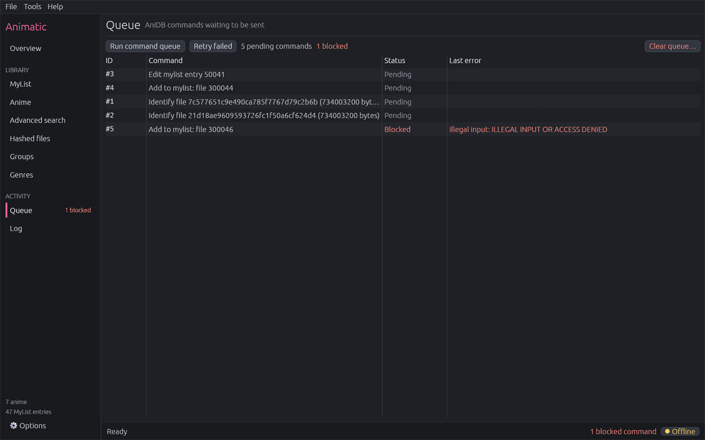
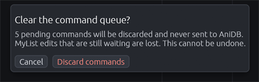
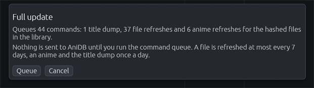
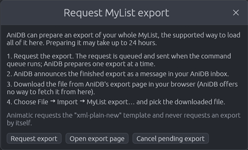
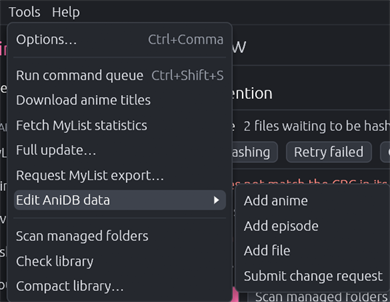

How local work reaches AniDB: which servers Animatic talks to, the command queue and its life
cycle, working offline, automatic runs, the full update, the request limits that protect your
account, and what happens when a command fails. Read it when you want to know *why* something
waits, or *when* it will be sent. For error messages and fixes, go to
[Network and sync problems](Network-and-Sync-Problems.md); for the everyday MyList tasks (edit,
add, remove), see [Managing MyList](Managing-MyList.md).

The limits and timings below are what the code enforces. The project has not recorded
verification against production AniDB traffic (see
[Feature parity](Feature-Parity.md#verification-status)), so treat the AniDB-side replies
described here as the documented protocol, not as observed behavior.

## How Animatic talks to AniDB

Animatic works **offline-first**. Hashing, browsing, searching and local MyList edits never touch
the network. Everything that needs AniDB is first saved as a *command* in the persistent
[command queue](#the-command-queue) and is sent only when the queue runs.

| What | Transport | Used for |
|---|---|---|
| AniDB UDP API (`api.anidb.net:9000`, setting `anidb.udp_server`) | UDP, one login session, optional encryption | Identifying files, MyList add/edit/remove/refresh, file, episode and group records, MyList statistics, the MyList export request |
| AniDB HTTP API (`api.anidb.net`, port 9001) | HTTP (plain, not encrypted; it carries no credentials) | The full record of one anime (titles, episodes, genres, relations, ratings). The request carries only the client name and version and the anime id: no user name or password |
| Anime title list (`anidb.net/api/anime-titles.xml.gz`) | HTTPS | **Tools → Download anime titles** and the full update |
| Cover pictures (the image server AniDB reports at login; `anidb.image_server`, default `cdn.anidb.net`) | HTTPS | The cover in the [anime detail window](Library-Pages.md#cover) |
| AniDB web pages | Your browser | The MyList export download and the [Edit AniDB data](#edit-anidb-data-menu) menu. Animatic does not fetch or submit anything there |

Update checks go to GitHub, never to AniDB; see [Updating Animatic](Updating-Animatic.md).

**Registered clients.** AniDB requires every program to register a client name. Animatic uses its
own two registered clients, `animatic` (UDP) and `animatichttp` (HTTP), both version 1. They are
built in: nothing is entered anywhere and old `client_name`-style keys in a settings file are
ignored. **Options → AniDB account** shows them in the line `AniDB client: …`. See
[client registration](First-Launch.md#anidb-client-registration).

**Account and encryption.** UDP needs your AniDB **Username** and **Password**. An **API key
(optional)** (set in your AniDB profile) makes Animatic ask for an encrypted UDP session before it
logs in; without one, the session is not encrypted. Where the password is stored is described in
[Settings files](Settings-Files.md#credentials-and-the-system-keystore).

**Local port.** AniDB replies to the UDP port you send from. Animatic always uses the port in
`anidb.local_port` (default `29456`); if it is busy, the run stops with an error naming that
setting (see [Network and firewall](Network-and-Sync-Problems.md#network-and-firewall)).

### Flood protection

AniDB bans clients that send too fast, and a ban lasts about half an hour. Animatic therefore
spaces its requests, and the spacing is shared by the whole program and saved to the database
*before* every request leaves:

| Traffic | Least gap between requests |
|---|---|
| UDP | 2 s for the first five packets of a burst, 4 s afterwards. After 10 idle minutes the burst allowance starts over |
| HTTP (anime records, the title list, cover pictures) | 2 s |
| Login (`AUTH`) without a reply | Waits 30 s, then 2 min, 5 min, 10 min, 30 min and 2 h on every further login that gets no reply (a successful login resets it) |

Two consequences you will notice: repeated **Run command queue** clicks share one burst
allowance, and closing and restarting Animatic cannot shorten the gaps (after a restart the gap is
still measured from the last saved packet, and the burst allowance counts as used up, so 4 s). A long queue takes a long time. That is not a hang.

### Sessions

UDP logs in lazily, when the first UDP command runs, and logs out when the run ends. AniDB
drops a session after 35 idle minutes. With **Run the command queue automatically** on, one login
is kept between runs; see [Automatic runs and the AniDB session](#automatic-runs-and-the-anidb-session).
On exit Animatic sends one `LOGOUT` and waits for it for about 8 seconds at most; it sends nothing
when you work offline or a cooldown is active.

## Synchronization

Network traffic happens only in the **Synchronizing with AniDB** job. You start it yourself, or
Animatic starts it for you when you switch on **Run the command queue automatically**
([below](#automatic-runs-and-the-anidb-session); off by default, so nothing runs on a timer unless
you ask for it).

### Before the first run

1. Open **Tools → Options…** and, on **AniDB account**, enter **Username** and **Password** and, if
   you want an encrypted session, the **API key (optional)** from your AniDB profile.
2. Clear **Work offline (keep commands queued)**.
3. Click **Save options**.

### Start a run

Any of these starts the same job:

- **Tools → Run command queue** (`Ctrl+Shift+S`).
- The **Run command queue** button on the **Queue** page.
- **Run command queue** in the tray menu, and the button on the [Overview](Library-Pages.md#needs-attention)
  next to `N commands wait to be sent to AniDB` (it reads **Go online** while you work offline).

The buttons are disabled during a settings import or review and while a cooldown is active (the
hover text then shows the cooldown). A manual run waits for the job in front of it (hashing, a scan, …)
to finish: Animatic runs one job at a time. While a run is going, the status bar shows the
command being sent, and **Cancel** stops the run after the command in flight (**Pause** has no
effect on it).

### What a run does

A run does this:

1. If **Work offline** is on, it logs `Offline mode is enabled; commands remain queued` and stops.
   The queue is unchanged.
2. If a persisted cooldown is active it logs how long remains (`AniDB sync is paused for another …`)
   and stops.
3. Otherwise it builds UDP and HTTP clients from the current in-memory settings and repeatedly runs
   the next unblocked command until the queue is empty, you cancel, a command stops the run or a
   cooldown begins. Every successful command is removed from the queue and logged
   (`known file F (anime A), mylist entry L`, `mylist entry updated`, `anime A updated`,
   `N titles downloaded (M new)`, …). It logs out of UDP at the end, unless automatic runs are on
   and the login is kept for the next run.
4. Requests keep the [flood spacing](#flood-protection), and UDP login is lazy (first UDP command).

### What each command does

| Command (as listed on the Queue page) | Effect on the local database |
|---|---|
| `Identify file …` | Stores AniDB's file record; optionally adds the file to MyList (a folder rule that adds files to MyList queues it as `Identify file … + add to mylist`) |
| `Edit mylist entry N` | Sends the merged state, watched, view date, storage, source and other changes; on success updates the local entry (keeping any newer pending edit on top) |
| `Add to mylist: …` | From **Hashed files → Add to MyList…**. An identified file is added by file id; an unidentified one by size and ED2K hash, which AniDB looks up first (a file it does not know is dropped with the log line `file unknown to AniDB`). A new entry is stored locally with the values you set; if the file is already in MyList the entry is refreshed and your values are applied as an edit. Until then **Hashed files** shows `Add queued` |
| `Remove mylist entry N` | From **MyList → Remove from MyList…** (after a confirmation dialog). Deletes the entry on AniDB. The local row is removed only after AniDB acknowledges (or says the entry no longer exists), and not at all if you queued something for the entry afterwards. Never touches your media file |
| `Refresh mylist entry N` | From **MyList → Refresh from AniDB**. Re-reads the entry and replaces the cached row, keeping edits that are still queued on top. If AniDB says the entry is gone, the row is removed unless changes for it are queued |
| `Fetch anime N` | Downloads the HTTP-API anime record: titles, episodes, genres (tags), relations, ratings including the review rating and count, metadata. Review texts are not part of it (they come only from an AOM import). At most once per anime per 24 hours (see [Request limits](#request-limits)) |
| `Fetch file N` | Updates a file record (from a full update, or from hashing an already identified file again with **Update known file information** on). At most once per file per 7 days |
| `Fetch episode N` | From the **Refresh** button of an episode in the [anime detail window](Library-Pages.md#anime-detail-window). Replaces the cached episode record |
| `Fetch group N` | From the **Refresh** link on the [Groups page](Library-Pages.md#groups). Replaces the cached group record |
| `Download anime title list` | Streams `anime-titles.xml.gz` into a temporary store, validates it, then merges atomically in one transaction (see [The anime title list](#the-anime-title-list)) |
| `Request MyList export from AniDB` | Sends `MYLISTEXPORT template=xml-plain-new`. Only from **Tools → Request MyList export…**; logs the answer (requested, already queued, or blocked as an unknown template). At most once per 24 hours. See [Full-account MyList import](#full-account-mylist-import) |
| `Cancel the queued MyList export` | Sends `MYLISTEXPORT cancel=1` (from the same dialog); logs that the export was canceled or that none was queued |
| `Fetch mylist statistics` | Stores AniDB's account figures with the time they arrived (replacing the previous ones) and shows them on the [Overview](Library-Pages.md#your-anidb-account) under **Your AniDB account**, apart from the local figures. The log line `N anime, N episodes, N files in mylist` is still written |

## The command queue

Everything you ask AniDB to do waits in the **command queue** first. It lives in the library
database, so it works offline and survives a restart. Open it with **Queue** in the sidebar (the
badge shows the number of pending commands, or a red `N blocked`). The page's controls are
listed in [Library pages](Library-Pages.md#queue); this section explains how commands move
through it.

*The Queue page of the sample library. The count `5 pending commands` includes the blocked one.*

### Life of a command

1. **Queued.** Each action that needs AniDB adds one row (an ID shown as `#n`, never reused).
   An identical command that is already queued (blocked ones count) is not added twice, and
   several edits of one MyList entry are merged into one row.
2. **Waiting.** Nothing is sent. Commands run in order of *priority*, then oldest first:

   | Priority | Commands |
   |---|---|
   | 0 | MyList writes: add, edit, removal |
   | 1 | `Identify file …` |
   | 2 | `Fetch file`, `Fetch episode`, `Fetch group` |
   | 3 | `Fetch anime`, MyList statistics, the title list, the MyList export and its cancel |
   | 4 | `Refresh mylist entry` |

   So your MyList changes go out before lookups, and bulk refreshes go last.
3. **Running.** A run takes the next unblocked command, sends it (respecting the
   [flood spacing](#flood-protection)) and applies the reply.
4. **Done.** On success the row is deleted and the result is logged. A command that a
   [request guard](#request-limits) skips finishes the same way (logged as skipped, no error).
5. **Failed.** What happens depends on the failure (see [Failure handling](#failure-handling)):
   the run stops and a cooldown starts, the command is retried later, or it becomes *blocked*.

The **Status** column shows where a command stands:

| Status | Meaning |
|---|---|
| `Pending` | Not tried yet, or deferred without a counted attempt (the last error may still be shown) |
| `1 retry`, `N retries` (yellow) | Tried and failed for a reason that may be the command's own; still runnable. After 5 counted failures it is blocked (`blocked after 5 failed attempts`) |
| `Blocked` (red) | Skipped by every run until you click **Retry failed** (permanent error, rejected credentials, or too many failures). The **Last error** column says why |

Blocked rows are listed last. A row whose stored command this version cannot read is kept,
blocked, as `Unreadable queued command: …`; Animatic never deletes it silently.

### Retry, run and clear

- **Retry failed** unblocks every blocked row with fresh attempts (edits of the same MyList entry
  are merged first). It does not send anything and does **not** bypass a cooldown. It is
  disabled while nothing is blocked (hover `No command has failed`).
- **Run command queue** sends what is runnable. See [Start a run](#start-a-run).
- **Clear queue…** (disabled while the queue is empty) opens a confirmation. **Discard commands**
  deletes *every* row: pending, blocked and unreadable. **Cancel**, `Esc` or a click outside
  discards nothing.

*The confirmation says the commands will be discarded and never sent, and that waiting MyList edits are lost.*

Clearing does not undo anything locally: a MyList edit you already made keeps showing on screen
even though AniDB will never receive it (see [MyList editing](#mylist-editing)).

### Where the queue shows up

| Where | What you see |
|---|---|
| Sidebar, **Queue** | The number of pending commands, or a red `N blocked` |
| Status bar, left | While a run goes: the command being sent. A failure is shown as `⚠ …` (click it to open the Log) |
| Status bar, right | The **Online** / **Offline** button; `AniDB sync paused until HH:MM:SS: reason` during a cooldown; `N blocked commands` (click to open the Queue); `N commands not saved yet` |
| **Overview → Needs attention** | `⚠ N commands could not be sent` (**Open queue**) and `N commands wait to be sent to AniDB` (**Go online** or **Run command queue**). Blocked commands are not counted in the second line; they appear in the first |
| MyList **Queue** column | `Edit queued`, `Removal queued`, or `Edit blocked` / `Removal blocked`; an anime row counts them, for example `1 queued, 1 removing, 1 blocked` |
| Hashed files **MyList** column | `Add queued` while an add waits |

`N commands not saved yet` means the database was busy with a background write when you asked, so
the command is held in memory and retried every half second until the database accepts it; see
[Network and sync problems](Network-and-Sync-Problems.md#database-busy-and-unsaved-commands).

## Working offline

**Work offline** keeps every command in the queue and sends nothing. Turn it on or off with the
**Online** / **Offline** button at the right of the status bar (a click switches and, unless the
settings were recovered from a backup, saves at once), or with **Work offline (keep commands
queued)** in **Options → AniDB account**.

While you work offline:

- Everything local still works: hashing, scanning, renaming, searching, MyList edits. Edits are
  queued and shown immediately.
- **Run command queue** stays clickable but only logs `Offline mode is enabled; commands remain
  queued`. Automatic runs are postponed.
- No session upkeep is sent, not even a logout (AniDB drops the session itself).
- The startup update check is skipped; **Help → Check for updates…** still works because you
  asked for it. See [Updating Animatic](Updating-Animatic.md#automatic-startup-check).
- Cover pictures are not requested.
- A recovered settings file always starts offline, and so does an applied
  [AOM settings import](Migrating-from-AOM.md#import-aom-settings), until you go online yourself.

Going back online sends nothing by itself unless automatic runs are on. Click **Go online** on the
Overview (or the status bar button), then **Run command queue**.

## Full update

A full update refreshes what AniDB already told you about. **Tools → Full update…**, or the
`--full-update` command-line option, queues:

- the anime title list,
- one `Fetch file` for each file id, and
- one `Fetch anime` for each anime id

that your **identified hashed local files** resolve to (not the whole local cache or the title
catalog). It does not run them. Commands already in the queue are not added twice.

*The confirmation of the sample library: the counts of what would be queued and the limits.*

1. Choose **Tools → Full update…**. Animatic works out the plan in the background. The menu item
   is disabled during a settings import or review and while a preview is open.
2. The **Full update** window says `Queues N commands: 1 title dump, N file refreshes and N anime
   refreshes for the hashed files in the library.` If limits keep something out it adds `Left out
   because AniDB's limits do not allow them yet: …` (the title dump with the time it is allowed
   again, `N anime requested within the last day`, `N files requested within the last 7 days`),
   then the reminder that nothing is sent until you run the queue.
3. Click **Queue** (disabled when there is nothing to queue) or **Cancel**.
4. Run the queue when you want. A large library means thousands of commands; the
   [flood spacing](#flood-protection) alone makes that hours of work, so leave it running or use
   [automatic runs](#automatic-runs-and-the-anidb-session).

A full update leaves out what AniDB's limits do not allow yet, so repeating it is harmless.

**Update known file information** (**Options → AniDB account**, off by default) is the small
version for single files. When a file the library already knows from AniDB is hashed again (Add
files, the command line or a scan), Animatic queues a `Fetch file` for it instead of looking it
up by hash again, unless that file was requested within the last 7 days (the log then says when it
is allowed). With the option off, hashing a known file again queues nothing; a file AniDB did not
know yet keeps the **Identify files with AniDB after hashing** path. A folder that adds files to MyList automatically
still queues `Identify` (which refreshes the record too) when **Identify files with AniDB after hashing** is on.

### The anime title list

The title list is AniDB's public dump of every anime title. It gives the Anime page and the
search something to work with before you have fetched any anime record.

- **Tools → Download anime titles** queues one `Download anime title list` command (it is
  not sent until the queue runs). If the list was requested in the last 24 hours it queues
  nothing and logs `Title dump skipped: …` with the time the next download is allowed.
- The run streams `anime-titles.xml.gz` into a temporary store, validates the XML and the
  single gzip member's end and checksum, and only then merges it into the library in one
  transaction (no library lock during the download). A failure or cancel leaves titles and the
  completion time untouched; there is no resume.
- The merge creates an anime row for every unknown id and replaces titles only of anime
  without a full HTTP record (imported AOM anime count as such).
- Limits: 32 MiB compressed, 128 MiB decoded, 250 000 anime, 2 000 000 titles, 2048 bytes per
  name. Log line on success: `N titles downloaded (M new)`.

## Automatic runs and the AniDB session

**Run the command queue automatically** (**Options → AniDB account**, `anidb.auto_run_queue`) is **off
by default**. With it off nothing is sent unless you start a run, and every run logs in when its
first command needs it and out when it ends. With it on, Animatic starts the same job for you:

- **When.** 30 seconds after the newest command was queued (a burst of edits becomes one run) and
  every 15 minutes for whatever is still waiting. Switching the option on counts the commands
  already queued as new. A queue holding nothing a run may send starts no run at all.
- **What.** The log shows `Automatic command queue run started` and the job is labelled
  **Synchronizing with AniDB (automatic run)**. Spacing, cooldowns, blocking and failure handling
  are exactly those of a manual run ([Request limits](#request-limits),
  [Failure handling](#failure-handling)), so a burst of new commands never goes out faster than
  AniDB allows. Blocked commands are not retried automatically: they wait for **Retry failed**.
- **MyList removals are never sent automatically.** A removal queued with **Remove from MyList…**
  stays queued until you click **Run command queue** on the **Queue** page or choose **Tools → Run command queue**; an
  automatic run sends everything else around it. The Queue page says so while the option is on
  and counts the removals that are waiting.
- **When it waits.** The run is postponed, with one log line (`Automatic command queue run
  postponed (reason); it starts when that is over`), while **Work offline** is on, an AniDB cooldown
  is active, the user name or password is not set (the queue is *not* blocked for
  that), another task is running, an import, settings review or restore is open, or changes are
  not saved to the database yet. It then starts by itself.
- **Settings** reach the background timer when Options is closed, not while you edit.

With the option on, **one AniDB login is kept between runs** (AniDB asks clients not to log in and
out around every command):

- Consecutive runs share one login. The session is logged out after
  `idle_logout_minutes` (Options: **Log out of AniDB when idle for** N **min**; default 10, from
  1 to 30) without a command, so it never reaches AniDB's 35 idle minutes. While commands that an
  automatic run would send are still waiting (the run was postponed or stopped), the session is
  kept instead, with a keep-alive command (`UPTIME`) at least every 30 minutes.
- A session that AniDB has already dropped (for example after a long hashing job) is forgotten
  without sending anything; the next run logs in again. A rejected session (`506`) is replaced by
  a new login, as before.
- **Behind a router.** The login reply tells which source port AniDB saw. Only when that differs
  from your local port, a `PING nat=1` is sent whenever 4 minutes pass without any packet (home
  routers forget a mapping after 5 to 15 minutes), until the logout. When the ports agree there
  are no pings. Pings are not commands: they do not postpone the idle logout.
- Every packet of this upkeep takes its place in the program-wide spacing like any other, and
  none is sent while **Work offline** is on or an AniDB cooldown is active, not even a logout (AniDB
  drops the session by itself).
- Switching the option off logs a kept session out as soon as nothing else is running. Changing
  the account, API key, server or port drops the session without a packet,
  and the next run logs in with the new values. A ban reply or a failed keep-alive forgets the
  session and starts the usual cooldown.
- **On exit** Animatic sends one `LOGOUT` and waits for it at most about 8 seconds. It sends nothing
  when offline or cooling down.

## Request limits

AniDB asks clients not to request the same data again and again, and bans those that do. Animatic
counts every request it **sends**, whether or not it succeeded, and saves the time *before* sending,
so a failed or interrupted request does not allow a quick second one:

| Request | Not sent again within |
|---|---|
| Anime title list (**Tools → Download anime titles**, full update) | 24 hours |
| One anime's details (anime detail **Refresh from AniDB**, full update) | 24 hours |
| One known file (`Fetch file`, full update) | 7 days (Animatic's own conservative choice; AniDB only asks clients to cache file data for long periods) |
| One anime's cover picture (anime detail window) | Never again once downloaded; 1 hour after a failed try (Animatic's own choice; AniDB publishes no image limits) |
| The MyList export (**Tools → Request MyList export…**) | 24 hours |

Inside the window the request is not sent and nothing is queued for it: the menu item or **Refresh
from AniDB** tells you when the next one is allowed (status bar and log). The messages read:

- `Title dump skipped: AniDB allows it once a day and it was requested recently. The next download is allowed after <time>`
- `Anime N skipped: AniDB asks for each anime at most once a day and it was requested recently. The next refresh is allowed after <time>`
- `File N skipped: it was requested from AniDB recently (known files are refreshed at most every 7 days). The next refresh is allowed after <time>`
- `MyList export not requested: one was requested recently and AniDB prepares it for up to 24 hours. A new request is allowed after <time>`

If such a command is already in the queue when it runs, it finishes as *skipped* (removed from the
queue, logged with the time it is allowed again) and is neither an error nor a counted attempt. This
includes a command whose first try failed: the failed try already used the window, so wait for the
time shown. Requests that are refused before anything is sent (a login that fails first) are not
counted.

Anime covers follow the same rules without going through the queue: the
[detail window](Library-Pages.md#cover) requests one picture from AniDB's image server when it opens
and the picture is not on disk yet. The request is paced with every other HTTP request (2 s), is not
sent offline or during a ban or cooldown, is not repeated for the same anime within an hour of a try
that failed, and a picture that arrived is never requested again. A ban answered to a cover request
pauses the queue for the same cooldown as any other ban. Clear **Download anime covers when a
detail window opens** (**Options → AniDB account**, `anidb.download_covers`) to never request them;
covers already on disk are always shown.

## MyList editing

On **MyList**, changing **State** or toggling **Watched**, or saving the **Edit…** dialog (state,
watched, view date, storage, source, other), is a *local-first* edit. The steps to do it are in
[Managing MyList](Managing-MyList.md); this section is what happens underneath.

1. In one database transaction the edit is saved to the queue **and** the stored MyList entry is
   updated, so the row shows the new value immediately (even before the next snapshot) and
   the change survives restarts.
2. The edit is sent to AniDB only when the queue runs (priority 0, ahead of lookups).
3. Further edits of the same entry before that are **merged** into one fresh queue row with a new,
   never-reused id: unset fields keep the older value, and the last watched/unwatched choice wins
   (watched → unwatched → watched ends watched at the latest time). Marking watched stamps the
   time of your click, not the time AniDB hears of it; unmarking clears the date. A field the
   editor sent as an empty string (ticked, empty) is a real value that clears it on AniDB and
   stays in the merge; a field you did not tick is simply absent.
4. When AniDB acknowledges, the local entry is rewritten with the acknowledged values **plus** any
   newer pending edit. An acknowledgement or reply for an older command cannot erase newer
   intent. Queued edits that can be read are re-applied over AniDB data fetched meanwhile, so it
   cannot overwrite an entry that still has them. A queue row this version cannot read is kept
   (blocked) but cannot be overlaid, so remote values may replace the local ones for its entry.
5. A malformed "success" reply is a protocol error, never evidence that something was deleted.

Failures and edge cases:

- *No such entry on AniDB:* the edit is kept and **blocked** with an explanation (the local entry
  stays). Use **Refresh from AniDB** on the entry or empty the queue with **Clear queue…**, then **Retry failed**.
- Permanent errors block the one edit; transient errors pause the queue ([below](#failure-handling));
  authentication problems block everything until fixed.
- **Clear queue…** deletes every queue row, the pending edits among them. Nothing restores the
  previous local values, so the screen keeps showing the edit even though AniDB will never receive
  it. A later AniDB refresh of that entry may overwrite it, because no queued change remains to protect it.
- If the database is locked by a background write the edit is refused with a visible message;
  repeat it.
- An entry with a queued removal ignores edits (`Mylist entry N is pending removal; edit
  ignored`); the editor says so and its **Save** is disabled. **Remove from MyList…** queues the
  removal (and discards the entry's queued edits, which are moot). The local row stays and shows
  `Removal queued` until AniDB acknowledges; a removal that fails permanently stays queued and
  blocked (`Removal blocked`, last error on hover) and the row is kept, until you **Retry failed**
  or clear it. If the removal left the queue while it was being sent (for example **Clear queue**
  during a run) and you then edit the entry, that newer edit wins: the acknowledgement does not
  delete the row.

## Full-account MyList import

AniDB has no way to hand a client its whole MyList, and asking for the entries one by one is the
bulk extraction its rules forbid. The supported way is a **MyList export**: AniDB prepares a file
on request, and Animatic imports that file. Nothing here runs by itself; each step is yours.
The task-style walkthrough, with the windows, is in
[Managing MyList](Managing-MyList.md#load-your-whole-mylist-with-an-export).

1. **Request the export.** **Tools → Request MyList export…** explains the steps and queues the
   request (UDP `MYLISTEXPORT`, template `xml-plain-new`). Like every queued command it is sent
   only when you run the command queue, with **Work offline** cleared. AniDB prepares **one export
   at a time**, and **may take up to 24 hours**. Animatic allows one request per 24 hours (the
   dialog then says when the next one is allowed, and **Request export** is disabled).
2. **Wait for AniDB's message.** AniDB announces the finished export as a message in your AniDB
   inbox. Animatic does not poll for it.
3. **Download the file.** Open [AniDB's export page](https://anidb.net/perl-bin/animedb.pl?show=export)
   (the dialog's **Open export page** button opens it in your browser) and save the export.
   AniDB documents no way to fetch it from a program, so Animatic does not try.
4. **Import it.** **File → Import → MyList export…** and pick the downloaded file (an archive
   `.tgz`/`.zip`/`.tar`, a compressed `.gz` or a plain `.xml`; the kind is recognized from the content).

What AniDB answers to the request:

| Answer | What Animatic does |
|---|---|
| Queued (`217`) | Logs that the export was requested and when to expect it; the command leaves the queue |
| Already queued (`318`) | Logs that an export is already on its way. This is **not an error**, nothing is retried and the rest of the queue goes on |
| Unknown template (`317`) | Blocks that one command with the reason (a retry cannot succeed); the rest of the queue goes on |

**Cancel pending export** in the dialog queues a cancellation (`cancel=1`) of the export AniDB
has queued; it does not undo the 24-hour wait for a new request.

The import reads the file on its own, never touching AniDB. It is **all or nothing**: the file is
checked completely first (size and entry limits, a well-formed document, valid ids, hashes and
dates), and only then written in a single step. A truncated, damaged, too large or unrecognized
file is refused with a message naming the problem, and your library is exactly as it was.
Cancel works while the file is read and during the final step, with the same result. The file may
hold up to 256 MiB (1 GiB decoded), 100 000 archive entries, 250 000 anime and 5 000 000 files.

How the file is merged:

- **Pending changes win.** A MyList entry with a queued add, edit or removal is not touched; the
  log says how many entries were kept for that reason.
- **Nothing is deleted.** Entries in your library that are not in the export stay; the log only
  counts them. The export is a snapshot (up to a day old), so a missing entry is no proof that
  it is gone. Remove entries with **Remove from MyList…**.
- **Richer local data stays.** Missing anime, episodes, files and groups are created; known ones
  only get empty fields filled. An existing MyList entry takes the export's state, watched flag
  and view date, plus the date added and storage text when the export has them; its other
  values stay. An entry that your library keeps for a different file is left alone.
- **Repeatable.** Importing the same file again changes nothing.
- Anime that are only on your wishlist (no files) are skipped.

The log line on success reads `MyList export imported: N entries in N anime (N added, N updated,
N unchanged)`, followed by `; N kept because of queued changes`, `; N left alone because they name
another file`, `; N library entries are not in the export and were kept` and `; N anime without
files were skipped` where they apply. A failure reads `MyList export not imported, the library was
not changed: …`; a cancel reads `MyList export import cancelled; the library was not changed`.

The accepted file layout is listed in
[the storage reference](https://github.com/RetroHazard/animatic/blob/main/docs/storage-and-network.md#mylist-export-import).
Because AniDB's own example files may not be downloaded for this project, the layout follows
what third-party tools read; Animatic has **not** been checked against a real `xml-plain-new`
file. If AniDB's file differs, the import stops with a message naming the first element it
could not use, and nothing changes. See
[Network and sync problems](Network-and-Sync-Problems.md#the-library-is-missing-entries).

## Edit AniDB data menu

Animatic does not send changes to AniDB's shared anime, episode or file data. The metadata
editors on AniDB's website are the supported way, so **Tools → Edit AniDB data** just opens them
in your browser:

| Item | Opens |
|---|---|
| **Add anime** | `https://anidb.net/anime/add` |
| **Add episode** | `https://anidb.net/episode/add` |
| **Add file** | `https://anidb.net/file/add` |
| **Submit change request** | `https://anidb.net/creq` |

Hover shows `Opens the AniDB website`. Sign in to AniDB in the browser as you normally would;
Animatic sends no credentials. If the browser cannot be started, the log shows `Could not open AniDB: …`.
After the change is accepted on AniDB, bring it into Animatic with **Refresh from AniDB** in the
[anime detail window](Library-Pages.md#anime-detail-window) (the 24-hour anime limit applies) or
with a [full update](#full-update).

## Failure handling

How the queue reacts to each kind of failure:

| Situation | Reaction |
|---|---|
| Ban (UDP 510/555; HTTP ban text) | Entry kept, **no attempt counted**, queue stops, cooldown **30 minutes** (persisted) |
| Rejected credentials, missing user name/password, outdated client (UDP 503) or **banned client version (UDP 504)** | **Every** unblocked command is blocked with the reason; the queue stops; no cooldown. Fix the credentials, **Save options**, **Retry failed**, run again. For 503/504 AniDB refuses Animatic's built-in client registration: update Animatic (a release carries a newly registered client version), or report it if you already run the latest release |
| HTTP client rejection | Only the HTTP commands (anime records) are blocked; UDP commands keep running. Same remedy as for 504 |
| Network/DNS/timeout, AniDB "unavailable" | Queue stops; cooldown 60 s (or the server's stated wait); not counted as an attempt |
| No reply to the login (`AUTH`) | Queue stops; cooldown **30 s, then 2 min, 5 min, 10 min, 30 min and 2 hours** on every further login without a reply (the step is saved, so a restart continues it; a successful login resets it); not counted as an attempt |
| UDP server errors 600/601/602/604 | 604 → 60 s cooldown; the others 30 minutes. Only error 600 and HTTP responses with an error status count toward the attempt limit |
| Storage I/O or database errors while applying a reply | Treated as transient: 60 s cooldown, counted |
| Attempt limit | After 5 counted failures a command is blocked (`blocked after 5 failed attempts`) |
| Permanent errors (illegal input, protocol/XML problem, unexpected reply, unknown command) | Only that command is blocked; the queue continues |

What you see: the status bar shows the failure as `⚠ <command>: <message>`; the Log has the same
line; a block adds `Command blocked: <command> blocked: <reason>` (or `N queued commands blocked:
<reason>`); a cooldown adds `AniDB sync paused until HH:MM:SS: <reason>` to the status bar and the
Queue page.

Cooldowns are stored in the database and survive restarts. **Retry failed** does
not clear them; **Run command queue** is disabled until the shown time passes. Blocked rows stay
visible with their last error until you retry, clear or the underlying problem is fixed.

## See also

- [Managing MyList](Managing-MyList.md): the MyList tasks that fill the queue.
- [Network and sync problems](Network-and-Sync-Problems.md): messages, bans and fixes.
- [Library pages](Library-Pages.md#queue): every control on the Queue page.
- [Options window](Options-Window.md) and [Settings reference](Settings-Reference.md#anidb-account): the AniDB account options.
- [Glossary](Glossary.md): AniDB ids, ED2K, command queue, cooldown.
