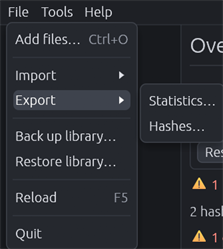
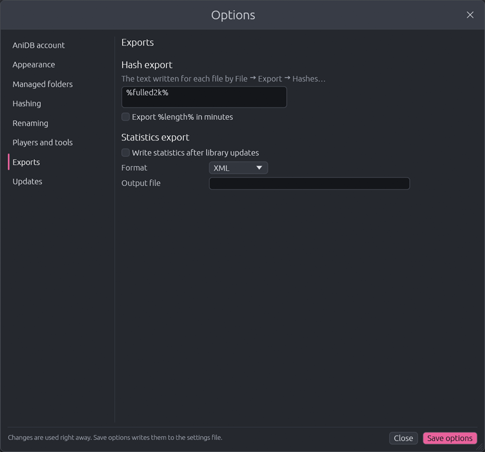

Animatic writes two kinds of files for other tools: a **statistics report** about your library (XML or INI) and a **hash export** with one line per hashed file (ED2K links, file lists, hashes, whatever your template says). This page shows how to produce each, what the options mean, every template token, and how the files are written safely. Their stored keys are also in the [Settings reference](Settings-Reference.md#hash-export-template-tokens).

*The **File → Export** submenu offers **Statistics…** and **Hashes…**.*

Both exports run in the background, so the window stays responsive; only the file dialog opens in the foreground. Neither export contacts AniDB. The result appears in the Log.

## Export options

**Options → Exports** holds the template and the statistics settings.

*The **Exports** category with its defaults: the template `%fulled2k%`, statistics export off, format XML.*

| Control | Default | What it does |
|---|---|---|
| **Hash export** text box | `%fulled2k%` | The text written for each file by **File → Export → Hashes…**. It may contain tokens (below), any other text and line breaks. An empty box also writes `%fulled2k%`. The gray hint inside an empty box is `%filename% %size% %fulled2k%` (an example, not the default). |
| **Export %length% in minutes** | off | `%length%` becomes whole minutes instead of whole seconds. |
| **Write statistics after library updates** | off | Rewrites the statistics file automatically (see [Automatic export](#automatic-export)). |
| **Format** | `XML` | `XML` or `INI`, for the manual and the automatic export. |
| **Output file** | empty | The file the automatic export writes. Not used by **File → Export → Statistics…**, which asks for a file every time. |

Changes are used right away; **Save options** writes them to the settings file.

## Statistics export

The statistics report is a one-way summary of your library, in the same shape the statistics export of AniDB O'Matic (AOM) used.

### Create a statistics file

1. Optional: open **Tools → Options… → Exports** and choose the **Format** (`XML` or `INI`).
2. Choose **File → Export → Statistics…**.
3. In the save dialog, pick a folder and a file name. The suggested name is `animatic-stats.xml` or `animatic-stats.ini`, following the format. Canceling the dialog does nothing.
4. Wait for the Log to say `Exported statistics to <path>`.

If anything fails the Log says `Statistics export failed: …` and the previous file, if any, stays as it was. All figures are read from one consistent database snapshot; if any query fails, the export fails with an error and writes nothing (it never writes zeros). The file is written to a temporary file next to the target and renamed over it (see [Safe replacement](#safe-replacement)).

### Automatic export

If **Write statistics after library updates** is on and **Output file** is not empty, the file is rewritten every time a library snapshot is loaded (after hashing, syncing, edits, refreshes, startup), replacing it. Failures log `Automatic statistics export failed: …` (and repeat on every library refresh until fixed); a successful automatic export is silent, so look at the file's date to confirm it ran. Parent folders are created. Automatic export uses the current Options values at once, before you click **Save options**.

### What the report contains

The report contains:

- **AniDB totals in your database:** anime, episodes, files, groups, total size, total length.
- **MyList totals:** anime, episodes, files, size, anime watched, anime partially watched, episodes watched, files watched, watched size, length, watched length.
- **Seven anime-type groups** (`tvseries`, `tvspecials`, `movies`, `ovas`, `web`, `other`, `unknown`), each with total, in MyList, all watched, part watched, size, length and watched length.
- **Four MyList-state groups** (`unknown`, `onhdd`, `oncd`, `deleted`), only when MyList is not empty. The state *Remote/Shared* is not reported.

Lengths are seconds; sizes are bytes. Lines end with CRLF.

| Format | Layout |
|---|---|
| XML | `<stats>` with `<anidb>` and `<mylist>`, the type groups as `<animetype type="…">` and the states as `<status type="…">`. |
| INI | Sections `[anidb]`, `[mylist]`, `[animetypeTVSeries]` … `[animetypeUnknown]` and `[statusUnknown]` … `[statusDeleted]`. |

Both formats contain your **AniDB username** (XML-escaped; INI verbatim). Treat the file as personal data and do not post it publicly.

## Hash export

### Create a hash export

1. Optional: set the template in **Tools → Options… → Exports → Hash export**. Leave it as `%fulled2k%` to get one `ed2k://` link per file.
2. Choose **File → Export → Hashes…**.
3. In the save dialog pick a folder and a name. The suggested name is `animatic-hashes.txt`. Canceling does nothing.
4. Wait for the Log to say `Exported N hashes to <path>`.

The export covers **all** hashed files, in path order. Search filters and the selection on **Hashed files** are ignored. If nothing is hashed yet the file is written empty and the Log says `Exported 0 hashes to <path>`. On failure the Log says `Hash export failed: …`. The file is replaced safely (see [Safe replacement](#safe-replacement)). Every line ends with CRLF; a line break you type in the template also becomes CRLF. The file is UTF-8 without a byte-order mark.

### Template tokens

Tokens are replaced sequentially in this order; text that is not a token is left as is, and a token you misspell is written literally. File names are inserted as they are, so a name that itself contains a token such as `%md5%` is expanded as well:

| Token | Value |
|---|---|
| `%filename%` | File name |
| `%filepath%` | Full stored path |
| `%ed2k%`, `%md5%`, `%sha1%`, `%crc32%` | Hash (ED2K lowercase; MD5/SHA-1/CRC32 uppercase; CRC32 zero-padded to 8) |
| `%size%` | **Human-readable** size such as `1.00 MB`, not a byte count |
| `%fulled2k%` | `ed2k://\|file\|<name>\|<bytes>\|<ed2k>\|/` |
| `%fps%` | Frames per second of the video stream, two decimals (`23.98`); constant `0.00` without data |
| `%length%` | Duration in whole seconds, or whole minutes (rounded) when **Export %length% in minutes** is on; empty (seconds) or `0` (minutes) without data |
| `%height%`, `%width%` | Video resolution in pixels; constant `0` without data |
| `%vcodec%`, `%acodec%` | `ffprobe` codec name (`h264`, `hevc`, `aac`, `flac`…); empty without data |
| `%vbitrate%`, `%abitrate%` | Bitrate in kbit/s, two decimals; constant `0.00` without data |
| `%asample%` | Audio sample rate in Hz; constant `0` without data |

`%size%` uses 1024-based units and about three significant digits (`512 bytes`, `1.39 GB`, `12.3 MB`, `980 MB`). For the exact number of bytes use `%fulled2k%`, which carries it.

Examples, with the sample library's invented names:

| Template | One line of the result |
|---|---|
| (empty) or `%fulled2k%` | `ed2k://\|file\|[NJF] Lanterns of Kiriyama - 01 [D7E2987E].mkv\|<bytes>\|<ed2k hash>\|/` |
| `%filename% %size% %crc32%` | `[NJF] Lanterns of Kiriyama - 01 [D7E2987E].mkv 980 MB D7E2987E` |
| `%filepath%;%md5%` | `S:\Anime\Lanterns of Kiriyama\[NJF] Lanterns of Kiriyama - 01 [D7E2987E].mkv;<md5>` |

The media tokens are filled only for files whose [media properties](External-Tools.md#media-properties-ffprobe) were read with the optional `ffprobe` tool (**Options → Players and tools → Media properties**, off by default). Each token falls back to its constant when the file was never read, has no such stream or `ffprobe` reported no value (an audio-only file has no `%width%`). Figures read before a file was hashed again to different content are ignored. See also the [settings reference](Settings-Reference.md#hash-export-template-tokens).

## Safe replacement

Both exports write the complete content to a temporary file in the target's folder (`.<name>.<numbers>.tmp`, hidden on Linux by its leading dot), flush it to disk and then rename it over the target. If the write or the rename fails (for example the disk is full, the folder is not writable or the target is a folder), the temporary file is deleted and an existing target file is left as it was; you never get a half-written export from a failed run. A crash can at worst leave a stray `.<name>.*.tmp` file, which is safe to delete. The statistics export creates missing parent folders; the hash export needs an existing folder (the file dialog provides one).

## If something goes wrong

- `Hash export failed: …` or `Statistics export failed: …`: the message names the cause (a read-only folder, a full disk, a locked target). The old file is intact. See [File and import problems](File-and-Import-Problems.md).
- A line shows `0`, `0.00` or an empty value for a media token: that file has no media properties. Enable **Read media properties after hashing** and use **Read missing properties now** ([External tools](External-Tools.md#media-properties-ffprobe)).
- A line contains `%something%` literally: the token is not on the list above.

## See also

- [Settings reference](Settings-Reference.md#hash-export-template-tokens) for the stored keys.
- [External tools](External-Tools.md#media-properties-ffprobe) for media properties.
- [Main window](Main-Window.md) for the File menu.
- [Migrating from AOM](Migrating-from-AOM.md) if you used AOM's exports.
