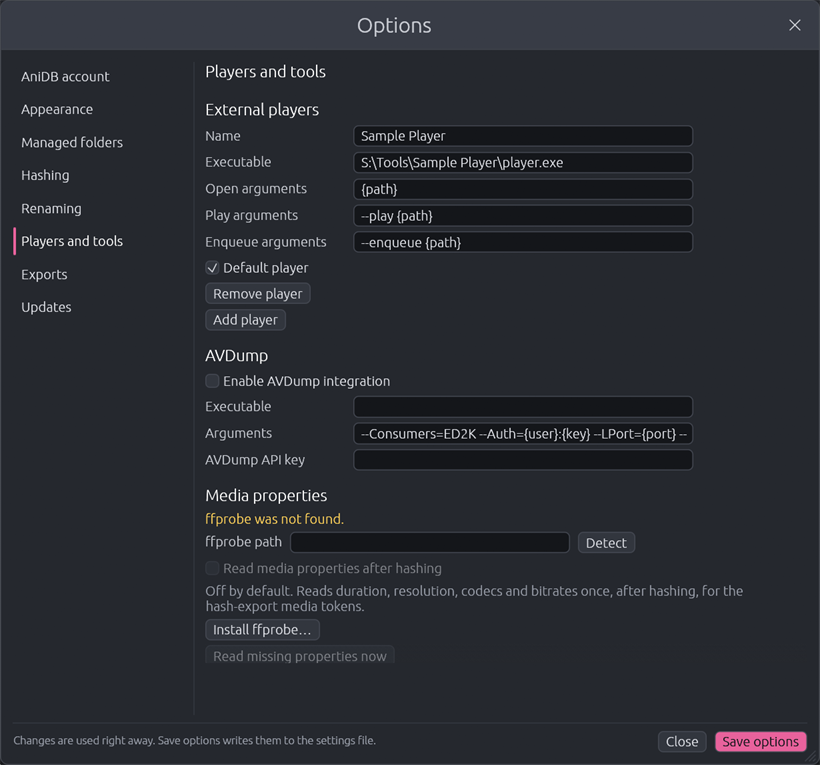
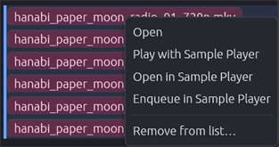
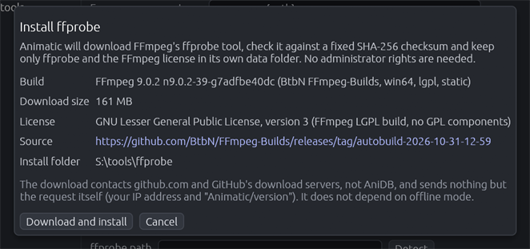

Animatic can start three kinds of outside programs: **media players** (to watch, open or queue a hashed file), **AVDump** (AniDB's file analysis tool) and **ffprobe** (to read duration, resolution and codecs for the hash export). All three are optional and off or empty by default; Animatic starts nothing until you configure it and click. All three live on one page, **Tools → Options… → Players and tools**.



*The **Players and tools** category of the Options window: **External players**, **AVDump** and **Media properties** sections. In this sample profile no `ffprobe` was found yet.*

## Players

Each player has the fields below. **Add player** appends a blank block; **Remove player** deletes the block it sits in.

| Field | What it holds |
|---|---|
| **Name** | The label shown in the player chooser when you have several players. An unnamed player appears as `Player N` (its position in the list). |
| **Executable** | The program to start: a full path (for example `S:\Tools\Sample Player\player.exe`) or a program name that is found on your `PATH`. Empty gives an error when you use the player. |
| **Open arguments** | Arguments for **Open in player**. Leave empty to hide that action for this player. |
| **Play arguments** | Arguments for **Play**. Without `{path}` or `%file%` the file is appended as the last argument. An empty box just passes the file. |
| **Enqueue arguments** | Arguments for **Enqueue**. Leave empty to hide that action for this player. |
| **Default player** | The player used until you pick another in the chooser. Ticking it makes this player the only default. If none is marked, the first one is the default. |

### Set up a player

1. Open **Tools → Options… → Players and tools** and click **Add player**.
2. Type a **Name** (`Sample Player`) and the **Executable** (the full path of the player's program).
3. In **Play arguments** type what the player needs to play a file, with `{path}` where the file belongs: `--play {path}`. If your player just takes a file name, leave the box empty.
4. Optional: fill **Open arguments** and **Enqueue arguments** (for example `--enqueue {path}`) to get those actions too.
5. Click **Save options**.

Check it: select a file on **Hashed files** and click **Play**. The player starts with the file. If it does not, the status bar shows an error such as `Could not start player: …` (see [If something goes wrong](#if-something-goes-wrong)).

### Using players on Hashed files

With a file selected on **Hashed files**:

- **Play** starts the chosen player with its **Play arguments**. The button is always shown. With no player configured it reports `No external player is configured`.
- **Open in player** and **Enqueue** start it with its **Open arguments** or **Enqueue arguments**. They appear only for a player whose template for that action is not blank, so a player that only plays shows just **Play**.
- With **several players** configured, a chooser next to **Play** picks the player for all three actions (the **Name** of each player). It starts on the player marked default, else the first, and goes back to that whenever you remove a player. The choice lasts for the session and is not saved.
- **Open file** (the toolbar button) opens the file with your system's default program for its type. It does not use a configured player.
- A double-click on a path in the **Path** column does the same as **Open file**.



*Right-click a file name: **Open**, **Play with Sample Player**, **Open in Sample Player**, **Enqueue in Sample Player** and **Remove from list…**.*

Right-clicking a file name opens a menu with the same actions for the chosen player: **Open** (the system default program, the same as **Open file**), **Play with …**, **Open in …** and **Enqueue in …** (the last two only when the player defines them), then **Remove from list…**. A right click on a file outside the current selection selects it first. **Remove from list…** only forgets Animatic's records; it never deletes the file.

### Argument tokens for players

| Token | Replaced by |
|---|---|
| `{path}` | The full path of the selected file. |
| `%file%` | The same; accepted for AOM-style templates. |

There are no other tokens for players. If a player's template contains neither token, the file is **appended as one more argument**. Examples:

| Play arguments | Command that is started |
|---|---|
| (empty) | `player.exe "S:\Anime\Lanterns of Kiriyama\[NJF] Lanterns of Kiriyama - 01 [D7E2987E].mkv"` |
| `--play {path}` | `player.exe --play "<that path>"` |
| `--start 0 /play "%file%" --close` | the arguments `--start`, `0`, `/play`, the path, `--close` |

## AVDump

**AVDump** is AniDB's separate tool that analyzes a file and prints its hashes. Animatic does not include it: download it from AniDB, then fill in:

| Field | What it holds |
|---|---|
| **Enable AVDump integration** | Off by default. The **AVDump** button on **Hashed files** is grayed out until this is on and a file is selected (hover text: `Turn on AVDump in Options, Players and tools`). |
| **Executable** | The path of the AVDump program. |
| **Arguments** | The argument template. |
| **AVDump API key** | Your AniDB UDP API key for AVDump (the old "AVDump password"). It is kept in the system keystore where one is available, like the other credentials. The box shows the key as plain text while you edit it. |

The default arguments are:

```
--Consumers=ED2K --Auth={user}:{key} --LPort={port} --PrintEd2kLink "{path}"
```

Placeholders in AVDump arguments:

| Token | Replaced by |
|---|---|
| `{path}` | The file. |
| `{user}` | The AniDB username from **Options → AniDB account**. |
| `{key}` | The **AVDump API key**. |
| `{port}` | The AniDB local UDP port (`anidb.local_port`, default `29456`; it is not shown in Options). |

Unlike players, AVDump never gets the file appended automatically: put `{path}` in the arguments. An empty **Executable** gives `Could not start AVDump: external executable is not configured`, and a disabled integration `Could not start AVDump: AVDump integration is disabled`.

### How arguments are built

The template is split into words with POSIX-shell rules first (spaces separate words; `'…'`, `"…"` and `\` quote; `#` starts a comment), then the placeholders are substituted inside each word, and the program is started directly, without a shell. For a player whose arguments do not contain a path placeholder the file is **appended as one argument**. Consequences:

- A path, username or key with spaces, quotes or option-like text always arrives as part of the one argument that held its placeholder; it cannot add or split arguments. Quoting a placeholder is unnecessary.
- A backslash typed into the template escapes the next character, except inside single quotes. Inside double quotes only `\"`, `\\`, `\$` and `` \` `` are escapes, so a Windows path in double quotes works unless it ends in `\` just before the closing quote. Substituted values are never affected.
- Unbalanced quotes are rejected: `invalid external command arguments: …`.
- Animatic does **not** wait for, capture or import the program's output: the ED2K link AVDump prints is not shown or stored by Animatic (a console program may open its own console window while it runs). The arguments, including your API key, are part of the program's command line, which other programs on your computer can usually read.

More examples and the stored-field details: [settings reference](Settings-Reference.md#external-command-templates).

### If something goes wrong

| Message | Cause |
|---|---|
| `No external player is configured` | **Play** or another player action with an empty player list. |
| `Could not start player: player executable is not configured` | The player's **Executable** is empty. |
| `Could not start player: this player has no open arguments configured` (or `enqueue`) | The action's template is blank. |
| `Could not start player: invalid external command arguments: …` | Unbalanced quotes in the template. |
| `Could not start player: …` followed by an operating-system message | The program was not found or could not be started. Check the **Executable** path. |
| `Could not start AVDump: …` | The same checks for AVDump (see above). |

## Media properties (ffprobe)

Animatic can read the duration, resolution, frame rate, codecs, sample rate and bitrates of your hashed files with **`ffprobe`**, the media-inspection tool of [FFmpeg](https://ffmpeg.org/). It is **optional and off by default**: nothing is read and no process is started until you enable **Read media properties after hashing** in **Options → Players and tools → Media properties**, and that checkbox stays disabled until an `ffprobe` is found. The values fill the media tokens of the [hash export](Exports.md#hash-export) (`%fps%`, `%length%`, `%height%`, `%width%`, `%vcodec%`, `%vbitrate%`, `%acodec%`, `%asample%`, `%abitrate%`); they are not shown elsewhere and do not change the [rename objects](Rename-Functions-and-Objects.md). Animatic parses no media itself.

### Turn it on

1. Open **Tools → Options… → Players and tools** and look at **Media properties**. While Animatic searches, it shows `Looking for ffprobe…`. When it finds one it shows `ffprobe <version> (<source>)` and the path; otherwise `ffprobe was not found.`
2. If none was found, either click **Install ffprobe…** (below) or type an **ffprobe path** and click **Detect**.
3. Tick **Read media properties after hashing**. The line under it says `Off by default. Reads duration, resolution, codecs and bitrates once, after hashing, for the hash-export media tokens.`
4. Click **Save options**.
5. For files you hashed earlier, click **Read missing properties now** (enabled when `ffprobe` is found and the checkbox is on).

### Where Animatic looks for ffprobe

Options shows the version it found, which of the places it came from (`configured path`, `installed by Animatic` or `found on PATH`), and its path:

| Order on Windows | Order on Linux |
|---|---|
| 1. The **ffprobe path** in Options (an executable, or the folder that holds it) | 1. The **ffprobe path** in Options |
| 2. Animatic's own copy, `tools\ffprobe\ffprobe.exe` in the [data folder](Data-Locations.md#where-data-lives) | 2. An `ffprobe` on `PATH` (a distribution package is preferred when present) |
| 3. An `ffprobe` on `PATH` | 3. Animatic's own copy, `tools/ffprobe/ffprobe` |

A candidate counts only if `ffprobe -version` answers with an `ffprobe version …` line. A path in Options that is not usable is reported under the version line and the search goes on. Entries of `PATH` that are not absolute are ignored. The search runs in the background when Animatic starts, with **Detect**, and after **Save options** changed the path.

### Install ffprobe…

**Install ffprobe…** downloads a pinned FFmpeg build for you, after you confirm. The button is offered on 64-bit Windows and 64-bit Linux only; elsewhere Options says `A download is only offered for 64-bit Windows and Linux. Install ffprobe yourself and set its path.`



*The confirmation lists the build, the download size, the license, the source page and the install folder.*

1. Click **Install ffprobe…**.
2. Read the window **Install ffprobe**: **Build**, **Download size**, **License**, **Source** and **Install folder**.
3. Click **Download and install**, or **Cancel**.
4. The Log says `Downloading ffprobe…` and a progress bar `Downloading ffprobe: X of Y` shows the download; **Cancel download** stops it. When it finishes the Log says `ffprobe <version> is ready (<path>)` and Options shows the new tool.

The pinned build (the values are compiled into Animatic; for developers, [the source](https://github.com/RetroHazard/animatic/blob/main/crates/animatic-core/src/media/install.rs) holds them):

| | Windows (x86-64) | Linux (x86-64) |
|---|---|---|
| Build | FFmpeg 9.0.2, `n9.0.2-39-g7adfbe40dc` (BtbN FFmpeg-Builds, win64, lgpl, static) | the same release, `linux64` |
| Archive | `.zip` | `.tar.xz` |
| Exact size | 168,715,328 bytes (shown as 161 MB) | 136,027,168 bytes (shown as 130 MB) |
| SHA-256 | `9d37c564e0d01c18cde184a079fa6ef04d7d2783ada41da81d04165cc8f1a650` | `6046d6731b26f58887e953561551d254a6eec9fbca4100dfeab56e19af8328d5` |
| Source page | the BtbN release `autobuild-2026-10-31-12-59` on GitHub | the same |
| License | GNU Lesser General Public License, version 3 (FFmpeg LGPL build, no GPL components) | the same |

What the install does:

- Contacts `github.com` and GitHub's download servers only (`github.com`, `release-assets.githubusercontent.com`, `objects.githubusercontent.com`; HTTPS, at most 5 redirects), never AniDB, anonymously: GitHub sees your IP address and `Animatic/<version>`; nothing about your library is sent. It works even with **Work offline** on, because you asked for it. The download is bounded in size and has a 30 minute limit, and **Cancel download** stops it. A failure shows `ffprobe was not installed: <reason>` in the Log and under the button.
- The build is [BtbN's FFmpeg-Builds](https://github.com/BtbN/FFmpeg-Builds) static **LGPL** build (no GPL components). Animatic checks the exact size and the SHA-256 checksum of the download against values built into the program and refuses anything else **before it opens the archive**. That proves it is the pinned file; it does not authenticate the publisher.
- It keeps only `ffprobe` and the FFmpeg license, `LICENSE-ffmpeg.txt`, in `tools/ffprobe/` of the data folder (the confirmation shows the exact folder); every other file in the archive is skipped without being written. It needs no administrator rights, and it never touches `PATH`. The release archives of Animatic do **not** contain `ffprobe`.
- If you cancel, the Log says `ffprobe download cancelled`. If the unpacked program does not start on your system, the Log and Options say `ffprobe was not installed: the downloaded ffprobe does not start on this system (…)`.
- Installing again replaces the two files. To remove the tool, delete the `tools/ffprobe` folder (and untick the option). A newer pinned build arrives with a newer Animatic; installing again then upgrades the copy.
- On Linux the button stays available even when a distribution `ffprobe` exists, which is preferred over the download. The project records no runtime verification of the Linux download or install.

### When files are read

After a hashing or scan job finishes, a separate background job probes the files that job hashed (progress shows as `Reading media properties`; **Cancel** stops it). Hashing itself never reads the file a second time for this. If the first search for `ffprobe` is still running at that moment, the files wait for its answer.

Files that were hashed before you enabled the option are read with **Read missing properties now**, which probes every hashed file without figures for its current content. When the job ends the Log says `Read media properties of N of M files` (with `(cancelled)` or `; ffprobe could not be started` when that applies). A database failure during the job is logged as `Media properties: <reason>`.

Each probe runs `ffprobe -v error -protocol_whitelist file -print_format json -show_format -show_streams -i <file>` directly (no shell, and on Windows without opening a console window, like the `ffprobe -version` check) with a 60 second limit and at most 4 MiB of output, and may open only local files: a playlist that points at a network address is not followed.

- A file `ffprobe` cannot read is logged (`Media properties of <path>: ffprobe could not read the file …`) and recorded as tried, so it is not tried again. A file that is not there (for example an unplugged drive), a timeout or an unstartable `ffprobe` are logged but not recorded.
- The figures belong to the file's content: renaming or moving a file keeps them, hashing the file again to different content discards them until it is read again, and removing the file from the library removes them.
- A value `ffprobe` does not report (no audio stream, unknown bitrate) stays empty; the export then keeps that token's constant. Cover art is not treated as video.

## See also

- [Exports](Exports.md#hash-export) for the media tokens.
- [Hashed files toolbar and table](Hashing-and-Identification.md#reading-the-hashed-files-table) for the buttons that start players.
- [Options window](Options-Window.md) for the other Options pages.
- [Settings reference](Settings-Reference.md#external-command-templates) for stored keys and more template examples.
- [Data locations](Data-Locations.md#where-data-lives) for where `tools/ffprobe` lives.
