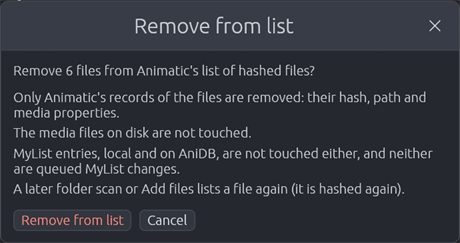
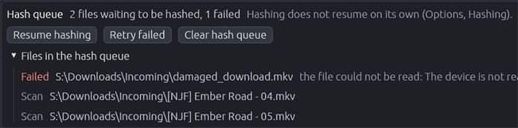

Problems with files on disk: scans, offline drives, removing records by hand, hashing, files that
are not identified, renaming, AOM imports, external tools and exports. Use the first table to
jump to the right section.

| Problem | Section |
|---|---|
| A scan found or hashed nothing | [Scans and managed folders](#scans-and-managed-folders) |
| Records vanished, or a drive was unplugged during a scan | [Offline drives and automatic removal](#offline-drives-and-automatic-removal) |
| I want to drop records of files by hand | [Remove from list](#remove-from-list) |
| A file is shown as **Failed**, hashing is slow or was cancelled | [Hashing large files](#hashing-large-files) |
| `Not identified` or a CRC `Mismatch` | [Files that are not identified or show a CRC mismatch](#files-that-are-not-identified-or-show-a-crc-mismatch) |
| A rename is refused or fails | [Rename problems](#rename-problems) |
| The AOM databank or settings import went wrong | [AOM import problems](#aom-import-problems) |
| A player, AVDump or an export fails | [External tools and exports](#external-tools-and-exports) |

## Scans and managed folders

A scan runs only when you choose **Tools → Scan managed folders** (it is disabled while an AOM
import or settings review is pending). It reads the managed-folder rules from the current
in-memory settings and plans three possible actions:

| Action | Condition |
|---|---|
| Hash | A file under a rule with **Auto hash** whose extension is allowed and whose path is not yet in the library. If several rules cover the same path, the **first rule in list order** that takes part in discovery wins (longest-path matching applies to MyList defaults, the rename base path and removal, not to discovery) |
| Rehash | A known file under a rule with **Rehash changed** whose modification time (in seconds) changed |
| Remove missing | A library path under a rule with **Remove missing** that is affirmatively absent; see [Offline drives](#offline-drives-and-automatic-removal) |

If a scan hashes nothing:

1. **No rule has Auto hash or Rehash changed**, or its folder path is empty or not an existing
   directory. A rule with neither box ticked is skipped for hashing.
2. **Extensions:** scans always filter by the extension list in **Tools → Options… → Hashing**,
   whatever **Restrict file extensions** is set to. A file without an extension never matches
   and an empty list hashes nothing. Entries may include a leading dot and are matched
   case-insensitively. (Files passed on the command line are not filtered.)
3. **Hidden entries** are skipped when the rule's `exclude_hidden` key is true: any file or
   folder whose name starts with `.`. There is no control for it in Options. It is true for
   new rules and false for the built-in network rule and for rules imported from AOM. Animatic
   does not look at the Windows *Hidden* attribute. On Windows, files and folders with the
   *system* attribute are skipped when the rule's **Skip system files** is on (no effect on
   Linux). Symbolic links are not followed. **Subfolders** controls depth: a non-recursive rule
   sees only its own folder.
4. Unreadable subfolders are skipped silently; they produce no hash actions.
5. A file that may still be being written is **deferred** to the next scan (the Log says `Scan
   deferred N file(s) that may still be written`; see [Settle delay and pacing](Managed-Folders-and-Scans.md#settle-delay-and-pacing)).

A scan never deletes folders (see **Remove emptied folders** under [Rename problems](#rename-problems)).
**Auto rename** is separate: a rule set to **Dry run (log only)** only logs planned renames, and one set to
**On** renames identified files (see
[Renaming files](Renaming-Files.md#automatic-rename-opt-in-per-managed-folder)). An imported
AOM `autorename` flag loads as **Dry run (log only)**.

Per-file hashing errors appear in the Log as `<path>: <reason>. It stays in the hash queue until
it is retried or cleared.` and hashing continues with the
next file. After a scan, each hashed file queues an **Identify** command when **Identify files
with AniDB after hashing** is on; with the default folder rule that command may also add the
file to MyList when the queue later runs online. Keep **Work offline** ticked until you have
reviewed the queue.

Moving or renaming files outside Animatic does not update library paths. The old record keeps
its path until a scan with **Remove missing** drops it and **Auto hash** adds the new location
(which hashes that file again), or until you add the file again with **File → Add files…**.

## Offline drives and automatic removal

Automatic removal only ever deletes **local inventory rows** (the path record and a stored hash
that no other path uses). It does not delete media, change MyList or touch AniDB. A removed
record means that file must be **hashed again** if you want it back, which re-reads the file.

A path is planned for removal only when all of these hold:

- a matching folder rule exists and has **Remove missing** on (a non-matching path never falls
  back to the default rule, and a non-recursive rule does not cover its subfolders);
- looking up the file reports that it **does not exist** (a permission or I/O error preserves
  the record);
- the rule's root folder is **currently a directory** (an unmounted Windows drive letter or an
  unreachable network root fails this root check, so records are preserved).

Remaining risk to plan for: the root check only asks whether the folder exists. A folder that
**exists but is empty because its storage is not mounted** (a Linux mount point, a placeholder
for a network mount, a cloud "online-only" folder) looks like an available root that contains
no files, so every record under it can be removed by a scan. Likewise, storage can disconnect
between planning and execution; the check is a conservative plan, not an atomic guarantee.

Recommendations:

- Leave **Remove missing** off for removable, network or cloud-backed folders.
- Back up the database before a scan with **Remove missing** enabled, and check the drive is
  mounted and shows its files first.
- If records were removed because storage was absent, restore the database from a backup made
  before the scan, or remount the storage and let a scan hash the files again.

## Remove from list

**Remove from list…** on the **Hashed files** page is the manual way to drop records on purpose,
for example for files you deleted or moved yourself, or to make Animatic hash a file again.

1. Open **Hashed files** and mark the files (`Ctrl+click` or `Shift+click`, or **Select all**).
   **Remove from list…** is enabled when files are marked and no other job is running.
2. Click **Remove from list…**. The confirmation window names the number of files:

3. Choose **Remove from list** (red) or **Cancel**, `Esc` or the close button. If another task
   is running the red button is disabled and its hover text says what to wait for.

The Log then says `Removed N file(s) from the list`. Only Animatic's records go: the path, the
stored hash (when no other path uses it) and the media properties, in one transaction. The
media files are not touched, MyList entries (local and on AniDB) are not touched, and queued
MyList changes stay in the queue. The files are not blocked: a later scan of a folder with
**Auto hash**, or **Add files…**, lists them again and hashes them again. If the removal fails
you see `Could not remove the files from the list: <error>` and nothing was removed. Nothing
removed this way can be undone except by hashing the file again or restoring a
[library backup](Backups-and-Recovery.md#back-up-and-restore-inside-animatic).

## Hashing large files

Hashing computes ED2K (the AniDB-compatible red variant), CRC32, MD5 and SHA-1 in **one pass**
over each file; nothing is read twice. Memory use does not grow with file size (4 MiB blocks).
Speed is limited by the disk, network share, USB bridge or security scanner reading the file.

The **Hash queue** panel (on **Hashed files** and, compactly, in **Needs attention** on the
Overview) shows what waits and what failed. Open **Files in the hash queue** to see each
entry: a red **Failed** with the path and the reason, or the source (`Add files`,
`Command line`, `Scan`, `Other launch`) and the path of a waiting file.

*The panel's buttons: **Resume hashing** starts the waiting files, **Retry failed** queues the failed ones again, **Clear hash queue** empties it.*

Fixing a failed file:

1. Read the reason. Remount the drive, close the program holding the file, or fix permissions.
2. Click **Retry failed**: the failed entries are queued again and hashed.
3. If the file is gone for good, click **Clear hash queue**. That forgets waiting and failed
   entries; it deletes no file.

How hashing behaves:

- Files are hashed one after another on the background worker. The status bar shows the file
  and a progress bar; **Pause** and **Cancel** act between 4 MiB blocks.
- A cancelled file is not recorded, and neither it nor the files after it are lost: they stay in
  the persistent [hash queue](Hashing-and-Identification.md#hash-queue) and the Log says how many.
  **Resume hashing** (Hashed files page or Overview) or the next start with *Start hashing
  automatically* on continues. Quitting also cancels.
- A file that cannot be read (permissions, a lock by another program, a vanished network share,
  a file that was moved) logs `<path>: <reason>. It stays in the hash queue until it is retried or
  cleared.` and the job continues with the next file. The
  file stays in the hash queue as *failed* with that reason until you add it again, use **Retry
  failed** or **Clear hash queue**. The reason is `file not found (moved, renamed or deleted, or
  its drive is unavailable)` or `the file could not be read: <operating-system error>`.
- A hash is stored only after the whole file was read, and the file leaves the queue only after
  that. After a crash or power loss mid-file the file is simply still queued.
- Hashing does not delay the interface; the library views read their own snapshot (WAL).
  The AniDB command queue runs separately and is not started by hashing.

## Files that are not identified or show a CRC mismatch

Hashing only records what the file contains. **Identifying** a file means asking AniDB which file
it is: Animatic queues an **Identify** command after hashing when **Identify files with AniDB
after hashing** is on, and the command is sent when the queue runs online. The **AniDB** column of
**Hashed files** shows `fid <id>` for an identified file and `Not identified` otherwise.

If a file stays `Not identified`:

1. **The command has not been sent.** Look for `Identify` rows on the **Queue** page. They wait
   while **Work offline** is on or until you run the queue ([Why are my commands not
   sent?](Network-and-Sync-Problems.md#why-are-my-commands-not-sent)).
2. **The command is blocked.** The row is red with a **Last error**; fix the cause and use
   **Retry failed** ([Queue states](Network-and-Sync-Problems.md#queue-states-blocked-deferred-and-unsaved)).
3. **AniDB does not know the file.** The Log says `file unknown to AniDB`. That is a normal
   answer, not an error, and the file is not asked about again at once. The file is not in
   AniDB's database; Animatic cannot add files to AniDB (use **Tools → Edit AniDB data**, which
   opens AniDB's own web editors).
4. **The request limits apply.** A known file is not requested again within 7 days of the last
   request ([Request limits](AniDB-Synchronization.md#request-limits)). This also holds for the
   refresh that **Update known file information** (**Tools → Options… → AniDB account**) queues when you hash
   an identified file again.

A **CRC** column showing `Mismatch` (and the Overview line `⚠ N file(s) do not match the CRC in
their name`) means that the CRC32 Animatic computed differs from the CRC32 AniDB has recorded
for the file it identified. Animatic never compares the CRC32 in a file name. A different
recorded CRC32 for the same ED2K hash and size is unusual: check that the file was not changed
after AniDB's record was fetched, re-hash it, and compare with AniDB's page for the file. A
mismatch also takes the highest-ranked row color on **Hashed files** (see **Tint table rows
by status** in the Appearance options); the status is always written in the row as well.

## Rename problems

Renaming is manual and previewed unless you opted a managed folder in: choose a file on **Hashed
files**, **Rename…**, review the **Confirm rename** window, then **Rename file**; or select
several files and use **Rename N selected…** and **Batch rename** (see
[Renaming files](Renaming-Files.md)). Only a folder whose **Auto rename** is **On** renames
automatically (**Dry run (log only)** only logs), and its skipped files and collisions are explained in the Log
(`Automatic rename skipped <path>: <reason>`). There is no undo.

| Message | Meaning and action |
|---|---|
| `Select a hashed file first` | No file is selected |
| `The selected file is no longer in the list` / `The selected file is not identified by AniDB` | The preview needs the file's AniDB identification. Run identification online first |
| `Rename not possible: <problem>` | The pattern or the data produced an error. The window shows details |
| `Rename blocked: the renaming pattern reported warnings` | Evaluation warnings block **Rename file**. Use **Edit pattern in Options** |
| `The renaming pattern is empty. …` | Choose a naming convention or write a pattern |
| `The renaming pattern has a syntax error: …` | Fix the pattern; **Validate on selected file** in Options dry-runs it |
| `The built-in naming convention needs the anime title, which has not been fetched yet. …` / `… needs the episode number, which is not known yet. …` | The built-in conventions need fetched title and episode data. Use the anime detail window's **Refresh from AniDB**, make sure the file is identified, and run the queue online, then retry |
| `The pattern ended with the truth value "…" instead of a file name. …` | The last expression must evaluate to the new name |
| `The pattern produced an empty file name; nothing would be renamed. …` | Same cause; an empty target is an error, never a silent no-op |
| `Renaming "<old>" to "<new>" would result in an invalid file name (<why>); rename skipped!` | A path component contains one of `<>:"\|?*` or a control character, is empty, is longer than 255 (UTF-16 units on Windows, UTF-8 bytes elsewhere), or is a reserved device name such as `CON`, `PRN`, `AUX`, `NUL`, `COM1`-`COM9`, `LPT1`-`LPT9`. Trailing dots and spaces are trimmed first. The rules apply on every platform |
| `The file already has the name the pattern produces` | Nothing to do |
| `Rename failed: <file>: destination already exists: <path> (target …)` | A collision. A single-file preview does **not** check for an existing target; the check happens when you apply it (the batch preview does check, and marks such a line blocked). Change the pattern or move the other file |
| `Rename failed: <file>: I/O error: <os error> (target …)` | The filesystem operation failed (see below) |
| `Rename failed: <file>: database error: … (target …)` | The library could not be updated; see below |
| `Rename failed: <file>: the file changed since it was hashed; hash it again before moving it …` | A move to another drive copies and verifies against the stored hash, so the file must still be the one that was hashed. Hash it again, then retry |
| `Rename failed: <file>: the library has no stored hash for this file, so a copy to another volume cannot be verified …` | Hash the file (**File → Add files…**), then retry |
| `Rename failed: <file>: the copy does not match the hash stored for this file; nothing was moved …` | The copy was damaged or the file changed while it was copied. Original and library are untouched and the temporary copy is removed; check the disks and retry |
| `Rename failed: <file>: the library now records this file at …` / `… the file is no longer in the library` | The library entry changed after the preview (a rescan, another rename). Reopen the preview |
| `Rename failed: <file>: Cancelled; the file and its library entry are unchanged` / `Skipped: cancelled` | You pressed Cancel; nothing was moved for that file |

Details:

- **Collisions** are detected when you apply (and, in the batch preview, also when planning).
  Two files that map to the same name succeed once and fail the second time; the batch preview
  blocks the second line up front.
- **Moves to another drive or filesystem** are copied, verified and swapped (see [Renaming
  files](Renaming-Files.md#what-applying-does)): the copy is made beside the destination as a
  hidden `.animatic-move-*.tmp` file, which is removed on any failure. It needs free space for a
  whole extra copy of the file on the destination volume and reads the file twice (copy, then
  verify). A crash during a copy can leave that hidden file behind; delete it with Animatic
  closed (the original is untouched).
- **The old file could not be removed** after a verified copy: the library already points at the
  new copy, the Log says so, and the old file remains as a duplicate you can delete.
- **Missing folders are created before the rename.** If the rename then fails, the new empty
  folders remain; Animatic does not remove them.
- **Emptied source folders** are removed only when the matching managed folder has **Remove
  emptied folders** on: the folder a moved file left, and its parents, while they are below the
  managed folder and completely empty ([details](Managed-Folders-and-Scans.md#removing-folders-a-rename-emptied)).
  A folder that still holds anything, hidden files included, stays; the managed folder itself
  is never removed.
- **Open files and permissions:** a file held open by a player or scanner, a read-only
  destination, or an operating-system limit on total path length (the planner limits each
  name component but not the whole path) causes an I/O error.
- The library path is updated only **after** the file reached its new place, and a failed update
  is undone (the rename is reverted, or the new copy removed), so the library keeps naming a
  file that exists. If the undo itself is impossible (for example the file is locked) the library
  can still show the old path; add the file again at its new location with **File → Add files…**,
  or let a scan hash it, and remove the stale record with a scan that has **Remove missing** or
  accept it as stale.
- An existing target is never replaced. The check happens before the move and the move itself
  refuses to replace, so a file another program created at the target in between makes the
  rename fail (an `I/O error` that says the file exists) and leaves that file alone. A move to
  another drive never replaces such a file either.

For syntax and functions see [Rename language](Rename-Language.md).

## AOM import problems

### Databank import

**File → Import → AOM databank…** and the Getting started card's **Browse…** open a folder picker titled
**Choose the AOM folder or its kowai folder (files are not listed)**. Folder pickers never show
files, so an empty-looking `kowai` folder is normal: select it and confirm. Either the `kowai`
folder (containing `mylist.data`, `local_files.data` or `animes.data`) or the AOM folder directly
above it is accepted; anything else is rejected with `No AOM databank found in <path> (choose
the AOM folder or its kowai folder)`.

The import reads the source files only (they are never modified). Before it starts, the
worker checks the database: if it already holds anime, MyList entries or hashed local files, the
**Import into a database that has data?** dialog says that rows with the same ids will be
replaced and offers **Continue** or **Cancel**; Cancel logs `Import cancelled; the database was
not changed`. To keep the current database, cancel and start Animatic with `--database FILE`
(a new file). An empty database imports without a question. The import decrypts each collection
into a marked work folder in the system temporary folder (a name starting
`animatic-legacy-import-` with the marker file `.animatic-legacy-import`), imports it in **one
transaction per collection**, and removes that folder when it ends, on success, failure or cancel.
If the folder cannot be removed the Log shows `Legacy import warning: could not remove the
temporary import folder …`. Results to be aware of:

- **Partial results.** A collection that fails to import is rolled back and skipped, and the
  import continues. The Log reports `Imported N records from M collections` and one error line
  `Legacy import warning: <collection>: <error>` per skipped collection. If M is smaller than
  the number of recognized `.data` files in the folder, some collections were skipped.
- **A decryption error aborts the run.** The text is `Legacy import failed: <error>`.
  Collections already committed stay in the database; the remaining ones and the final
  derived-data step (highest episode, special counts, group fix-up) did not run, and the
  `legacy_import_source`/`legacy_import_date` markers were not written.
- **Cancel.** **Cancel** is cooperative and is not guaranteed to stop the import at once. It is
  honored while a collection decrypts and just before each collection's transaction; the log
  then shows `Legacy import failed: cancelled`. Decrypting a collection cannot be interrupted
  midway, so cancelling can take until the current collection finishes decrypting. A Cancel
  that arrives during the final collection's transaction or the derived-data step is ignored:
  the import can complete and report success. Already committed collections remain.
- **Recovering.** Restore a backup taken before the import, or rerun the import after fixing
  the cause. Most collections are written with replace-by-key statements, so a rerun replaces
  rows instead of duplicating them; that also means a rerun overwrites rows with the
  databank's older values, so import into a fresh database, or one you have backed up, rather
  than into a library with newer synchronized data.
- **Leftover decrypted files.** At every start Animatic looks in the system temporary folder for
  import folders (name starting `animatic-legacy-import-`, containing the marker file
  `.animatic-legacy-import`) that an interrupted import left behind and that no running import is
  using. If it finds any, **Leftover import files** lists them; **Remove** deletes only those
  folders, **Keep for now** asks again at the next start. A removal that fails is logged as
  `Kept leftover import folder <path>: <reason>`. A folder without the marker, such as the
  `import-temp` folder of an older version, is never offered; see
  [Disk space, temporary files and leftovers](Backups-and-Recovery.md#disk-space-temporary-files-and-leftovers)
  for removing it by hand.
- The import menu items are disabled while an import or settings review is pending, and other
  job submissions are blocked until the review ends.

### Settings import

**File → Import → AOM settings…** parses the chosen XML on the worker and shows **Review imported
AOM settings**. Errors appear as `Could not import AOM settings: …` (for example `XML: No
supported AOM settings found in the selected XML` for unrelated XML). Failure or **Cancel**
leaves your active settings unchanged and releases the lock on other actions. **Apply imported
settings** saves first and forces work offline; if the save fails you see `Could not save
settings: …`, your old settings stay active, and the review remains open. The import starts
from defaults and replaces whole sections, so settings the XML does not mention are replaced
by the importer's fallbacks rather than kept, except your **Updates** settings, your
media-properties (`ffprobe`) settings and your **Color scheme**, which are carried over. The
imported values include the AOM password;
it is saved to the system keystore, or in plain text when none is available. Review managed folders, players and credentials
before going online (see the [Settings reference](Settings-Reference.md)).

## External tools and exports

- `player executable is not configured`: set a player in **Tools → Options… → Players and tools**.
- `invalid external command arguments: …`: the argument template could not be split (for
  example an unbalanced quote). Templates are split into an argument list before placeholder
  substitution, with no shell involved; see the [Settings reference](Settings-Reference.md)
  for placeholders.
- `AVDump integration is disabled` / `external executable is not configured`: enable and
  configure it in **Tools → Options… → Players and tools → AVDump**. Each placeholder value (user name, key, path) is
  substituted inside its own argument, so spaces or quotes in it cannot split it. A template
  that uses `{key}` places that key on the child process's command line.
- `Hash export failed: …`, `Automatic statistics export failed: …` or a manual statistics
  export error: the destination is not writable, is a folder, the disk is full or the path is
  invalid, or (statistics) a database query failed. The previous file is left unchanged; see
  [Exports](Exports.md#safe-replacement). These write to the path you chose; they reveal your library, so keep them out of the repository.

## See also

- [Managed folders and scans](Managed-Folders-and-Scans.md) for the folder rules behind scans.
- [Hashing and identification](Hashing-and-Identification.md) for the hash queue and identification.
- [Renaming files](Renaming-Files.md) and [Rename language](Rename-Language.md) for patterns.
- [Troubleshooting](Troubleshooting.md) for the symptom index and message index.
