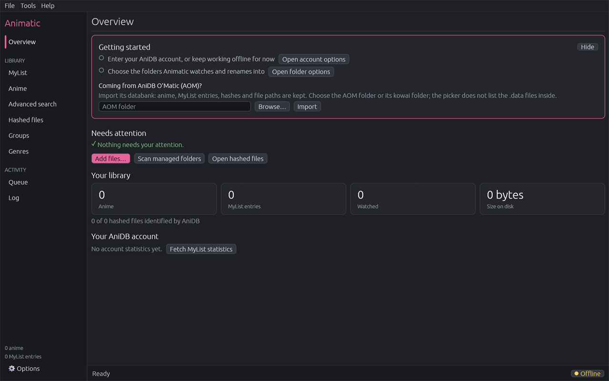
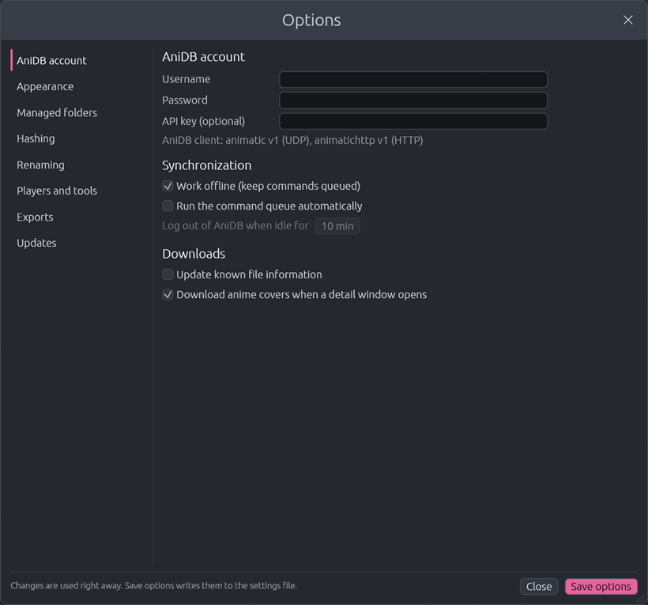

What you see the first time Animatic starts, which few settings to review before anything talks to
AniDB, and the AniDB clients Animatic uses for online work. This page is the short, safe route; the
[Quick start](Quick-Start.md) continues from here with files, hashing, identification and renaming.

## First launch

On a fresh profile (no settings file yet) every setting has its default, the library is empty and
nothing has contacted AniDB. A first launch with default settings does perform an automatic update
check against GitHub (and so does every later start unless you switch it off; see
[status](Installation.md#status-and-limits)); to avoid it on the first start, create the
settings file before then ([Avoiding the startup update check](Data-Locations.md#avoiding-the-startup-update-check)).

*The Overview after the first start of the sample library. The picture was taken with the sample's
**Work offline** turned on, so the status bar shows **Offline**; a real first start shows a green
**Online** button (see below). The second step shows `✓` because the sample has folder rules of its own.*

### What happens at the first start

1. **Startup.** The database is created and opened first, then settings are loaded: a missing
   primary and missing backup mean defaults; a valid primary loads; an invalid or missing primary
   with a valid `.bak` loads the backup **offline** and shows a "Settings recovered" window;
   unreadable settings or two unusable files abort startup. Details:
   [Settings problems](Backups-and-Recovery.md#settings-problems).
2. **Status bar** shows `Loading library…` and then `Ready`. The left panel lists the pages
   (Overview, MyList, Anime, Advanced search, Hashed files, Groups, Genres, Queue, Log) and an
   **Options** button; **Overview** is shown. At the right of the status bar, a button reads
   **Online** (green dot) or **Offline** (amber dot). A new profile reads **Online** because *Work
   offline* is off by default. "Online" only means the queue is *allowed* to contact AniDB when you
   run it; nothing is sent until then.
3. **Update check.** At every start, unless you switched off **Check for updates at startup** or work
   offline, Animatic asks GitHub whether a newer release exists
   ([Updating Animatic](Updating-Animatic.md)). It only looks; nothing is downloaded or installed.
4. **Overview "Getting started" box** appears on top of the page because the profile is still new,
   until you click **Hide**. It is described next.
5. **Nothing else runs.** No scan, no hashing, no AniDB request. The queue is empty.

### The Getting started box

The box has two steps and an optional AOM import. Each step has a mark (`○` open, `✓` done) and a
button that opens the matching category of the [Options window](Options-Window.md).

| Step | Button | Opens | Shows `✓` when |
|---|---|---|---|
| **Enter your AniDB account, or keep working offline for now** | **Open account options** | **Options → AniDB account** | A **Username** is entered (an empty or blank name leaves `○`). Choosing to work offline does *not* tick it. |
| **Choose the folders Animatic watches and renames into** | **Open folder options** | **Options → Managed folders** | A folder rule that you added has a non-empty **Path**. The built-in **Default** and `\\` network rules do not count. |
| **Coming from AniDB O'Matic (AOM)?** | **Browse…** and **Import** (the **AOM folder** field) | Picks the AOM folder or its `kowai` folder and imports the databank | Not a checklist step: see [Migrating from AOM](Migrating-from-AOM.md#migrate-an-aom-databank). |

- The second step shows `○` on a brand-new profile: the built-in **Default** rule and the `\\ (Default network path)`
  rule are always present and do not count. It turns to `✓` only when you add a folder rule of your own and
  give it a path ([Quick start, step 4](Quick-Start.md#4-add-your-managed-folders)).
- **Hide** removes the box and sets `first_launch` to false. Hiding writes the settings file
  immediately (a first save), unless the settings were recovered from a backup (then the change
  stays in memory until you save in Options). A normal exit also saves the settings. The box does
  not come back by itself; a new settings file (or an AOM settings import for an account-less
  profile) brings it back.
- The box is only guidance. Neither button changes a setting; they open Options.
- **Coming from AOM?** Import before you do anything else with a new library. The picker does not
  list the `.data` files inside the folder. See [Migrating from AOM](Migrating-from-AOM.md).

### Safe first-run settings

Do these once, before the first run of the command queue.

1. **Open Options.** Click **Open account options**, or choose **Tools → Options…** (`Ctrl+,`), or
   click **Options** at the bottom of the left panel.
2. **Work offline.** Under **Synchronization**, tick **Work offline (keep commands queued)**. (A
   shortcut: click **Online** in the status bar, which switches to **Offline**; that click also saves
   the choice at once.) While it is on, **Run command queue** reports `Offline mode is enabled;
   commands remain queued` and sends nothing, and the startup update check is skipped. The factory
   default is *not* offline, which is why you do this first.
3. **Leave the account fields empty until your AniDB account is at hand.** **Username**, **Password**
   and **API key (optional)** are only used when the queue runs. Enter them later, when you are ready
   to go online ([below](#going-online-for-the-first-time)).
4. **Look at the Default folder rule.** Under **Managed folders**, open **Default**. The built-in
   rule applies to every file that is not inside one of your own folder rules. It has **Add to MyList**
   on with **Set state** *On HDD* and **Set watched** with *Watched* off. That means files you add by
   hand and that AniDB identifies will be **added to your AniDB MyList as On HDD, unwatched** when you
   later run the queue. Leave it if that is what you want; otherwise untick **Add to MyList** now. See
   [managed folders](Managed-Folders-and-Scans.md).
5. **Decide about the update check.** Under **Updates**, **Check for updates at startup** is on by
   default. Untick it if you do not want Animatic to contact GitHub when it starts; **Help → Check
   for updates…** works whenever you ask.
6. **Press Save options.** Changes take effect right away, but **Save options** writes them to the
   settings file and closes the window. (A normal exit saves too.)

*Options → AniDB account on a fresh profile with **Work offline** ticked. The credential fields are
empty; the read-only line under them names the AniDB clients Animatic uses.*

Expected result: the status bar button reads **Offline** (amber). You can now hash files and browse
without anything leaving the computer.

### Going online for the first time

When you are ready:

1. Enter your AniDB **Username** and **Password** under **Options → AniDB account**. The **API key
   (optional)**, set in your AniDB profile, turns on encrypted UDP sessions.
2. Untick **Work offline (keep commands queued)**.
3. Press **Save options**. The password and key go to the system keystore when one works
   ([credentials and the keystore](Settings-Files.md#credentials-and-the-system-keystore)); Options
   shows a warning when it does not and the values stay in `settings.json` as plain text.
4. Start the queue yourself (**Tools → Run command queue**, `Ctrl+Shift+S`) with only a few commands
   waiting. Requests are spaced out by Animatic on purpose
   ([Request limits](AniDB-Synchronization.md#request-limits)); a long queue takes a long time and
   that is not a hang. Leave **Run the command queue automatically** off until you have seen a
   manual run succeed.

### Defaults worth knowing

These are the values a new profile starts with (see the [Settings reference](Settings-Reference.md) for every key).

| Area | Default |
|---|---|
| Appearance | Dark theme, **Sakura** color scheme, UI scale 1.0, status colors on (**Soft**), tray icon on and minimize to tray on |
| AniDB | UDP server `api.anidb.net:9000`, local UDP port 29456, image server `cdn.anidb.net`; **Work offline** off; **Run the command queue automatically** off (idle logout 10 min when on); **Update known file information** off; **Download anime covers when a detail window opens** on |
| Hashing | **Start hashing automatically** on; **Identify files with AniDB after hashing** on; **Restrict file extensions** off; hash export template `%fulled2k%` |
| Managed folders | Two built-in rules, **Default** and `\\ (Default network path)`; scan at start off; scheduled scan off (60 minutes when on); **Hash a file once it is unchanged for** 500 ms; **Pause between hashed files** 0 ms. A rule you add has **Subfolders** on, **Skip system files** on, and **Auto hash**, **Rehash changed**, **Remove missing**, **Remove emptied folders**, **Add to MyList** and **Auto rename** (Off) all off. |
| Updates | **Check for updates at startup** on; channel **Stable** |
| Other | Statistics export off; media properties (ffprobe) off; the file-menu entry off |

The built-in `\\ (Default network path)` rule covers network paths that start with `\\` (Windows) and
adds nothing to MyList.

### If the first start fails

An error dialog or a message in your terminal means Animatic could not open its database or settings;
the message names both files. See [Running Animatic](Running-Animatic.md#if-startup-fails) and
[Troubleshooting](Troubleshooting.md#startup-problems).

## AniDB client registration

AniDB refuses unregistered API clients, and AniDB registers a client **per API**. Animatic has
its own registered clients, built into the program: `animatic` version 1 for the UDP API (login,
file identification, MyList) and `animatichttp` version 1 for the HTTP API (full anime records).
You do not register, enter or change anything: Options shows them read-only under the account
fields ("AniDB client: …"), and there is no setting for them. Updating Animatic never changes
them; they change only in a release that ships a newly registered client version. What to know:

- You only need your AniDB **Username** and **Password** (an AniDB account; sign up at
  <https://anidb.net>). The **API key** (set in your AniDB profile) is optional and turns on
  encrypted UDP sessions.
- The local UDP port (`anidb.local_port`, default 29456) and UDP server have no Options control; you
  change them in `settings.json`. If the port cannot be bound, the run stops with an error that names
  the setting; Animatic never switches to another port by itself (AniDB bans many different source ports).
- An empty user name or password makes the queue stop at the first command with an
  authentication error and blocks *every* pending command until you correct it and use
  **Retry failed** ([queue failure handling](AniDB-Synchronization.md#failure-handling)).
- Settings files from older versions may still hold `client_name`, `client_version`,
  `http_client_name` and `http_client_version`. They are ignored and dropped the next time the
  settings are saved.
- If AniDB refuses the built-in client (reply 503 or 504, or an HTTP client rejection), the
  commands are blocked with that reason; update Animatic, and report it if you already run the
  latest release ([Network and sync problems](Network-and-Sync-Problems.md#credentials-and-client-registration)).
- The project has not recorded production AniDB traffic as verified ([status](Installation.md#status-and-limits)),
  so treat your first real queue run as a small, supervised test.

The HTTP API endpoint is plain `http://api.anidb.net:9001/httpapi`; the title list comes
from `https://anidb.net/api/anime-titles.xml.gz`; UDP uses `api.anidb.net:9000` by default.
Transport details: [storage and network contracts](https://github.com/RetroHazard/animatic/blob/main/docs/storage-and-network.md).

## Next steps

- Work through the [Quick start](Quick-Start.md): managed folders, hashing, identification and your
  first rename.
- Hash and identify files, edit MyList, run scans: [Hashing and identification](Hashing-and-Identification.md),
  [AniDB synchronization](AniDB-Synchronization.md),
  [Managed folders and scans](Managed-Folders-and-Scans.md).
- Import an AOM library and its settings:
  [Migrating from AOM](Migrating-from-AOM.md#migrate-an-aom-databank).
- Understand or edit stored options: [settings reference](Settings-Reference.md).
- Write a rename pattern: [rename language](Rename-Language.md).
- Unfamiliar words: the [Glossary](Glossary.md).
- Developer documentation (architecture, storage and network contracts) is indexed in the
  [developer docs](https://github.com/RetroHazard/animatic/blob/main/docs/README.md).
