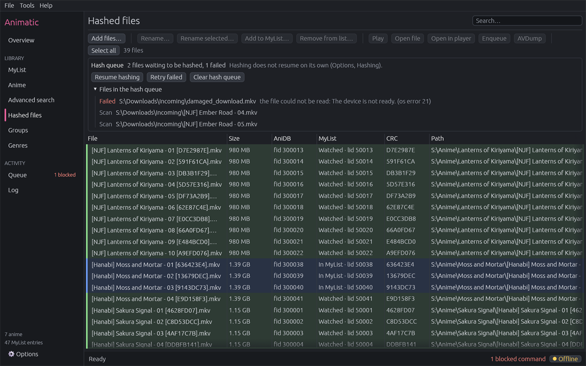
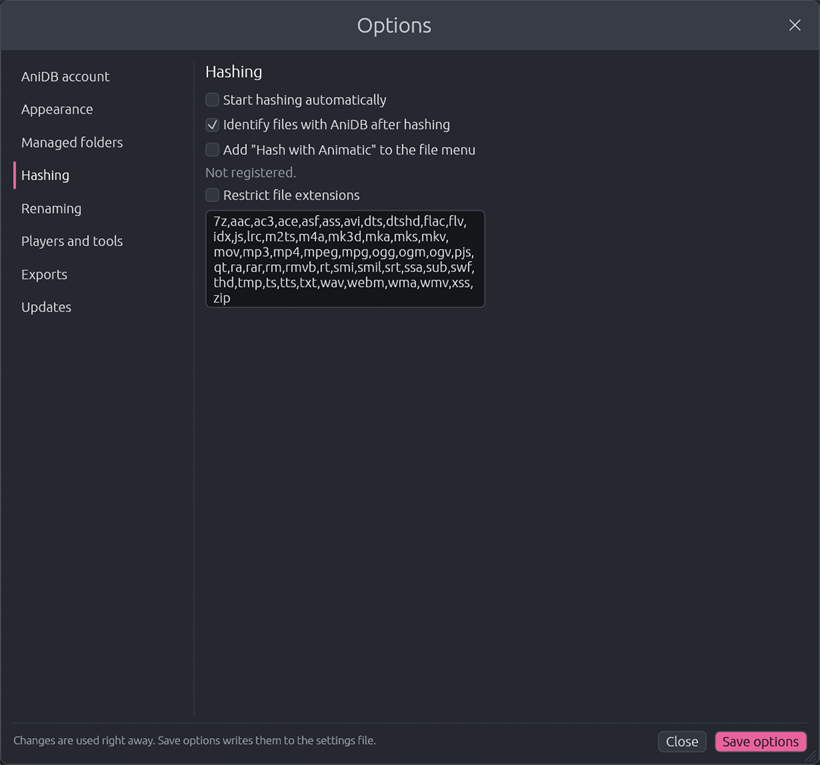
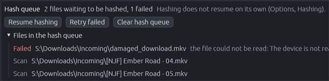

Hashing turns a media file into a short fingerprint that lets AniDB identify it. This page explains every way to give Animatic files, what happens to each file (the **hash queue**, the four hashes, identification through the command queue), what a **CRC mismatch** means, and which options control all of it. Read it when you add files for the first time, when files wait in the hash queue, or when a file stays **Not identified**.

*The Hashed files page. The **Hash queue** panel sits between the toolbar and the table while files are waiting or have failed.*

## The short version

1. You add files (a picker, the command line, a file-menu entry, or a folder scan).
2. Every file joins the **hash queue**, which is saved in your library database.
3. Animatic reads each file **once** and computes ED2K, CRC32, MD5 and SHA-1 together.
4. The result is stored locally. Hashing never contacts AniDB.
5. If **Identify files with AniDB after hashing** is on, an **Identify** command is added to the [command queue](AniDB-Synchronization.md). AniDB is asked about the file only when you (or the automatic run) run that queue.

## Ways to add files

All routes end in the same place: the hash queue. Each queued file remembers where it came from, and the list in the hash queue panel shows that label.

| Route | How | Label in the queue |
|---|---|---|
| **Add files…** | **File → Add files…**, the **Add files…** button on **Hashed files**, the **Add files…** button on **Overview**, or `Ctrl+O`. A native picker titled `Add files to hash` opens; you can select several files. The picker starts in the folder you used last. The menu entry and buttons are disabled while an import is in progress. | `Add files` |
| Command line | `animatic "S:\Downloads\clip.mkv"`: every argument that is not an option is a media file. See the [command-line reference](Running-Animatic.md#command-line-reference). | `Command line` |
| File menu of your system | **Hash with Animatic** in your file browser's right-click menu (Explorer on Windows), once you switched it on (see below). | `Other launch` if Animatic is already running (the file is handed to that window), otherwise `Command line` |
| Another launch | Starting Animatic with files while it already runs hands the files to the running window (see below). | `Other launch` |
| Folder scans | **Tools → Scan managed folders**, the start-up scan and the scheduled scan queue the files they find. See [Managed folders and scans](Managed-Folders-and-Scans.md). | `Scan` |

Notes that apply to every route:

- The picker's extension filter (`Configured media files`) appears only while **Restrict file extensions** is on, and it is a convenience: you can still type any file name in the picker. Paths from the command line and from the file menu are **never** filtered. See [Choosing which files are hashed](#choosing-which-files-are-hashed).
- Paths are stored exactly as given, made absolute first. A relative path from the command line is resolved against the folder you started Animatic from.
- A file is queued once, however its path is spelled (a relative path, a different letter case on Windows, `..` segments or a link all resolve to one entry). Adding a file that already waits only logs `Queued 0 file(s) for hashing (1 already queued)`.
- Queuing a file that is already hashed is allowed: the file is read again and its record is updated in place.

### The file-menu entry (Hash with Animatic)

Animatic can add a **Hash with Animatic** entry to your system's file menu so you can hash a file from your file browser without opening Animatic first.

1. Open **Tools → Options…** and choose **Hashing**.
2. Tick **Add "Hash with Animatic" to the file menu**.
3. Click **Save options**. The entry is created only now: ticking the box changes nothing by itself, and importing AOM settings never creates it.

The status line under the checkbox tells you what is registered:

| Status line | Meaning |
|---|---|
| `Checking…` | Animatic is reading the registration. |
| `Not registered.` | No entry exists and the box is off. |
| `Not registered yet; Save options to add it.` | The box is ticked, but nothing is created before you save. |
| `Registered for the current user.` | The entry exists and starts this copy of Animatic. |
| `Registered for the current user; Save options to remove it.` | The entry exists but the box is off; saving removes it. |
| `Registered for another copy of Animatic (…); Save options to register this copy instead.` | The entry starts a different Animatic (an older folder, or the program was moved). |
| `Registered for another copy of Animatic (…); Save options to remove it.` | The entry starts a different Animatic and the box is off; saving removes it. |
| `Could not check the registration: …` | The registry or desktop file could not be read; the message gives the reason. |
| `Not available: <reason>.` | This system cannot register an entry (the checkbox is grayed out). |
| `An entry with this name exists that Animatic did not create; it is left unchanged.` | A foreign entry with the same name is never touched. |

After **Save options** the Log says `Added "Hash with Animatic" to the file menu` or `Removed "Hash with Animatic" from the file menu`; a foreign entry gives `A file-menu entry with Animatic's name exists that Animatic did not create; it was left unchanged`, and a failure is reported as `File-menu entry: <reason>`. Hover over the checkbox to see where the entry is stored.

Animatic keeps an ownership marker in every entry it creates and never changes or removes one without that marker. The entry belongs to the current user and needs no administrator rights.

- **Windows:** a key under `HKEY_CURRENT_USER\Software\Classes\*\shell\Animatic.Hash` that runs `"<animatic.exe>" "%1"`.
- **Linux:** a file `animatic-hash.desktop` in `~/.local/share/applications` (or `$XDG_DATA_HOME/applications`) with `NoDisplay=true`, offered for common video and audio file types, so it appears in your file browser's **Open With** list. The project records no runtime verification of this on Linux (see [Installation](Installation.md)).

Unticking the box and saving removes Animatic's own entry. The file locations are also listed in [Data locations](Data-Locations.md#shell-entries-and-the-lock-file).

### One window per database (handoff)

If Animatic is already running on the same database and you start it again with media files (from the command line or the file-menu entry), the new process does not open a second window. It sends the files to the running Animatic and exits. The running window is brought back (it leaves the tray or is restored if minimized) and logs `Hashing N file(s) from another launch`. While an import is in progress, the files wait until it is finished.

- The files are made absolute first, because the running program has another working directory.
- The handoff goes over `127.0.0.1` only and needs the secret token that the running Animatic keeps in a lock file beside the database.
- A launch with `--full-update`, or with no files, is never handed over. A launch with another `--database` never shares the window either.
- If anything about the handoff fails (a stale lock file, no answer within a few seconds), the new process simply starts as a normal window. See [Running Animatic](Running-Animatic.md#one-window-per-database).

## What happens to each file

Animatic works through the queue in order. For every file:

1. **One read, four hashes.** The file is read once, in 4 MiB blocks, and the blocks feed all four hashes at once, so hashing runs at the speed of your disk:

   | Hash | Form stored and shown |
   |---|---|
   | **ED2K** | The AniDB-compatible "red" variant, lowercase hex. This identifies the file to AniDB together with its size. |
   | **CRC32** | Uppercase hex, always 8 digits. Shown in the **CRC** column and usable as `[CRC]` in naming conventions. |
   | **MD5** | Uppercase hex. |
   | **SHA-1** | Uppercase hex. |

   Nothing in the application reads a file a second time for hashing. (A cross-drive rename re-reads the copy once to verify it; that is part of renaming, not hashing.)
2. **The result is stored.** The hashes, the path and the file's modification time go into the library. Hashing the same path again updates it in place; identical content at a different path shares one hash record.
3. **The log says so:** `Hashed <path> (local #N, <ed2k>)`.
4. **Identification is queued** if the settings ask for it (see [Identification](#identification)).
5. **The file leaves the hash queue** only now, after its result is stored. If Animatic quits or crashes in between, the file is simply hashed again at the next run.

While files are hashed, the status bar shows a progress bar for the current file, the current file name with `(n/total)`, and the **Pause**, **Resume** and **Cancel** buttons. The Log records the start of a run as `Hashing files` (a scan logs `Scanning managed folders` instead).

- **Pause** holds the read until you click **Resume**.
- **Cancel** stops the whole run and leaves the files that are not hashed yet in the queue.
- With **Pause between hashed files** (**Options → Managed folders → Folder scanning**, 0 to 10000 ms, default 0) Animatic waits between two files of one run; there is no pause before the first or after the last file. See [Settle delay and pacing](Managed-Folders-and-Scans.md#settle-delay-and-pacing).

### If a file cannot be hashed

A missing, unreadable or locked file does not stop the run. It is logged as `<path>: <reason>. It stays in the hash queue until it is retried or cleared.`, marked **Failed** in the queue, and the remaining files are hashed. The reason is `file not found (moved, renamed or deleted, or its drive is unavailable)` or `the file could not be read: <operating-system message>`. A database error ends the run with `Hashing stopped: …` and leaves the file queued. After **Cancel** the log says `Hashing stopped; N file(s) stay in the hash queue`.

## Choosing which files are hashed

**Options → Hashing** has an **extension list**, shown in a text box as comma-separated extensions without dots (for example `mkv,mp4,avi`). Matching ignores letter case. The list starts with the extensions AniDB O'Matic (AOM) used: archives, subtitles and audio as well as video (`7z`, `ass`, `avi`, `flac`, `mkv`, `mp4`, `srt`, `zip`, …). It is not video-only: it also contains `txt`, `tmp`, `js` and archive types such as `zip` and `rar`. A folder scan hashes every file with a listed extension, so trim the list if you keep other files in your managed folders.

*Options → Hashing. In this sample profile **Start hashing automatically** is off, so the queue waits for **Resume hashing**.*

| Option | Default | What it does |
|---|---|---|
| **Start hashing automatically** | on | Resumes files still waiting in the [hash queue](#hash-queue) when Animatic starts. |
| **Identify files with AniDB after hashing** | on | Queues an **Identify** command for each hashed file (see [Identification](#identification)). |
| **Add "Hash with Animatic" to the file menu** | off | The [file-menu entry](#the-file-menu-entry-hash-with-animatic). |
| **Restrict file extensions** | off | Makes the **Add files…** picker show only the listed extensions. |
| Extension list | the AOM list | Used by the picker filter (when restricted) and by every **folder scan**. |

Write extensions without a dot, such as `mkv`: a scan also tolerates a leading dot, the **Add files…** picker does not.

Where the list applies:

- **Add files… picker:** only while **Restrict file extensions** is on, and only as a display filter.
- **Command line and file-menu entry:** never. A file you name explicitly is always hashed.
- **Folder scans:** always, whether or not **Restrict file extensions** is ticked. A file without an extension is never picked up by a scan, and an empty list means a scan finds nothing. A scan also accepts `;` or spaces between extensions.

## Hash queue

Files waiting to be hashed are saved in the library database, so they survive closing Animatic, a crash and a restart. The same file is queued once, however its path is spelled; the path that is hashed and stored in the library is the absolute path as given.

*The hash queue panel on **Hashed files**: two files waiting (queued by a scan), one failed file with its reason.*

- **Where it is shown.** The **Hashed files** page shows the panel between the toolbar and the table while the queue is not empty; **Overview → Needs attention** shows a compact summary (counts and buttons, without the file list). The panel title is **Hash queue** and the summary reads `N files waiting to be hashed`, `N files failed`, or both (`2 files waiting to be hashed, 1 failed`). With nothing queued and nothing failed the panel is gone.
- **Files in the hash queue** is a list of up to 500 entries, failed ones first, then waiting ones in hashing order. A **failed** entry shows a red `Failed`, the path and the reason. A **queued** entry shows its source label (`Add files`, `Command line`, `Scan`, `Other launch`) and the path. More entries read `… and N more`; the counts in the summary are always exact.

### States

| State | Meaning | How it ends |
|---|---|---|
| **Queued** | Waiting for its turn. Files are hashed oldest first. | Hashed (the entry disappears), or canceled (stays queued), or it fails. |
| **Failed** | Could not be read; keeps its reason. Hashing does not retry it by itself. | You add the file again, click **Retry failed**, or clear the queue. A scan with **Hash new files** that finds the file again also queues it again. |

### Controls

| Button | Enabled when | What it does |
|---|---|---|
| **Resume hashing** | files are waiting | Hashes the waiting files in order now. Hover text: `Hash the waiting files in order. Cancel stops and keeps the rest queued`. |
| **Retry failed** | files failed | Queues the failed files again, then hashes everything that waits (including files that were already queued). Log: `Queued N failed file(s) again`. |
| **Clear hash queue** | always (while the panel is shown) | Forgets every waiting and failed file, without asking for confirmation. Hashed files, the library and the files on disk are untouched. Log: `Removed N file(s) from the hash queue`. |

All three wait while another task runs, an import is open or imported settings are waiting for review; their hover text then says `Wait for the running task to finish, or cancel it, first.` (or the matching reason). Resuming is local work and does not depend on **Work offline**.

### Cancel, quit and crash

**Cancel** stops the current run and leaves everything that was not hashed yet queued, including the file that was being read. A scan, **Add files…** or **Resume hashing** later continues with the remaining files, oldest first, before the newly added ones. Closing Animatic does the same.

### Start hashing automatically

**Start hashing automatically** (**Options → Hashing**; on by default, imported from AOM's `autostartHashing`): when Animatic starts and files are still queued, hashing resumes by itself once nothing else blocks it. "Blocks" means that an import review, a library restore or the settings recovery notice is open, some commands are not saved to the database yet, or another task is running. This resume happens before a start-up scan.

With the option off nothing is hashed at start: **Hashed files** and **Overview** show the pending count, the note `Hashing does not resume on its own (Options, Hashing).` and the **Resume hashing** button. Files given on the command line are always hashed, together with any older queued files.

### Hashing thread priority

`hashing.priority` is kept only for compatibility with AOM settings; hashing always runs at the normal thread priority. There is no cross-platform thread-priority control, so none is applied.

## Identification

Identification means asking AniDB which file a hash belongs to. It uses the ED2K hash and the file size.

**Identify files with AniDB after hashing** (default on) decides what a freshly hashed file leads to:

| Situation after hashing | What is queued |
|---|---|
| The library has no AniDB record for the file yet and **Identify** is on | An **Identify** command. If the file's [folder rule](Managed-Folders-and-Scans.md#folder-rules) has **Add identified files to MyList** on, the command also carries that rule's MyList settings (add policy). |
| The library already has the file's AniDB record, **Identify** is on and the rule has **Add identified files to MyList** on | An **Identify** command again, so the add policy can be applied; it refreshes the record too. |
| The library already has the record, the row above does not apply, and **Update known file information** (**Options → AniDB account → Downloads**, off by default) is on | A refresh of the file record, unless it was requested within the last 7 days; then the Log says `File N skipped: it was requested from AniDB recently …`. |
| Anything else (for example **Identify** is off and the file is new) | Nothing. The file stays **Not identified** until you identify it some other way (for example **Add to MyList…** on **Hashed files**). |

Commands are not sent when they are queued. They wait in the persistent command queue until the queue runs: **Tools → Run command queue**, `Ctrl+Shift+S`, or the [automatic run](AniDB-Synchronization.md) if you turned it on. Offline, they simply stay queued. When the queue runs:

- If AniDB knows the file, the file record is stored, so **Hashed files** shows `fid N` in the **AniDB** column.
- If the file is not in your MyList and the command carries an add policy, it is added with the rule's state, watched flag, storage, source and other fields.
- If the file is already in your MyList, the policy is **not** applied; the MyList entry AniDB reports is stored locally.
- If AniDB explicitly reports that the file is **not** in your MyList, local entries for that file are removed unless they have queued edits.
- If AniDB does not know the file, the Log says `file unknown to AniDB` and nothing else changes. The row stays **Not identified**; see [File and import problems](File-and-Import-Problems.md).

With default settings, the built-in **Default** rule has **Add identified files to MyList** on, **Set state** on with **On HDD**, and **Set watched** on with **Watched** off. Identified files that match no folder rule are therefore added to MyList as "On HDD", unwatched, when you run the queue. Review this before online work. Without a Default rule (it can be removed), such files are not added to MyList.

Once a file is identified and its anime and episode records are cached, a [folder with automatic rename](Managed-Folders-and-Scans.md#automatic-rename) can rename it.

## Reading the Hashed files table

| Column | Shows |
|---|---|
| **File** | The file name. Click selects, `Ctrl`+click toggles, `Shift`+click extends the selection. Right-click opens the [file menu](External-Tools.md#using-players-on-hashed-files). |
| **Size** | The file size. |
| **AniDB** | `fid N` once AniDB identified the file, otherwise `Not identified`. |
| **MyList** | `Watched · lid N`, `In MyList · lid N`, `Add queued` (an add waits in the command queue) or `—`. |
| **CRC** | The local CRC32 in uppercase hex, `Mismatch`, or `—`. |
| **Path** | The stored path. Double-click opens the file with your system's default program. |

### What a CRC mismatch means

`Mismatch` appears when AniDB has a CRC32 on record for the identified file **and** it differs from the CRC32 Animatic computed. AniDB found the file by its ED2K hash and size, so the content matches that record, yet the two CRC32 values disagree.

Animatic never changes AniDB's record and does not decide which side is right: check the file against AniDB's file page. The CRC written in the file name (`[0BADC0DE]`) is **not** compared: only AniDB's stored CRC is. Mismatching files are tinted as needing attention and counted in **Overview → Needs attention**, which words the line as `⚠ N files do not match the CRC in their name`; the comparison is still with AniDB's CRC, not with the name.

To check a file, hash it again (**Add files…**) and compare the **CRC** column with AniDB's file page.

In the sample library, `[Hanabi] Moss and Mortar - 04v2 [0BADC0DE].mkv` is the one mismatching file.

## Media properties

Animatic can optionally read duration, resolution, codecs and bitrates with `ffprobe` after hashing. This is a separate step and never part of the hash read; it is off by default and feeds the media tokens of the [hash export](Exports.md#hash-export). See [Media properties (ffprobe)](External-Tools.md#media-properties-ffprobe).

## See also

- [Managed folders and scans](Managed-Folders-and-Scans.md) for folder rules, the settle delay and automatic hashing.
- [Quick start](Quick-Start.md) for a first end-to-end run.
- [AniDB synchronization](AniDB-Synchronization.md) for running the command queue.
- [Library pages](Library-Pages.md) for the other tables and the row colors.
- [Glossary](Glossary.md) for ED2K, CRC32, fid and the other terms.
