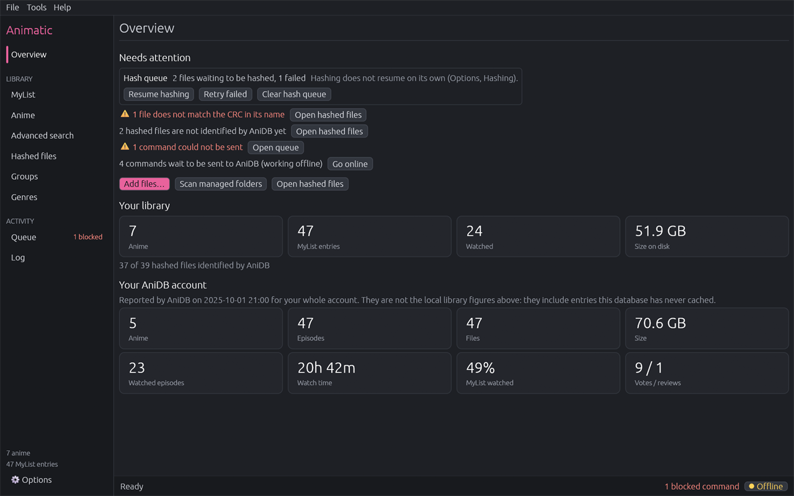

Animatic keeps your anime files and your AniDB account in step. It hashes the files on your
disks, identifies them on [AniDB](https://anidb.net), keeps your MyList up to date (even while you
work offline), renames files to a naming convention you choose, and imports an existing
**AniDB O'Matic (AOM)** library without changing it. It is a native application for Windows and
Linux, and the successor to AOM.

These pages describe what the desktop application does today. A setting that is stored but has
no effect, or a library capability that has no screen, is labeled as such. Linux runtime
behavior and production AniDB traffic have not been exercised by the project; see
[Status and limits](Installation.md#status-and-limits).

The pictures in this guide show an invented sample library (titles such as *Sakura Shingou* and
*Kiriyama no Tourou*, groups such as *Hanabi Subs*, paths on drive `S:`); your own library will
look different.

## New to Animatic?

1. [Install Animatic](Installation.md) and check the download.
2. Follow the [Quick start](Quick-Start.md): a first session from the first launch to a hashed,
   identified and renamed library.
3. Coming from AOM? Read [Migrating from AOM](Migrating-from-AOM.md) before the first launch.

Unfamiliar word? The [Glossary](Glossary.md) explains AniDB and Animatic terms such as *ed2k*,
*fid*, *MyList* and *command queue*. Short answers to common questions are in the [FAQ](FAQ.md).

## I want to…

| Task | Page |
|---|---|
| Add files and find out what they are | [Hashing and identification](Hashing-and-Identification.md) |
| Let Animatic watch my anime folders | [Managed folders and scans](Managed-Folders-and-Scans.md) |
| Mark episodes watched, add or remove MyList entries | [Managing MyList](Managing-MyList.md) |
| Understand when Animatic talks to AniDB | [AniDB synchronization](AniDB-Synchronization.md) |
| Rename files to a consistent scheme | [Renaming files](Renaming-Files.md) |
| Write my own naming pattern | [Rename language](Rename-Language.md), [Patterns](Rename-Patterns.md) |
| Play files in my player or run AVDump | [External tools](External-Tools.md) |
| Export statistics or hash lists | [Exports](Exports.md) |
| Change a setting | [Options window](Options-Window.md), [Settings reference](Settings-Reference.md) |
| Back up or move my library | [Backups and recovery](Backups-and-Recovery.md), [Data locations](Data-Locations.md) |
| Get the newest version | [Updating Animatic](Updating-Animatic.md) |
| Fix a problem | [Troubleshooting](Troubleshooting.md) |

## All pages

### Get started

| Page | Read it for |
|---|---|
| [Quick start](Quick-Start.md) | A guided first session, step by step |
| [Installation](Installation.md) | Status and limits, downloading and verifying a release, building from source |
| [Running Animatic](Running-Animatic.md) | Starting the application and the complete command-line reference |
| [Data locations](Data-Locations.md) | Where the database and settings live, portable and rehearsal profiles |
| [First launch](First-Launch.md) | The Getting started box, safe first-run settings and AniDB client registration |
| [Migrating from AOM](Migrating-from-AOM.md) | Importing an AOM databank and AOM settings |

### The window

| Page | Read it for |
|---|---|
| [Main window](Main-Window.md) | Layout, status bar and progress, searching and tables, menus, keyboard shortcuts |
| [Library pages](Library-Pages.md) | Overview, MyList, Anime, Advanced search, Hashed files, Groups, Genres, Queue, Log and the anime detail window |
| [Options window](Options-Window.md) | Every page of **Tools → Options…** |

### Tasks

| Page | Read it for |
|---|---|
| [Hashing and identification](Hashing-and-Identification.md) | Adding files, the hash queue, the single-pass hashes and identifying files on AniDB |
| [Managed folders and scans](Managed-Folders-and-Scans.md) | Folder rules, manual and scheduled scans, safe removal of missing files, automatic rename |
| [Managing MyList](Managing-MyList.md) | Editing, adding and removing MyList entries, statistics and the full MyList export |
| [AniDB synchronization](AniDB-Synchronization.md) | The command queue, working offline, flood protection and failure handling |
| [Renaming files](Renaming-Files.md) | Renaming one file or a selection, naming conventions and custom patterns |
| [Exports](Exports.md) | Statistics and hash exports |
| [External tools](External-Tools.md) | External players, AVDump and ffprobe |
| [Updating Animatic](Updating-Animatic.md) | Checking for, verifying and installing a newer release |

### Settings and renaming

| Page | Read it for |
|---|---|
| [Settings reference](Settings-Reference.md) | Every `settings.json` key: type, default, Options control and whether it does anything |
| [Settings files](Settings-Files.md) | Loading, saving, backup recovery, credentials in the system keystore and the AOM settings import |
| [Rename language](Rename-Language.md) | Syntax, values and coercion, variables and user functions |
| [Rename functions and objects](Rename-Functions-and-Objects.md) | Every built-in function and object property |
| [Rename targets and apply](Rename-Targets-and-Apply.md) | How a result becomes a path, blocking rules and the built-in naming conventions |
| [Rename patterns](Rename-Patterns.md) | Worked patterns, pitfalls, diagnostics and how to verify a pattern |

### Help

| Page | Read it for |
|---|---|
| [FAQ](FAQ.md) | Short answers to common questions |
| [Troubleshooting](Troubleshooting.md) | A symptom index, which files are in use, startup problems and recurring messages |
| [Backups and recovery](Backups-and-Recovery.md) | Backups, restore, integrity checks, settings recovery, temporary and leftover files |
| [Network and sync problems](Network-and-Sync-Problems.md) | Network access, credentials, cooldowns and bans, queue states, update problems |
| [File and import problems](File-and-Import-Problems.md) | Scans, offline drives, hashing, renaming, AOM imports, external tools |
| [Reporting problems](Reporting-Problems.md) | Privacy-safe support requests and bug reports |

### Reference

| Page | Read it for |
|---|---|
| [Glossary](Glossary.md) | AniDB and Animatic terms |
| [Feature parity](Feature-Parity.md) | Every AOM workflow mapped to its Animatic equivalent, and what is not implemented |

## About this wiki

The wiki is published from the
[`wiki/` folder of the repository](https://github.com/RetroHazard/animatic/tree/main/wiki), and
release archives carry the same pages in `docs/` for offline reading (without the pictures,
which are published with the wiki only). Corrections go through a pull request; edits made in
the wiki editor are overwritten by the next publish. The pictures are generated from the
invented sample library by a script, see
[Wiki screenshots](https://github.com/RetroHazard/animatic/blob/main/docs/development.md#wiki-screenshots).
Developer documentation (architecture, storage and network contracts, development and releases)
stays in the repository: see the
[developer documentation index](https://github.com/RetroHazard/animatic/blob/main/docs/README.md).
