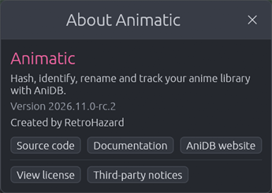
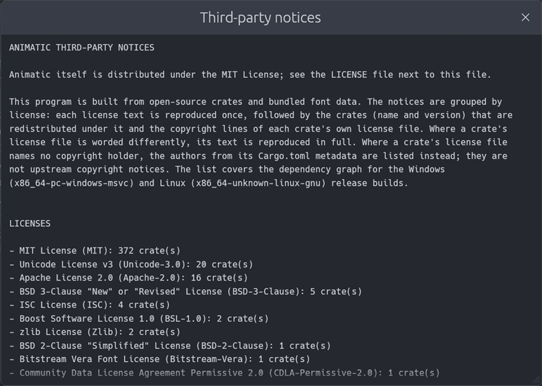

This page covers how to get Animatic running: download a published release archive, check it and
unpack it, or build it from source. Read [Status and limits](#status-and-limits) first: it says what
the project has and has not verified. After the program starts, continue with
[Quick start](Quick-Start.md) for a guided first session, [Running Animatic](Running-Animatic.md) for
the command line, [Data locations](Data-Locations.md) for where your library and settings are kept
and [First launch](First-Launch.md) for safe first-run settings.

## Status and limits

- **Platforms.** Windows and Linux (x86-64) are the supported targets. Published releases carry an
  unsigned Windows ZIP and an unsigned Linux tar.gz (see [Option A](#option-a-download-a-release));
  CI builds and tests both platforms.
- **What has been run.** Native Windows runs were exercised during development. **Linux runtime
  behavior and production AniDB traffic have not been exercised** (see the
  [v2 verification record](https://github.com/RetroHazard/animatic/blob/main/docs/aom-forum-audit.md#v2-verification-observed-only)).
  Treat a Linux desktop launch and any real AniDB exchange as unverified.
- **No installer, no signing.** Releases are plain archives. They are published as GitHub Releases
  when a maintainer merges a reviewed release pull request; see
  [Releases](https://github.com/RetroHazard/animatic/blob/main/docs/releases.md). A CI build
  artifact is not a release. Because the files are unsigned, your browser or Windows may warn that
  the download is unrecognized (this guide cannot promise what such a warning looks like; it has not
  been tested on a clean machine). The SHA-256 check below is how you confirm that a download is the
  file that was published.
- **AniDB contact.** Animatic never contacts AniDB at startup. It talks to AniDB in three cases:
  - when you run the command queue (**Tools → Run command queue**, `Ctrl+Shift+S`, the **Run command
    queue** button on the **Queue** page or the tray menu);
  - when Animatic starts a run itself because you switched on **Run the command queue
    automatically** (off by default);
  - while **Work offline** is off, when you open an anime detail window whose cover is not on disk
    yet (**Download anime covers when a detail window opens**, on by default).

  See [Synchronization](AniDB-Synchronization.md#synchronization). **Work offline** is **off** in a
  fresh profile, so the first thing to do is turn it on ([first launch](First-Launch.md#first-launch)).
  Animatic sends its own registered AniDB clients (`animatic` for UDP, `animatichttp` for HTTP), so
  you need only your AniDB username and password; there is no client to register or enter
  ([AniDB client registration](First-Launch.md#anidb-client-registration)).
- **GitHub contact.** Separately, an **update check** at every start (`updates.auto_check`, on by
  default) asks GitHub for a newer release on your update channel (stable by default) unless *Work
  offline* is on or the settings were recovered from a backup. It only looks for a version: nothing
  is downloaded or installed until you choose **Download and verify** and confirm the installation
  ([Updating Animatic](Updating-Animatic.md)). On a brand-new profile that means a request to GitHub
  (your IP address and the Animatic version) at the very first start; see
  [Portable and rehearsal setups](Data-Locations.md#portable-and-rehearsal-setups) to avoid it.

### System requirements

| Item | Requirement |
|---|---|
| Operating system | 64-bit (x86-64) Windows or Linux. Other platforms are not built or tested. The built-in updater only works on these two. |
| Desktop | A graphical session. Animatic is a window program; it has no text-only mode (the command-line options only change how the window starts). |
| Linux libraries | A desktop session with X11 or Wayland and the xkbcommon library. The build instructions below list the packages CI installs *for building*; which of them are needed to run the release binary is not verified (see [Status and limits](#status-and-limits)). |
| Disk | The executable plus your library. The optional ffprobe download is about 161 MB on Windows and 130 MB on Linux ([External tools](External-Tools.md#media-properties-ffprobe)). |
| Account | An AniDB account is only needed once you want to identify files or edit MyList. Everything local works without one. |

## Get an executable

Choose **Option A** unless you want to change the code or run a version that has no release yet.

### Option A: download a release

Releases come in two streams: **stable** (`YYYY.M.PATCH`) and **beta** (`YYYY.M.PATCH-rc.N`, shown on
GitHub as a prerelease). Betas are for testing: the in-app updater offers them only if you switch
**Options → Updates → Release channel** to **Beta**; otherwise download a beta from its release page
and install it manually, as below. A stable release is offered by the updater on both channels once
it is published.

Releases are listed at <https://github.com/RetroHazard/animatic/releases>. Each GitHub Release lists
three assets (if the project has published one):

| Asset | Content | Platform |
|---|---|---|
| `animatic-vVERSION-windows-x86_64.zip` | `animatic.exe` plus `LICENSE`, `NOTICES`, `README.md`, `CHANGELOG.md` and this user guide as `docs/*.md` | Windows |
| `animatic-vVERSION-linux-x86_64.tar.gz` | `animatic` (executable) plus the same license and documentation files | Linux |
| `SHA256SUMS` | SHA-256 of both archives | both |

Each archive has a single root folder named after the archive, for example
`animatic-v2026.11.0-windows-x86_64/`. The Linux binary keeps its executable bit. The archives hold
no settings, databases, media or credentials: Animatic creates its own data at first run
([Data locations](Data-Locations.md)). The examples below use the illustrative version `2026.11.0`;
replace it with the version you downloaded.

#### 1. Download

Open <https://github.com/RetroHazard/animatic/releases>, find the newest release (beta releases are
marked as a prerelease) and open **Assets**. Download the archive for your platform **and**
`SHA256SUMS` into the same folder. If your browser or Windows warns that the file is unrecognized or
not commonly downloaded, that is expected for an unsigned program; do the check in step 2 before you
run anything.

#### 2. Verify the download

Do not unpack a file that fails this check.

**Windows (PowerShell).** Open the folder that holds both downloads in Explorer, click its address
bar, type `powershell` and press `Enter` (or right-click an empty spot in the folder and choose
**Open in Terminal**, where your Windows version offers it). In the window that opens, paste the
script below. **Change the file name in the first line to the file you downloaded** (it must match
`SHA256SUMS` exactly, including the version).

```powershell
$archive = 'animatic-v2026.11.0-windows-x86_64.zip'
$lines = @(Get-Content .\SHA256SUMS | Where-Object { $_ -match '^\S+\s+\*?(.+)$' -and $Matches[1] -ceq $archive })
if ($lines.Count -ne 1) { throw "expected exactly one SHA256SUMS entry for $archive" }
$expected = ($lines[0] -split '\s+')[0]
$actual = (Get-FileHash -Algorithm SHA256 -LiteralPath $archive).Hash
if ($actual -ieq $expected) { 'checksum OK' } else { throw "checksum mismatch for $archive" }
```

**Linux.** Open a terminal, change to the folder that holds both downloads (for example
`cd ~/Downloads`) and run:

```sh
sha256sum --check --ignore-missing SHA256SUMS
```

Expected result: PowerShell prints `checksum OK`; `sha256sum` prints `OK` for the archive you
downloaded. Any other result (`checksum mismatch…`, `expected exactly one SHA256SUMS entry…`,
`FAILED`) means the download is damaged, is not the published file, or you typed the wrong file name:
check the name first, then delete the download and fetch it again.

A SHA-256 check detects a corrupted or mismatched download. It is **not** a signature and does not
prove who produced the file. If the release page shows it as **Immutable**, GitHub also attests the
release; with the GitHub CLI, `gh release verify-asset vVERSION FILE -R RetroHazard/animatic`
confirms a downloaded archive is exactly the one published in that release (it does not make the
program signed). The full command reference is in
[Releases](https://github.com/RetroHazard/animatic/blob/main/docs/releases.md#install-a-release).

#### 3. Unpack

Windows: in the same PowerShell window run `Expand-Archive -LiteralPath $archive -DestinationPath .`,
or right-click the ZIP in Explorer and choose **Extract All…**. Linux, in the same terminal:

```sh
tar -xzf animatic-v2026.11.0-linux-x86_64.tar.gz
```

Put the folder where you want to keep the program. Choose a folder **you can write to**: the in-app
updater replaces the executable in place without elevation and needs write access to its folder
(a location such as `C:\Program Files` normally does not qualify).

#### 4. Start

Windows: double-click `animatic.exe` in the unpacked folder, or run it from a terminal. Linux: open a
terminal, `cd` into the unpacked folder (`cd animatic-v2026.11.0-linux-x86_64`, using your version) and
run `./animatic`. A window titled "Animatic — AniDB library manager" opens on the **Overview** page.
Nothing is installed: the program creates no registry entries, services or shortcuts of its own. It
writes its data folders (see [Data locations](Data-Locations.md)), the optional file-menu entry that
you can switch on later (see
[Shell entries and the lock file](Data-Locations.md#shell-entries-and-the-lock-file)) and, when you
install an update, a few files next to the executable (see [Updating Animatic](Updating-Animatic.md)).
Start from a terminal if you want the [command-line options](Running-Animatic.md#command-line-reference).

Then follow [Quick start](Quick-Start.md). **Start Animatic offline** on the first run: see
[First launch](First-Launch.md#first-launch).

#### What is in the archive

| File | What it is |
|---|---|
| `animatic.exe` / `animatic` | The program. |
| `LICENSE` | Animatic's license (MIT). |
| `NOTICES` | Licenses of the third-party components built into the program. |
| `README.md`, `CHANGELOG.md` | The project overview and the list of changes. |
| `docs/*.md` | This user guide, the same pages as the project wiki at the release commit. Links between the pages work offline; links to developer documentation and source files point to GitHub and need a network. The pictures are not included (image links in the offline pages stay empty), and neither is developer documentation. |

#### Updating later

An installed release can replace its own executable with a newer published release through
**Help → Check for updates…** (Windows and Linux x86-64, writable folder required, no elevation). It
also replaces `LICENSE` and `NOTICES` beside the executable; the README, changelog and guides stay at
the version you unpacked.
Download a new archive by hand when you want the newer guide pages. Details and limits:
[Updating Animatic](Updating-Animatic.md). A checkout built from source can run the updater, but it
only replaces the compiled binary, never the source: use `git pull` and rebuild, and update
package-manager installations with that manager.

### Option B: build from source

You need these tools to build:

| Item | Requirement |
|---|---|
| Rust toolchain | The current stable release. No version is pinned; the project uses recent language features, so an old compiler fails. |
| C toolchain and linker | Whatever Rust needs on your platform (the MSVC build tools on Windows). SQLite is built into Animatic, so you need no separate SQLite. |
| Debian/Ubuntu libraries | `libgtk-3-dev libxkbcommon-dev libwayland-dev libssl-dev` (build-time development packages, as the project's CI installs them). |

Linux (Debian/Ubuntu):

```sh
sudo apt-get update
sudo apt-get install -y libgtk-3-dev libxkbcommon-dev libwayland-dev libssl-dev
cargo build --release -p animatic
```

Windows (PowerShell) and any other platform with the toolchain installed:

```powershell
cargo build --release -p animatic
```

Run these from the repository root. The executable is `target/release/animatic`
(`target\release\animatic.exe` on Windows). Release builds are optimized and stripped of debugging
symbols. For a quick trial without building a release binary, `cargo run -p animatic` starts
the application (see [Running Animatic](Running-Animatic.md#start-animatic)). Other distributions
need the equivalent packages; they are not documented or tested here.

A build from source has no bundled guide: read the pages in the repository's
[`wiki/` folder](https://github.com/RetroHazard/animatic/tree/main/wiki) or on the project wiki.

## Licenses and notices

Animatic is free software under the MIT license. Both texts ship with the program, so you can read
them without any file next to the executable: choose **Help → About Animatic**.



*The About window shows the version, who created the program and five buttons: **Source code**,
**Documentation** (this wiki), **AniDB website**, **View license** and **Third-party notices**.*

- **View license** opens the **Animatic license** window with the MIT text. It is the same text as
  the `LICENSE` file in the archive.
- **Third-party notices** opens a scrollable, selectable list of every open-source component built
  into this version, grouped by license, with the license texts and copyright lines. It is the same
  text as the `NOTICES` file in the archive. The list covers the dependencies of the Windows and
  Linux release builds.



*The notices start with a summary of licenses and how many components use each.*

The optional **ffprobe** download for media properties is a separate program with its own license:
Animatic keeps its license text beside it (`LICENSE-ffmpeg.txt`) and shows the license in the
confirmation before it downloads anything ([External tools](External-Tools.md#media-properties-ffprobe)).
The AniDB covers and the data you read through AniDB are subject to AniDB's own terms; Animatic does
not license them ([Cover pictures](Data-Locations.md#cover-pictures)).

## Removing Animatic

There is no uninstaller because nothing was installed. To remove Animatic completely:

1. If you ever switched on **Add "Hash with Animatic" to the file menu** (**Options → Hashing**), switch
   it off and press **Save options** first. Deleting the program does not remove that entry.
2. Quit Animatic (**File → Quit**; closing the window also quits).
3. Delete the unpacked program folder.
4. Optionally delete your library and settings. [Back up the library](Backups-and-Recovery.md) first
   if you may want it again: this deletes your hashes, MyList cache and queued edits. The folders
   are listed in [Where data lives](Data-Locations.md#where-data-lives).
5. If you saved an AniDB password, API key or AVDump key, delete the entries in the Windows
   Credential Manager or your Linux Secret Service front end; deleting the folders does not remove
   them ([credentials and the keystore](Settings-Files.md#credentials-and-the-system-keystore)).

Your media files are never touched by any of this.

## See also

- [Quick start](Quick-Start.md): your first session, step by step.
- [First launch](First-Launch.md): what to set before Animatic talks to AniDB.
- [Updating Animatic](Updating-Animatic.md): checking, verifying and installing a newer release.
- [Troubleshooting](Troubleshooting.md): startup problems and recurring messages.
