The nine navigation pages in order, and the anime detail window. Each section says what the page shows, explains every column and button (with when it is enabled and what the grayed-out hover text says), the selection rules, the context menu and the empty state, and links to the task pages for the jobs you do there. Search, sorting and the column chooser shared by the tables are in [Main window](Main-Window.md#searching-and-tables) and [Sorting, columns and row colors](Main-Window.md#sorting-columns-and-row-colors). The page title is the same as the sidebar label.

| Page | Use it to |
|---|---|
| [Overview](#overview) | See what needs attention and the library figures. |
| [MyList](#mylist) | View and edit your MyList entries. |
| [Anime](#anime) | Browse every anime stored locally; filter by genre. |
| [Advanced search](#advanced-search) | Combine title, year, type and MyList filters. |
| [Hashed files](#hashed-files) | Work with the files Animatic has hashed: rename, add to MyList, play. |
| [Groups](#groups) | Browse release groups. |
| [Genres](#genres) | Browse genres and jump to their anime. |
| [Queue](#queue) | Run, retry or clear the commands waiting for AniDB. |
| [Log](#log) | Read this session's activity and errors. |

On a fresh database most tables are blank (they have no empty-state text); the Queue and Log pages explain their empty state.

## Overview

The first page. From top to bottom:

1. **Getting started** (only on a new profile, see [Getting started](#getting-started)).
2. **Needs attention:** what asks for action now, each with the button that resolves it. When there is nothing, one line: `✓ Nothing needs your attention.`
3. The buttons **Add files…**, **Scan managed folders** and **Open hashed files**.
4. **Your library:** four figures counted from this database, and a line with the identification count.
5. **Your AniDB account:** the figures AniDB reported for the whole account.

The next picture shows the page with the sample library: a hash queue, a CRC mismatch, unidentified files, a blocked command and waiting commands.

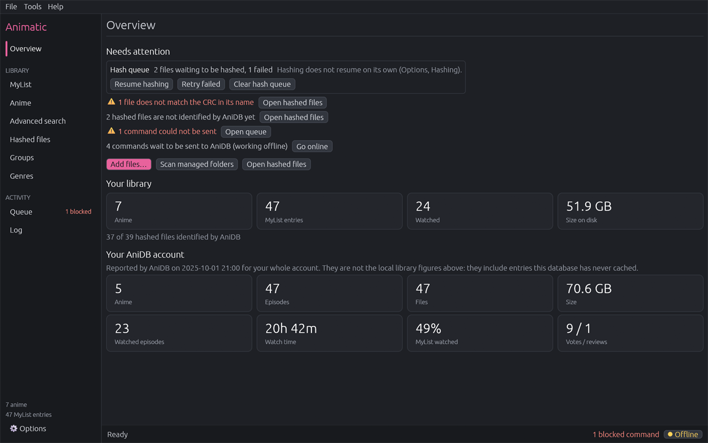

### Needs attention

This section is cropped in the next picture, with the Hash queue panel at the top and one row per kind of problem below it.

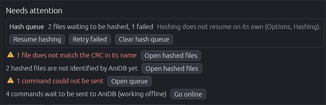

**Needs attention** lists, in this order, only what applies:

| Row | Button | What to do |
|---|---|---|
| A framed panel titled **Hash queue** (the [hash queue](Hashing-and-Identification.md#hash-queue)) while files wait to be hashed or failed (pending and failed counts) | **Resume hashing**, **Retry failed**, **Clear hash queue** | See [Hash queue panel](#hash-queue-panel). |
| A red `⚠ N files do not match the CRC in their name` (`⚠ 1 file does not match the CRC in its name`) when AniDB knows a CRC for a file that differs from the one Animatic computed (compared case-insensitively; no AniDB CRC means no mismatch) | **Open hashed files** | See [File and import problems](File-and-Import-Problems.md). |
| `N hashed files are not identified by AniDB yet` | **Open hashed files** | Identification needs AniDB; see [Hashing and identification](Hashing-and-Identification.md). |
| A red `⚠ N commands could not be sent` for blocked queue commands | **Open queue** | See [Queue](#queue). |
| `N commands wait to be sent to AniDB` | **Run command queue** (disabled during a cooldown or settings review) | While **Work offline** is on, the text adds `(working offline)` and the button is **Go online**, which turns **Work offline** off and saves the settings file (not while [recovered settings](Settings-Files.md#recovery-matrix) are unsaved). Nothing is sent until you then run the queue. |
| A yellow `N commands not saved yet; Animatic keeps retrying` | none | Queue commands are held in memory (see [Status bar](Main-Window.md#status-bar-progress-and-the-log)). |

### Your library

| Tile | Definition |
|---|---|
| Anime | Number of anime rows in the database. This includes rows created by the [title-list download](AniDB-Synchronization.md#synchronization), so it can far exceed your own library. |
| MyList entries | Number of MyList entries |
| Watched | MyList entries marked watched |
| Size on disk | Total size of hashed files (binary units, e.g. `1.23 GB`) |

Below the tiles: `N of N hashed files identified by AniDB`.

### Your AniDB account

The result of the last **Tools → Fetch MyList statistics** that AniDB answered, with the time it was received. Eight tiles: **Anime**, **Episodes**, **Files**, **Size**, **Watched episodes**, **Watch time**, **MyList watched** (share of MyList watched) and **Votes / reviews**. Above them the page says `Reported by AniDB on <date time> for your whole account. They are not the local library figures above: they include entries this database has never cached.`

Before any result the section reads `No account statistics yet.` with a **Fetch MyList statistics** button (hover: `Queues the request; AniDB answers when you run the command queue`).

These figures describe your whole AniDB account, so they differ from the local tiles above, which count only the rows stored in this database. The page never mixes the two. The result is kept in the library database and shown again after a restart; each new result replaces the old one.

There is no refresh button: the page follows the library snapshot, and **File → Reload** (`F5`) re-reads it at once.

### Getting started

The **Getting started** box is shown on a new profile (while the settings key `first_launch` is true), as in the next picture.

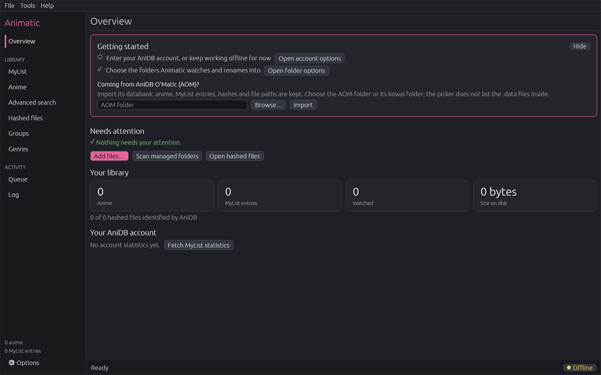

It is a checklist with two steps, each ticked (✓) or open (○). Both buttons open the [Options window](Options-Window.md) at the matching category:

- **Enter your AniDB account, or keep working offline for now**: button **Open account options**; done once a user name is entered.
- **Choose the folders Animatic watches and renames into**: button **Open folder options**; done once a folder rule has a path.

Below the checklist, "Coming from AniDB O'Matic (AOM)?" offers the databank import. It keeps anime, MyList entries, hashes and file paths. Choose the AOM folder or its kowai folder (the picker does not list the `.data` files inside). The box has a folder field (hint `AOM folder`), **Browse…** and **Import**. This is the same as [**File → Import → AOM databank…**](Migrating-from-AOM.md#migrate-an-aom-databank), except that you may paste a folder path. Both are disabled during a settings review.

**Hide** clears the flag and writes the settings file at once (unless [recovered settings](Settings-Files.md#recovery-matrix) are guarding it). The box never goes away by itself: it stays until you click **Hide**, even when both steps are ticked. See [First launch](First-Launch.md).

## MyList

The page groups the MyList by anime: one top-level row per anime, collapsed by default, and the anime's MyList entries (episodes and files) as child rows when it is expanded. It lists the MyList entries stored locally. They come from an AOM import, from files identified or added through the [queue](#queue), or from a [MyList export import](AniDB-Synchronization.md#full-account-mylist-import) (**File → Import → MyList export…**); Animatic never downloads your MyList entry by entry (see [Not implemented](Feature-Parity.md#not-implemented)). The tasks you do here (edit, mark watched, remove, refresh) are described in [Managing MyList](Managing-MyList.md).

The next picture shows the sample library with Sakura Shingou expanded and one entry selected.

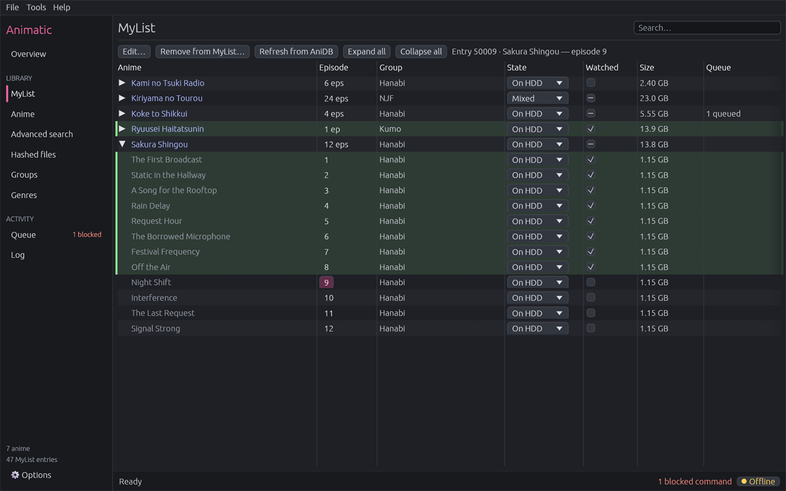

*One anime expanded; the episode `9` cell is highlighted because that entry is selected, which is why the toolbar reads `Entry 50009 · Sakura Shingou — episode 9`.*

Click the arrow in front of the title to expand or collapse one anime (hover: `Show the entries of this anime` or `Hide the entries of this anime`). **Expand all** and **Collapse all** in the toolbar do it for every anime in the table. The expand state is kept while you work and is not saved when you quit.

Child rows are always in AniDB episode order: regular episodes by number, then specials (`S`), credits (`C`), trailers (`T`), parodies (`P`) and others (`O`) by type and number; entries whose episode is unknown come last.

The headers sort the anime rows by their totals (title, episodes/files, group, state, watched share, size, queue); the entries below an anime stay in episode order whatever the sort. Without a sort the anime are in title order. The search box filters by anime title: a matching anime shows with all of its entries.

### Columns of an anime row

| Column | Meaning |
|---|---|
| **Anime** | The title; a link that opens the [detail window](#anime-detail-window). |
| **Episode** | `12 eps` (`1 ep` for one), or `15 files` (`1 file`) when an episode has several files; hover shows both counts. **Click it to select every entry of the anime.** |
| **Group** | The group's short name (else its name), or `various` when the entries come from different groups; blank when no group is known. |
| **State** | A combo box showing the common state, or `Mixed`. Choosing a value sets it on every entry (hover: `Sets the state of every entry of this anime`). |
| **Watched** | A checkbox: ticked when every entry is watched, unticked when none is, a dash when only some are (hover: `Marks every entry of this anime watched, or none of them`). |
| **Size** | The sum of the entries' file sizes. |
| **Queue** | How many entries wait for an edit (`N queued`), for removal (`N removing`) or are blocked (`N blocked`), joined with commas, for example `2 queued, 1 blocked`. |

The row is tinted like a watched entry once all of its entries are watched.

### Columns of an entry row

| Column | Meaning |
|---|---|
| **Anime** | The episode's title, indented. |
| **Episode** | `12`, `S1`, `C1`, `T1`, `P1`, `O1`, or `—` if unknown. **Click it to select the entry.** |
| **Group** | Short name, else full name. |
| **State** | A combo box. |
| **Watched** | A checkbox. |
| **Size** | The file size, when the file is known. |
| **Queue** | `Edit queued`, `Removal queued`, or the same with `blocked`; hover shows the last error. |

State choices are `Unknown`, `On HDD`, `On CD/DVD`, `Deleted`, `Remote/Shared` (stored as 0–4), shown the same way in the closed combo box. Any other stored value shows as `Other (N)`; it cannot be selected.

### Selecting and editing in place

Choosing a **State** or ticking **Watched** on an anime row applies it to every entry of the anime in one step. Animatic queues one merged `Edit mylist entry N` per entry, saves them all in a single database transaction and shows the new values at once.

- Entries that already have the value are left alone: nothing is queued for them and a watched date is not restamped.
- Entries waiting to be removed are skipped.
- Marking watched stamps the moment of the click.
- Clicking the dash of a partly watched anime marks every entry watched; click again to unmark them all.

On an entry row the combo box and checkbox queue one `Edit mylist entry N` (merged with an edit still waiting). If the entry is waiting for removal the log says `Mylist entry N is pending removal; edit ignored`.

Selecting is separate from editing: click an entry's episode, or an anime's episode count, to select; the buttons above the table act on the selection. Until something is selected, a weak hint says `Click a row's episode to select it; an anime's episode count selects all of its entries`. Then the toolbar shows `Entry N · <anime — episode>`, `<anime> · all N entries selected` (with ` (M being removed)` when some are waiting for removal) or `Entry N: removal queued`. All changes are queued first, so they work offline; see [MyList editing](AniDB-Synchronization.md#mylist-editing).

### Toolbar buttons

| Button | Enabled when | Does |
|---|---|---|
| **Edit…** | An entry, or an anime, is selected and not all its entries wait for removal. Disabled hover: `Select a row (click its episode) that is not being removed`. | Opens the entry editor (below) for the selected entry, or for every entry of the selected anime (entries already waiting for removal are left out). |
| **Remove from MyList…** | Same as **Edit…**. | Opens a confirmation dialog (`Esc` or a click outside cancels); its **Remove from MyList** button queues `Remove mylist entry N`, one per selected entry (every entry of the anime for an anime row). Your media files are never touched. The rows stay until AniDB confirms, show `Removal queued` meanwhile and `Removal blocked` if the request failed permanently (they stay listed on the [Queue](#queue) page until you retry or discard them). Edits of the entries still waiting in the queue are discarded; later edits are refused while the removal waits. |
| **Refresh from AniDB** | Something is selected. | Queues `Refresh mylist entry N` for the selected entry, or for each entry of the selected anime. The reply replaces the cached row but never overwrites a change you made that has not been sent yet. If AniDB says the entry no longer exists, the row is removed unless you have queued changes for it. |
| **Expand all** / **Collapse all** | There is at least one anime row. | Show the entries of every anime in the table, or one row per anime. |

The confirmation that **Remove from MyList…** opens looks like this.

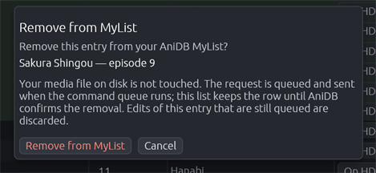

### Entry editor

The **Edit MyList entry** window is shown next.

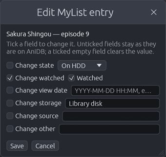

The window shows the anime and episode below the title; for an anime row the title names the anime and how many entries are edited. The fields are **state**, **watched**, **view date**, **storage**, **source** and **other**. Each has a **Change** checkbox (`Change state`, `Change watched`, …), ticked automatically when you edit the value. An **unticked field is left as it is on AniDB; a ticked empty text field clears it** (the same rule as the folder rule's MyList values in the [Options window](Options-Window.md#mylist-values-of-a-rule)).

The view date (`YYYY-MM-DD HH:MM` or `YYYY-MM-DD`, in your local time zone; hint `YYYY-MM-DD HH:MM, empty = now`) is offered while the entry is watched; ticking it with no text means "now". An invalid date shows a red `View date "<text>" must look like 2025-03-04 18:30 (local time)` and blocks **Save**. Marking an entry watched stamps the moment you saved it, not the moment AniDB hears of it, and marking it unwatched drops the date.

**Save** is disabled until a field is ticked (the window says `Nothing is ticked yet.`; hover: `Queues the change and shows it here at once; it is sent to AniDB when the command queue runs`). It queues one merged `Edit mylist entry N` (merged with any edit still waiting, so a stale acknowledgement never undoes a newer edit) and shows the new values at once. **Cancel** changes nothing. The edit survives a restart.

An entry waiting for removal shows `This entry is waiting to be removed from MyList; edits are refused.` and the form is grayed out. When you edit an anime, the fields start unticked and empty (the entries differ, so there is nothing to show). A ticked field is set on every entry that does not already have the value, and all the changes are saved in one transaction.

## Anime

Subtitle: *every anime stored locally*. This is the full list of anime rows, including ones that are not in your MyList (for example from the title-list download). The page has a search box and a genre filter. Until you click a column header the anime are listed in the order they were stored, not alphabetically; click **Title** to sort.

The next picture shows the page with the sample library.

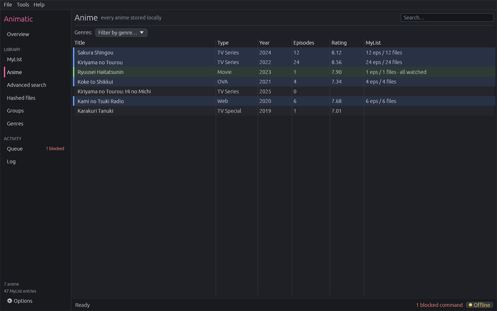

| Column | Meaning |
|---|---|
| **Title** | The display name. Click to select the row and open the [detail window](#anime-detail-window). |
| **Type** | `TV Series`, `OVA`, `Movie`, `Other`, `Web`, `TV Special`, `Music Video`, else `Unknown`. |
| **Year** | Year text as AniDB gave it. |
| **Episodes** | Total episode count; 0 if unknown. |
| **Rating** | Two decimals, blank when none. |
| **MyList** | `N eps / M files` when any of its files are in MyList, followed by ` · all watched` when every episode is watched. Here `N eps` counts regular episodes only (specials, credits and trailers are not counted) and `M` is the number of MyList entries. Blank when the anime has no MyList entry. |

Rows are tinted by status (fully watched, in MyList) when [row tinting](Main-Window.md#sorting-columns-and-row-colors) is on. There are no buttons or context menu on this page.

### Filtering by genre

A `Genres:` line above the table (shown once any genre is stored, or while a filter is active) shows the chosen genres. Each is a button with **✕** that removes it (hover: `Remove this genre from the filter`). A **Filter by genre…** / **Add genre…** list (each genre with its anime count, `Name (count)`) adds one.

- With several genres chosen the page lists the anime that have **all** of them, a weak note `anime with all of these genres` appears and **Clear** removes every genre.
- Clicking a genre on the [Genres](#genres) page or in an anime's detail window shows that genre alone; `Ctrl+click` (or `Shift+click`) adds it to the genres already chosen.
- Picking a genre by clicking a link clears the search text, which then narrows the list as usual, and closes an open detail window. Choosing from the **Add genre…** list keeps your search text.
- The genres stay chosen while you move between pages.

The next picture shows the page filtered by one genre.

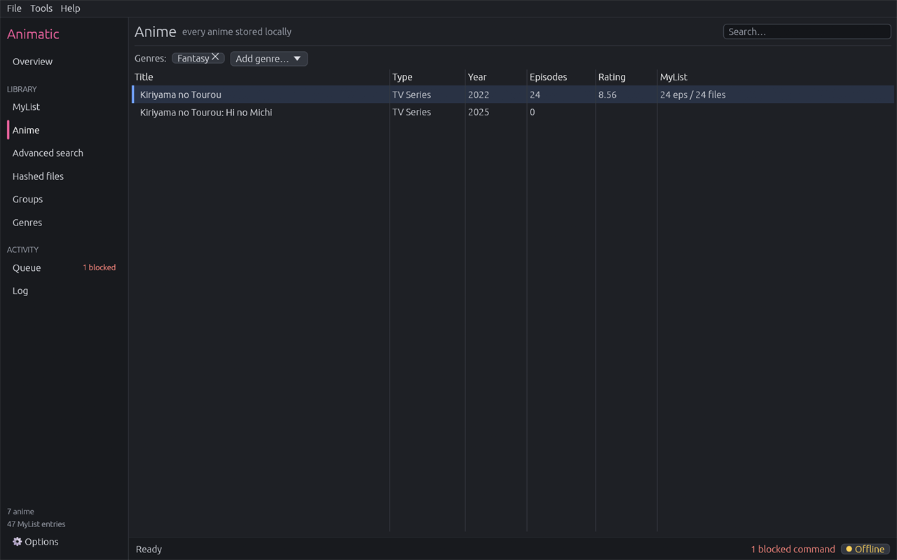

*Filtered by one genre; the filter line shows the chosen genre and the list to add another.*

Search is described in [Searching and tables](Main-Window.md#searching-and-tables).

## Advanced search

Combine several conditions. There is no search box in the heading: the controls sit in one row above the results, as the next picture shows.

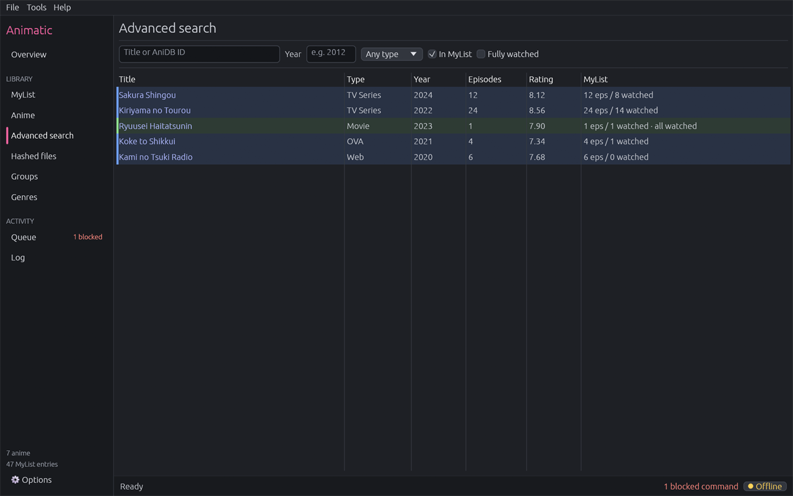

Fields, combined with AND:

| Control | Rule |
|---|---|
| Title or AniDB ID (hint `Title or AniDB ID`) | As the shared search; it holds the same text as the other pages' search box. |
| Year (hint `e.g. 2012`) | Text typed here (trimmed) must be **contained in** the year text: `2012` matches `2012`; `20` matches 2012 and 2020 |
| Type combo (shows `Any type`) | Any type, TV Series, OVA, Movie, Other, Web, TV Special, Music Video |
| In MyList | Anime has at least one MyList entry |
| Fully watched | Watched regular episodes ≥ the anime's episode count (total, else highest known number); requires a known count |

Result columns match the [Anime](#anime) page (**Title**, **Type**, **Year**, **Episodes**, **Rating**, **MyList**), but here **Title** is a link, and the MyList column reads `N eps / M watched` (distinct regular episodes in MyList / watched regular episodes, followed by ` · all watched` when every episode is watched). Clicking a title opens the [detail window](#anime-detail-window). With no matching anime the table is empty.

## Hashed files

Local files Animatic has hashed, by default sorted by path. Hashing, identification and the hash queue are explained in [Hashing and identification](Hashing-and-Identification.md); renaming in [Renaming files](Renaming-Files.md); adding to MyList in [AniDB synchronization](AniDB-Synchronization.md#mylist-editing). The next picture shows the page with the hash queue panel open above the table.

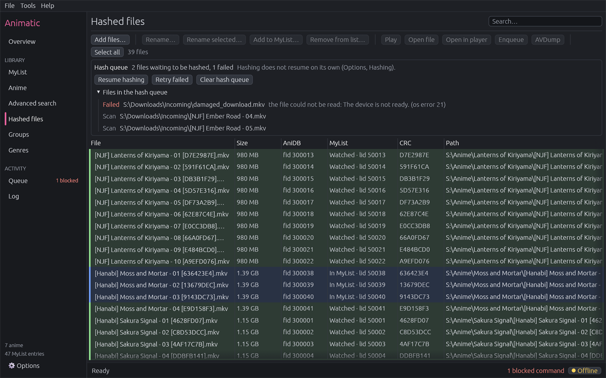

### Columns

| Column | Meaning |
|---|---|
| **File** | The file name. Click to select; `Ctrl+click` toggles a file; `Shift+click` selects a range (see Selection). Right-click for the [context menu](#context-menu-of-a-file). |
| **Size** | File size in binary units. |
| **AniDB** | `fid N` or `Not identified`. |
| **MyList** | `In MyList · lid N`, `Watched · lid N` once watched, `Add queued` while an add waits in the queue, or `—`. |
| **CRC** | The local CRC32 in upper-case hex, or `Mismatch` when AniDB knows a different CRC; `—` before hashing finished. |
| **Path** | The full path. Double-click opens the file with the operating system's default program. |

`fid N` means the hash matches a file record already stored locally (from the import or from an identify command that ran); `Not identified` means no such record, not necessarily that AniDB does not know the file. Rows are tinted when [row tinting](Main-Window.md#sorting-columns-and-row-colors) is on: CRC mismatch and not identified ask for action; in MyList and watched are calmer.

### Selection

There is one selection on this page, shown as highlighted **File** cells; the toolbar acts on it. A plain click selects only that file; `Ctrl+click` adds or removes one; `Shift+click` selects every visible row between the *anchor* and the clicked row (in the current sort and filter order). The anchor is the *primary* file: the one you last selected with a plain click or `Ctrl+click`; a `Shift+click` range does not move it. **Select all** selects every listed file; **Clear selection** empties it. Right-clicking a row outside the selection selects that row alone. The count at the end of the toolbar reads `N files`, or `M of N files` under a filter, plus ` · N selected` when files are selected.

If a search hides a selected row the selection is cleared of the hidden rows, so no action can hit an invisible file; **Add to MyList…** and **Rename N selected…** likewise only act on files that are listed. The single-file buttons (**Rename…**, **Play**, **Open file**, **Open in player**, **Enqueue**, **AVDump**) act on the primary file only; **Rename N selected…**, **Add to MyList…** and **Remove from list…** act on the whole selection.

The next picture shows a search that narrowed the list, with six files selected.

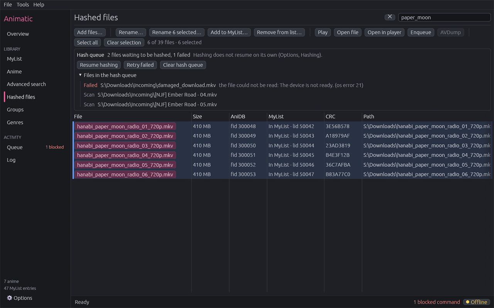

*A search narrows the list, then `Shift+click` selects six files; the toolbar reads `Rename 6 selected…`.*

### Toolbar

The toolbar wraps onto several lines instead of clipping and groups its buttons: **Add files…** | **Rename…**, **Rename N selected…**, **Add to MyList…**, **Remove from list…** | **Play**, **Open file**, the player buttons, **AVDump** | **Select all**, **Clear selection**, the count.

| Button | Enabled when | Does |
|---|---|---|
| **Add files…** | No settings review is open (`An import is in progress`). Hover: `Shortcut: Ctrl+O`. | File picker (multiple); queues the files and starts [hashing](Hashing-and-Identification.md). |
| **Rename…** | A file is selected. Disabled hover: `Select a file in the table first`. Hover: `Preview and rename the selected file`. | Previews a [manual rename](Renaming-Files.md) of the primary selected file. |
| **Rename N selected…** (reads **Rename selected…** with nothing selected) | One or more files are selected. Disabled hover: `Ctrl+click or Shift+click selects several files`. | Plans the selected files in the background and opens the [Batch rename](Renaming-Files.md#several-files-batch-rename) preview. |
| **Add to MyList…** | A file is selected. | Opens a dialog for the selected files: state, watched, view date, storage, source and other (tick a field to set it; unticked fields keep AniDB's defaults). **Queue add** queues one `Add to mylist` per file: an identified file by its file id, an unidentified one by size and ED2K hash, which AniDB resolves first (a file AniDB does not know is skipped when the queue runs). Files already in MyList, files with an add already waiting and further copies of the same content are left out. The dialog says `N files will be queued for your MyList`, `N of them are not identified yet: AniDB looks them up by hash first, and a file it does not know is skipped.`, `N already in MyList (edit them on the MyList page)` and `N already waiting to be added`; with nothing left it says `None of the selected files can be added.` The MyList column shows `Add queued` at once and `lid N` after AniDB confirmed. |
| **Remove from list…** | One or more files are selected **and** no task is running. Hover: `Forget the selected files in Animatic; the files on disk and MyList are untouched`. Disabled hover: why (for example `Wait for the running task to finish, or cancel it, first.`, or `Select a file in the table first`). | Asks first (see below). |
| **Play** | A file is selected. | Starts the chosen [external player](External-Tools.md) (the default one unless you pick another) with its **Play arguments**. With no player set up in **Options → Players and tools**, the button is still enabled and shows the error `No external player is configured`. |
| **Open file** | A file is selected. Hover: `Open with the program your system uses for this file type`. | Opens the file with the OS default program (not your configured player). |
| Player chooser | Shown only when several players are configured. Hover: `The player used by Play, Open in player and Enqueue`. | A combo box listing the players' names. |
| **Open in player**, **Enqueue** | A file is selected. Shown only when the chosen player has **Open arguments** or **Enqueue arguments** set. | Start the player with those. |
| **AVDump** | A file is selected **and** AVDump integration is on. Disabled hover without it: `Turn on AVDump in Options, Players and tools`. | Starts [AVDump](External-Tools.md). |
| **Select all** | Always. | Selects every listed file (hover: `Select every listed file (Rename and Add to MyList act on all)`). |
| **Clear selection** | Shown once files are selected. | Clears the selection. |

### Remove from list

The next picture shows the confirmation window that **Remove from list…** opens.

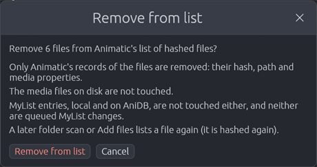

It asks first (`Esc` or **Cancel** closes the window), then removes Animatic's records of the selected files, one or several: their hash, path and [media properties](External-Tools.md#media-properties-ffprobe). **Your media files on disk are not touched, and neither are MyList entries** (the local rows and anything queued for AniDB). It is a manual cleanup of the list, never automatic: a later [scan](Managed-Folders-and-Scans.md) of the folder or **Add files…** lists the file again (and hashes it again). It runs as a background task, so it waits while another task runs (the **Remove from list** button is disabled while the worker is busy), and the log says `Removed N files from the list`.

### Context menu of a file

Right-click a file name to open the menu shown next.

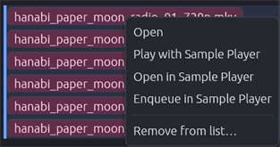

The entries are **Open** (the OS default program), **Play with <player>** (when a player is configured), **Open in <player>** and **Enqueue in <player>** (only when that player defines those arguments), then **Remove from list…** (hover `Forget the selected files; the files on disk stay`; disabled with the reason while a task runs). **Open**, **Play with …**, **Open in …** and **Enqueue in …** act on the primary file (see Selection); **Remove from list…** acts on the whole selection.

### Hash queue panel

The next picture shows the panel with queued and failed files.

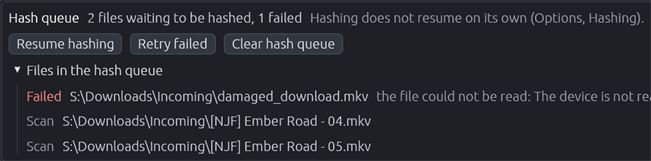

While files wait to be hashed (or failed), a framed panel titled **Hash queue** sits between the toolbar and the table. It shows `N files waiting to be hashed`, `N files failed` or `N files waiting to be hashed, M failed`.

- A collapsible **Files in the hash queue** lists them (up to 500, then `… and N more`): failed files first, as a red `Failed`, the path and the reason; then waiting files in hashing order, each tagged with where it came from: Add files, Command line, Scan or Other launch.
- Its buttons are **Resume hashing**, **Retry failed** and **Clear hash queue**. They wait while another task runs; hover for what each does, for example `Forget every waiting and failed file. Hashed files stay in the library`.
- With **Start hashing automatically** off, a note says `Hashing does not resume on its own (Options, Hashing).`

The same panel, without the file list, appears on the [Overview](#overview) under **Needs attention**. See [Hash queue](Hashing-and-Identification.md#hash-queue).

## Groups

Release groups known to the local database. Searchable by name or short name. The next picture shows the page.

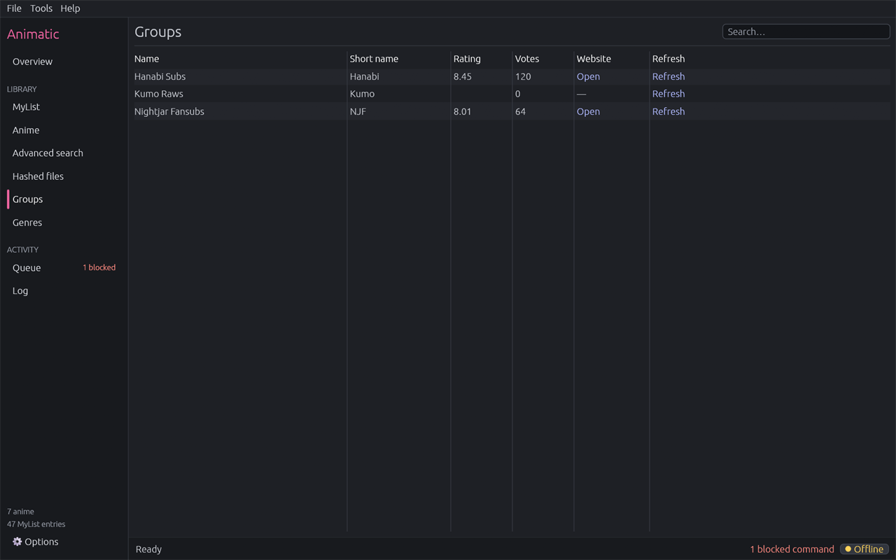

| Column | Meaning |
|---|---|
| **Name** | The group's name. |
| **Short name** | The tag used in file names, such as `Hanabi`. |
| **Rating** | AniDB's group rating, two decimals, blank when none. |
| **Votes** | Number of votes. |
| **Website** | An `Open` link that launches the browser; `—` if the group has none. |
| **Refresh** | A **Refresh** link (hover: `Queues a request that re-reads this group from AniDB`) that queues `Fetch group N`; nothing is sent until the queue runs, and the reply replaces the cached group. |

## Genres

Every genre stored locally. Searchable by name. The next picture shows the page.

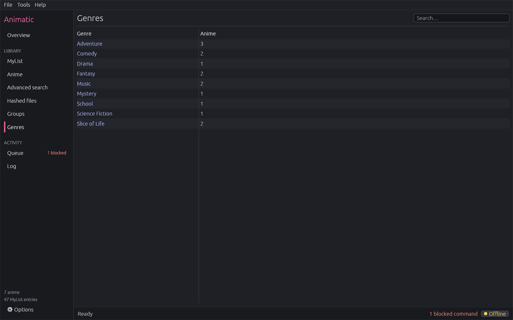

| Column | Meaning |
|---|---|
| **Genre** | A link. Click it to list that genre's anime on the [Anime](#anime) page (hover: `Show the anime of this genre; Ctrl+click adds it to the genres already chosen`); `Ctrl+click` (or `Shift+click`) adds it to the genres already chosen there. |
| **Anime** | Number of anime carrying it. |

## Queue

The durable AniDB command queue (subtitle: *AniDB commands waiting to be sent*). Everything you ask AniDB to do (identify files, MyList adds, edits, removals, refreshes) waits here first, so it works offline and survives a restart. The sidebar entry shows the number of pending commands, or a red `N blocked`. See [AniDB synchronization](AniDB-Synchronization.md) and [Network and sync problems](Network-and-Sync-Problems.md). The next picture shows the page with pending and blocked commands.

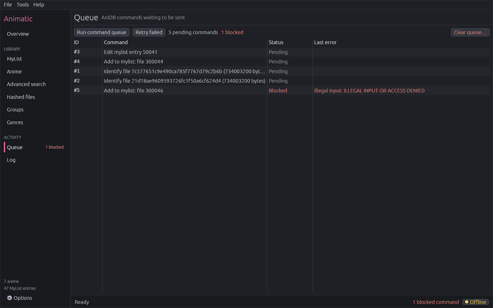

### Header and buttons

| Control | Does |
|---|---|
| **Run command queue** | Starts the same job as **Tools → Run command queue** (hover `Shortcut: Ctrl+Shift+S`; shortcut `Ctrl+Shift+S`). Disabled during a settings review (`An import is in progress`) or an active cooldown (the hover shows the cooldown text). While **Work offline** is on the button is still enabled, but pressing it only reports `Offline mode is enabled; commands remain queued`: click **Offline** in the status bar (or **Go online** on Overview) first. |
| **Retry failed** | Enabled when something is blocked. Disabled hover: `No command has failed`. Unblocks every blocked row with fresh attempts (edits of the same MyList entry are merged first). Does not run anything and does not bypass a cooldown. |
| `N pending commands` | Label: everything in the queue, blocked rows included. |
| red `N blocked` / `blocked commands (refreshing)` | Shown when some are blocked, or a blocked event is newer than the snapshot on screen. |
| **Clear queue…** (red, at the right) | Disabled while the queue is empty (`The queue is empty`). Asks for confirmation in a dialog (below). See [MyList editing](AniDB-Synchronization.md#mylist-editing) for the effect on the local copy. |

The next picture shows the dialog that **Clear queue…** opens.

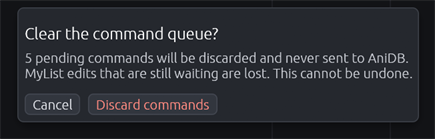

The dialog **Clear the command queue?** says that the pending commands will be discarded and never sent, that waiting MyList edits are lost and that this cannot be undone. **Discard commands** (red) then deletes *every* queue row, blocked ones and unsynchronized MyList edits included. **Cancel**, `Esc` or a click outside discards nothing.

A yellow line repeats an active cooldown. While **Run the command queue automatically** is on, a gray line says that automatic runs never remove MyList entries, and a yellow line counts the removals that wait for you to click **Run command queue**.

### Table

Columns: **ID** (`#n`, never reused), **Command**, **Status**, **Last error** (red; hover for the full text). The table cannot be sorted.

| Status | Meaning |
|---|---|
| `Pending` | Not yet attempted |
| `N retries` (`1 retry`, yellow) | Attempted before; still runnable |
| `Blocked` (red) | Skipped until **Retry failed** |

Order of execution (and of the list, blocked rows last): lower priority number first, then oldest. Priorities: MyList writes (add, edit, removal) 0; Identify 1; file/episode/group lookups 2; anime refresh, MyList statistics, title list, MyList export (and its cancel) 3; MyList entry refresh 4.

Command descriptions you will see: `Identify file <ed2k> (<n> bytes)` (with ` + add to mylist` when the folder rule adds it), `Add to mylist: file N` or `Add to mylist: <ed2k> (<n> bytes)`, `Edit mylist entry N`, `Remove mylist entry N`, `Refresh mylist entry N`, `Fetch anime N`, `Fetch episode N`, `Fetch group N`, `Fetch file N` (from the full update or **Update known file information**), `Fetch mylist statistics`, `Download anime title list`, `Request MyList export from AniDB`, `Cancel the queued MyList export`.

A row whose stored payload this version cannot read is kept, blocked, as `Unreadable queued command: …`; it is never deleted silently.

### Empty state

An empty queue shows **Nothing is waiting for AniDB** with the line `MyList edits and lookups wait here until they are sent.` (and ` You are working offline, so they are kept.` while **Work offline** is on) instead of the table.

## Log

In-memory activity log for this session (subtitle: *this session's activity*), newest at the bottom (it scrolls with new lines). The next picture shows it after **Tools → Check library**.

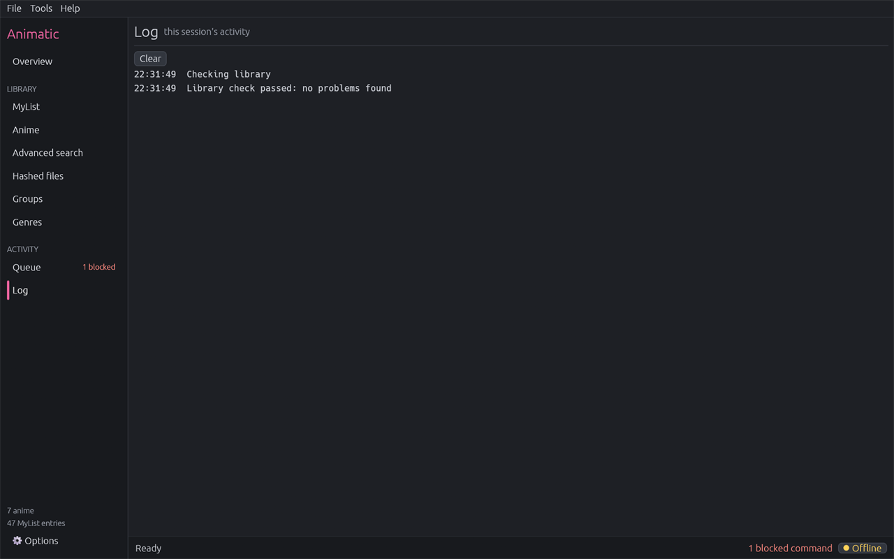

- **Clear** empties it (hover: `Empty the log; nothing else changes`); it is disabled while the log is empty.
- Each line starts with the time `HH:MM:SS`; lines with `ERROR` are red. Most lines also appear in the [status bar](Main-Window.md#status-bar-progress-and-the-log) while they are the newest message.
- It is not written to disk and resets on exit. Ordinary lines trim it: the oldest 500 are dropped each time it grows past 2000 (a long run of error lines can grow it past that until the next ordinary line).
- It records starts, hash results (`Hashed <path> (local #N, <ed2k>)`), sync outcomes, blocked commands, cooldowns, imports, exports and every error. Hash output reveals file paths and hashes, so mind what you paste when asking for support (see [Reporting problems](Reporting-Problems.md)).
- **Empty state:** `No activity yet` with the line `Hashing, renaming, AniDB requests and errors are listed here as they happen.`

## Anime detail window

Opened from any anime link or title (the Anime page's **Title**, the Advanced search and MyList title links, or a Relations entry). The window title is the anime's name (`Anime N` until the record is available). It is about 560 pixels wide by default (it scales with **UI scale**), scrolls inside, and closes with its title-bar **×** button or `Esc`; closing it clears the selection.

Only the Anime, Advanced search and MyList pages draw it. If you switch to another page the window disappears (it is hidden, not closed, and `Esc` cannot reach it) and comes back when you return to one of those three pages. The next picture shows the window with the Episodes section open.

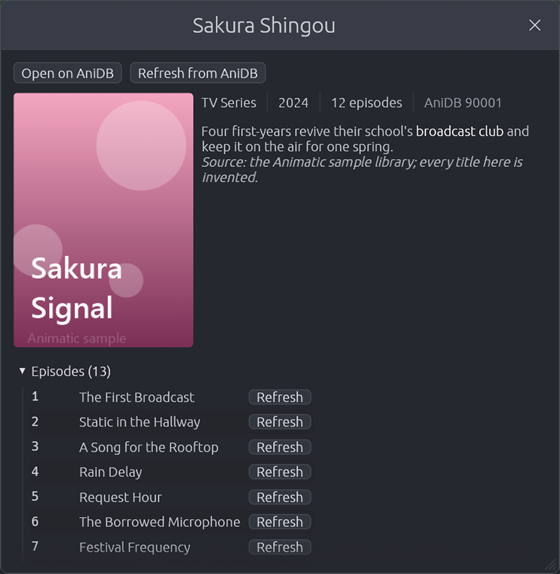

At the top: **Open on AniDB** and **Refresh from AniDB**. If no record is stored the window shows only these two buttons and `No detail record is available.` Otherwise: the [cover](#cover) on the left, then `type`, `year`, `N episodes` and `AniDB <id>` in one line, the description if one is stored, and collapsible sections, each listed with its count. A section with no entries shows `(0)` and cannot be opened.

| Section | Contents |
|---|---|
| **Episodes (N)** (open by default) | A grid of episode number, name and a small **Refresh** button per row (hover: `Queues a request that re-reads this episode from AniDB`) that queues `Fetch episode N`. Ordered by type, then number; specials count too, so an anime with 12 episodes and one special lists 13. |
| **Titles (N)** | Language code and text. |
| **Genres (N)** | Each genre is a link that opens the [Anime](#anime) page filtered to it, or with `Ctrl+click` adds it to the chosen genres, and closes the window. Strongest genres first. |
| **Relations (N)** | `<relation> — <title>`; clicking one switches the window to that anime, and shows `No detail record is available.` if it is not stored. |
| **Reviews (N)** | Author (or `Anonymous`), rating, body; best rated first. |

The next picture shows the Genres and Reviews sections open; the review text is styled.

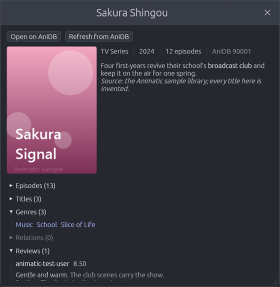

- **Open on AniDB** opens `https://anidb.net/anime/<id>` in your browser.
- **Refresh from AniDB** (hover: `Queues a request that re-reads this anime from AniDB`) queues `Fetch anime N` (HTTP API). Nothing is sent until you run the queue; a duplicate of an already queued refresh is ignored. AniDB asks clients to request an anime at most once per 24 hours, so inside that window after the last request (successful or not) the button queues nothing and the status bar and log say when the refresh is allowed ([Request limits](AniDB-Synchronization.md#request-limits)).

### Text formatting in descriptions and reviews

Descriptions and review bodies keep AniDB's formatting (they come from the HTTP API or an AOM import). Tag names are case-insensitive. Nothing is dropped: anything not recognized is shown as written, including a tag that is never closed.

| AniDB markup | Shown as |
|---|---|
| `[b]…[/b]` | Emphasized (brighter) text |
| `[i]…[/i]` | Italic |
| `[u]…[/u]` | Underlined |
| `[s]…[/s]` | Struck through |
| `[url]…[/url]`, `[url=…]…[/url]` | Link-colored, underlined text (links are not clickable; the target of `[url=…]` is not shown) |
| `http://anidb.net/ch123 [Name]` (the API's link form) | `Name`, link-colored and underlined |
| `[quote]…[/quote]` | Italic |
| `[spoiler]…[/spoiler]` | Italic, after the label `Spoiler: ` |
| `[img]…[/img]` | The label `Image: ` and the picture's address as link-colored text; pictures are never downloaded |
| `[hr]` | A line across, on its own line |
| `[ul]`/`[ol]` with `[li]…[/li]` or `[*]` | Bulleted (`• `) or numbered (`1. `) lines; nested lists indent up to four levels |
| ` `, ` `, ` ` | A line break |
| `&amp;`, `&lt;`, `&gt;`, `&quot;`, `&apos;`, `&nbsp;`, `&#39;`, `&#x2019;` | The character (control characters are not produced) |
| A backtick `` ` `` | An apostrophe `'` (AniDB stores apostrophes that way) |

### Cover

The cover sits left of the heading. It comes from a folder on disk, never from a bulk download:

- A picture that is already in the [covers folder](Data-Locations.md#cover-pictures) is shown at once, whatever the network state, **Work offline** or **Download anime covers when a detail window opens** say. It is never downloaded again; if AniDB gives the anime a new picture, the new one is a new file.
- Otherwise, opening the window asks AniDB's image server for that one picture. This happens only when **Download anime covers when a detail window opens** is on (**Options → AniDB account**, on by default), **Work offline** is off, no ban or [cooldown](AniDB-Synchronization.md#request-limits) is active, and the last try for this anime is more than an hour ago. It is one request, paced like every AniDB request (the same 2 s spacing as the queue), made in the background: the window shows `Loading cover…` and stays usable. No other picture is ever requested, and nothing downloads covers for the whole library.
- When no picture is shown the placeholder says why, for example `Cover not downloaded (offline)`, `Cover not downloaded (cover downloads are off in Options)` or `No cover on record` (the anime has no picture name yet; refresh it from AniDB). **Try again** (hover: `Asks for the cover again`) asks once more; closing and reopening the window does too.
- JPEG, PNG, WebP and GIF pictures are read (large ones are scaled down for display). A download that is not a readable picture is shown as an error and is not kept; a kept file that turns out unreadable is removed and fetched again.
- Covers are for your own display. AniDB does not give a license for the artwork, so Animatic keeps covers only on your computer, never uploads, exports or re-hosts them, and library backups do not contain them. Copying the covers folder to share it is not what it is for.

## See also

- [Main window](Main-Window.md): sidebar, status bar, menus and shortcuts.
- [Managing MyList](Managing-MyList.md): the MyList tasks step by step.
- [Hashing and identification](Hashing-and-Identification.md) and [Renaming files](Renaming-Files.md).
- [AniDB synchronization](AniDB-Synchronization.md): what the Queue page runs.
- [Glossary](Glossary.md): terms such as `fid`, `lid` and ed2k.
