The parts of the window that every page shares: layout, the sidebar, the status bar and progress, searching, tables, the menus, keyboard shortcuts, floating windows and the system tray. The individual pages are described in [Library pages](Library-Pages.md). If you are new, [Quick start](Quick-Start.md) walks through a first session.

The next picture shows the main window on the Overview page, with the sample library loaded.

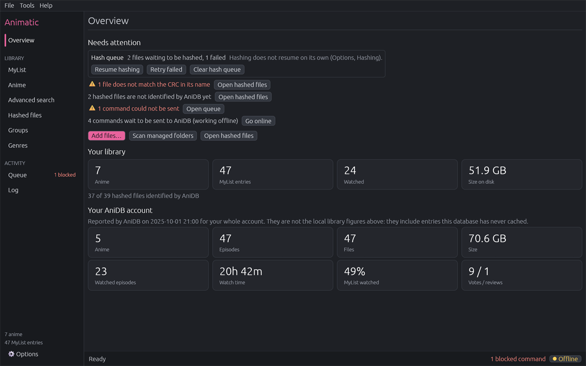

*The main window with the sample library: menu bar, sidebar, the Overview page and the status bar.*

## Window layout

The window has four regions, drawn from the outside in:

| Region | Where | What it holds |
|---|---|---|
| **Menu bar** | Top | [File, Tools and Help](#menus). When an update needs your attention, a button appears at the right end of the bar (see [Update notice](#update-notice)). |
| **Sidebar** | Left, fixed width | The brand name, the nine [pages](#sidebar-and-badges), the library counts and the **Options** entry. |
| **Page** | Center | The selected page. Its heading equals its sidebar label; pages with a search box show it at the right of the heading. Table pages are virtualized: only the visible rows are drawn, so very large libraries stay responsive. |
| **Status bar** | Bottom | Current activity or the last message, the Online/Offline switch, cooldown and queue warnings. |

On top of these come [floating windows](#floating-windows).

The window opens with the size, position and maximized state it had when you last used Animatic (first start: 1280 × 800, minimum 900 × 600); see [window and layout state](Settings-Reference.md#window-and-layout-state) for what is ignored as unsafe.

All data on screen comes from a **snapshot** of the local database that a background thread loads and swaps in whole. Changes appear after the next snapshot (requests are coalesced, at most one every 250 ms). **File → Reload** (`F5`) requests one immediately. If loading fails, the Log shows `Unable to refresh library: …` and the old snapshot stays. The very first status text is `Loading library…`.

The window does not accept drag-and-drop of files; add files with **File → Add files…** (`Ctrl+O`), the Hashed files page, the Overview button, or the command line.

### Sidebar and badges

The sidebar lists the pages in this order. Click an entry, or press `Ctrl+1` … `Ctrl+9`, to open it.

| Group heading | Page | Shortcut |
|---|---|---|
| (none) | [Overview](Library-Pages.md#overview) | `Ctrl+1` |
| **LIBRARY** | [MyList](Library-Pages.md#mylist) | `Ctrl+2` |
| | [Anime](Library-Pages.md#anime) | `Ctrl+3` |
| | [Advanced search](Library-Pages.md#advanced-search) | `Ctrl+4` |
| | [Hashed files](Library-Pages.md#hashed-files) | `Ctrl+5` |
| | [Groups](Library-Pages.md#groups) | `Ctrl+6` |
| | [Genres](Library-Pages.md#genres) | `Ctrl+7` |
| **ACTIVITY** | [Queue](Library-Pages.md#queue) | `Ctrl+8` |
| | [Log](Library-Pages.md#log) | `Ctrl+9` |

The current page has an accent bar at its left edge. Only the **Queue** entry carries a badge, because pending work is the one state the other pages do not show: a plain number is the count of pending commands; when some commands are blocked it turns into a red `N blocked`.

At the bottom of the sidebar, from top to bottom: two small lines with the counts of the loaded snapshot (`N anime`, then `N MyList entries`, or `1 MyList entry`) and the **⚙ Options** entry. **Options** opens and closes the [Options window](Options-Window.md); hover it to see `Shortcut: Ctrl+Comma` (the app spells the comma key out; you press `Ctrl+,`). The anime count includes rows created by the [title-list download](AniDB-Synchronization.md#synchronization), so it can far exceed your own library.

### Floating windows

Windows that are not pages open on top of the page:

- [Options](Options-Window.md), **Edit MyList entry**, **Add to MyList**, **Remove from list**, **Request MyList export**, **Confirm rename**, **Batch rename**, **Renaming pattern reference**, **Review imported AOM settings**, **Import into a database that has data?**, **Leftover import files**, **Settings recovered**, the [Software updates](Updating-Animatic.md) window and **About Animatic** (the version, `Created by RetroHazard`, links and the license buttons; the license opens in its own **Animatic license** window, the third-party licenses in **Third-party notices**).
- The [Anime detail](Library-Pages.md#anime-detail-window) window is a floating window too, but only the Anime, Advanced search and MyList pages draw it: if you switch to another page it is hidden (not closed) and comes back when you return to one of those three pages.
- **Modal dialogs** block the rest of the program until you answer: **Remove from MyList**, **Clear the command queue?**, **Full update**, **Compact library**, **Restore library**, **Restoring library**, **Library unavailable**, **Install ffprobe** and **Turn on automatic rename**.

Windows open centered in the window and have no collapse triangle. Most have a close button (**×**) in the title bar.

- `Esc` closes the topmost window. It does nothing while you type in a text field, while a menu or drop-down is open, or while a modal dialog is open (in the confirmation dialogs **Remove from MyList**, **Clear the command queue?**, **Full update**, **Compact library**, **Restore library**, **Install ffprobe** and **Turn on automatic rename**, `Esc` cancels).
- A few windows that need a decision first (**Review imported AOM settings**, **Import into a database that has data?**, **Leftover import files**, **Settings recovered**) ignore `Esc`; answer them with their buttons. They do not block the menus or shortcuts, but actions that would clash are grayed out (**Back up library…** and the other library tasks while the import question or the settings review is open, **Add files…** during the settings review).
- No keyboard shortcut acts while a modal dialog is open.

### Update notice

When the updater has news, a button appears at the right end of the menu bar. Clicking it opens the [Software updates](Updating-Animatic.md) window. The text is one of:

| Text | Meaning |
|---|---|
| `Update available: <version>` | A newer release exists on your update channel. |
| `Update ready to install` | A download finished and its hash matched. |
| `Restart to finish updating` | An update was installed; restart Animatic. |
| `Update failed: see details` | The installation did not finish. |

The button is absent in every other state, including "up to date".

## Status bar, progress and the Log

The left side of the status bar shows one of three things:

- **A running job:** a progress bar with percentage, the label `<what> (<current>/<total>)`, a **Pause**/**Resume** button and a **Cancel** button.
- **A message:** the last status text, for example `Ready`, `Hashed …` or `Library backed up to …`. The text is truncated when the window is narrow.
- **An error:** shown in red as `⚠ message`. It stays until the next message (a finished job does not replace it with `Ready`). Hover it for `Open the log` and click it to open the [Log](Library-Pages.md#log). Errors include blocked commands (`⚠ Command blocked: …`), a cooldown (`⚠ AniDB sync paused until …`) and a run attempted while **Work offline** is on (`⚠ Offline mode is enabled; commands remain queued`).

Every message also goes to the Log, so nothing is lost when the status line changes.

Right side, from the edge inwards:

| Item | Meaning |
|---|---|
| **Offline** (amber dot) / **Online** (green dot) | A button that toggles **Work offline** and saves the settings file (except while [recovered settings](Settings-Files.md#recovery-matrix) are unsaved: the change then lasts until you quit or press **Save options**); the log records `Working offline` or `Working online`. Hover for the explanation. "Online" only means that **Work offline** is off, not that your credentials or the network work. |
| `AniDB sync paused until HH:MM:SS: <reason>` (yellow) | An active [cooldown](AniDB-Synchronization.md#failure-handling); the time is local. It disappears when the time has passed. While it shows, **Tools → Run command queue**, the **Run command queue** buttons and `Ctrl+Shift+S` are disabled, and hovering them shows the same text. |
| `1 blocked command` / `N blocked commands` / `blocked commands (refreshing)` (red) | A link to the [Queue](Library-Pages.md#queue) (hover: `Open the queue`): blocked queue entries, or a blocked event newer than the snapshot on screen. |
| `N commands not saved yet` (yellow) | Queue commands held in memory because the database was busy. See below. |

### Jobs and what the controls do

Jobs run one at a time, in the order you started them. **Pause** is shown for every job, but only the jobs marked below react to it. While a job is paused the button reads **Resume**.

The pause switch is one setting for the whole program and is not cleared when a job ends. If you pause a job that ignores it, or pause and then cancel, the next hashing run or scan can start paused. Press **Resume** in the status bar while it runs.

| Job (status label) | Started by | Pause | Cancel |
|---|---|---|---|
| Hashing files | Add files…, command-line paths, files from another launch, **Resume hashing**, **Retry failed**, hashing autostart | Pauses between 4 MiB blocks | Stops after the current block; the file in progress is discarded and, like every file not hashed yet, stays in the persistent [hash queue](Hashing-and-Identification.md#hash-queue) (the log says how many) |
| Clearing hash queue | **Clear hash queue** | No effect | No effect |
| Scanning managed folders | **Tools → Scan managed folders**, scheduled scan | Pauses while a file is being hashed | Stops before the next planned action or file; files already queued but not hashed stay in the hash queue |
| Renaming files, Renaming files automatically | **Rename…** / **Rename N selected…** (after confirming), [automatic rename](Managed-Folders-and-Scans.md) | Pauses while a file is being copied | Stops before the next file; files already renamed stay renamed |
| Removing files from the list | **Hashed files → Remove from list…** | No effect | No effect |
| Importing legacy databank | **File → Import → AOM databank…** | No effect | Checked only between steps (see [migration](Migrating-from-AOM.md#migrate-an-aom-databank)); a late Cancel can still end in success |
| Reading AOM settings | **File → Import → AOM settings…** | No effect | No effect; the review window decides whether anything changes |
| Synchronizing with AniDB, Synchronizing with AniDB (automatic run) | **Tools → Run command queue**, **Queue → Run command queue**, the tray menu; automatic runs when **Run the command queue automatically** is on | No effect | Stops before the next command; a request already in flight finishes or times out (UDP 20 s, HTTP 60 s) |
| Queueing full update | `--full-update`, **Tools → Full update…** (after confirming) | No effect | – |
| Backing up library | **File → Back up library…** | No effect | No effect; it runs to completion and a half-written file is never left |
| Importing MyList export | **File → Import → MyList export…** | No effect | Checked while the file is read and during the merge; the library is unchanged when it stops |
| Checking backup file | **File → Restore library…** | No effect | No effect; the check changes nothing |
| Checking library | **Tools → Check library** | No effect | No effect |
| Compacting library | **Tools → Compact library…** | No effect | No effect; compacting is all-or-nothing |

Library snapshots and the statistics and hash exports run on their own thread and do not show a progress bar or take part in Cancel.

### Commands not saved yet

Most commands you request (identify, MyList add, removal and refresh, episode, group, file and anime refresh, title download, statistics fetch, MyList export request and cancel) are saved to the command queue on disk right away. If the database is busy, Animatic keeps the command in memory, shows `N commands not saved yet` in the status bar and retries every 500 ms until it succeeds.

- Up to 1000 distinct unsaved commands can be held at once. A new command is refused with the log line `NOT queued: …` only when 1000 others are already unsaved.
- Unsaved commands are not durable until they appear on the Queue page.
- On exit Animatic tries once more for up to 5 seconds. If that fails, the commands are lost without any message, so wait for the indicator to clear before you quit.
- **Restore library…** is disabled while commands are unsaved (`Some changes are not saved to the database yet.`).

MyList edits are different: if they cannot be saved immediately you see `Could not edit mylist entry N: the database is busy…; nothing was changed, try again`.

### The Log page

See [Log](Library-Pages.md#log). Messages carry `HH:MM:SS`; errors add `ERROR`.

## Searching and tables

One search string is shared by every page that has a search box. The box is at the top right of **MyList**, **Anime**, **Hashed files**, **Groups** and **Genres** (hint `Search…`), with a **✕** button (hover `Clear the search`) that clears it while it holds text, and `Ctrl+F` focuses it. **Overview**, **Queue** and **Log** have no search box; **Advanced search** has its own query field (hint `Title or AniDB ID`) bound to the same string, which `Ctrl+F` does not focus. Typing on one page filters the others when you switch to them.

The next picture shows the Anime page after typing `kiri` in the search box.

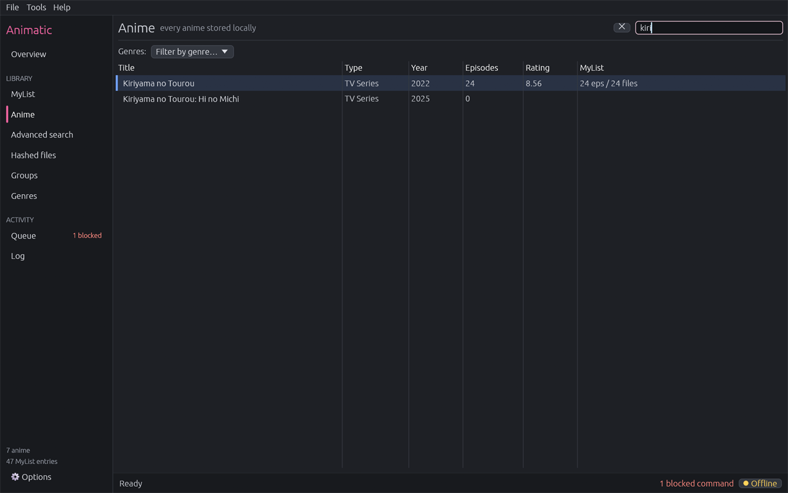

*Searching the Anime page for `kiri`.*

How the search works:

- **Substring, not words.** A row matches when the query appears anywhere in the searched text. There are no wildcards, regular expressions, quotes, operators or multi-term AND.
- **ASCII case folding only.** Both sides are lower-cased with ASCII rules; `a`/`A` match, but `é`/`É` do not match each other.
- **Not trimmed.** A leading or trailing space is part of the query.
- **What is searched:**

| Page | Searched text |
|---|---|
| Anime, Advanced search | The anime's **display name** (main title preferred, then `x-jat`, then `en`) – *not* synonyms, other-language titles or episodes. Also an exact AniDB id. |
| MyList | The anime's display name only (not episode, group or file). A matching anime shows with all of its entries. |
| Hashed files | The **full path**, not just the file name. |
| Groups | Group name or short name. |
| Genres | Genre name. |

- **AniDB id matching** (Anime and Advanced search only): if the query is canonical decimal digits (no leading zeros or signs) the row whose id equals it also matches. `3` finds anime 3; `03` is treated as plain text and does not.
- Rows without a name display as `aid N`; they are found by the number alone, not by the text `aid N`. MyList rows whose anime is missing display `Unknown anime`.
- An empty query shows everything. There is no "no results" message: the table is simply empty.
- The search does not look at the [genre filter](Library-Pages.md#anime) of the Anime page; both apply together.

## Sorting, columns and row colors

Every table is drawn the same way: columns can be resized, rows are striped, text is truncated instead of wrapped, and a horizontal scrollbar appears when the window is narrower than the columns.

**Sorting.** Click a column header to sort by it: first ascending (`▲`), then descending (`▼`), then back to the default order. Hover a header to see what a click does (for example `Sorted by Size, ascending. Click for descending. Right-click to choose columns`). Text sorts case-insensitively with numbers read by value (`Ep2` before `Ep10`); rows that compare equal keep the default order in both directions, and a missing value (for example an unidentified file's AniDB id) sorts before any present one. Details that may surprise you:

- On **Hashed files**, the **File** column sorts by file name only, while **Path** sorts by the whole path; **CRC** sorts `Mismatch` as text among the hex values.
- On **Anime** and **Advanced search**, **Type** sorts by the type's name and **MyList** by episodes in MyList, then files.
- On **Groups**, **Website** sorts the groups with a link before or after those without; **Refresh** is a button column, and clicking its header changes nothing (the order stays the default).
- On **MyList**, the headers sort the anime rows by their totals; the entries below an anime stay in episode order.
- The **Queue** table is not sortable because its order is the order commands run in (its headers only offer the column chooser).

**Default order** (before you click a header): Anime and Advanced search list the anime in the order they were stored, not alphabetically (click **Title** to sort); Hashed files by path; Groups and Genres by name; MyList by anime title; Queue in the order the commands run.

**Columns.** Right-click a header to open the **Columns** menu and hide or show columns. At least one column stays visible (the last checkbox is disabled, with the hover text `At least one column must stay visible`), and hiding the sorted column returns the table to its default order. Drag a header edge to resize. The last visible column fills the remaining width.

Sorting and hiding do not change a selection (it follows the row, not its position). The columns you click to select or open a row are the only click targets, so keep them visible:

- **File** on Hashed files;
- **Episode** on MyList (its **Anime** column holds the link that opens the detail window);
- **Title** on Anime and Advanced search;
- **Genre** on Genres.

Only Hashed files has an alternative (**Select all**).

**Remembered.** Widths, hidden columns and the sort order of every table are kept with the settings (`ui.columns`, see the [settings reference](Settings-Reference.md#window-and-layout-state)): written by **Save options** and when Animatic exits normally, not while [recovered settings](Settings-Files.md#recovery-matrix) are unsaved. The expand state of MyList is not saved.

**Row colors.** With **Tint table rows by status** on (**Options → Appearance → Customize status colors**, on by default) rows are tinted by status:

| Table | Status | Written in the row as |
|---|---|---|
| Hashed files | CRC mismatch | CRC column `Mismatch` |
| | Not identified | AniDB column `Not identified` |
| | Watched | MyList column `Watched · lid N` |
| | In MyList | MyList column `In MyList · lid N` |
| Anime, Advanced search | Fully watched | MyList column `… · all watched` |
| | In MyList | MyList column `N eps / M …` |
| MyList | Watched | Watched checkbox ticked |

Color is never the only signal: every status is also text or a control state. The **Row color style** setting changes how a tinted row looks:

- **Soft (tint and marker)** (the default): the page background blended toward the status color, with a 3-point bar in the full status color at the left edge. The row keeps the theme's text colors. Statuses that ask for action (not identified, CRC mismatch) are tinted more strongly than watched or in MyList.
- **Solid (classic AOM):** the whole row is filled with the full status color and black or white text, whichever reads better.

A color with its own text color in `ui.colors` is always drawn solid. The colors come from `ui.colors` (see [row colors](Settings-Reference.md#row-colors-uicolors)); plain rows stay uncolored unless you set a color for them.

**Options → Appearance → Customize status colors** edits them: a background and an optional text color for each status above, with a sample of the row in the current style and theme. The next picture shows that section.

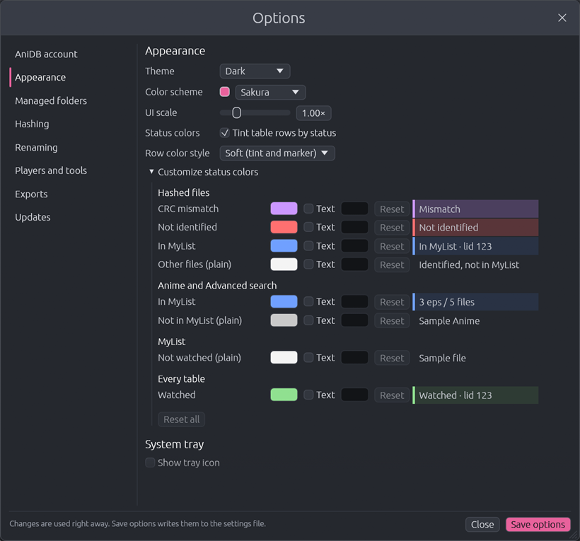

The whole window follows the **Theme** (**Dark**, **Light** or **Same as the system**) and **Color scheme** chosen in **Options → Appearance** (see the [Options window](Options-Window.md#appearance)); the row tints adapt to the theme. The next picture shows the MyList page in the Light theme.

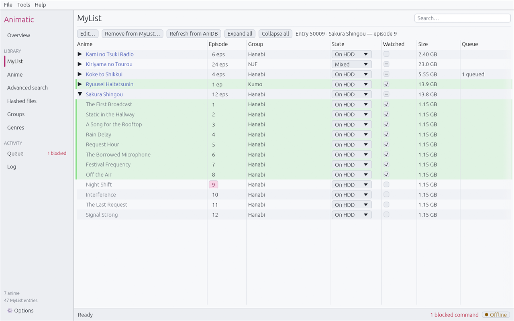

## Menus

Items that cannot be used at the moment are grayed out and say why when you hover them. Separators group the items.

### File menu

The File menu holds everything that brings files and data in or out of the library. The next picture shows it open.

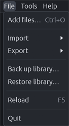

| Item | Behavior |
|---|---|
| **Add files…** (`Ctrl+O`) | A picker titled **Add files to hash**; queues the chosen files in the [hash queue](Hashing-and-Identification.md#hash-queue) and hashes them. Disabled while an AOM settings review is open (hover: `An import is in progress`). Remembers the last folder. When **Restrict file extensions** is on, the picker filter is "Configured media files". |
| **Import ▸** | Submenu, below. |
| **Export ▸** | Submenu, below. |
| **Back up library…** | Save dialog (default `animatic-backup-YYYYMMDD-HHMMSS.sqlite3`) → [online backup](Backups-and-Recovery.md#back-up-and-restore-inside-animatic) of the library. Disabled while a job runs, during an import or settings review, or during a restore; hover shows the reason. |
| **Restore library…** | File picker → background validation → confirmation window → [restore](Backups-and-Recovery.md#back-up-and-restore-inside-animatic). Disabled for the same reasons as Back up library and while commands are not saved yet. |
| **Reload** (`F5`) | Re-reads the library from disk into a new snapshot. Hover: `Re-read the library from disk. Nothing is sent to AniDB.` |
| **Quit** | Closes; saves settings (unless guarded) and tries to save unsaved commands. |

**File → Import**

The Import submenu offers the three kinds of import, shown next.

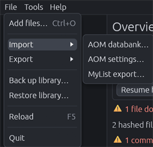

| Item | Behavior |
|---|---|
| **AOM databank…** | Folder picker titled `Choose the AOM folder or its kowai folder (files are not listed)` → [databank import](Migrating-from-AOM.md#migrate-an-aom-databank); a folder without a databank gives the error `No AOM databank found in <folder> (choose the AOM folder or its kowai folder)`. A database that already holds data first shows **Import into a database that has data?** (Continue / Cancel). Disabled during a settings review. |
| **AOM settings…** | File picker (`.xml`) → [settings import](Migrating-from-AOM.md#import-aom-settings). |
| **MyList export…** | File picker (`.tgz`, `.gz`, `.xml`, `.zip`, `.tar`, or any file) → [import of the downloaded export](AniDB-Synchronization.md#full-account-mylist-import) on the worker. Validates the whole file first; a refused file changes nothing. Disabled while a job runs, during an import or settings review, or during a restore. |

**File → Export**

The Export submenu writes two kinds of file; it looks like this.

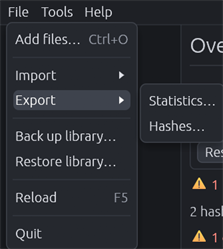

| Item | Behavior |
|---|---|
| **Statistics…** | Save dialog (default `animatic-stats.xml`/`.ini`) → [statistics export](Exports.md#statistics-export). |
| **Hashes…** | Save dialog (default `animatic-hashes.txt`) → [hash export](Exports.md#hash-export). |

### Tools menu

The Tools menu starts with **Options…**, then the AniDB items (from Run command queue to Edit AniDB data), then the local ones (Scan managed folders, Check library, Compact library…). It is shown next.

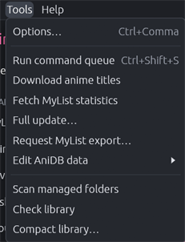

| Item | Behavior |
|---|---|
| **Options…** (`Ctrl+,`; the menu spells it `Ctrl+Comma`) | Opens [Options](Options-Window.md). |
| **Run command queue** (`Ctrl+Shift+S`) | Starts the [synchronization](AniDB-Synchronization.md#synchronization) job. Disabled during a settings review or an active cooldown (hover shows the cooldown text). |
| **Download anime titles** | Queues the title-list download (nothing is sent yet; hover: `Adds a command to the queue; nothing is sent to AniDB until the command queue runs.`). The list is requested at most once per 24 hours: inside that window after the last attempt (even a failed one) nothing is queued and the log says when the next download is allowed. |
| **Fetch MyList statistics** | Queues a MyList-statistics request. When run, the figures are stored with the time they arrived and shown on the [Overview](Library-Pages.md#overview) under **Your AniDB account**, apart from the local figures; the log also gets a line (`N anime, N episodes, N files in mylist`). |
| **Full update…** | Works out in the background what a [full update](AniDB-Synchronization.md#synchronization) would queue (the title list, a file refresh and an anime refresh for each identified hashed local file, minus what AniDB's limits do not allow yet and what the queue holds already) and asks for confirmation, showing the counts, how many were left out and when the title list is next allowed. **Queue** adds them (the same as `--full-update`); nothing is sent until you run the queue. Disabled during a settings review and while a preview is open. |
| **Request MyList export…** | Opens a dialog that explains the [MyList export](AniDB-Synchronization.md#full-account-mylist-import): AniDB prepares the export for up to 24 hours, announces it as an AniDB message, and the file is downloaded from AniDB's web export page. **Request export** queues the request (nothing is sent until the command queue runs; one request per 24 hours, and it is disabled with the next allowed time inside that window), **Open export page** opens the page in the browser, **Cancel pending export** queues the cancellation. |
| **Edit AniDB data ▸** | Submenu below. |
| **Scan managed folders** | Starts a [scan](Managed-Folders-and-Scans.md). Disabled during a settings review. |
| **Check library** | Checks the library for corruption in the background; never repairs ([details](Backups-and-Recovery.md#check-and-compact-the-library)). Disabled while a job runs, during an import or settings review, or during a restore. |
| **Compact library…** | After a confirmation, compacts the library file in the background ([details](Backups-and-Recovery.md#check-and-compact-the-library)). Disabled like Check library. |

**Tools → Edit AniDB data**

The submenu with the four AniDB web editors looks like this.

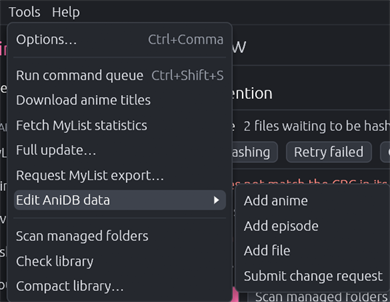

These items open AniDB web pages in your browser (hover: `Opens the AniDB website`); Animatic sends nothing itself. If the browser cannot be started the status bar shows `Could not open AniDB: …`.

| Item | Opens |
|---|---|
| **Add anime** | `https://anidb.net/anime/add` |
| **Add episode** | `https://anidb.net/episode/add` |
| **Add file** | `https://anidb.net/file/add` |
| **Submit change request** | `https://anidb.net/creq` |

### Help menu

The Help menu is shown next.

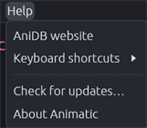

| Item | Behavior |
|---|---|
| **AniDB website** | Opens `https://anidb.net/`. |
| **Keyboard shortcuts ▸** | Read-only list of the [shortcuts](#keyboard-shortcuts); clicking a row does nothing. |
| **Check for updates…** | Opens the [Software updates window](Updating-Animatic.md) and starts a check for a newer release on your [update channel](Updating-Animatic.md) (stable by default). This is an explicit request and works even when *Work offline* is on (that setting only governs AniDB and the automatic startup check). Disabled on platforms other than 64-bit Windows and Linux (hover: `Updates are only available for 64-bit Windows and Linux builds`). |
| **About Animatic** | Shows the version, `Created by RetroHazard` and the buttons **Source code**, **Documentation** (this wiki) and **AniDB website**, which open in your browser, plus **View license** and **Third-party notices**. **View license** shows Animatic's MIT license inside the app (the text built into this version), so it works without a file next to the program. **Third-party notices** shows the licenses of the libraries and fonts Animatic uses (the `NOTICES` text built into this version) in a window inside the app. It is generated automatically and is not a legal audit. |

There is no menu item for downloading images (a [cover](Library-Pages.md#cover) is downloaded when an anime detail window opens). MyList adds, removals and refreshes are buttons on the [Hashed files](Library-Pages.md#hashed-files) and [MyList](Library-Pages.md#mylist) pages.

## Keyboard shortcuts

`Ctrl` is the main modifier (`Cmd` on macOS, which Animatic does not target). **Help → Keyboard shortcuts** lists them, as the next picture shows. The app spells the comma key out (`Ctrl+Comma`) and writes the page shortcuts as `Ctrl1…9`.

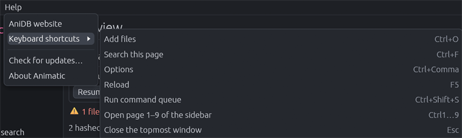

| Keys | Does |
|---|---|
| `Ctrl+O` | Add files (same as **File → Add files…**) |
| `Ctrl+F` | Focus the search field of the current page. It does nothing on Overview, Advanced search, Queue and Log; the request is remembered, so the next MyList, Anime, Hashed files, Groups or Genres page you open takes the focus. |
| `Ctrl+,` (shown as `Ctrl+Comma`) | Open Options |
| `F5` | Reload the library (**File → Reload**) |
| `Ctrl+Shift+S` | Run the command queue (when **Tools → Run command queue** is enabled) |
| `Ctrl+1` … `Ctrl+9` | Open the sidebar pages in order: Overview, MyList, Anime, Advanced search, Hashed files, Groups, Genres, Queue, Log |
| `Esc` | Close the topmost window (Options, Anime detail, Edit MyList entry, Add to MyList, Request MyList export, Remove from list, Confirm rename, Batch rename, About and the other information windows; not the windows listed under [Floating windows](#floating-windows) that ignore `Esc`) |

Mouse selection on the Hashed files page: a click selects one file, `Ctrl+click` toggles a file, `Shift+click` selects every row between the file you last selected with a plain click or `Ctrl+click` (the anchor) and the one you click. See [Hashed files](Library-Pages.md#hashed-files).

## System tray

**Options → Appearance → System tray** has two controls: **Show tray icon** and **Minimize to tray** (both on by default; the second needs the first). Both act as you click, not only on **Save options**.

- **Windows:** the icon sits in the notification area (it may be in the overflow flyout, depending on your taskbar settings).
- **Linux:** the icon uses the StatusNotifierItem protocol over the session D-Bus, so it needs a desktop with a tray host: KDE Plasma, Xfce, Cinnamon, MATE and others have one; GNOME needs the AppIndicator extension. Animatic needs no extra system package for it.
- **No tray available** (no host running, no session bus, or a platform without support): both controls are disabled and a yellow line says why. Nothing is ever hidden without an icon to bring the window back. If the tray host disappears while Animatic runs (for example the desktop panel restarts), the icon is dropped, a hidden window is shown again and the tray stays off until you restart Animatic.

**Minimize hides, close quits.** With **Minimize to tray** on, minimizing the window hides it and leaves the icon. A left click on the icon, or **Show Animatic** in its menu, restores and focuses the window. Closing the window (the title-bar button, **File → Quit**, or **Quit** in the tray menu) still quits Animatic. On Linux, a compositor that does not report a minimized window to the application (some Wayland sessions) never triggers the hide; the window then just minimizes.

**Tray menu:** **Show Animatic**, **Run command queue** and **Quit**. **Run command queue** does what **Tools → Run command queue** does and is disabled under the same conditions (an AOM settings import waiting for review, or a sync cooldown in force). It runs with the window hidden too; with **Work offline** on it reports that it is offline and does not contact AniDB.

## See also

- [Library pages](Library-Pages.md): every page in detail.
- [Options window](Options-Window.md) and [Settings reference](Settings-Reference.md).
- [AniDB synchronization](AniDB-Synchronization.md): the command queue, cooldowns and offline work.
- [Troubleshooting](Troubleshooting.md).
