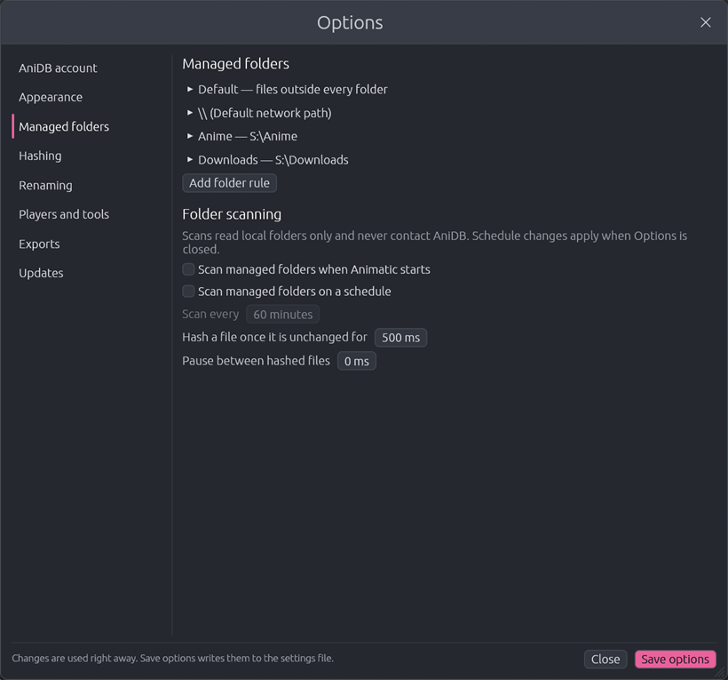
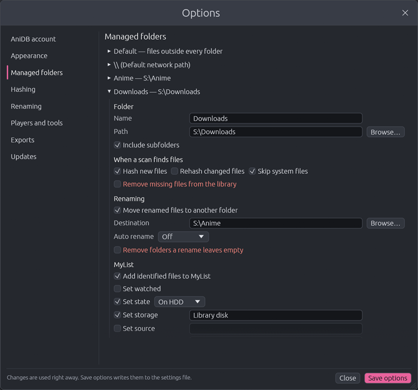
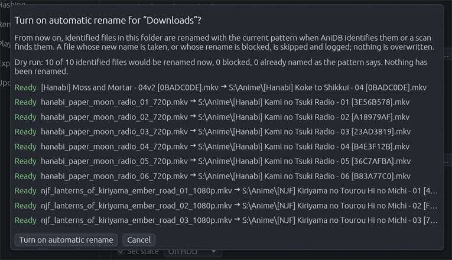

A **managed folder** (a *folder rule* in **Options → Managed folders**) tells Animatic what to do with the files below one folder: whether to hash new files, whether to forget missing ones, which MyList settings to use when a file is added, where renamed files go and whether Animatic may rename them on its own. This page is the reference for every field, for scans (manual, at start-up and scheduled), for the safety rules around deleting records, and for automatic rename. Read it before you point Animatic at the folders where your anime lives.

*Options → Managed folders in the sample library: three rules (all collapsed) and the **Folder scanning** section.*

## What a scan does and does not do

Scans start from **Tools → Scan managed folders**, from the **Scan managed folders** button on **Overview**, optionally also [when Animatic starts and on a schedule](#scheduled-scans). There is no filesystem watcher, and the [tray icon](Main-Window.md#system-tray) starts nothing by itself.

A scan **never deletes media files and never writes MyList**. It never moves or renames a file itself ([automatic rename](#automatic-rename) can do that afterwards for folders you switched on). It can hash files and forget missing local records. Hashing is not the end of it, though: every file the scan hashes raises the same event as any other hashing, so with **Identify files with AniDB after hashing** on and the folder rule's **Add identified files to MyList** on, an Identify command with an add policy is queued, and **running the command queue later adds the file to your AniDB MyList**. Scans themselves never contact AniDB, so they work offline.

## Folder rules

Open **Tools → Options…** and choose **Managed folders**. Each rule is a collapsible section titled with its **Name** (or `Unnamed folder`) and, for a folder rule, its **Path**. Inside, the controls are grouped under **Folder**, **When a scan finds files**, **Renaming** and **MyList**. Edits apply at once to a manual scan. A scheduled or start-up scan, and automatic rename, use your edits only after you close Options; **Save options** writes them to the settings file.

*The **Downloads** rule: it hashes new files in `S:\Downloads`, adds identified files to MyList as On HDD with the storage text "Library disk", and moves renamed files into `S:\Anime` (automatic rename is **Off**).*

The built-in **Default** rule has no folder: it applies to files outside every folder rule, so only its **Name**, **Renaming** (without automatic rename) and **MyList** controls are shown. The built-in `\\` rule covers every network path; its path cannot be changed. Any rule, built-in ones included, can be removed with **Remove rule…** (after a confirmation) as long as another rule remains; **Restore built-in rules** brings a removed built-in rule back. Without a Default rule, files outside your folders are not added to MyList and are renamed where they are.

### Where files are and how they are found

| Field | Default for a new rule | What it does |
|---|---|---|
| **Name** | `New folder` | A label for the list. It has no other effect. |
| **Path** and **Browse…** | empty | The folder to scan; type it or pick it with **Browse…**. A rule with an empty path is never walked and never matches a file by location. Use an absolute path such as `S:\Downloads`. |
| **Include subfolders** | on | On: all depth levels below **Path**. Off: only the files directly in **Path**. Symbolic links are skipped (a linked file is not hashed and a linked folder is not entered). |
| **Hash new files** | off | A scan hashes files whose path is not in the library yet. |
| **Rehash changed files** | off | A scan hashes a known file again when its modification time differs from the stored one. |
| **Skip system files** | on | Skips files and folders that carry the Windows *system* attribute (a skipped folder is not entered). Linux has no such attribute, so there it changes nothing. |
| **Remove missing files from the library** | off | A scan forgets the local record of a file that is affirmatively gone (see [Remove missing and the safety rules](#remove-missing-and-the-safety-rules)). Shown in red. |
| **Move renamed files to another folder** / **Destination** | off, empty | The base folder for [renames](Renaming-Files.md) of files in this rule: ticked, a **Destination** field with **Browse…** appears. Off (empty destination) keeps the new name relative to the file's current folder: a plain file name leaves the file where it is. Unticking clears the destination. |
| **Remove folders a rename leaves empty** | off | After Animatic renames files, removes the folders they left if they are completely empty (see [Removing folders a rename emptied](#removing-folders-a-rename-emptied)). Shown in red. |

A rule is walked by a scan only if its **Path** is a directory that exists *and* **Hash new files** or **Rehash changed files** is on. With both off, the rule still supplies its MyList settings and rename destination to files that live below it.

Entries whose name starts with a dot (`.`) are skipped, folders included, for every rule you create in Animatic (the `exclude_hidden` key is on by default; there is no checkbox for it in Options, and the Windows *hidden* attribute is not consulted). A rule that came from an AniDB O'Matic (AOM) settings import keeps AOM's own setting, which is usually **off**, so such a rule also scans dot-files; the built-in `\\` rule has it off too.

### MyList settings for added files

These fields, under **MyList**, apply to files that this rule adds to your MyList. They are greyed out while **Add identified files to MyList** is off.

| Field | Default | What it does |
|---|---|---|
| **Add identified files to MyList** | off | When a file below this rule is identified, add it to your MyList. Hover text: `Added when the queue runs online, with the values below.` |
| **Set watched** | off | Tick to set the watched state on added files. A nested **Watched** checkbox appears: ticked marks the entry watched (with the time of the add as view date), unticked marks it unwatched. |
| **Set state** | on, **On HDD** | Tick to set the MyList state. A list offers `Unknown`, `On HDD`, `On CD/DVD`, `Deleted`, `Remote/Shared`. |
| **Set storage** | off | Tick to set the storage text in the box on the same row (for example `Library disk`). |
| **Set source** | off | Tick to set the source text in the box on the same row. |
| **Set other** | off | Tick to set the other text in the box on the same row. |

For each field the checkbox decides whether Animatic sets it. **Unchecked leaves the field unchanged** on AniDB. **Checked with an empty text explicitly clears** the field. The text boxes are grayed out while their checkbox is off.

These settings are applied only to files that are **newly added**. If AniDB reports that a file is already in your MyList, the settings are **not** applied. Adding to MyList happens when you run the command queue (see [Identification](Hashing-and-Identification.md#identification)), never during a scan.

### Add, remove, built-in rules

- **Add folder rule** appends a rule named `New folder`.
- **Remove rule…** deletes the rule after a confirmation. Any rule can be removed, built-in ones included, as long as another rule remains.
- **Restore built-in rules** brings a removed built-in rule back.
- A fresh settings file contains two built-in rules: **Default** (no path; it catches files no other rule claims and adds them to MyList as On HDD, unwatched) and **\\\\ (Default network path)** (matches any path that starts with `\\` or `//`, adds nothing). Both start with every scan switch off, so out of the box nothing is scanned. Without a Default rule, files outside every folder rule are not added to MyList and are renamed in place. Full key list: [Settings reference](Settings-Reference.md#managed-folders-file_managers).

### Which rule applies to a file

Rules with a non-empty path are candidates. A rule applies if the file is below its folder (any depth when **Include subfolders** is on, direct children only otherwise). The **longest matching path wins**. When no rule matches, the rule marked default (else the first) is used. The fallback supplies the MyList settings for identify-after-hash and the rename destination, but it never authorizes removal or automatic rename. This choice is made for every hashed file, whichever route added it.

### Set up a folder: step by step

1. Open **Tools → Options… → Managed folders** and click **Add folder rule**.
2. Expand the new rule. Type a **Name** (for example `Downloads`) and the **Path** (`S:\Downloads`), or pick the folder with **Browse…**.
3. Tick **Include subfolders** if the folder has subfolders, and tick **Hash new files**.
4. Optional: tick **Add identified files to MyList** and choose the MyList settings; tick **Move renamed files to another folder** and set the **Destination** if you rename into another folder.
5. Click **Save options**.
6. Choose **Tools → Scan managed folders**.

What happens next: the Log says `Scanning managed folders` and, if files were found, `Queued N file(s) for hashing`. The status bar shows the progress bar and the name of the file being hashed. New files appear on **Hashed files** as they are hashed. If the Log says `Scan deferred N file(s) that may still be written`, those files are still changing and the next scan looks at them again (see [Settle delay and pacing](#settle-delay-and-pacing)).

## How a scan decides what to do

A scan plans its work by walking the rules in list order:

- A rule is walked only if its **Path** is an existing directory and **Hash new files** or **Rehash changed files** is on.
- **Include subfolders** on = unlimited depth; off = direct children only. Symbolic links are skipped.
- Entries whose name starts with `.` are skipped; with **Skip system files**, entries with the Windows system attribute are skipped. The attribute is read from the entry itself, never from the target of a link.
- Only files whose extension is in the **extension list** are considered. This list is always applied during a scan, even when **Restrict file extensions** is unchecked (that checkbox only filters the file picker). An empty list means a scan finds nothing. Matching is case-insensitive. See [Choosing which files are hashed](Hashing-and-Identification.md#choosing-which-files-are-hashed).
- A file whose path is not in the database is hashed (**Hash new files**). A known path whose modified time differs from the stored one is re-hashed (**Rehash changed files**).
- Discovery is **first rule wins** in the order of the rules list: each discovered path is recorded once, so a file inside two overlapping rules is planned under the earlier one. (Longest-path matching applies only to the post-hash MyList settings, the rename destination, **Remove missing files from the library** and automatic rename.) Windows compares paths case-insensitively and with `\` and `/` unified; Linux compares case-sensitively.

Then the settle check (below) holds back files that may still be written, the remaining files are queued in the persistent [hash queue](Hashing-and-Identification.md#hash-queue) and hashed, and missing records are forgotten where the rules allow it.

## Remove missing and the safety rules

**Remove missing files from the library** is evaluated independently of walking, and it is the only way a scan removes anything. A stored path is removed from the local inventory only when **all** hold:

- the path is under an **explicit rule** that has **Remove missing files from the library** on (subfolders count only for rules with **Include subfolders**; the unmatched Default rule never authorizes removal);
- the filesystem reports the file **not found**. Any other error, such as an unavailable drive, a network share that does not answer or a permission failure, **keeps** the record;
- the rule's own folder exists as a directory. If the whole folder or drive is unavailable, nothing is removed.

It then removes only Animatic's local record (and a hash record nothing else uses). Media files and MyList entries are untouched. The Log notes `Removed missing path <path>`. The manual counterpart is **Remove from list…** on **Hashed files**, which asks first and never deletes files (see [Library pages](Library-Pages.md)).

The only automatic removal of a **folder** is [Remove folders a rename leaves empty](#removing-folders-a-rename-emptied) after Animatic's own rename.

## Scheduled scans

**Options → Managed folders → Folder scanning** has five controls. The first three (start-up scan, schedule, interval) are described here and are off by default; the last two (**Hash a file once it is unchanged for** and **Pause between hashed files**) are described under [Settle delay and pacing](#settle-delay-and-pacing).

- **Scan managed folders when Animatic starts** runs one scan right after the application opens.
- **Scan managed folders on a schedule** with **Scan every N minutes** (5 minutes to 10080, one week; the default is 60) runs a scan every N minutes, counted from the previous scheduled scan's start. The interval box is grayed out while the schedule is off. Changing the setting restarts the count.

A timer starts the same scan as the menu item, so everything above applies. The window never waits for it. The timer polls once a second; it uses no filesystem watcher, which keeps it identical on Windows and Linux and on network drives. The Log notes `Scheduled folder scan started` for the start-up scan and for each scheduled scan.

The three settings are saved as `scan_at_start`, `scheduled_scan` and `scan_interval_minutes` in the [settings file](Settings-Reference.md#managed-folders-file_managers). A change reaches the background timer when Options is closed, not while you edit.

A scheduled scan **never overlaps other work**. It waits (and is retried every second, with one log line `Scheduled folder scan postponed (<reason>); it starts when that is over`) while any background task or manual scan is running, an import or its confirmation is open, imported settings are waiting for review, the settings recovery notice is open, a library restore is running, or queue commands are not saved to the database yet. It then starts, and the next interval counts from that start. **Work offline** does not matter to a scan: scans never contact AniDB. The queued `Identify` commands described above still wait for you to run the queue, offline or not. Closing Animatic cancels a running scan at the next file.

## Settle delay and pacing

A file still being copied or downloaded must not be hashed half-written. A discovered file is hashed only when both hold:

1. its modification time is at least **Hash a file once it is unchanged for** (`action_delay_ms`, default 500 ms, 0 to 600000) in the past, and
2. its size and modification time did not change during one further wait of that length, which the scan observes once for all candidate files.

The first rule needs no earlier scan; the second catches a copy that keeps the source file's old modification time while it grows. A file that fails either rule is **deferred**: it is not hashed and not recorded, the log lists it (`Scan deferred N file(s) that may still be written, the next scan retries them: <up to five paths> and N more`), and the next scan looks at it again.

With a delay of 0 nothing is held back. A scan with a candidate file older than the delay takes at least the delay; if every candidate is too young, they are deferred at once. While a scan waits for files to settle, the status bar shows nothing; the scan starts its progress display when the wait is over.

**Pause between hashed files** (`sleep_time_ms`, default 0, 0 to 10000 ms) waits between two hashed files of one run of the [hash queue](Hashing-and-Identification.md#hash-queue), so a large folder does not keep the disk busy continuously; there is no pause before the first or after the last file. Canceling interrupts both waits. Earlier versions stored `sleep_time_ms` as a pause between scans (default 900000); a stored value above 10000 is reset to 0 on load, and the scan interval above replaces the old meaning.

**Scans use the hash queue.** A scan first queues every file it will hash (settled files only, after the settle delay) in the persistent [hash queue](Hashing-and-Identification.md#hash-queue) and then drains the queue in order. Canceling a scan, or closing Animatic, leaves the files that were not hashed yet queued; they are hashed by the next run (autostart, **Resume hashing**, or the next scan) without being discovered again.

Hashes found by a scan follow the normal [identification](Hashing-and-Identification.md#identification) path.

## Automatic rename

**Auto rename** is a drop-down list with three choices on each rule. It is **Off** by default and is never turned on implicitly.

| Mode | Behavior |
|---|---|
| **Off** | Never rename. |
| **Dry run (log only)** | Write the renames that would happen to the Log (`Automatic rename (dry run): <old path> would be renamed to <new path>`) and move nothing. Takes effect at once. |
| **On** | Rename identified files in this folder with the current naming convention or pattern. Choosing **On** first shows a confirmation (below). |

A scan itself never moves files. A file that a scan hashed and that the library already knows as identified makes the next background step plan its rename when its folder has the mode on or on dry run; so does an AniDB identify reply applied after you run the queue.

**On** renames in the background, the same verified way as a [manual rename](Renaming-Files.md). It skips and logs collisions (`Automatic rename skipped <path>: <reasons>`) and only ever touches files inside a folder rule with a path (never through the built-in Default fallback). A file is considered only once AniDB identified it and its anime and episode records are cached. An automatic pass never runs while Options is open, so half-edited settings never rename anything.

A pass looks at **every** identified file in each folder whose mode is **On** or **Dry run**, not only at the file just hashed, so turning **On** can rename files hashed long ago. Each file is reported once per state, at most 20 lines per pass (then `Automatic rename: N more note(s) not shown`). If the naming pattern cannot be used, the Log says `Automatic rename is paused: the renaming pattern cannot be used (…)` and nothing is renamed; a failed pass logs `Automatic rename failed: …`.

### The confirmation before turning it on

Choosing **On** does not switch it on at once. Animatic plans, without moving anything, what it would rename in that folder right now, and shows it.

*The confirmation for **Downloads**: `Dry run: 10 of 10 identified files would be renamed now, 0 blocked, 0 already named as the pattern says. Nothing has been renamed.`*

1. In the rule, open the **Auto rename** list and choose **On**.
2. The window **Turn on automatic rename for “Downloads”?** opens. It explains that from now on identified files in this folder are renamed with the current pattern when AniDB identifies them or a scan finds them, and that a file whose new name is taken, or whose rename is blocked, is skipped and logged; nothing is overwritten.
3. Wait for `Planning what would be renamed now…`; the summary and a list with `old name → new path` follow.
4. Click **Turn on automatic rename** to confirm, or **Cancel** (or press `Esc`) to leave the mode as it was.
5. Click **Save options** to keep the change. The Log says `Automatic rename is on for “Downloads”; save the options to keep it`.

More about plans, collisions and what is logged: [Renaming files](Renaming-Files.md#automatic-rename-opt-in-per-managed-folder).

## Removing folders a rename emptied

**Remove folders a rename leaves empty** (`clear_empty_folders`, off by default) is the only place Animatic deletes a folder, and it is not part of a scan. After a [manual rename](Renaming-Files.md) (single, batch or [automatic](Renaming-Files.md#automatic-rename-opt-in-per-managed-folder)) has moved files, each folder a moved file left is removed when **all** hold:

- the old path is under an explicit rule with the option on (the same longest-path matching as **Remove missing files from the library**; a rule without **Include subfolders** only covers its own folder, which is never removed), and the rule's folder exists as a directory;
- the folder is **strictly below** the rule's folder; the rule's own folder is never removed;
- the folder is **completely empty**: any file, folder or hidden file keeps it. Nothing is deleted recursively and links are not followed or removed.

Parents are then checked in turn, upward, under the same conditions. Only folders that one of the files moved by that job came from are considered; an empty folder somewhere else is left alone, and so is a folder whose file could not be moved (or whose old copy remains after a cross-drive copy). The Log notes `Removed N empty folders` (`Removed 1 empty folder` for one); a folder that cannot be removed is only written to the diagnostic log, and the rename itself is not affected.

## Messages you may see in the Log

| Message | Meaning |
|---|---|
| `Queued N file(s) for hashing` | A scan (or other route) put files into the hash queue; `(M already queued)` counts repeats. |
| `Scan deferred N file(s) that may still be written, the next scan retries them: …` | The settle check held files back. |
| `Removed missing path <path>` | **Remove missing files from the library** forgot a record. |
| `Scheduled folder scan started` / `Scheduled folder scan postponed (<reason>); it starts when that is over` | The timer's decisions. |
| `Automatic rename (dry run): … would be renamed to …`, `Automatic rename skipped …`, `Automatic rename finished: N renamed, M not renamed` | Automatic rename output. |
| `Removed N empty folders` (singular for one) | **Remove folders a rename leaves empty** deleted folders. |

## See also

- [Hashing and identification](Hashing-and-Identification.md) for the hash queue, the extension list and identification.
- [Renaming files](Renaming-Files.md) for naming conventions, plans and automatic rename details.
- [Options window](Options-Window.md) for the rest of the Options pages.
- [File and import problems](File-and-Import-Problems.md) when a scan does not find or hash files.
- [Settings reference](Settings-Reference.md#managed-folders-file_managers) for every stored key.
