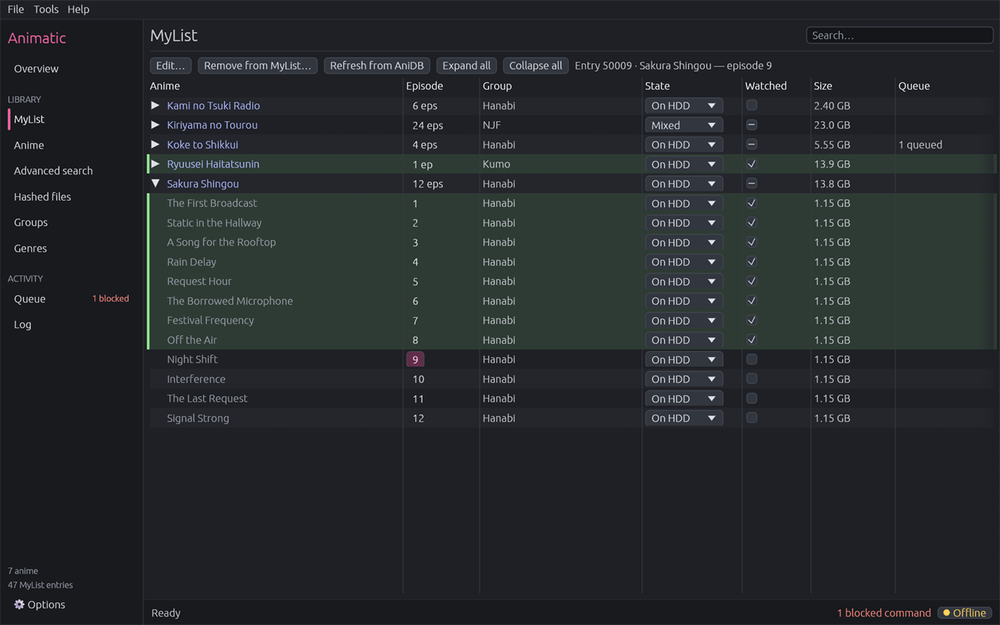
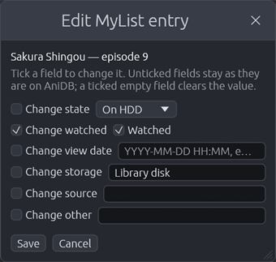
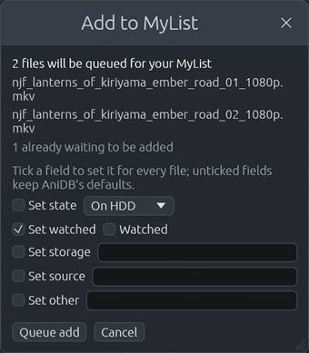
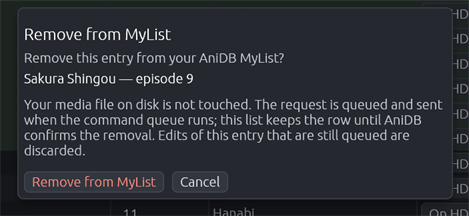
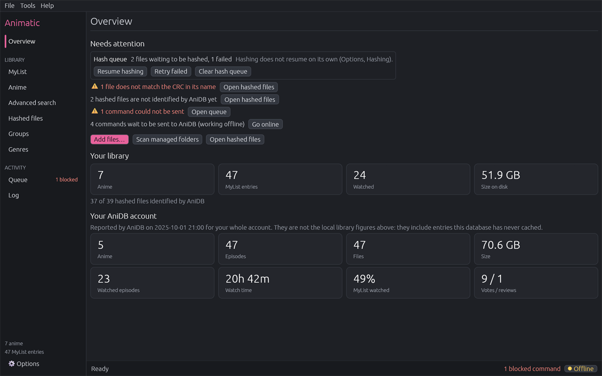
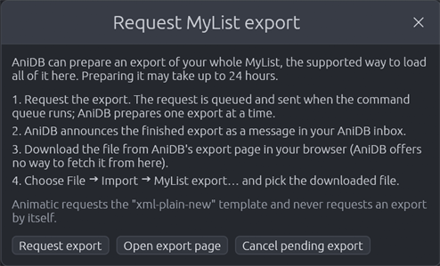
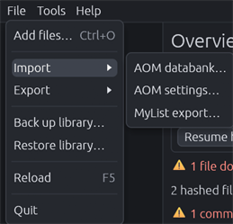

How to do the everyday MyList tasks in Animatic: read the MyList page, change a state or watched
mark, edit an entry, add files, remove entries, check your account statistics and load your whole
MyList from an AniDB export. Every task works offline: Animatic saves your change first and sends
it to AniDB later, when you run the command queue. The mechanics (merging, priorities, limits,
failures) are in [AniDB synchronization](AniDB-Synchronization.md); every column and button of the
page is listed in [Library pages](Library-Pages.md#mylist).

## How a MyList change works

MyList is your list on AniDB: the files you own or have seen, each with a **state** (where the
file is), a **watched** mark with a date, and free text for **storage**, **source** and **other**.
Animatic keeps a local copy and shows it on the **MyList** page. The copy comes from an
[AOM import](Migrating-from-AOM.md), from files you identify or add, and from a
[MyList export](#load-your-whole-mylist-with-an-export). Animatic never downloads your whole MyList
entry by entry; **Refresh from AniDB** re-reads only the entries you select.

When you change something:

1. The change is saved in the command queue **and** applied to the local entry in one step, so the
   table shows the new value at once and the change survives a restart.
2. The **Queue** column of the row says `Edit queued` (or `Removal queued`) until the change is
   sent.
3. The change is sent when you run the command queue with **Tools → Run command queue**
   (`Ctrl+Shift+S`), or automatically if you turned on **Run the command queue automatically**
   (never for removals). After AniDB confirms, the mark in the **Queue** column disappears.

## Before you start

- To *send* changes you need your **Username** and **Password** in
  **Tools → Options… → AniDB account** and **Work offline** cleared (see
  [Going online for the first time](First-Launch.md#going-online-for-the-first-time)). To *queue* changes you need nothing:
  they wait.
- The **Online** / **Offline** button at the right of the status bar shows which mode you are in.
- Your MyList page is empty until entries exist locally. If it is, add files
  ([below](#add-files-to-your-mylist)), import an [AOM databank](Migrating-from-AOM.md) or
  [load an export](#load-your-whole-mylist-with-an-export).

## Read the MyList page

*The MyList page of the sample library: one anime expanded, episode 9 selected.*

Open **MyList** in the sidebar (`Ctrl+2`). Each anime is one row (collapsed at first); its
entries (episodes and files) are the child rows.

- **Expand or collapse.** Click the arrow in front of a title, or use **Expand all** and
  **Collapse all** in the toolbar.
- **Search.** The box at the top right (`Ctrl+F`) filters by anime title: a matching anime shows with all of its entries.
- **Select.** Click an entry's **Episode** cell to select that entry. Click an anime row's episode
  count (for example `12 eps`, or `15 files` when an episode has several files) to select **all
  entries of that anime**. The toolbar says what is selected: `Entry 50009 · Sakura Shingou —
  episode 9`, or `Sakura Shingou · all 12 entries selected`. Clicking a title opens the anime's
  [detail window](Library-Pages.md#anime-detail-window) instead; it does not select.
- **Read the columns.** **State** is the entry's state; **Watched** is a checkbox (a dash on an
  anime row means some entries are watched and some are not); **Queue** shows changes still
  waiting: `Edit queued`, `Removal queued`, `Edit blocked`, `Removal blocked`. An anime row counts
  them, for example `1 queued` or `1 queued, 1 removing, 1 blocked`. Hover a blocked mark to see
  the error.
- **Row color.** A fully watched entry or anime is tinted (see the
  [row colors](Main-Window.md#sorting-columns-and-row-colors)).

The **State** values are `Unknown`, `On HDD`, `On CD/DVD`, `Deleted` and `Remote/Shared`.

## Change the state or the watched mark in the table

This is the fastest edit and needs no window.

1. Expand the anime.
2. On the entry's row, choose a **State** from the drop-down, or tick or untick **Watched**.
3. The row updates immediately and `Edit queued` appears in the **Queue** column.

On an **anime row** the same controls act on **every entry of that anime** in one step:

- The **State** drop-down shows the common state, or `Mixed` when entries differ. Choosing a value
  sets it on all entries (hover: `Sets the state of every entry of this anime`).
- The **Watched** checkbox marks every entry watched, or none (hover: `Marks every entry of this
  anime watched, or none of them`). Clicking the dash of a partly watched anime marks all entries
  watched; click again to unmark them all.

Entries that already have the value are left alone: nothing is queued for them and their watched
date is not changed. Entries that wait for removal are skipped; the log says
`N MyList entries are pending removal or missing; edit ignored`.

Marking an entry watched stamps **the moment you clicked**, not the moment AniDB hears of it.
Unmarking clears the date. If you change the same entry several times before it is sent, the
changes are merged into one command (the last watched or unwatched choice wins).

If you edit an entry that is waiting for removal, nothing happens and the log says `Mylist entry N
is pending removal; edit ignored`.

## Edit one entry

Use the editor when you want the view date, **storage**, **source** or **other** as well.

1. Click the entry's **Episode** cell to select it.
2. Click **Edit…** in the toolbar. The **Edit MyList entry** window opens, with the anime and
   episode below the title.

   

3. Change what you want. Each field has a **Change** checkbox that ticks itself when you edit the
   value; you can also tick it yourself:

   | Field | Notes |
   |---|---|
   | **Change state** | A drop-down of the five states |
   | **Change watched** + **Watched** | Tick the second box for watched, clear it for unwatched |
   | **Change view date** | Offered only while the entry is watched. Type `YYYY-MM-DD HH:MM` or `YYYY-MM-DD` in your local time zone (a date alone means midnight). Ticked with no text means *now* (hint `YYYY-MM-DD HH:MM, empty = now`) |
   | **Change storage**, **Change source**, **Change other** | Free text. Spaces around the text are trimmed |

   **An unticked field stays as it is on AniDB. A ticked field with empty text clears the value
   on AniDB.** If you type something Animatic cannot read as a date, the window says `View date
   "…" must look like 2025-03-04 18:30 (local time)` and **Save** stays disabled.
4. Click **Save**. The window closes, the row shows the new values at once, and the log says
   `Queued an edit of MyList entry N`. **Save** stays disabled while nothing is ticked (the
   window says `Nothing is ticked yet.`); hover it for `Queues the change and shows it here at
   once; it is sent to AniDB when the command queue runs`. **Cancel**, `Esc` or the **×** close the
   window without queueing anything.

Good to know: marking an entry that is already watched as watched again changes nothing (the date
is kept). Correcting only the view date of a watched entry keeps it watched.

### Edit all entries of an anime

1. Click the anime row's episode count to select all its entries.
2. Click **Edit…**. The window title names the anime and the number of entries
   (`Sakura Shingou — 12 entries`) and says `Tick a field to change it for every one of these
   entries; entries that already have the value are left alone. A ticked empty field clears the
   value.`
3. Tick the fields and click **Save**. The log says, for example, `Queued an edit of 9 MyList
   entries (3 already as asked)`.

A watched mark without a typed date carries no date: entries that are already watched keep theirs,
and the others are stamped with the time of your click. A date you type is set on every entry.
Entries waiting for removal are left out. If every selected entry gets queued for removal while
the editor is open, it says `This entry is waiting to be removed from MyList; edits are refused.`

## Add files to your MyList

You add *files you have hashed*. Animatic needs the file's hash to tell AniDB which release you
own.

1. Hash the files first (**File → Add files…**, a [managed folder](Managed-Folders-and-Scans.md)
   or the command line). See [Hashing and identification](Hashing-and-Identification.md).
2. Open **Hashed files**, select the files (click, `Ctrl`+click, `Shift`+click) and click
   **Add to MyList…**. The **Add to MyList** window opens.

   

   The header says `N files will be queued for your MyList` and lists them. Under it you may see
   notes:
   - `N of them are not identified yet: AniDB looks them up by hash first, and a file it does not
     know is skipped.`
   - `N already in MyList (edit them on the MyList page)`: those files are left out.
   - `N already waiting to be added`: their add is already queued.

   If nothing can be added, the window says `None of the selected files can be added.` Further
   copies of the same file content are listed once.
3. Optionally set values for **every file**: **Set state**, **Set watched** + **Watched**,
   **Set view date** (while watched is ticked), **Set storage**, **Set source**, **Set other**.
   `Tick a field to set it for every file; unticked fields keep AniDB's defaults.`
4. Click **Queue add**. The log says `Queued N files for MyList; run the command queue to send
   them`. Until then **Hashed files** shows `Add queued` in the **MyList** column.
5. Run the command queue. Each file is one `Add to mylist: …` command (priority 0, ahead of
   lookups).

What happens next, per file (the log lines in backticks):

| Situation | Result |
|---|---|
| Added | `added as mylist entry N`; the entry appears on the MyList page with your values |
| Already in your MyList on AniDB | The entry is refreshed and your values are applied as an edit: `mylist entry updated` |
| AniDB does not know the file | `file unknown to AniDB`; nothing is added and the command leaves the queue |
| AniDB has no such file id | `AniDB has no file N` |

You can also let a folder add files for you: in **Options → Managed folders**, tick **Add identified
files to MyList** on a folder rule and set the values it should use (state, watched, storage, source,
other). Those files are queued as `Identify file … + add to mylist` once they are hashed, provided
**Identify files with AniDB after hashing** (**Options → Hashing**) is on. A file that no rule covers
is identified but not added. See
[Managed folders and scans](Managed-Folders-and-Scans.md).

## Remove entries from your MyList

Removing deletes the entry on **AniDB**. It never deletes your media file or its record in
Animatic's list of hashed files.

1. Select an entry (or an anime row, to select all its entries).
2. Click **Remove from MyList…**. A confirmation opens:

   

   It names the entry (`Remove this entry from your AniDB MyList?`) or the anime with its entry
   count (`Remove all of these entries from your AniDB MyList?`) and explains that the media
   file is not touched, that the request is queued and that edits of the entry still queued are
   discarded.
3. Click **Remove from MyList** (red) to queue `Remove mylist entry N` for each entry, or
   **Cancel** (or `Esc`) to do nothing. The log says `Queued removal of MyList entry N; run the
   command queue to send it`.
4. The rows stay, marked `Removal queued`, until AniDB confirms. Then they disappear. While a
   removal waits you cannot edit that entry (**Edit…** is disabled).

Things that are different for removals:

- **Automatic runs never send removals.** Even with **Run the command queue automatically** on,
  a removal waits until you click **Run command queue** on the **Queue** page or choose **Tools → Run command queue**.
  The Queue page tells you how many removals wait.
- If the removal fails permanently, the row shows `Removal blocked` (hover for the error) and
  stays in the queue until you click **Retry failed** or clear the queue.
- There is no way to withdraw one queued removal. **Clear queue…** discards *every* queued
  command, so use it only when you mean to.
- AniDB saying the entry is already gone counts as success: the local row is removed.

## Refresh entries from AniDB

**Refresh from AniDB** queues `Refresh mylist entry N` for the selected entry, or one for each entry
of the selected anime. Use it after you changed an entry on AniDB's website or in another
program. The reply replaces the cached row but never overwrites a change you made that has not
been sent. If AniDB says the entry no longer exists, the row is removed, unless changes for it
are queued.

Each entry is one UDP command, spaced by the [flood protection](AniDB-Synchronization.md#flood-protection),
so refreshing a long anime takes a while.

Identifying a file works as a refresh too: if AniDB's reply for a hashed file says it is in your
MyList, the entry is stored; if AniDB says it is **not** in your MyList, Animatic deletes the local
entry for that file unless you have queued changes for it.

## See your MyList statistics

The **Overview** shows two sets of numbers: **Your library** (what is stored in this database) and
**Your AniDB account** (what AniDB reports for your whole MyList).

1. Click **Fetch MyList statistics** in the **Your AniDB account** section (the text beside it is
   `No account statistics yet.`), or use **Tools → Fetch MyList statistics**. This only queues the
   request.
2. Run the command queue. The log says `N anime, N episodes, N files in mylist`.
3. The section now reads `Reported by AniDB on <time> for your whole account. They are not the
   local library figures above: they include entries this database has never cached.` with eight
   tiles: **Anime**, **Episodes**, **Files**, **Size**, **Watched episodes**, **Watch time**,
   **MyList watched** (percent of the MyList watched) and **Votes / reviews**.

The figures are saved in the database and shown again after a restart; each new answer replaces
the old. The account figures usually differ from the local ones, because the local ones count only
what you have stored. To make them match, load your whole MyList with an export.

## Load your whole MyList with an export

AniDB does not let a program read your MyList entry by entry, so there is a supported route that
has four steps and one wait. Nothing runs by itself.

1. Choose **Tools → Request MyList export…**. The window lists the four steps. Click
   **Request export**. This queues one command; the window closes and the log says `Queued a MyList
   export request; run the command queue to send it. AniDB may take up to 24 hours and announces
   the export as a message`.
   - **Request export** is disabled right after a request, with the line `MyList export not
     requested: one was requested recently …` and the time a new request is allowed. Animatic
     allows one request per 24 hours and never requests an export on its own.
2. Run the command queue (with **Work offline** off). The log says `MyList export requested: AniDB
   announces it as a message when it is ready (up to 24 hours); …`. If one was already on its way
   you see `A MyList export is already queued on AniDB; wait for its message, then download it from
   the export page`; that is not an error.
3. Wait for AniDB's message in your AniDB inbox. Animatic does not check for it.
4. Click **Open export page** (in the same window) to open AniDB's export page in your browser, and
   save the file AniDB prepared. Animatic cannot download it for you.
5. Choose **File → Import → MyList export…** and pick the file. It may be an archive (`.tgz`,
   `.zip`, `.tar`), a compressed `.gz` or a plain `.xml`; Animatic recognizes the kind from the
   content.

   

6. Watch the status bar (`Importing MyList export`). The log ends with `MyList export imported: N
   entries in N anime (N added, N updated, N unchanged)` and, where they apply, notes on entries
   kept because of queued changes, entries left alone because they name another file, library
   entries that are not in the export, and anime without files.

To abandon a request, open **Tools → Request MyList export…** again and click **Cancel pending
export**; it queues a cancellation, and AniDB answers when you run the queue. A cancellation does
not shorten the 24-hour wait for a new request.

How the import treats your library:

- **All or nothing.** The whole file is checked first; a damaged, truncated, too large or unknown
  file is refused with a message and your library is untouched. **Cancel** in the status bar
  has the same effect.
- **Queued changes win.** An entry with a queued add, edit or removal is not touched.
- **Nothing is deleted.** Entries missing from the export stay (the export may be a day old).
  Remove them yourself with **Remove from MyList…**.
- **Local data stays richer.** Missing anime, episodes, files and groups are created; known ones
  only get empty fields filled. An existing entry takes the export's state, watched flag and view
  date (plus the date added and storage text when the export has them).
- **Repeatable.** Importing the same file again changes nothing. Anime that are only on your
  wishlist are skipped.

**File → Import → MyList export…** is disabled, with the reason as hover text, while a task is
running, an import is going or a settings review is open. Details, limits and the
unverified-layout note are in
[AniDB synchronization](AniDB-Synchronization.md#full-account-mylist-import).

## Work offline

While **Work offline** is on:

- You can edit, add, remove and refresh as usual. Everything is queued and the table shows
  the new values.
- The sidebar **Queue** badge and **Overview → Needs attention** show how many commands wait
  (`N commands wait to be sent to AniDB (working offline)`).
- Nothing is sent. Go online with the status bar button (or **Go online** on the Overview), then
  run the command queue.

Your queued edits are safe across restarts. They are lost only if you use **Clear queue…**, and
even then the table keeps showing the local value; a later refresh from AniDB may overwrite it.

## If something goes wrong

| What you see | Why | What to do |
|---|---|---|
| **Edit…** and **Remove from MyList…** are disabled | Nothing is selected, or every selected entry waits for removal | Click an **Episode** cell (hover: `Select a row (click its episode) that is not being removed`) |
| `Edit blocked` in the **Queue** column | AniDB refused this edit permanently, for example because the entry no longer exists on AniDB | Hover for the error. Use **Refresh from AniDB** on the entry, or clear the queue, then **Retry failed** on the **Queue** page |
| `Removal blocked` | The removal failed permanently | Read the error on the **Queue** page, then **Retry failed** or clear the queue |
| Edits never reach AniDB | **Work offline** is on, a cooldown is active, or the queue was never run | Check the status bar, then **Run command queue**. See [Network and sync problems](Network-and-Sync-Problems.md) |
| `Mylist entry N is pending removal; edit ignored` | The entry waits to be removed | Wait for the removal, or retry/clear it |
| `N commands not saved yet` in the status bar | The database was busy; Animatic keeps retrying | Wait a moment; see [Network and sync problems](Network-and-Sync-Problems.md#database-busy-and-unsaved-commands) |
| The log says `file unknown to AniDB` after an add | AniDB has no record of that exact file | The file may be a new release or a re-encode: add it on AniDB through **Tools → Edit AniDB data** and try again later |
| Local MyList differs from the website | The local copy is only as new as your last refresh or import | **Refresh from AniDB**, or [import an export](#load-your-whole-mylist-with-an-export) |
| The export import is refused | The file is damaged, too large or in an unexpected layout | Read the message; nothing changed. See [The library is missing entries](Network-and-Sync-Problems.md#the-library-is-missing-entries) |

## See also

- [AniDB synchronization](AniDB-Synchronization.md): the command queue, request limits and failures.
- [Library pages](Library-Pages.md#mylist): every column and button of the MyList and Queue pages.
- [Managed folders and scans](Managed-Folders-and-Scans.md): add files to MyList automatically.
- [Network and sync problems](Network-and-Sync-Problems.md): when changes do not go out.
- [Glossary](Glossary.md): MyList, file states, lid, command queue.
