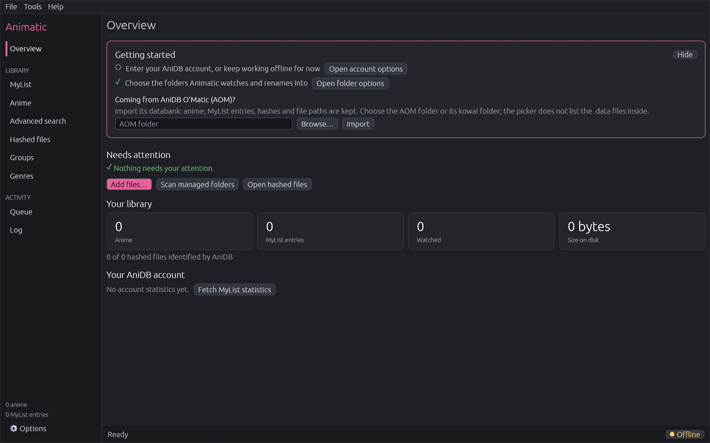
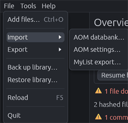

Bring an AniDB O'Matic (AOM) library and its settings into Animatic. This page is for AOM users
moving over: it covers what each import takes, the steps, what the windows say, and what is and is
not changed. **Both imports only read the AOM files.** Animatic never modifies, moves or deletes
your AOM folder, databank or settings file. Problems are covered in
[File and import problems](File-and-Import-Problems.md#aom-import-problems).

| You want to bring | Use | Source |
|---|---|---|
| Your library: anime, episodes, files, groups, MyList entries, hashes and file paths | [Migrate an AOM databank](#migrate-an-aom-databank) | AOM's `kowai` folder (`*.data` files) |
| Your preferences: account, managed folders, players, rename pattern, hashing options, colors | [Import AOM settings](#import-aom-settings) | AOM's `local_settings.xml` |
| Your current MyList from AniDB itself, newer than the databank | [MyList export](Managing-MyList.md#load-your-whole-mylist-with-an-export) | AniDB's export page |

Do the databank first, then the settings, then go online. The order is a recommendation, not a
requirement.

## Before you start

1. **Close AOM.** Do not import while it is running.
2. **Back up the `kowai` folder** (and, if you want to keep them, `local_settings.xml` and AOM's
   other files). Animatic only reads them, but a backup costs nothing.
3. **Decide the target.** The import writes into the database Animatic currently has open (the
   default location, the file named by `ANIMATIC_DB`, or the file given with `--database`). For a clean result start with an
   empty database: launch Animatic with a new `--database` file ([Running Animatic](Running-Animatic.md))
   and keep a copy of any existing database made while Animatic is closed (the database file plus
   its `-wal`/`-shm` files). Animatic asks for confirmation when that database already holds
   data, but it cannot undo an import.
4. **Note the plain-text copies.** The databank is encrypted. While it is imported, decrypted copies
   exist in your system's temporary folder until the import ends ([Temporary files](#temporary-files)).
5. **Expect a long import for a big library.** Progress is shown in the status bar and you can
   cancel.

## Migrate an AOM databank

AOM keeps its library in encrypted `kowai/*.data` SQLite files. Animatic reads them without
modifying or deleting them.

There are two ways in. On a fresh profile the **Overview** shows the **Getting started** box:

*The Overview on first start. The lower part of the box, below `Coming from AniDB O'Matic (AOM)?`, imports the databank.*

1. Start the import in either way:
   - **Overview:** in the **Getting started** box, type or paste the path of the AOM folder in
     the text field (it shows the hint `AOM folder`), or click **Browse…** and pick it, then click **Import**.
     The box is shown only on a new profile: if you clicked **Hide** on it, use the menu instead.
   - **Menu:** **File → Import → AOM databank…** (always available; a folder picker opens; choose the folder and
     the import starts).

   

   Choose the `kowai` folder or the AOM folder directly above it; the folder picker does not list
   the `.data` files inside (its title says `Choose the AOM folder or its kowai folder (files are
   not listed)`). The `kowai` folder must directly contain `mylist.data`, `local_files.data` or
   `animes.data`, else Animatic says `No AOM databank found in <folder> (choose the AOM folder or
   its kowai folder)`.
2. If the database already holds anime, MyList entries or hashed local files, the window **Import
   into a database that has data?** opens first. Read it, then click **Continue** to start or
   **Cancel** to change nothing (the log says `Import cancelled; the database was not changed`).
   See [Existing database](#existing-database).
3. Watch the progress bar in the status bar. It runs through `Decrypting <name>.data`,
   `Importing <name>`, `Imported <name>`, `Computing derived data` and `Import complete`. Use
   **Cancel** to stop (see [Cancel](#cancel)).
4. The Log ends with `Imported N records from M collections`.
5. Continue with [settings import](#import-aom-settings), then Options and the
   [first sync](AniDB-Synchronization.md#synchronization).

While the import runs Animatic is busy: jobs you start meanwhile (a scan, hashing, a queue run)
wait for it, and a backup, restore or MyList export import refuses with `Wait for the running task
to finish, or cancel it, first.`

### What the import does

- Up to 23 collections are processed **in this order**, skipping any `.data` file that is absent:
  `catcat, catlang, catqual, cattype, catvcodec, catacodec, catres, catsub, genres, groups,
  animes, animetitles, animegenres, animerelations, episodes, episodetitles, files,
  fileepisoderelations, filerelations, reviews, mylist, local_hashes, local_files`.
  If none exist the import fails with `no legacy databank files found`.
- In plain terms that brings over: the categories (quality, source, codecs, resolution, subtitle
  types), genres, release groups, anime with their titles, genres and relations, episodes with
  their titles, AniDB's file records and their relations, **review texts** (the only way review
  texts reach Animatic), your **MyList entries**, and your **hashed local files** with their
  hashes and paths.
- For each collection one file is decrypted into a plain SQLite file in the temporary work
  folder (see [Temporary files](#temporary-files)), attached, imported inside **one transaction per
  collection**, committed, detached and the temporary file deleted. Progress is weighted by file
  size.
- **Atomicity is per collection, not for the whole import.** A collection that fails is rolled back
  and skipped while later collections still run. The Log summary reports only how many
  collections were imported, and each skipped collection is also logged as an error line
  `Legacy import warning: <collection>: <error>`, so compare `M` with the number of recognized
  `.data` files you have. Unreadable individual records inside a collection are dropped silently.
  A failure while *decrypting* (for example a truncated file) aborts the entire import with
  `Legacy import failed: …`; collections already committed stay in the database.
- After the last collection the highest/special episode counts are recomputed, missing MyList
  group ids are filled from file records, episode names the databank held for episodes without a
  title are added, and the source folder plus date are recorded in the database.
- Nothing is queued, sent to AniDB or deleted. The import does not create queue entries; the
  Queue only fills as you hash/identify or refresh. Imported MyList entries stay as the local copy
  until an identify reply for their file says otherwise (see [Hashing and identification](Hashing-and-Identification.md)).
- Local file paths are imported verbatim (AOM's Windows paths). On Linux those paths do not
  exist; **Remove missing** only acts under an explicit folder rule whose directory exists, so
  they remain as stale records until you configure rules or remove them
  (**Hashed files → Remove from list…**).

### Cancel

**Cancel** is only checked while a collection is being decrypted and at the "Importing <name>"
step before it. It is *not* checked inside a collection's import transaction, during the final
derived-data processing or the closing bookkeeping. A decryption in progress finishes first. A
Cancel that arrives late therefore may still finish with **success** (`Imported N records…`). A
Cancel that is honored reports `Legacy import failed: cancelled`; collections already committed
**remain**, the remaining ones are not imported, and the derived-data step and import bookkeeping
are skipped, so run the import again (it is safe to repeat) rather than using a half-imported
library.

### Existing database

Rows are written with *insert or replace* keyed by AniDB identifiers: a row with the same id
(anime, file, group, MyList entry `lid`, local hash/file id, …) is replaced as a whole by the AOM
copy, even if you fetched newer data from AniDB since; columns the import does not supply return to
their defaults (so imported anime have no "fetched" marker and a later title-list merge may
replace their titles). Rows that exist only in your database, and the command queue, are left
alone. Re-importing the same databank converges to the same result.

Because of that, **File → Import → AOM databank…** (and the Overview **Import**) asks first when
the database already holds anime, MyList entries or hashed local files: **Import into a database
that has data?** says that rows with the same ids will be replaced, names the database file, and
offers **Continue** and **Cancel**. To keep the current database untouched, cancel and start
Animatic with `--database FILE` (a new file) instead. An empty database imports without the
question.

### Bring the library up to date

The databank is a snapshot of when AOM last saved it. To bring it up to date with your whole
AniDB account, request a MyList export and import the downloaded file (**Tools → Request MyList
export…**, then **File → Import → MyList export…**; see
[Managing MyList](Managing-MyList.md#load-your-whole-mylist-with-an-export) and
[Full-account MyList import](AniDB-Synchronization.md#full-account-mylist-import)). It fills what
the databank lacked and refreshes state and watched data; it never deletes entries, so entries
you removed on AniDB since the databank was made stay until you remove them here.

### Temporary files

Decrypted collections are plaintext copies of your library. They are written to a folder that only
Animatic creates, directly in the system temporary folder: its name starts with
`animatic-legacy-import-` and it contains a marker file named `.animatic-legacy-import`, created
before any decrypted data is written (on Linux the folder is private to your user). Each copy is
deleted after its collection, and the whole folder is removed when the import ends, whether it
succeeded, failed or was canceled; if the folder cannot be removed the Log says so.

A crash, a kill or a power loss can still leave it behind. At the **next start** Animatic looks
for such folders in the temporary folder and, if it finds any that no running import is using,
shows **Leftover import files**: `An earlier import of an AOM databank did not finish cleanly. It
left decrypted copies of the databank in these temporary folders:` and the paths.

- **Remove** deletes only those folders (a folder counts only if its name has the prefix **and** it
  holds the marker).
- **Keep for now** leaves them and Animatic asks again at the next start.

Nothing else in the temporary folder, and never the AOM databank, is touched. A folder that lacks
the marker (for example one left by an older version, which used an `import-temp` folder next to
the database) is not offered and has to be inspected and removed by hand.

### The command-line example

Developers can run the same import from the command line with the `import-legacy` example program.
It runs against a database file, uses the system temporary folder in the same way (the same marked
folder, removed the same way) and does not ask before writing into an existing file. Use it only
with a copy of the data outside the repository and delete the outputs afterwards (see
[development](https://github.com/RetroHazard/animatic/blob/main/docs/development.md)).

## Import AOM settings

Imports AOM's `local_settings.xml` (UTF-16 or UTF-8). It is read-only for the source file.

1. Choose **File → Import → AOM settings…** and pick the XML (the dialog is titled `Choose AOM
   local_settings.xml`). **Starting an import cancels whatever job is currently running**, then
   reads the file in the background. All background actions (add files, import databank, scan, queue) stay
   disabled until the review ends.
2. **Review imported AOM settings** opens. It says **Applying will replace your current Animatic
   settings.**, warns `Imported credentials will not connect to AniDB: offline mode remains
   enabled.` and `Review managed folders before scanning them.`, and shows counts (`Managed
   folders`, `External players`, `Hash file extensions`) and whether credentials were detected
   (`Imported credentials were detected and will require review.` or `No imported credentials
   were detected.`). It never shows the values.
3. Click **Apply imported settings** to save immediately and activate the result **offline**.
   **Cancel**, or closing the window, discards it. If saving fails the error is logged
   (`Could not save settings: …`) and the review stays open. Unrelated or empty XML is rejected
   (`No supported AOM settings found in the selected XML`) and your settings are unchanged.

Important: the imported settings are built on the Animatic **defaults**, not on your current
settings. Everything the XML does not mention (API key, UDP server and port, theme, scale,
current folder rules when the XML has none, …) reverts to the default, and applying overwrites
your settings file. A save first tries to copy your previous valid file to `settings.json.bak` (a
failed copy is ignored, so the backup can be stale or absent); the backup holds the *previous*
settings, including credentials you may have since removed (blanked once the keystore holds
credentials), and is only loaded automatically when the primary is missing or invalid. Copy your
settings file yourself first if you may want it back.

The exceptions are preferences AOM cannot know about, which keep your current values when you
apply an import: the `updates` object (`updates.auto_check`, `updates.channel`), the `media`
object (`media.read_properties`, `media.ffprobe_path`) and the color scheme (`ui.color_scheme`).

### What is read

| From the XML | Becomes |
|---|---|
| User name and password | `anidb.username`, `anidb.password` (saved like any save: into the system keystore when one is available, otherwise in plain text in the settings file, [details](Settings-Files.md#credentials-and-the-system-keystore)) |
| Image server, file-information flag | `anidb.image_server`, **Update known file information** |
| Hashing: autostart, thread priority, shell integration, extension restriction and list, hash export template | The matching **Hashing** and **Exports** options |
| Rename pattern | The renaming pattern (custom pattern) |
| Statistics export: enabled, format, file name | **Exports → Statistics export** |
| AVDump enable and key | **Players and tools → AVDump** |
| Players | **External players** |
| Window position and size, maximized, last directory, tray icon and minimize-to-tray, tree and size display preferences, colors | The UI state and [row colors](Main-Window.md#sorting-columns-and-row-colors) |
| Folder rules, with their MyList policy | **Managed folders**. An AOM rule with automatic rename on becomes **Dry run (log only)**, never **On** |
| The folder-scan settle delay and AOM's pause between scans | The settle delay, and the interval of the [scheduled scan](Managed-Folders-and-Scans.md#scheduled-scans), left switched off |

Several of those have no effect in Animatic (see
[Settings files](Settings-Files.md#aom-settings-import) and the [settings reference](Settings-Reference.md)).
A profile that imports an XML without a user name shows the **Getting started** box again.

### After applying

1. Review the **Managed folders**: paths, **Subfolders**, **Remove missing**, **Add to MyList** and
   its values, **Auto rename** (check that dry run is what you want).
2. Check **External players** and the **Renaming** pattern.
3. Enter or confirm your **Password** and **API key** if AOM did not hold them.
4. Clear **Work offline** only when you are ready; the import leaves it on.
5. Run a [first sync](AniDB-Synchronization.md#synchronization) when you are ready.

## What stays safe

- **Source files.** The databank, `local_settings.xml` and the rest of the AOM folder are only read.
  Nothing there is rewritten, renamed or deleted, including the temporary-file clean-up, which
  touches only Animatic's marked folders.
- **Your media.** Neither import touches a media file.
- **AniDB.** Neither import sends anything to AniDB or queues a command.
- **A cancel or failure of the settings import** keeps your active settings. The databank import
  keeps committed collections ([Cancel](#cancel)); repeating it converges to the same result.
- **Credentials.** The settings review never shows secrets; applying stores them like any save.

## See also

- [File and import problems](File-and-Import-Problems.md#aom-import-problems): error messages and fixes.
- [First launch](First-Launch.md): the Getting started box and safe first settings.
- [Settings files](Settings-Files.md#aom-settings-import): which AOM keys carry over and which have no effect.
- [Managing MyList](Managing-MyList.md#load-your-whole-mylist-with-an-export): refresh the imported MyList from AniDB.
- [Feature parity](Feature-Parity.md): what AOM did and where Animatic differs.
