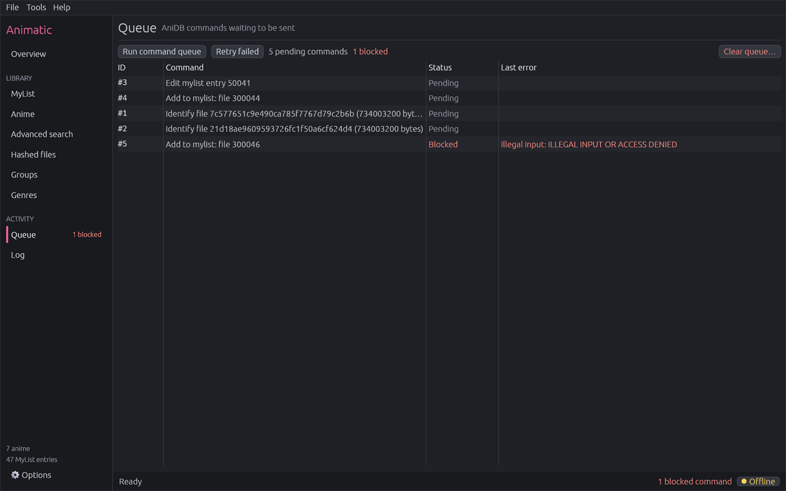

Problems reaching AniDB or GitHub: why commands are not sent, network access, credentials,
cooldowns and bans, AniDB reply codes, queue states, missing library entries and failed updates.
Read it when the status bar shows **Offline**, a red blocked counter or a pause message, or when
an update does not work.

## Network and firewall

What Animatic connects to:

| Purpose | Endpoint | Notes |
|---|---|---|
| UDP API | `api.anidb.net:9000` by default (the server `anidb.udp_server` and the local port `anidb.local_port` can only be changed in the settings file; Options has no field for them) | IPv4 only. The client binds `0.0.0.0` on the configured local port (default 29456) and **never uses another port**: if it cannot be bound the run stops with an error naming `anidb.local_port` and nothing is sent. Each exchange waits up to 20 s and a first timeout is retried once |
| HTTP API | `http://api.anidb.net:9001/httpapi` | Plain HTTP; every HTTP request (anime records, the title list, cover pictures) is spaced at least 2 s from the previous one; 60 s timeout |
| Titles dump | `https://anidb.net/api/anime-titles.xml.gz` | Public download, at most once per 24 hours, bounded as described in [Disk space, temporary files and leftovers](Backups-and-Recovery.md#disk-space-temporary-files-and-leftovers) |
| Cover pictures | `https://<image host>/images/main/<picture>`, HTTPS; the host AniDB announced at the last login, else `anidb.image_server` (`cdn.anidb.net`) | One picture per request, only when an anime detail window opens on an anime whose cover is not in the [covers folder](Data-Locations.md#cover-pictures); never offline or during a ban; spaced with every other HTTP request; no `Referer`; at most 16 MiB; 60 s timeout; after a failed try the same anime's cover is not requested again for an hour. Turn it off with **Download anime covers when a detail window opens** (**Tools → Options… → AniDB account → Downloads**) |
| Update check and download | `https://api.github.com/` and `https://github.com/` (plus the CDN hosts GitHub redirects asset downloads to), HTTPS only | Not AniDB: no flood spacing and no cooldown. Anonymous: sends your IP address and `User-Agent: Animatic/VERSION`, no credentials or library data. Bounded sizes and timeouts. Used only for update checks and downloads you start, plus the optional startup check |

Animatic enforces AniDB's request spacing for the whole program, not per run: UDP packets are
2 s apart for the first five, then 4 s apart (10 idle minutes restart the burst), and HTTP
requests 2 s apart. The time of each request is saved in the database before it is sent, so
restarting Animatic does not shorten the gaps (after a restart the first packet waits 4 s from
the last one). The client also re-authenticates when a session expires. With **Run the command
queue automatically** on, one login is kept between runs and looked after in between (an idle
logout, a keep-alive command, a `PING` behind a router; see
[Automatic runs](AniDB-Synchronization.md#automatic-runs-and-the-anidb-session)); those packets
keep the same spacing. A long queue therefore
takes a long time; that is not a hang. AniDB also asks clients not to repeat requests: the
title list is requested at most once per 24 hours, an anime at most once per 24 hours and a file
at most once per 7 days (see [Request limits](AniDB-Synchronization.md#request-limits)). The
HTTP client uses its default settings and Animatic sets no proxy of its own; the
UDP API cannot use an HTTP proxy.

| Message | Cause and action |
|---|---|
| `network error: cannot resolve <server>: …` | DNS failure, no internet connection, or a wrong `anidb.udp_server` value in the settings file |
| `network error: no IPv4 address for <server>` | The name resolves to IPv6 only. The UDP client needs an IPv4 address |
| `network error: cannot bind UDP port N: …; the port is set by anidb.local_port …` | Another program already uses the local UDP port. Close it, or change `anidb.local_port` in the settings file (a free port above 1024; see the [Settings reference](Settings-Reference.md)). Animatic never picks another port by itself, because AniDB bans clients that show many different source ports. Nothing was sent and the commands stay queued; the next run is allowed after 60 s |
| `no reply from AniDB (timeout)` | Outbound UDP to the server is blocked or lost. Allow outbound UDP to the server's port, and replies back to the local port (NAT and router behavior is outside Animatic) |
| `HTTP error: HTTP status 5xx` | A server-side failure from the HTTP API; counted toward the command's retry budget |
| `AniDB unavailable, retry in N min` | Animatic's own wait after AniDB answered 600, 601, 602 or 604, or after the HTTP API answered status 429 (treated as a 30-minute wait). The text shows the wait that is left |
| `no reply to the AniDB login (AUTH); the next try is allowed in …` | The login got no answer. Animatic waits longer after every further unanswered login: 30 s, 2 min, 5 min, 10 min, 30 min, then 2 hours, and starts over after a successful login. The step survives restarts. Check your internet connection, `anidb.udp_server` and `anidb.local_port` in the settings file and your firewall |
| `cannot save the AniDB request state, nothing was sent: …` | The database could not record the time of the request, so Animatic did not send it (disk full or database locked). Retried after 60 s |
| `Automatic command queue run postponed (<reason>); it starts when that is over` | Only with the automatic option on. The reason is one of `Work offline is on`, `the AniDB account is not set`, `an AniDB cooldown is active`, `another task is running`, `a library restore is in progress`, `an import is in progress`, `imported settings are waiting for review`, `the settings recovery notice is open` (the **Settings recovered** window is still open) or `some changes are not saved to the database yet`. Nothing is wrong: the run starts by itself when the reason is gone, and nothing was sent meanwhile. The Log also says `Automatic command queue run started` when it starts |
| `AniDB session upkeep failed: …` | The keep-alive command or the `PING` that looks after a kept login got no answer or an error (shown after the usual cause text). The login is forgotten, the usual cooldown starts for network errors and bans, and the next run logs in again |
| `Logged out of AniDB: the session was idle` / `… automatic queue runs are off` / `The AniDB session ran out while idle; the next run logs in again` | Routine: the kept login ended after `idle_logout_minutes` without commands, because you switched the automatic option off, or because AniDB ended it while idle. The keep-alive commands (`UPTIME`, `PING`) themselves write nothing to the Log |

Transient network failures never lose queued work: the command stays in the queue and syncing
pauses for 60 seconds (see [Cooldowns and bans](#cooldowns-and-bans)).

## Why are my commands not sent?

Work through this list from the top; the first line that applies is the cause.

1. **Work offline is on** (**Work offline (keep commands queued)** in **Tools → Options… → AniDB account**). The right of the status bar shows **Offline** (yellow dot). Click it
   to go **Online**, or untick **Work offline**. Nothing
   is sent while it is on, and the Log says `Offline mode is enabled; commands remain queued`.
2. **Nothing started the queue.** Queued commands wait until you choose **Tools → Run command
   queue**, click **Run command queue** on the **Queue** page or press `Ctrl+Shift+S`, unless you switched on **Run
   the command queue automatically** (off by default). MyList removals are never sent
   automatically, even then.
3. **A cooldown is active.** The status bar shows `AniDB sync paused until <time>: <reason>`
   and **Run command queue** is disabled. See [Cooldowns and bans](#cooldowns-and-bans).
4. **The account is not set.** `authentication: username and password required` appears and the
   command is blocked. Enter them in **Tools → Options… → AniDB account**.
5. **Commands are blocked.** The red `N blocked` in the sidebar and `N blocked command(s)` in
   the status bar mean permanent failures; read **Last error** on the **Queue** page. See
   [Queue states](#queue-states-blocked-deferred-and-unsaved).
6. **Another task is running**, an import or the review of imported settings is open, a restore
   is in progress or commands are not saved yet. An automatic run says `Automatic command queue
   run postponed (…); it starts when that is over`; **Run command queue** is disabled while an
   import is pending.
7. **The queue is long.** Every packet keeps AniDB's spacing (2 s for the first five packets,
   then 4 s), so many commands take minutes. That is not a hang; **Cancel** works between
   commands.

## AniDB reply codes at a glance

What Animatic does with the replies it understands.
"Cooldown" means all AniDB requests pause; see [Cooldowns and bans](#cooldowns-and-bans).

| Code | AniDB's meaning | What Animatic does |
|---|---|---|
| 200, 201 | Login accepted (201: a newer AniDB client version exists) | Continues |
| 500 | Login failed | Blocks the whole queue: `authentication: login failed: wrong username or password` |
| 501, 506 | Session expired or invalid | Forgets the session, logs in again and retries once |
| 502 | Access denied | Blocks the whole queue: `authentication: access denied` |
| 503 | Client version outdated | Blocks the queue until Animatic is updated |
| 504 | Client banned | Blocks the queue with no timed cooldown; update Animatic |
| 505 | Illegal input or access denied | At login: `authentication: illegal input or access denied (is the client registered?)`; on a command: that command is blocked with `illegal input: …` |
| 555 (and 510, which Animatic treats the same way) | Banned | Cooldown of 30 minutes; commands stay queued |
| 598 | Unknown command | That command is blocked; the run continues |
| 600, 601, 602 | Server error (600), out of service (601) or server busy (602) | Cooldown of 30 minutes |
| 604 | Server timeout | Cooldown of 60 seconds |
| 309, 394 | Encrypted session setup failed (API key not defined, no such user) | Blocks the whole queue: `authentication: API key not defined in your AniDB profile` or `authentication: no such user` |
| Anything else unexpected | | The command is blocked as `unexpected reply <code>: <text>` |

The 30-minute and 60-second pauses are Animatic's own conservative choices unless AniDB sent a
duration; the project has no recorded observation of AniDB's real ban lengths.

## Credentials and client registration

Animatic sends its own registered AniDB clients (`animatic` version 1 on UDP, `animatichttp`
version 1 on HTTP), so there is nothing to register or enter: the account (**Tools → Options… →
AniDB account**) needs only a user name and password, and optionally an API key. The client
identifiers are built in, are not settings, and change only when a release registers a new client version with AniDB (an ordinary version bump does not change them); a
settings file that still holds the old client keys has them ignored (see the
[Settings reference](Settings-Reference.md)). Client errors below mean AniDB refused that
built-in registration. For the details see
[AniDB client registration](First-Launch.md#anidb-client-registration).

The queue runs on its own only if you switch on **Run the command queue automatically**
(off by default; see [Automatic runs](AniDB-Synchronization.md#automatic-runs-and-the-anidb-session)).
It never sends MyList removals: the Queue page says `N MyList removals wait for you to click Run
command queue.` **Tools → Run command queue** and the **Run command queue** button on the
**Queue** page
take a snapshot of the **current in-memory options** (saved or not) at the moment you click.
With **Work offline (keep commands queued)** ticked they send nothing, log `Offline mode is enabled; commands remain
queued`, and leave the queue alone; an automatic run is postponed instead.

| Message (in the **Last error** column, the **Log** or the status bar) | Meaning | Effect | Action |
|---|---|---|---|
| `authentication: username and password required` | Missing user name or password | Blocks the whole queue (no timer) | Enter them, then **Retry failed** |
| `authentication: login failed: wrong username or password` | Login code 500 | Blocks the whole queue (no timer) | Correct the credentials, then **Retry failed** |
| `authentication: illegal input or access denied (is the client registered?)` | Login code 505 | Blocks the whole queue (no timer) | Check the user name, password and API key; if they are right, AniDB may be refusing the built-in client, so update Animatic or report it |
| `authentication: API key not defined in your AniDB profile` / `no such user` | Encrypted-session setup failed (codes 309, 394) | Blocks the whole queue (no timer) | Fix or clear the API key; check the user name |
| `authentication: access denied` | A later command was refused (code 502) | Blocks the whole queue (no timer) | Check the account |
| `client version outdated - update Animatic, or report this if it is already the latest version` | Code 503: AniDB refuses the client version Animatic's built-in registration sends | Blocks the whole queue (no timer) | Update Animatic; if it is already the latest release, report it ([Reporting problems](Reporting-Problems.md)); then **Retry failed** |
| `AniDB refuses Animatic's built-in client registration (reply 504): …` | Code 504: AniDB bans the built-in client name and version | Blocks the whole queue, **no timed cooldown** | Update Animatic (a release carries a newly registered client version); if it is already the latest release, report it; then **Retry failed** |
| `authentication: HTTP API rejected the client registration (…)` | The HTTP API refused Animatic's built-in HTTP client (`animatichttp`) | Only the HTTP commands (anime records) are blocked; UDP commands keep running. The Log line ends `Check the HTTP client in Options.`, but Options has no HTTP client field: the client is built in | Update Animatic; if it is already the latest release, report it; then **Retry failed** |

After a fatal credential or client error the status bar shows **N blocked commands** and the Log shows
`Command blocked: N queued commands blocked: <message>`. Correct the cause, optionally **Save
options**, then click **Retry failed** on the **Queue** page, then **Run command queue**. A wrong password that you
keep retrying will keep failing; stop and fix it first.

Credentials live in the system keystore, or in plain text in the settings file when Options says no
keystore is available. Do not paste them into bug reports; see
[Privacy-safe support](Reporting-Problems.md).

## Cooldowns and bans

When the network fails, the server is unavailable or AniDB bans you, Animatic **stops the whole queue run** and
stores a cooldown so that it holds across restarts and new jobs. (A refused or outdated client is
different: it blocks the queue until you update Animatic, with no timer; see
[Credentials and client registration](#credentials-and-client-registration).)

- It is stored in the library database (an expiry time and the reason), so it belongs to
  **that database**. Another database or machine does not know about
  it; waiting still makes sense because the server-side condition remains.
- While it is active, **Run command queue** (menu, Queue page and `Ctrl+Shift+S`) is disabled (hover for the
  text) and the status bar and **Queue** page show `AniDB sync paused until HH:MM:SS: <reason>`
  in local time. A run started through another path logs `AniDB sync is paused for another …`
  and sends nothing.
- **Retry failed does not bypass a cooldown.** It only unblocks entries; the run still checks the
  stored cooldown first, and a stored value that cannot be read never locks syncing.
- There is no control to clear a cooldown, and editing the database to remove it is not
  supported. The cooldown exists to avoid immediate repeat requests after a refusal.

| Condition | Pause | What happens to the command |
|---|---|---|
| Connectivity failure: DNS, connect, TLS, timeout, no reply | 60 s | Stays queued, no attempt is counted |
| No reply to the login (`AUTH`) | 30 s, then 2 min, 5 min, 10 min, 30 min, 2 h for each further unanswered login; reset by a successful login | Stays queued, no attempt counted |
| UDP server code 604 | 60 s | Stays queued, no attempt counted |
| UDP server codes 600, 601, 602 | 30 min | Stays queued; code 600 counts one attempt |
| `AniDB unavailable, retry in N min` | The duration given (HTTP 429: 30 min) | Stays queued |
| Ban: UDP codes 510, 555; HTTP 403; HTTP `banned` / error 500 | 30 min (Animatic's conservative default when no duration is known) | Stays queued; a ban never blocks entries |
| HTTP status ≥ 500 or malformed server answers | 60 s | The command **counts an attempt**; after 5 counted attempts it is blocked |
| Local storage errors while applying a reply | 60 s | Counts an attempt |
| Code 598 (unknown command), 505 on a command (`illegal input: …`), unexpected reply codes, protocol errors, XML errors | none | That command is **blocked** and the run continues with the next |

Notes:

- The ban text may include the server's wording. If you see `client banned by AniDB: …`, stop
  starting more runs and wait.
- A run that finishes sends a logout. Cancel acts **between commands**: a command already in
  flight can take up to about 45 s for UDP (a 20 s timeout, retried once, plus packet spacing)
  or 60 s for HTTP to end. Closing the window
  does not wait for it.
- Durations are Animatic's own conservative choices unless AniDB supplied one; the project
  has no recorded production AniDB observation to cite for AniDB's actual ban lengths.

## Queue states: blocked, deferred and unsaved

The **Queue** page lists every saved command with its **Status** and **Last error**. The sample
library below has four pending commands and one blocked command, and Animatic is working offline.

*The Queue page. The toolbar shows **Run command queue**, **Retry failed**, `5 pending commands` and the red `1 blocked`; **Clear queue…** is at the right.*

There are three different situations, and they are handled differently.

| State | Where you see it | Meaning | What to do |
|---|---|---|---|
| **Pending** | Status `Pending`, no retries | Waiting to run | Nothing; run the queue |
| **N retries** | Yellow status | Failed `N` times with errors that count toward the budget (at most 5) | Wait; it becomes **Blocked** at 5 |
| **Deferred** (not a separate label) | `Pending` or `N retries`, with a **Last error** such as a timeout or ban | Not attempted again because of connectivity or a cooldown, which do not count as attempts | Wait out the cooldown, fix connectivity, run again |
| **Blocked** | Red **Blocked**, red **N blocked** in the toolbar and status bar | A permanent failure, a protocol/format error, rejected credentials, or an unreadable stored command. It is skipped by runs and stays visible | Read **Last error**, fix the cause, then **Retry failed** |
| **blocked commands (refreshing)** | Red text | A newer blocked event arrived than the data on screen; the view is refreshing | Wait a moment |
| **Not saved yet** | Yellow `N commands not saved yet` in the status bar | The command is only in memory | See below |

Rules that matter:

- **Retry failed** is enabled only when something is blocked. It unblocks and resets the
  attempt counter of every blocked command, merges multiple edits of the same MyList entry into
  the latest, and does not touch the cooldown. It does not clear **Last error** text; a stale
  message can remain until the command is retried or removed.
- **Clear queue…** (the red button on the Queue page, enabled while the queue is not empty) deletes
  **every** queued command, including unsynchronized MyList edits and
  blocked commands, after you confirm **Discard commands** in the "Clear the command queue?" dialog. It does not undo the optimistic local state
  those edits already applied, so the local view can then disagree with AniDB. It does not
  clear the cooldown. There is no per-command discard in the interface; to drop one command you
  must clear the whole queue, so make a backup first when other work is pending.
- A blocked MyList edit whose entry no longer exists on AniDB says `mylist entry N no longer
  exists on AniDB; the edit is kept (blocked): discard it from the queue or refresh the entry`.
  Retrying it fails again; only **Clear queue** discards it from the interface.
- An unreadable stored command is blocked with `unreadable queued command: …` rather than being
  deleted. Because Animatic cannot read it, such a row cannot overlay its pending intent onto
  values received from AniDB; readable queued edits are preserved over remote values.
- `file unknown to AniDB` after identification is a normal answer for a file AniDB does not
  know, not an error, and is not queued again.
- Command identifiers are never reused, so an older reply cannot erase newer intent.

### Database busy and unsaved commands

Two connections write to the database: the background worker and the interface. A long write
(for example an import, a title merge or a large registration) makes the other side wait.

| Side | Wait before giving up | What you see |
|---|---|---|
| Worker | 30 s | A failed job reports the database error |
| Interface | 1.5 s | The behavior below |

- **A MyList edit that cannot be saved** reports `<action>: the database is busy with a
  background write; nothing was changed, try again`. The edit is not applied; repeat it.
- **A queued command (identify, title download, refresh)** that hits a busy database is kept in
  memory: the Log says `Database busy: queued command is NOT saved yet, retrying` and the
  status bar shows `N commands not saved yet`. Animatic retries every half second and logs
  `Saved N previously unsaved commands` when it succeeds. At most 1000 are held; beyond that
  you get `NOT queued: <command> (database busy and 1000 commands are already unsaved)`.
- **Closing the window** makes one final attempt of up to 5 s. If the database is still busy,
  the unsaved commands are lost, and nothing records them anywhere (Animatic writes no log file).
  **Do not quit while the unsaved counter is non-zero.**
- Causes of long busy periods: a legacy import (each collection is one transaction), the
  titles merge, another program touching the files (backup tool, antivirus, sync client) or a
  second Animatic instance. Wait for the running job to finish or cancel it.
- `Unable to refresh library: …` means the background snapshot failed; a later reload
  (**File → Reload**, `F5`) usually succeeds once the contention ends.

## The library is missing entries

- **Loading your whole AniDB MyList is a two-step export, not a download.** Animatic never walks
  your MyList entry by entry (AniDB forbids it). **Tools → Request MyList export…** asks AniDB to
  prepare an export (up to 24 hours; AniDB sends a message when it is ready), you download the
  file from AniDB's export page, and **File → Import → MyList export…** merges it. See
  [Full-account MyList import](AniDB-Synchronization.md#full-account-mylist-import).
  **Tools → Fetch MyList statistics** only fetches counts (kept and shown on Overview).
  **Tools → Download anime
  titles** fetches the public titles dump only. **Tools → Full update…** (after a confirmation) or `--full-update` queues the titles dump plus lookups for the files and anime your **hashed local files**
  already reference, leaving out what was requested too recently (see the next point). Library
  content comes from an AOM import, from hashing and identifying files, from the anime detail
  window's **Refresh from AniDB**, from a MyList export import and from your own edits.
- **MyList export messages.** `A MyList export is already queued on AniDB…` is information, not
  an error: wait for AniDB's message. `MyList export not requested: … allowed after …` means one
  was requested within 24 hours. A blocked *Request MyList export* command with `unexpected
  reply 317` means AniDB no longer knows the template; it needs a new Animatic version. An
  import that ends with `MyList export not imported, the library was not changed: …` names why
  the file was refused (for example `larger than the … byte limit`, `truncated export`,
  `root element is <…>`, a missing element or an invalid value); nothing was written. Download
  the export again, or open an issue without attaching the file (it holds your account's
  library).
- Not every hashed file is known to AniDB. A file AniDB does not know logs `file unknown to
  AniDB`.
- **Download anime titles** failures leave your existing titles and the "last updated"
  timestamp unchanged: the download is validated (XML, gzip end-of-stream and CRC, size and
  count limits) and merged in a single transaction only when complete. Errors you may see
  include `titles dump larger than the N byte download limit`, `… decompressed limit`,
  `unexpected data after the compressed titles dump`, `invalid compressed body: …` and `title
  longer than N bytes`. Format and size errors block the title-list download command; connectivity
  errors pause syncing instead (see [Cooldowns and bans](#cooldowns-and-bans)). After a block,
  use **Retry failed** or queue the download again from the Tools menu once the cause is gone
  **and** 24 hours have passed since the failed attempt (next point). A download is not
  resumable.
- **"Skipped" or "allowed after …" instead of a download or refresh.** AniDB asks clients not
  to request the same data again and again, so Animatic does not send the title list more than
  once per 24 hours, an anime more than once per 24 hours or a known file more than once per 7
  days, **counted from the last request it sent, even if that request failed or was cut off**
  (the time is saved before sending, so a crash or restart does not reset it). **Download anime
  titles** and **Refresh from AniDB** then queue nothing and log `… allowed after <date time>`;
  a command already in the queue finishes as `… skipped: …` without an error. Wait until the
  time shown; there is no way to bypass it (and no setting), because sending sooner risks a ban.
  See [Request limits](AniDB-Synchronization.md#request-limits).
- Cached **MyList** displays include optimistic local state for queued edits; a blocked or
  cleared edit can leave the local view different from AniDB.
- A file lookup that **explicitly** reports "not in MyList" removes the local MyList rows for
  that file, unless a queued local edit for the entry exists. A malformed successful reply is
  a protocol error, never treated as absence. If an entry vanished after an online run,
  check the **Log** for the identification result and compare with AniDB's website before
  assuming data loss; a backup taken before the run is the way back.

## Update problems

How updating works and what it changes: [Updating Animatic](Updating-Animatic.md). The
update path is separate from AniDB: an update failure never touches the command queue or an
AniDB cooldown, and an AniDB cooldown never blocks it.

| Symptom | Cause and action |
|---|---|
| No check happens at startup | By design when **Check for updates at startup** is off, **Work offline** is on, or settings were recovered from a backup. **Help → Check for updates…** still works |
| **Help → Check for updates…** is disabled or the platform is reported unsupported | Only Windows and Linux on x86_64 are supported. Download releases manually elsewhere (none are built) |
| The check fails, or reports a rate limit | Unauthenticated GitHub API requests are limited per IP address, and a firewall, proxy or offline machine also fails. Nothing is retried automatically; try again later. A manual check always shows the error, a startup check writes it only to the **Log** |
| The check reports "not found" or the release feed as unavailable | GitHub answers HTTP 404 when the release data is not visible to an anonymous client: the repository's releases are not publicly readable, or nothing is published. This is an error, never "up to date". Animatic has no token or sign-in setting, so until the releases are publicly readable, update manually ([Releases](https://github.com/RetroHazard/animatic/blob/main/docs/releases.md#install-a-release)). This guide does not state whether the repository is currently public |
| "Animatic is up to date" although a newer tag exists on GitHub | Only published, non-draft releases with a valid CalVer tag that is strictly newer than the running version are offered. On the default **Stable** channel prereleases (release candidates, `-rc.N`) are not offered: switch **Tools → Options… → Updates → Release channel** to **Beta** to be offered them. Other prerelease forms, drafts and older versions are never offered on either channel, and the platform archive and `SHA256SUMS` must be present and correctly named. If the newest eligible release is incomplete the check reports an error instead of offering an older one |
| Download or verify fails (size, SHA-256 or archive error) | Nothing was installed. The staged files are in a private temporary folder that is removed when the update is dropped or Animatic exits. Retry; if the SHA-256 check keeps failing, do not install and download manually from the [releases page](https://github.com/RetroHazard/animatic/releases) as described in [Releases](https://github.com/RetroHazard/animatic/blob/main/docs/releases.md#install-a-release), and report it |
| Install or Restart now is disabled | They are blocked while a job is running, an AOM import is in progress, imported settings are waiting to be applied, or some changes are not yet saved to the database; Restart is also blocked while settings recovered from a backup are unsaved (use **Save options**). The reason is shown in the window. Finish or cancel that work first |
| Install fails with a permission or read-only error | The folder holding the executable must be writable by your account. There is no elevation. Update the copy the way it was installed (administrator copy, package manager) or move Animatic to a user-writable folder |
| Install refuses because the executable does not match | The running file is not the one Animatic started from (moved, replaced or launched through an unusual path). Restart Animatic normally and try again |
| `LICENSE-vVERSION` and `NOTICES-vVERSION` appear beside the executable | Expected after an install, even a failed one. They are the new release's license and notices files, are never overwritten, and are harmless to keep. A different pre-existing file with the same name makes the install stop; inspect or rename it |
| An empty `.animatic-update.lock` file beside the executable, or a message that another install is running | Created by the install step; the OS holds an advisory lock on it only while an install runs. The empty file is harmless and may remain. The message means another Animatic process holds the lock: wait for it or close that instance |
| Dot-prefixed files next to the executable (`.animatic-recovery-*.exe`, `.animatic-restore-*`, or helper files from `self-replace` such as `.__selfdelete__.exe`) or a renamed old executable | `.animatic-recovery-*.exe` is the Windows copy of the previous executable made before the swap; it is removed after a successful install and **kept after any failed one**. Other files are left if the machine lost power or Animatic was killed mid-install. Animatic never deletes them automatically. Check which executable starts, and delete leftovers by hand only after confirming a working copy |
| The window says the installation did not finish and the program files may be in an unknown state | The swap itself failed. Animatic stops offering updates and does not restart by itself. Check that the executable still starts; the message names the recovery copy and, if the old file was not restored, which file to copy to which name. Otherwise install the release manually ([Releases](https://github.com/RetroHazard/animatic/blob/main/docs/releases.md#install-a-release)). Restart Animatic by hand before trying again |
| Animatic does not start after an update | Download the archive for your platform from the releases page, verify `SHA256SUMS`, and run or copy the executable from it ([Releases](https://github.com/RetroHazard/animatic/blob/main/docs/releases.md#install-a-release)). Your database and settings were not changed by the update |
| The documentation or notices beside the executable are older than the program | Expected: only the executable and versioned license files are updated. Replace the whole folder from a newly downloaded archive to refresh the bundled documents |
| Restart did not start a new window | The new process is started only after the old one exits, with only your `--database` path (and `ANIMATIC_SETTINGS` when it was set). Start Animatic yourself; nothing is lost because settings were saved before closing |

The check, download and install are bounded by byte limits and timeouts and run on their own
thread, so a slow or stuck GitHub connection never freezes the window; use **Cancel** during
a download, or close Animatic (which cancels it). Closing during the short install step waits for it.

## See also

- [AniDB synchronization](AniDB-Synchronization.md) for how the queue, request limits and automatic runs work.
- [Updating Animatic](Updating-Animatic.md) for the update flow.
- [Troubleshooting](Troubleshooting.md) for the symptom index and message index.
- [FAQ](FAQ.md) for short answers, for example why commands are not sent.
- [Reporting problems](Reporting-Problems.md) if a message here does not match what you see.
