The Options window holds every setting you can change in Animatic: your AniDB account, how the
program looks, which folders it manages, how files are hashed, renamed and exported, your media
player, and update behavior. This page walks through the eight categories control by control, says
what each control does and what it is set to out of the box, and names the settings key behind it so
you can look it up in the [Settings reference](Settings-Reference.md). It also explains what **Save
options** and **Close** do, because the window works differently from most dialogs: edits are live.

## Opening the Options window

Any of these opens it:

- **Tools → Options…** or `Ctrl+,` (opens the window; it never closes it).
- The **⚙ Options** entry at the bottom of the sidebar (a second click closes the window again, exactly like **Close**).
- The buttons of the Overview's **Getting started** card: **Open account options** opens the
  **AniDB account** category, **Open folder options** opens **Managed folders**.
- The **Edit pattern in Options** button of the rename preview windows opens **Renaming**.

The window is a normal floating window, not a modal dialog: you can leave it open next to the rest of
Animatic. It starts at about 820 × 560 points, can be resized (never larger than the main window, never
smaller than about 520 × 300 points) and always keeps its footer on screen. A list of categories
fills the left side and the controls of the chosen category the right side, in this order:

1. **AniDB account**
2. **Appearance**
3. **Managed folders**
4. **Hashing**
5. **Renaming**
6. **Players and tools**
7. **Exports**
8. **Updates**

The window opens on **AniDB account** the first time and on the category you used last for the rest of
the session. It opens centered over the main window.

## Saving, closing and when changes apply

The footer is always visible. It reads "Changes are used right away. Save options writes them to the
settings file." and has two buttons, **Close** and **Save options**.

**Edits are live.** A control changes Animatic's in-memory settings the moment you change it. There is
no Cancel and no "revert": closing the window does not undo anything.

| Action | What it does |
|---|---|
| **Save options** | Writes `settings.json` (and, when a system keystore is available, stores the password, API key and AVDump key there), applies the theme, color scheme and UI scale again, searches for `ffprobe` again if its path changed, adds or removes the file-menu entry to match its checkbox, then closes the window. The Log page records `Settings saved`. If the write fails, the status bar and Log show `Could not save settings: …` and the window **stays open**, so your edits stay in view to try again; they stay in effect in memory, and the theme, `ffprobe` search and file-menu entry are still applied even though the file was not written. |
| **Close**, the title-bar **✕**, `Esc`, the sidebar **Options** entry | Closes the window and keeps every edit in memory. All of them close it the same way, so what the window showed (for example the file-menu status line) is read again the next time it opens. Nothing is written yet and the file-menu entry is not changed. The edits are written when you quit Animatic normally, or by the next explicit save. `Esc` only works while the Options window is the front window, no text box has the focus and no drop-down list is open. |
| Quitting Animatic, using the status bar's **Online** / **Offline** button, or the Overview's **Hide** or **Go online** | Each of these writes the whole current settings, including edits you made in Options and did not save. A crash before any of these loses the edits. |

If Animatic started from the backup copy of a damaged settings file, quitting and those buttons do
**not** write (the window "Settings recovered" explained that at startup); only **Save options** (or
applying an AOM settings import) writes and ends that protection. See the
[recovery matrix](Settings-Files.md#recovery-matrix).

When each kind of change takes effect:

| Change | Takes effect |
|---|---|
| **Theme**, **Color scheme**, **Tint table rows by status**, **Row color style**, **Customize status colors**, tray options | At once, as you click. |
| UI scale | When you release the slider (or finish typing a value), so the slider does not move under your pointer. |
| **Username**, **Password**, **API key**, **Work offline** | A queue run you start yourself uses them from the moment you click Run. Automatic runs and the kept AniDB login pick them up when you close Options. |
| Everything in **Hashing** except the checkboxes named below, **Renaming**, **Players and tools**, **Exports**, per-folder fields of **Managed folders** (scheduled scans use them once Options is closed), **Update known file information**, **Download anime covers when a detail window opens** | Used by the next action that reads it: the next hashing job, rename, player launch, export, queue run or cover download. |
| The scan schedule (**Scan managed folders on a schedule**, **Scan every … minutes**) and **Run the command queue automatically** with its idle logout | Reach the background timers when the Options window is **closed**, not while you edit, so a half-edited number never starts a scan or a queue run. |
| **Scan managed folders when Animatic starts**, **Check for updates at startup** | The next time Animatic starts. |
| **Auto rename** on a managed folder | Passes run only while Options is closed (half-edited settings never rename a file). |
| **Start hashing automatically** | At the next start of Animatic. |
| **Add "Hash with Animatic" to the file menu** | Only when you click **Save options**. |
| The **Release channel** | At once (an earlier "update available" result of the other channel is discarded); the next check uses it. |

The window's own size and position, the main window's geometry and the table column layouts are not
Options controls. They are kept as you use the application and written with the other settings.

## AniDB account

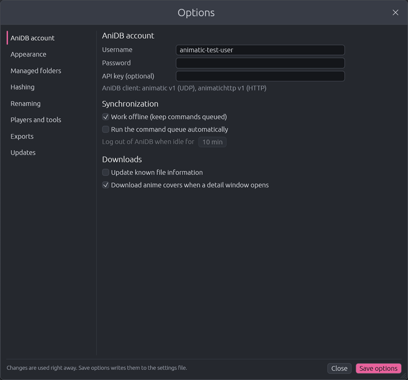

*The sample profile: user name `animatic-test-user`, empty password, Work offline on.*

| Control | What it does | Default | Key |
|---|---|---|---|
| **Username** | Your AniDB user name. Used for the login, written into statistics exports and substituted for `{user}` in AVDump arguments. | empty | `anidb.username` |
| **Password** | Your AniDB password. The box is masked. Used for the login. | empty | `anidb.password` |
| **API key (optional)** | The UDP API key from your AniDB profile. When it is set the AniDB session is encrypted; leave it empty for an unencrypted session. The box is **not** masked. | empty | `anidb.api_key` |
| Yellow notice (only sometimes) | Under the key boxes. *Credentials are stored in the settings file because no system keystore is available: …* means the three secrets are kept in plain text in `settings.json`; it also appears on a computer that has no keystore even before you type a credential. *Saved credentials could not be read from the system keystore: … Enter them again or fix the keystore; saving keeps unread entries unchanged.* means the keystore refused to give them back. See [Credentials and the system keystore](Settings-Files.md#credentials-and-the-system-keystore). | none | n/a (depends on whether the keystore works) |
| **AniDB client: animatic v1 (UDP), animatichttp v1 (HTTP)** | Read-only line. These are Animatic's own registered AniDB clients, built in and fixed; you only need your account. Updates never change them. See [client registration](First-Launch.md#anidb-client-registration). | n/a | none |

**Synchronization**

| Control | What it does | Default | Key |
|---|---|---|---|
| **Work offline (keep commands queued)** | While ticked, nothing is sent to AniDB: commands only queue on the Queue page, and no cover is downloaded. The status bar's **Online** / **Offline** button changes the same setting. Backup recovery and applying imported AOM settings switch it on. It also suppresses the automatic update check at startup (**Help → Check for updates…** still works). | off | `anidb.offline` |
| **Run the command queue automatically** | Animatic starts a queue run itself 30 seconds after new commands arrive and every 15 minutes for anything still waiting, and keeps one AniDB login between runs. Never while **Work offline** is on, during an AniDB cooldown, without an account, while another task runs or while an import or restore review is open. MyList removals are never sent automatically. See [Automatic runs](AniDB-Synchronization.md#automatic-runs-and-the-anidb-session). | off | `anidb.auto_run_queue` |
| **Log out of AniDB when idle for … min** | Grayed out until the automatic option is on. How long the kept login may sit idle before Animatic logs out. Accepts 1 to 30 (AniDB itself drops an idle login after 35 minutes). Without automatic runs every run logs out when it ends. | 10 min | `anidb.idle_logout_minutes` |

**Downloads**

| Control | What it does | Default | Key |
|---|---|---|---|
| **Update known file information** | When you hash a file that AniDB already identified again, queue a refresh of its AniDB record (at most once every 7 days per file). It only decides the case where the file's rule does not have **Add to MyList** with **Identify files with AniDB after hashing** on; in that case an `Identify` is queued anyway and refreshes the record too. | off | `anidb.update_file_information` |
| **Download anime covers when a detail window opens** | The first time you open an anime's detail window, download its cover once from AniDB's image server and keep it on disk for your own display. Covers already on disk are always shown. Never offline, and never during a ban or cooldown. A failed download is not retried for an hour. See [Cover](Library-Pages.md#cover). | on | `anidb.download_covers` |

Not in Options (edit `settings.json` with Animatic closed): the UDP server, the local UDP port and the
image server. See [AniDB account settings](Settings-Reference.md#anidb-account).

## Appearance

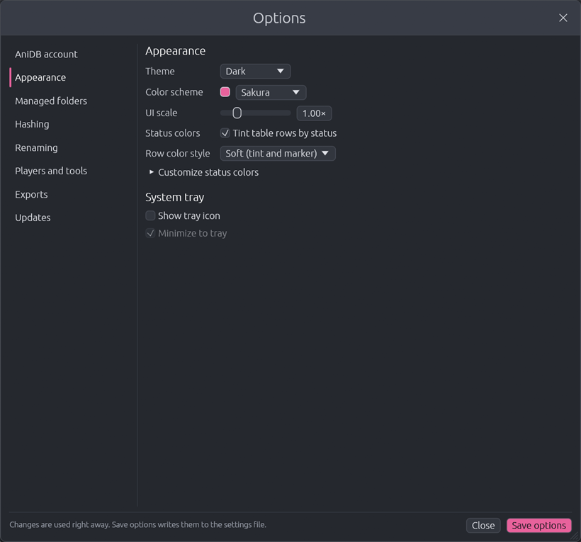

| Control | What it does | Default | Key |
|---|---|---|---|
| **Theme** | **Dark**, **Light** or **Same as the system** (follows the operating system's light or dark mode and changes with it while Animatic runs; where the system reports no mode it is dark). | Dark | `ui.theme` |
| **Color scheme** | The accent family of the interface: **Sakura** (the original pink), **Ocean**, **Forest**, **Sunset**, **Wisteria** or **Graphite**. Each entry shows a swatch of its accent. Every scheme has a dark and a light variant and sets the accent, selection and link colors and a subtle tint of the backgrounds. The status colors of table rows are separate. | Sakura | `ui.color_scheme` |
| **UI scale** | Slider from 0.75× to 2.0× in steps of 0.05. Scales the whole interface. | 1.00× | `ui.zoom` |
| **Tint table rows by status** | Tints table rows by status: CRC mismatch, not identified, watched and in MyList. The status is also written in the row, so the color is never the only signal. | on | `ui.colored_rows` |
| **Row color style** | **Soft (tint and marker)** blends the status color into the background and puts a colored bar at the left edge of the row. **Solid (classic AOM)** fills the whole row with the status color, like AniDB O'Matic. Grayed out while the tint is off. | Soft | `ui.row_style` |
| **Customize status colors** | A collapsible list, described below. | see below | `ui.colors` |

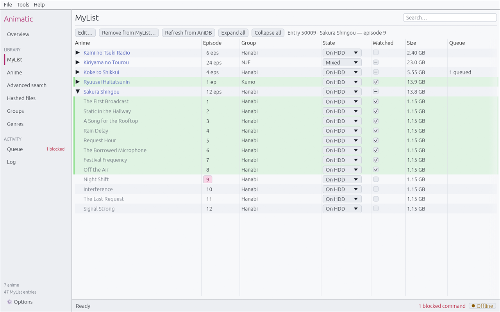

*The same MyList page in the Light theme. Rows for watched entries use the Watched color.*

### Customize status colors

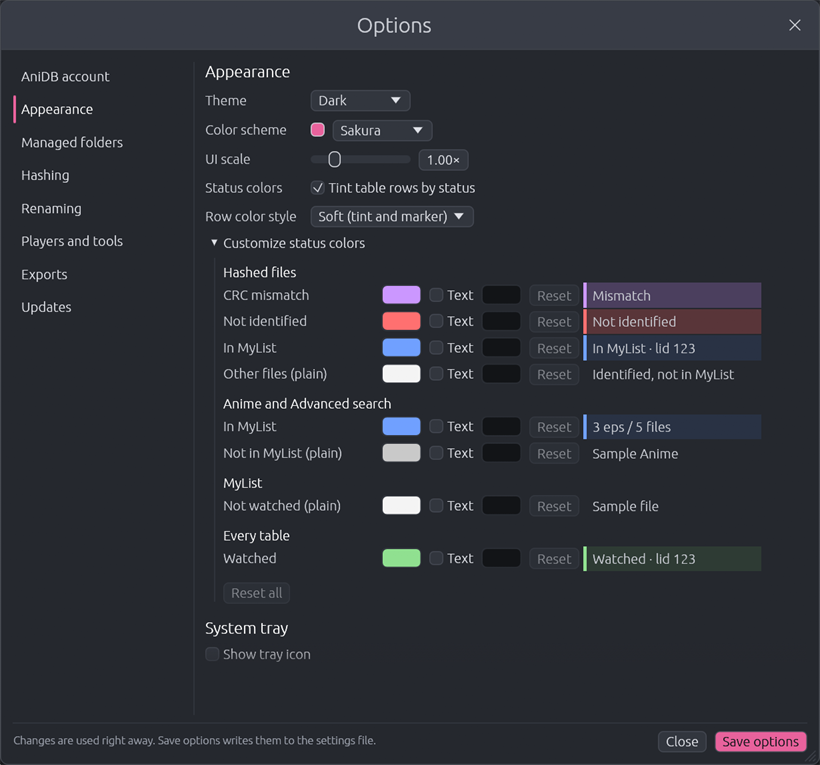

Open **Customize status colors** to change the color of each status the tables draw. The list is
grouped by table:

| Group | Status rows (as written in the list) |
|---|---|
| **Hashed files** | **CRC mismatch**, **Not identified**, **In MyList**, **Other files (plain)** |
| **Anime and Advanced search** | **In MyList**, **Not in MyList (plain)** |
| **MyList** | **Not watched (plain)** |
| **Every table** | **Watched** |

Each row has:

- a **color button** for the background (the status color; click it to open a color picker);
- a **Text** checkbox. The second color button (grayed out until the box is ticked) picks the text
  color. A row with its own text color is always drawn solid. Unticked, the text is black or white,
  whichever reads better;
- **Reset**, enabled once that status differs from its default, which puts it back;
- a **live sample row** drawn the way the tables draw a row, in the current row style and theme.

A yellow note appears when a chosen text color has a contrast below 4.5:1 on its background. You can
keep it. **Reset all** (enabled when anything is customized) restores all the statuses above. The
whole list is disabled while **Tint table rows by status** is off, with a note saying so. Colors that
match a default are not stored. The AOM color slots that no table uses are not listed here; see
[row colors](Settings-Reference.md#row-colors-uicolors) and
[Main window](Main-Window.md#sorting-columns-and-row-colors).

### System tray

| Control | What it does | Default | Key |
|---|---|---|---|
| **Show tray icon** | Puts an icon in the Windows notification area or the Linux StatusNotifierItem tray. Its menu offers **Show Animatic**, **Run command queue** and **Quit**; a left click shows the window. | on | `ui.show_tray_icon` |
| **Minimize to tray** | Minimizing hides the window to the tray instead of the taskbar. Grayed out while the tray icon is off. Closing the window still quits. | on | `ui.minimize_to_tray` |

Where the system has no tray, both are grayed out and a yellow line explains why (`No system tray is
available here: …`); the stored values are kept but never acted on, so the window is never hidden
without a way back. Briefly after start the section reads `Checking for a system tray…`. In the first
Appearance picture (at the top of this category) the tray icon is turned off, which is why **Minimize to tray** is grayed out. See
[System tray](Main-Window.md#system-tray).

## Managed folders

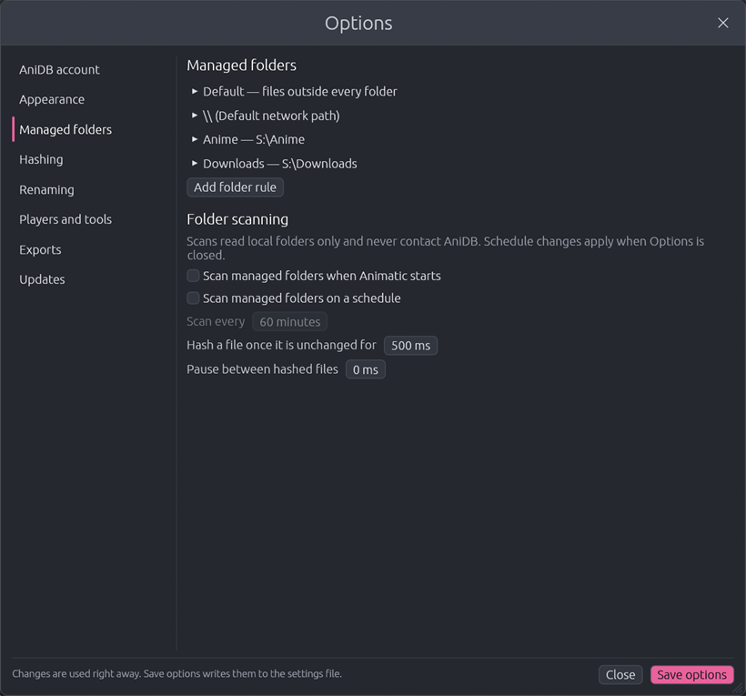

*The sample profile: the two built-in rules (**Default** and `\\ (Default network path)`) followed by the user's **Anime** and **Downloads** rules.*

A managed folder is a folder rule: where your files live, what happens when a scan finds a file there,
what is sent to MyList for them, and where renamed files go. The page lists one collapsible section per
rule, then **Add folder rule**, then **Folder scanning**. A folder rule's header shows its **Name** and
**Path** (`Downloads — S:\Downloads`; `Unnamed folder` while the name is empty). See
[Managed folders and scans](Managed-Folders-and-Scans.md) for the full picture of how rules are chosen
and scans run.

A fresh settings file holds two built-in rules:

- **Default** (header `Default — files outside every folder`) is not a folder. It applies to files
  outside every folder rule, such as files added by hand: it adds identified files to MyList as state
  On HDD and not watched, and its **Move renamed files** destination is used when you rename them. It
  shows only **Name**, **Renaming** (without automatic rename) and **MyList**.
- `\\ (Default network path)` applies to every network path (`\\server\share\…`) no folder rule
  covers. Its path cannot be changed, so it shows no **Path** or **Include subfolders**.

Any rule can be removed, including the built-in ones, as long as one rule remains. Without a Default
rule, files outside your folders are not added to MyList and are renamed where they are. While a
built-in rule is missing, **Restore built-in rules** next to **Add folder rule** adds it back with its
original values. The sample profile in the pictures adds two rules of its own, **Anime** and
**Downloads**.

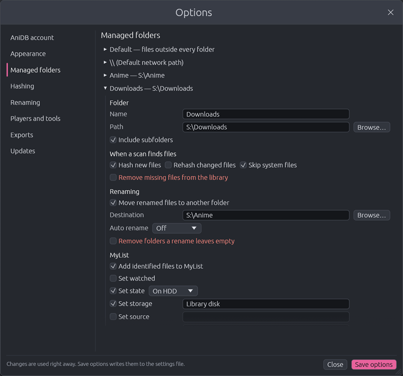

### Fields of a folder rule

The controls are grouped under **Folder**, **When a scan finds files**, **Renaming** and **MyList**.

| Control | What it does | Default for a new rule | Key (in `file_managers.managers[]`) |
|---|---|---|---|
| **Name** | The label of the rule in this list and in the automatic rename confirmation. | `New folder` | `name` |
| **Path** and **Browse…** | The folder the rule applies to: type it, or choose it with **Browse…** (the picker opens in the current folder when it exists). An empty path never matches and is skipped by scans. | empty | `path` |
| **Include subfolders** | Include folders below **Path**: scan all levels, and match files in them. Off: direct children only. | on | `include_subdirs` |
| **Hash new files** | A scan hashes files it finds that are not in the library yet. | off | `auto_hash` |
| **Rehash changed files** | A scan hashes known files again when their modification time changed. | off | `auto_rehash` |
| **Skip system files** | Scans skip files and folders with the Windows system attribute. No effect on Linux, which has no such attribute. | on | `exclude_system` |
| **Remove missing files from the library** (red) | A scan removes the library record of a file that is positively gone, but only while the folder itself is reachable. Never deletes media files. | off | `auto_remove` |
| **Move renamed files to another folder** | Off: files are renamed where they are. Ticked, a **Destination** field with **Browse…** appears: renamed files are moved under it (`BASEPATH` in rename patterns). Unticking clears the destination. | off | `base_path` (empty = off) |
| **Auto rename** (drop-down) | **Off**, **Dry run (log only)** or **On**. Choosing **On** first shows a dry-run list of what would be renamed now and needs **Turn on automatic rename**; **Cancel** (or `Esc`) leaves the mode unchanged. See [Automatic rename](Renaming-Files.md#automatic-rename-opt-in-per-managed-folder). | Off | `auto_rename` |
| **Remove folders a rename leaves empty** (red) | After Animatic renames or moves a file out of a subfolder, remove the folder (and emptied parents) if nothing at all is left. The rule's own folder is never removed. See [Removing folders](Managed-Folders-and-Scans.md#removing-folders-a-rename-emptied). | off | `clear_empty_folders` |
| **Remove rule…** | Asks for confirmation (saying what changes), then deletes the rule. Disabled for the last remaining rule. | n/a | n/a |

Scans skip files and folders whose name starts with a dot while the rule's `exclude_hidden` key is
`true` (the default for new rules; the built-in network rule has it off). Options has no control for
it; edit `settings.json`.

### MyList values of a rule

Under **MyList**, **Add identified files to MyList** (`mylist_auto_add`) decides whether files the
rule covers are added to your AniDB MyList when the queue runs online. The values below it are greyed
out while it is off:

| Control | What it does | Default | Key |
|---|---|---|---|
| **Set watched** / **Watched** | **Set watched** decides whether the watched flag is sent at all. Ticked, a **Watched** checkbox appears; ticked, files are added as watched with the current time. | both off | `mylist_watched_check`, `mylist_watched` |
| **Set state** / state drop-down | **Set state** decides whether a state is sent; the drop-down (**Unknown**, **On HDD**, **On CD/DVD**, **Deleted**, **Remote/Shared**) is greyed out until it is ticked. | on, **On HDD** | `mylist_state_check`, `mylist_state` |
| **Set storage** and its text box | A free-text storage label (for example `Library disk`), on one row with its checkbox; the box is greyed out until the check is ticked. | off, empty | `mylist_storage_check`, `mylist_storage` |
| **Set source** and its text box | Free-text source. | off, empty | `mylist_source_check`, `mylist_source` |
| **Set other** and its text box | Free-text note. | off, empty | `mylist_other_check`, `mylist_other` |

All the per-folder keys are in [Per-folder keys](Settings-Reference.md#per-folder-keys).

### Folder scanning

The caption reads "Scans read local folders only and never contact AniDB. Schedule changes apply when
Options is closed."

| Control | What it does | Default | Key (in `file_managers`) |
|---|---|---|---|
| **Scan managed folders when Animatic starts** | Runs one scan after start, as soon as nothing blocks it. | off | `scan_at_start` |
| **Scan managed folders on a schedule** | Runs a scan every N minutes. It waits while another task, an import, a settings review or a restore is running. | off | `scheduled_scan` |
| **Scan every … minutes** | Greyed out until the schedule is on. Accepts 5 to 10080 (one week). | 60 minutes | `scan_interval_minutes` |
| **Hash a file once it is unchanged for … ms** | A file still being written is left for the next scan. Accepts 0 (hash at once) to 600000. | 500 ms | `action_delay_ms` |
| **Pause between hashed files … ms** | Pause between two hashed files of one scan. Accepts 0 to 10000. | 0 ms | `sleep_time_ms` |

See [scheduled scans](Managed-Folders-and-Scans.md#scheduled-scans) and
[settle delay and pacing](Managed-Folders-and-Scans.md#settle-delay-and-pacing).
A scan only starts when you choose **Tools → Scan managed folders** or one of the two automatic
options is on.

## Hashing

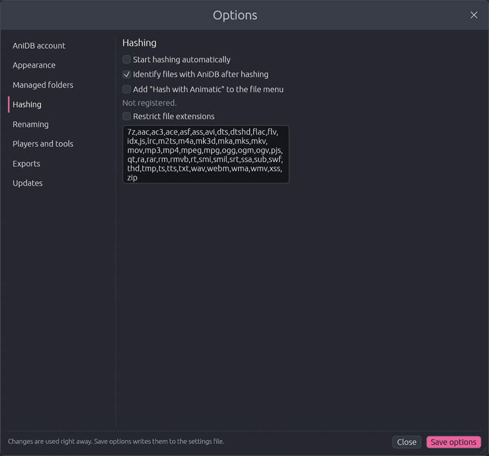

*The sample profile has **Start hashing automatically** off; the default is on.*

| Control | What it does | Default | Key (in `hashing`) |
|---|---|---|---|
| **Start hashing automatically** | When Animatic starts with files still in the [persistent hash queue](Hashing-and-Identification.md#hash-queue), hashing resumes by itself once nothing blocks it. Off: nothing hashes at start and the Hashed files page and Overview show the pending count with **Resume hashing**. Applies at the next start. | on | `autostart` |
| **Identify files with AniDB after hashing** | After a file is hashed (Add files, command line or scan), queue an `Identify` command. With the rule's **Add to MyList** on, the command also carries that rule's MyList values. Offline, it waits in the queue. A file AniDB already identified is looked up again only when its managed-folder rule has **Add to MyList** on. | on | `identify_after_hashing` |
| **Add "Hash with Animatic" to the file menu** | A per-user entry in Explorer's right-click menu (or your Linux file browser's). Saved only by **Save options**; see [File-menu entry](#file-menu-entry). | off | `integrate_into_shell` |
| **Restrict file extensions** | Applies the list below as a file-type filter of the **Add files…** picker. It does not filter files given on the command line. | off | `use_extensions` |
| Extension list (multi-line box) | Comma-separated extensions, written without a dot. **Scans always use this list**, whether or not **Restrict file extensions** is ticked, and an empty list means a scan hashes nothing. Spaces around entries are trimmed and empty entries dropped. | the 52 AOM extensions (`7z`, `aac`, `ac3` … `zip`) | `extensions` |

The extension list is a legacy AOM list that includes subtitles, archives and `txt`; it is not
media-only. Edit it freely. How the list is matched is under
[Hashing](Settings-Reference.md#hashing). The thread-priority setting AOM had is not offered: hashing
always runs at the normal priority. The box keeps exactly what you type while it has the focus, so a
comma after the last extension stays until you type the next one; empty entries are dropped from the
list, and the box shows the cleaned list again when you leave it.

## Renaming

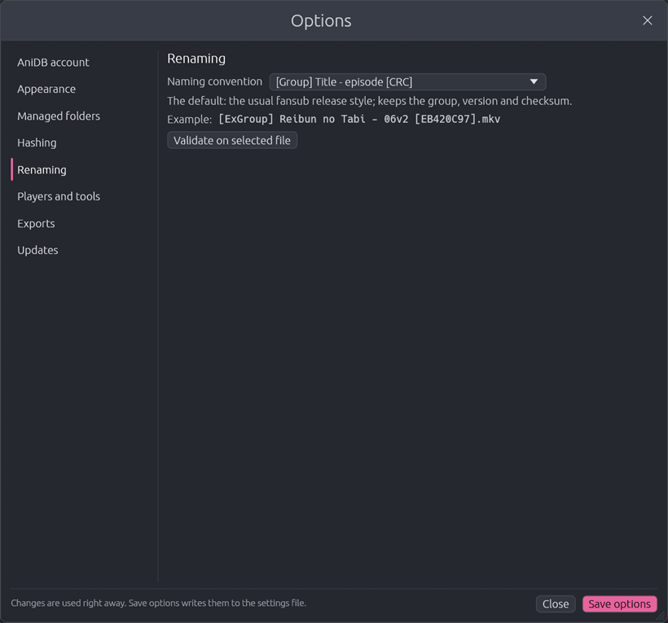

This category chooses the pattern every rename uses. The full workflow is in
[Renaming files](Renaming-Files.md#choosing-how-files-are-named); the pattern language is in the
[rename language](Rename-Language.md).

| Control | What it does | Default | Key |
|---|---|---|---|
| **Naming convention** | Drop-down with four built-in conventions (`[Group] Title - episode [CRC]`; `Title - episode - episode title [group](CRC)`; `Title - episode - episode title`; `Title - S01E06 - episode title (media servers)`) and **Custom pattern**. A line below describes the chosen convention. Choosing one replaces the pattern; if your previous pattern was custom, **Restore my custom pattern** puts it back. | `[Group] Title - episode [CRC]` | `renaming_pattern` |
| **Example:** line | The pattern's result for a fictitious file (episode 6, release version 2, by a group). | n/a | n/a |
| **Pattern reference** | Opens the Renaming pattern reference window. Only shown while **Custom pattern** is chosen. | n/a | n/a |
| **Restore my custom pattern** | Only shown after you picked a convention over a custom pattern. | n/a | n/a |
| **Validate on selected file** | Runs the pattern on the file currently selected on the Hashed files page and shows its result and any diagnostics; `The pattern is valid for this file.` when it can be applied. With nothing selected: `Select a file identified by AniDB on the Hashed files page, then validate again.` A selected file AniDB has not identified shows `The selected file is not identified by AniDB`. | n/a | n/a |
| Pattern editor | A 12-line monospace box, shown only for **Custom pattern**. A syntax error appears in red under it; otherwise the diagnostics of the example. | n/a | `renaming_pattern` |

Only the pattern text is stored: text equal to a built-in convention is shown as that convention and
anything else as **Custom pattern**. Saving never validates or rewrites the text; an empty or invalid
pattern simply blocks renames.

## Players and tools

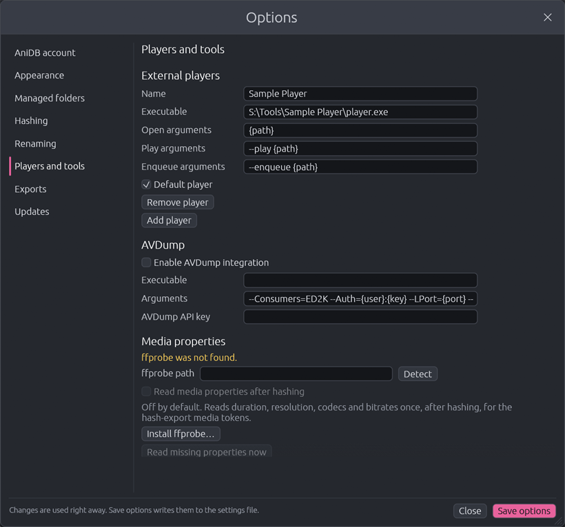

### External players

One block per player, then **Add player**. See [External tools](External-Tools.md).

| Control | What it does | Default | Key (in `players[]`) |
|---|---|---|---|
| **Name** | Shown in the player chooser on Hashed files when more than one player exists. An empty name appears as `Player N`. | empty | `name` |
| **Executable** | The program every player action starts. Empty is rejected. | empty | `path` |
| **Open arguments** | Arguments of **Open in player**. Leave empty to hide that action for this player. | empty | `open` |
| **Play arguments** | Arguments of **Play**. Without `{path}` or `%file%` the file path is appended. | empty | `play` |
| **Enqueue arguments** | Arguments of **Enqueue**. Leave empty to hide that action. | empty | `enqueue` |
| **Default player** | The player **Play** uses until you pick another in the chooser. Ticking it makes this the only default; clearing it leaves the first player as the default. | off (the first player always counts as the default while none is ticked, so its box shows as ticked) | `default` |
| **Remove player** | Deletes this player. | n/a | n/a |
| **Add player** | Appends an empty player. | n/a | n/a |

Argument templates use `{path}` or `%file%` for the file; see
[External command templates](Settings-Reference.md#external-command-templates).

### AVDump

| Control | What it does | Default | Key (in `avdump`) |
|---|---|---|---|
| **Enable AVDump integration** | Enables the **AVDump** button on Hashed files. | off | `enabled` |
| **Executable** | The AVDump command-line program to start. | empty | `executable` |
| **Arguments** | Template; `{path}`, `{user}`, `{key}` and `{port}` are replaced. Animatic only starts the program and does not read its output. | `--Consumers=ED2K --Auth={user}:{key} --LPort={port} --PrintEd2kLink "{path}"` | `arguments` |
| **AVDump API key** | The value of `{key}`. Separate from the AniDB API key. The box is masked like the password. | empty | `key` |

### Media properties

Optional and off by default; Animatic itself parses no media, it asks the external `ffprobe` tool. See
[External tools](External-Tools.md#media-properties-ffprobe).

| Control | What it does | Default | Key (in `media`) |
|---|---|---|---|
| Status lines | `Looking for ffprobe…`, then `ffprobe <version> (<where it came from>)` with its path, or a yellow `ffprobe was not found.` Notes about a configured path that cannot be used follow in gray. | n/a | n/a |
| **ffprobe path** | Optional: an `ffprobe` executable, or the folder holding it. Empty: Animatic's own copy in its data folder and `ffprobe` on `PATH` (own copy first on Windows, `PATH` first on Linux). | empty | `ffprobe_path` |
| **Detect** | Searches again with this path. Grayed out while a search or install is running. | n/a | n/a |
| **Read media properties after hashing** | After each hashing job, read duration, resolution, codecs and bitrates of the files it hashed, once, for the hash export's media tokens. Grayed out until `ffprobe` is found. | off | `read_properties` |
| **Install ffprobe…** | Opens a confirmation (build, download size, license, source, install folder), then downloads and verifies `ffprobe` into Animatic's data folder. No administrator rights. A progress bar and **Cancel download** appear while it runs. On platforms without a pinned download the page says so instead. | n/a | n/a |
| **Read missing properties now** | Probes the hashed files that have no media properties yet. Needs `ffprobe` and **Read media properties after hashing** ticked. | n/a | n/a |

## Exports

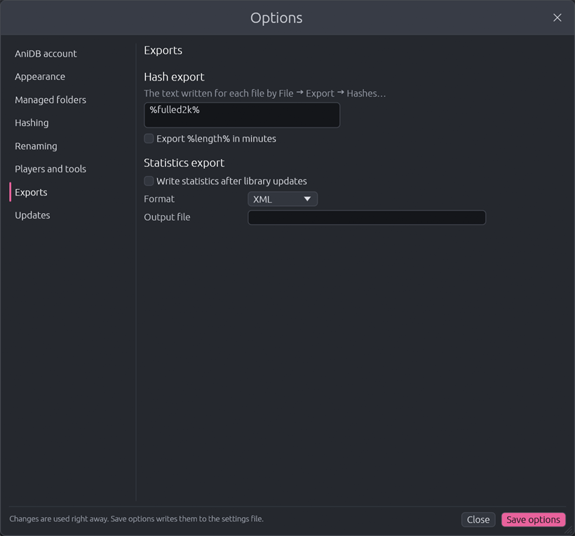

### Hash export

| Control | What it does | Default | Key |
|---|---|---|---|
| Template box | The text written for each file by **File → Export → Hashes…**. The hint shown while empty is `%filename% %size% %fulled2k%`; an empty template exports `%fulled2k%`. Tokens are listed under [Hash export template tokens](Settings-Reference.md#hash-export-template-tokens). | `%fulled2k%` | `hashing.export_template` |
| **Export %length% in minutes** | `%length%` becomes whole minutes instead of whole seconds. | off | `ui.copy_length_as_minutes` |

### Statistics export

| Control | What it does | Default | Key (in `stat_whore`) |
|---|---|---|---|
| **Write statistics after library updates** | Rewrites the statistics file every time the library view reloads in the background. Needs **Output file**. | off | `enabled` |
| **Format** | **XML** or **INI**. Also the suggested type of **File → Export → Statistics…**. | XML | `format` |
| **Output file** | Where the automatic file goes. Missing parent folders are created and the file is replaced atomically. | empty | `file` |

**File → Export → Statistics…** always asks for a path and ignores the checkbox and file. The files
contain your AniDB user name (not the password); treat them as personal data. More in
[Exports](Exports.md#hash-export) and [statistics export](Exports.md#statistics-export).

## Updates

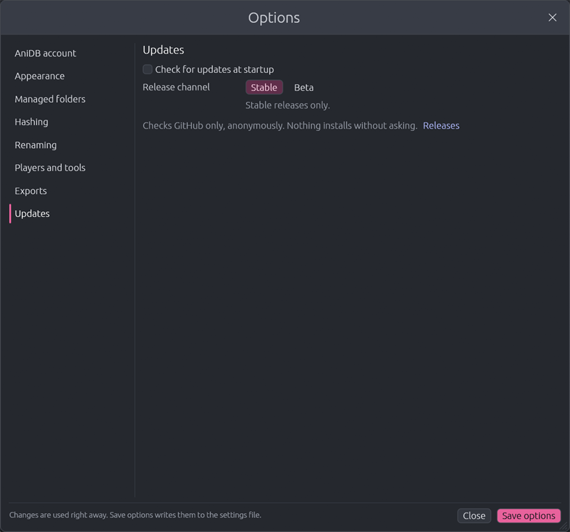

*The sample profile has the startup check off, because the sample never contacts GitHub; the default is on.*

| Control | What it does | Default | Key (in `updates`) |
|---|---|---|---|
| **Check for updates at startup** | One background check for a newer release at startup, skipped while **Work offline** is on or after a settings recovery. It never downloads or installs. **Help → Check for updates…** always works. | on | `auto_check` |
| **Release channel**: **Stable** / **Beta** | **Stable** offers published stable releases only. **Beta** also offers betas (version numbers ending in `-rc.1`, `-rc.2` …), which may have bugs. Switching back to Stable never installs an older version. A one-line caption under the buttons says which is chosen. The buttons are disabled with an explanation while a check or download runs, or after an update was installed until you restart. | Stable | `channel` |
| Privacy line and **Releases** link | `Checks GitHub only, anonymously. Nothing installs without asking.` The link opens the project's releases page in your browser. | n/a | n/a |

See [Updating Animatic](Updating-Animatic.md).

## File-menu entry

**Add "Hash with Animatic" to the file menu** (`hashing.integrate_into_shell`) puts a per-user entry
in your system's file menu so you can send files to Animatic from Explorer or your file browser. It is off by
default and needs no administrator rights.

- **Only Save options changes the system.** Ticking the box does nothing yet. **Save options**
  registers the entry when the box is ticked and removes it when it is not. Closing the window with its
  title-bar button, quitting, loading settings and **importing AOM settings** never register or remove
  anything; an imported `integrateIntoShell = true` is only stored, and Options then reads
  "Not registered yet; Save options to add it."
- **Options shows the real state** under the checkbox, read from the system each time the window
  opens: *Registered for the current user.*, *Not registered.*, *Registered for another copy of
  Animatic (…)* (for example after you moved the program; saving with the box ticked points the entry
  at this copy), or *An entry with this name exists that Animatic did not create; it is left
  unchanged.* The last one is never changed or removed: if you tick the box and save while such an
  entry exists, the change is refused with `File-menu entry: …` in the status bar and Log. While
  Options is looking, the line reads `Checking…`; a failed look reads `Could not check the
  registration: …`. A successful change is logged as `Added "Hash with Animatic" to the file menu` or
  `Removed "Hash with Animatic" from the file menu`. Where the program's own location cannot be
  identified, or the system has no supported file menu, the box is disabled and the line reads
  `Not available: …`.
- **Windows.** The entry is added to the current user's registry classes
  (`HKEY_CURRENT_USER\Software\Classes\*\shell\Animatic.Hash`) as **Hash with Animatic** on the context
  menu of files (on Windows 11 under **Show more options**). It runs `"<animatic.exe>" "%1"`. Removing
  it deletes that key and any parent key that is left empty; other entries are untouched.
- **Linux.** The entry is the file `animatic-hash.desktop` in `$XDG_DATA_HOME/applications` (default
  `~/.local/share/applications`), hidden from application menus (`NoDisplay=true`) and offered for
  common video and audio types, so it appears under **Open With → Hash with Animatic**. It runs the
  program's path with `%F`. `update-desktop-database` is run when it is installed; the entry also works
  without it. (Linux runtime behavior is not recorded as verified by the project.)
- **Only files, only the program's path.** The command passes the clicked files and nothing else, so
  it opens the default database (or `ANIMATIC_DB`/`ANIMATIC_SETTINGS` if those are set in the
  environment your file browser runs in). Folders are not offered because Animatic does not expand
  folders; use [Managed folders](Managed-Folders-and-Scans.md).
- **Several files at once.** Windows starts one process per selected file; they hand their files to
  the one running window ([One window per database](Running-Animatic.md#one-window-per-database)).
- **Ownership.** Animatic marks its entry (registry value `AnimaticManaged`, line
  `X-Animatic-Managed=true` in the desktop file) and removes only entries that carry the mark. See
  [Data locations](Data-Locations.md#shell-entries-and-the-lock-file).

## Settings you cannot change in Options

A few settings have no control. Edit `settings.json` with Animatic closed, because Animatic writes
the whole file when it quits:

- `anidb.udp_server`, `anidb.local_port` and `anidb.image_server` (AniDB connection details);
- `ui.window`, `ui.maximized` and `ui.columns` (kept by using the window and its tables);
- per-folder `exclude_hidden` and the built-in rules' `can_edit_path` and `default`;
- the row-color slots no table uses, and keys kept only for AOM compatibility.

The [Settings reference](Settings-Reference.md) lists every key with its status. How the file is read,
saved, backed up and recovered, and where the password and keys are kept, is in
[Settings files](Settings-Files.md).

## If something goes wrong

- **The "Settings recovered" window appeared at startup.** The primary file was missing or invalid and
  the backup was loaded **offline**; the original file was not touched. Review the values, then click
  **Save options** to replace it. See the [recovery matrix](Settings-Files.md#recovery-matrix) and
  [Troubleshooting](Troubleshooting.md).
- **Save options said `Could not save settings: …`.** The window stays open and your edits are still
  active. Check the settings folder's permissions and free space and save again.
- **A yellow keystore notice sits under the API key.** See
  [Credentials and the system keystore](Settings-Files.md#credentials-and-the-system-keystore).
- **A scan or queue run did not start after you changed its schedule.** Close the Options window; the
  schedule only reaches the background timers then.

## See also

- [Settings reference](Settings-Reference.md): every key, type and default.
- [Settings files](Settings-Files.md): loading, saving, backup recovery and the keystore.
- [Managed folders and scans](Managed-Folders-and-Scans.md) and [Renaming files](Renaming-Files.md).
- [First launch](First-Launch.md): the first Options pages you will use.
