This page walks you through your first session with Animatic, from the downloaded archive to your
first renamed file. You install and start the program, decide whether to work offline or enter your
AniDB account, tell Animatic which folders hold your anime, hash files, let AniDB identify them, see
them in your library and rename one. Every step says what to expect. Nothing here deletes a media
file, and nothing contacts AniDB until step 7.

The examples use the invented sample library from the pictures: a download folder `S:\Downloads`,
a library folder `S:\Anime`, a release group called Hanabi and a file named
`hanabi_paper_moon_radio_01_720p.mkv`. That file is not on your computer: use your own folders and
files (on Linux, paths look like `/home/you/Downloads`).

## Before you start

You need:

- A Windows or Linux (x86-64) computer and a few media files you want to organize. Start with
  **two or three files**, not your whole collection.
- Optional: an AniDB account (sign up at <https://anidb.net>). Steps 1 to 6 work without one; you
  need it from step 7 on to identify files. Animatic can only rename a file that is **identified**:
  either AniDB identified it (steps 6 and 7) or an [AOM import](Migrating-from-AOM.md) brought it in
  already identified.
- Time. Hashing time depends on file size and disk speed; identification time depends on AniDB's
  request spacing (see the safety notes).
- The **Log** page (sidebar, `Ctrl+9`) is where Animatic writes what it did, one line per event, for
  the current session. When a step says "the Log shows…", look there.

Safety notes for the whole tutorial:

- **Offline first.** Animatic talks to AniDB only when you run the command queue (or switch on
  automatic runs, which are off by default) and, while **Work offline** is off, when you open an anime
  detail window whose cover is not on disk yet (the **Download anime covers when a detail window
  opens** option). Hashing, browsing, searching and local edits never use the network. See
  [AniDB synchronization](AniDB-Synchronization.md#synchronization).
- **The queue is durable.** Things that need AniDB wait in the **command queue** and survive closing
  Animatic and restarting the computer. You can queue commands today and send them next week.
- **Flood protection.** AniDB bans clients that send too many requests, so Animatic spaces them out:
  UDP packets at least 2 seconds apart for the first five of a burst and 4 seconds apart afterwards,
  HTTP requests 2 seconds apart, and nothing is repeated sooner than AniDB's limits allow. A queue of
  100 files therefore takes many minutes; that is not a hang. After a refusal or network failure
  Animatic pauses all requests for a while (a **cooldown**). Never try to bypass these limits. See
  [Request limits](AniDB-Synchronization.md#request-limits) and
  [Cooldowns and bans](Network-and-Sync-Problems.md#cooldowns-and-bans).
- **Your files are safe.** Renaming moves a file only after you confirm it (or, if you switch on
  **Auto rename** for a folder, after you confirmed that setting). Removing records
  (**Remove from list…**) forgets Animatic's record and never deletes the media file. Removing a MyList
  entry is never sent by an automatic run.
- **Rehearse if you like.** A throw-away profile with its own library and settings lets you practice
  without touching your real one: [Portable and rehearsal setups](Data-Locations.md#portable-and-rehearsal-setups).

## 1. Download and verify

1. Open the project's Releases page, <https://github.com/RetroHazard/animatic/releases>, and under
   the newest release download the archive for your platform
   (`animatic-vVERSION-windows-x86_64.zip` or `animatic-vVERSION-linux-x86_64.tar.gz`) **and**
   `SHA256SUMS` into the same folder. If your browser warns about the files, see the note below.
2. Check the download against `SHA256SUMS`. On Windows, open the download folder in Explorer, click
   its address bar, type `powershell` and press `Enter`; in the window that opens, copy the script from
   [Installation, Option A](Installation.md#option-a-download-a-release) and **change the file name
   in its first line to the one you downloaded**. On Linux, open a terminal, `cd` into the download
   folder and run the `sha256sum` command from the same page. Expected result: `checksum OK`
   (Windows) or `OK` (Linux). If you see anything else, delete the download and fetch it again: do not
   unpack or run it.
3. Unpack the archive (Explorer's **Extract All…**, or `tar -xzf` on Linux) into a folder you can
   write to.

Expected result: a folder holding `animatic.exe` (Windows) or `animatic` (Linux), `LICENSE`, `NOTICES`,
`README.md`, `CHANGELOG.md` and a `docs` folder with this guide (without its pictures). There is no
installer and the program is unsigned, so Windows or your browser may warn that it is unrecognized
(this guide cannot promise what such a warning looks like); that is why step 2 matters. Read
[Status and limits](Installation.md#status-and-limits) once.

## 2. Start Animatic

On Windows, double-click `animatic.exe`. On Linux, open a terminal, `cd` into the unpacked folder
(for example `cd animatic-v2026.11.0-linux-x86_64`, using your version) and run `./animatic`. A window
titled "Animatic — AniDB library manager" opens on the **Overview** page with a **Getting started**
box on top. Starting the program a second time opens a second window on the same library; use one.

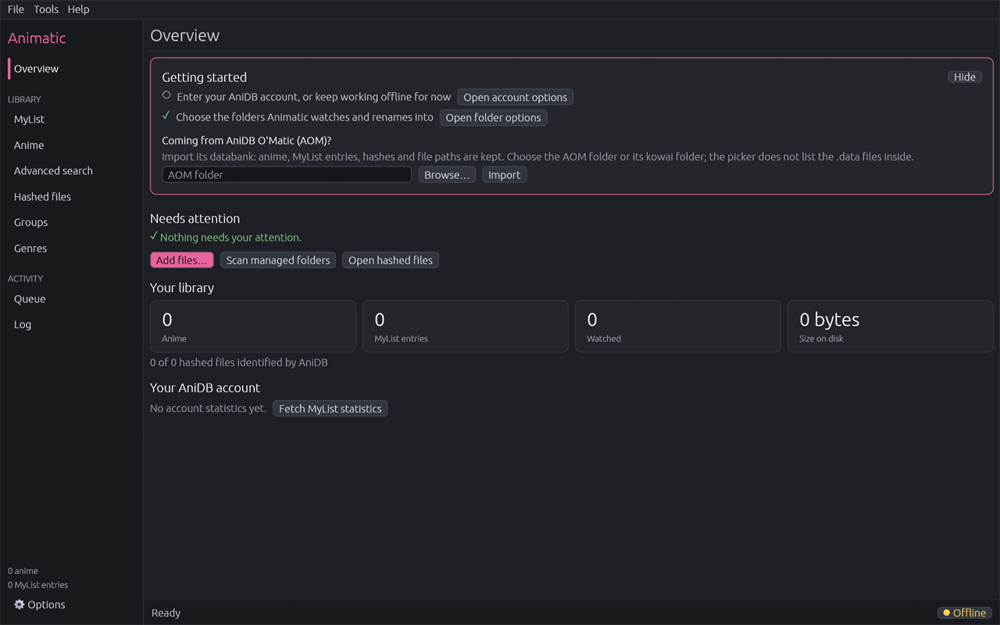

*The first start of the sample library. The picture was taken with **Work offline** already on, so the
button at the bottom right shows **Offline**; a brand-new profile shows a green **Online** button.
The status bar says `Ready`.*

Expected results:

- The status bar shows `Loading library…` and then `Ready`.
- The library figures read 0 (and `0 bytes` for the size), and `0 of 0 hashed files identified by
  AniDB` appears under them.
- The button at the right of the status bar reads **Online** (green) on a brand-new profile. That
  only means a queue run would be allowed to contact AniDB; nothing has been sent and the queue is
  empty.
- At every start, unless you switched off **Check for updates at startup** or work offline, Animatic
  asks GitHub whether a newer release exists. It only looks; it downloads nothing. See
  [First launch](First-Launch.md#first-launch).
- Minimizing the window hides it to the tray icon by default; click the icon or choose **Show
  Animatic** to bring it back. Closing the window quits Animatic.

Details of the window and its command line: [Running Animatic](Running-Animatic.md).

## 3. Work offline, or enter your account

Choose now and change your mind later at any time.

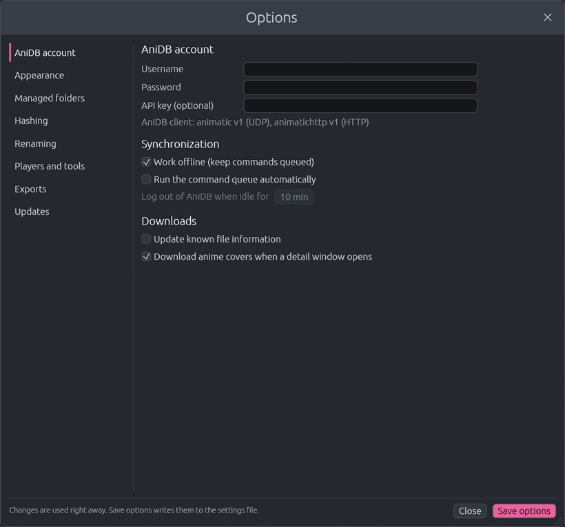

*Options → AniDB account. In the picture **Work offline** is ticked and the account fields are empty.*

**Recommended for the first run: work offline.**

1. Click **Open account options** in the Getting started box (or choose **Tools → Options…**,
   `Ctrl+,`).
2. Under **Synchronization**, tick **Work offline (keep commands queued)**.
3. Click **Save options**. This writes the settings and closes the Options window (if the file cannot be
   written, the window stays open and the status bar says `Could not save settings: …`); reopen it from
   **Options** at the bottom of the left panel whenever you need it.

Expected result: the status bar button now reads **Offline** (amber). While it is on, **Run command
queue** answers `Offline mode is enabled; commands remain queued` and sends nothing.

You can also click the **Online** / **Offline** button in the status bar to switch; that saves at
once.

**If you already want to go online:** enter your AniDB **Username** and **Password**, leave **API key
(optional)** empty unless you set one in your AniDB profile, and leave **Work offline** ticked until
step 7. Entering the account does not contact AniDB. Animatic keeps the password in the system keystore
when one works; see [Settings files](Settings-Files.md#credentials-and-the-system-keystore). More on
this page and on AniDB client registration: [First launch](First-Launch.md).

While you are in Options, note **Download anime covers when a detail window opens** (on by default). It
only downloads when you open an anime detail window while online, and never twice.

## 4. Add your managed folders

A **managed folder** (a folder rule) tells Animatic where your files are, what to do with new files
found there, where renamed files go and what to put in MyList for them. You can skip this step and
add files by hand (step 5), but folders make scanning and renaming much easier.

1. Open **Tools → Options…** and choose **Managed folders**.

   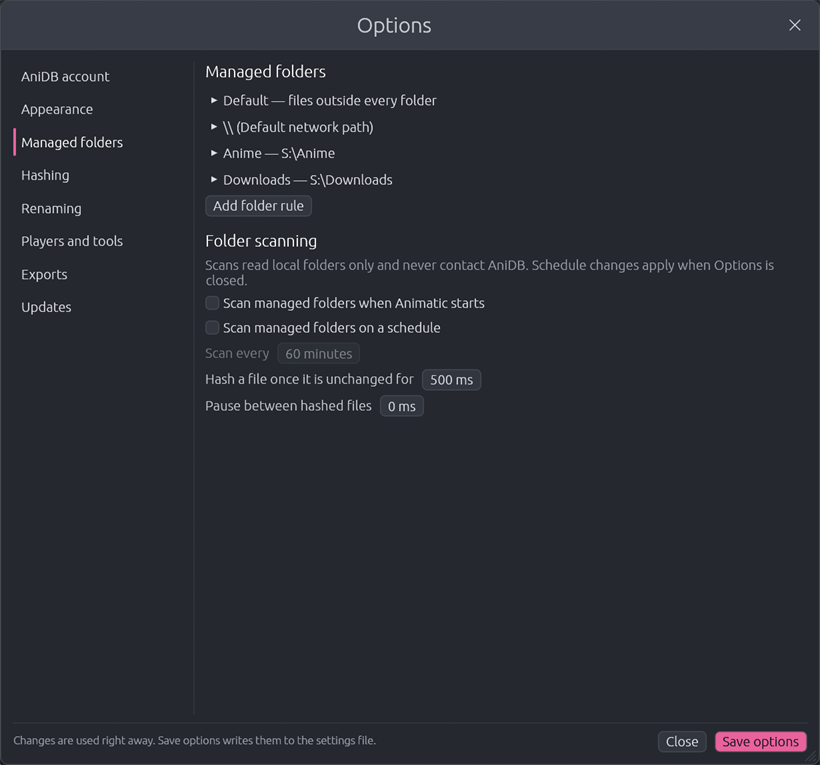

   *The sample library's **Managed folders** page: the built-in **Default** rule followed by the
   sample's two folders (**Anime** and **Downloads**). A brand-new profile lists **Default** and the
   built-in `\\ (Default network path)` rule.*

2. Click **Add folder rule**. A rule named **New folder** appears; click the small triangle left of its
   name to open it.
3. Fill in the rule:

   | Field | What to enter |
   |---|---|
   | **Name** | A label, for example `Downloads`. |
   | **Path** | The folder to watch, for example `S:\Downloads` or `/home/you/Downloads`. Type or paste the full path, or choose the folder with **Browse…**. |
   | **Move renamed files to another folder** | Tick it to send renamed files elsewhere: a **Destination** field (with **Browse…**) appears, for example `S:\Anime`. Leave it unticked, or the destination empty, to rename inside the file's own folder. With the built-in naming conventions all renamed files go directly into this folder, without a folder per anime. |
   | **Include subfolders** | On (default): look in all folders below. Off: direct children only. |
   | **Hash new files** | **Tick it.** A scan only hashes new files in a rule with **Hash new files** (or **Rehash changed files**) on. Off by default. |
   | **Add identified files to MyList** | Tick it if identified files from this folder should be added to your AniDB MyList when the queue runs. Leave it off to only identify them. |

   Leave **Rehash changed files**, **Remove missing files from the library**, **Remove folders a rename leaves empty** and **Auto rename** off for
   now. **Remove missing files from the library** forgets records of files that disappear from disk; **Auto rename** renames
   without asking, per folder. Both are covered in [Managed folders and scans](Managed-Folders-and-Scans.md).

   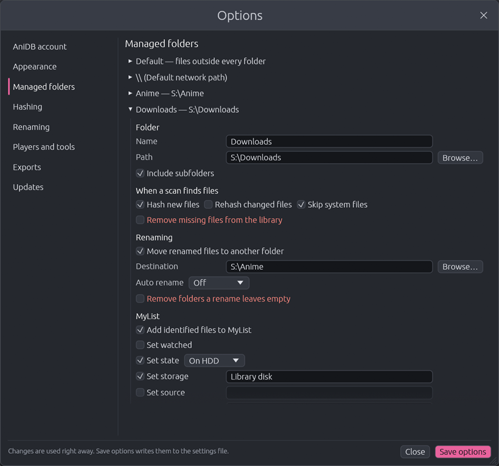

   *A finished rule: **Hash new files** and **Add identified files to MyList** are on, files are added as **On HDD** with the
   storage text `Library disk`, and renamed files go to `S:\Anime`.*

4. If the rule adds to MyList, review the **MyList** group: **Set state** is ticked
   with *On HDD* for a new rule; tick **Set watched** (then **Watched** appears) only if you want files
   added as watched, and leave it off to add them unwatched; **Set storage**, **Set source** and
   **Set other** are optional texts.
5. Click **Save options**.

Expected result: the folder's rule is listed under **Managed folders**, and nothing else happens.
Folder rules do not scan by themselves. (The **Folder scanning** options at the bottom can scan when
Animatic starts or on a schedule; they are off by default, and scans never contact AniDB.)

**What about the Default rule?** It applies to every file that is not inside one of your own rules
(except network paths starting with `\\`, which the built-in network rule covers and which adds nothing
to MyList), including files you add by hand from outside them. It has **Add identified files to MyList** on, state
*On HDD* and *Watched* off, so a file added by hand that AniDB identifies is **added to your MyList**
when the queue runs. Untick **Add identified files to MyList** under **Default** if that is not what you want. The
Default rule has no folder, so a scan never walks it.

## 5. Add files and hash them

*Hashing* reads each file once and computes the fingerprints AniDB uses to identify it (ED2K and
CRC32, plus MD5 and SHA-1) without changing the file.

**By hand:**

1. Press `Ctrl+O` (**File → Add files…**; also a button on the **Overview** and on **Hashed files**).
2. In the dialog titled "Add files to hash", select two or three files and confirm.

**Or by scanning your folder rules:** choose **Tools → Scan managed folders** (also on the Overview).
A scan hashes every new file whose extension is in the list under **Options → Hashing**, in rules with
**Hash new files** on. It hashes a file only once the file has been unchanged for 500 ms, so a download
in progress is left for the next scan. A scan that finds nothing new finishes without a message; if
nothing was hashed, check the list in [If something goes wrong](#if-something-goes-wrong).

Expected results:

- The status bar shows a progress bar with the file name and `(n/total)`, plus **Pause** and
  **Cancel** buttons. Pausing and cancelling are safe: a cancelled run leaves the unhashed files in the
  hash queue.
- Open **Hashed files** (sidebar, `Ctrl+5`). Each file is listed with its size, the **AniDB** column
  reading `Not identified`, the **MyList** column reading `Add queued` (the file's folder rule has **Add
  to MyList** on; `—` if it is off), its **CRC** and its path.
- The **Log** has a line `Hashed <path> (local #N, <ed2k>)` per file. `N` is Animatic's own number for
  the hashed file; `<ed2k>` is its ED2K hash.

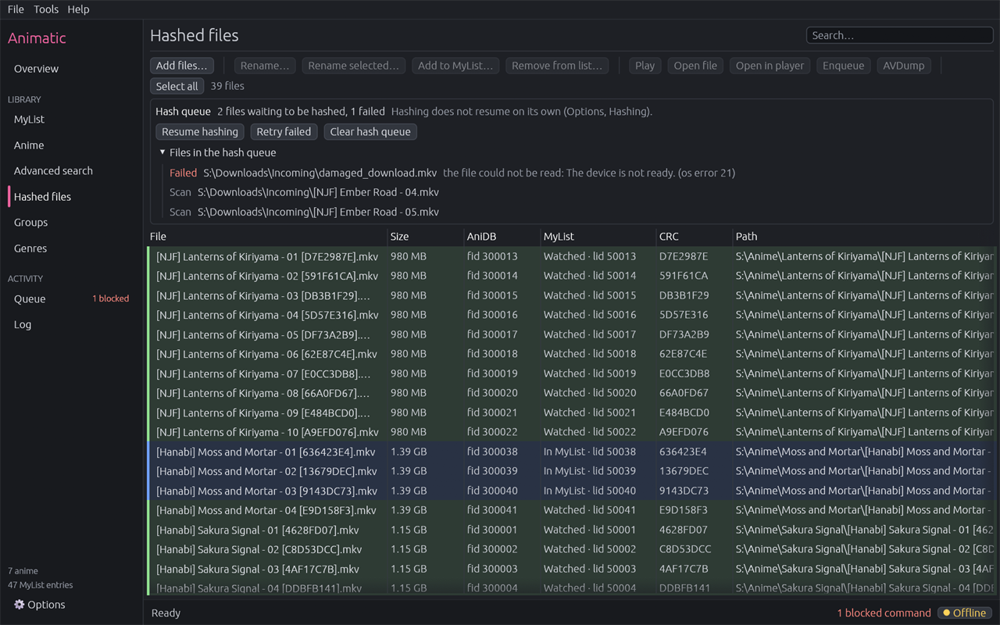

*The Hashed files page. The **Hash queue** panel above the table lists files still waiting or failed;
the table lists hashed files. In the sample library most files are already identified (`fid …`).*

Good to know:

- Files waiting to be hashed are saved in the **hash queue** in your library, so they survive a restart.
  If hashing does not continue on its own, the panel offers **Resume hashing**; a file that could not
  be read shows as **Failed** with its reason until you use **Retry failed** or **Clear hash queue**.
  See [Hashing and identification](Hashing-and-Identification.md).
- Hashing is local work. It does not depend on **Work offline**.
- The **CRC** column shows `Mismatch` when AniDB knows a different CRC32 than the one Animatic
  computed for the file, which usually means a damaged or modified file. It reads `—` until hashing
  finished.

## 6. See what is waiting for AniDB

With **Identify files with AniDB after hashing** on (the default), every newly hashed file that is not
identified yet queues an **Identify** command. If the file's folder rule has **Add to
MyList**, the command also carries the rule's MyList settings.

1. Open **Queue** (sidebar, `Ctrl+8`).
2. Read the list: one row per command, with its **ID** (`#1`), the **Command** (for example
   `Identify file 7c577651c9e490ca785f7767d79c2b6b (734003200 bytes)`, with ` + add to mylist` at the
   end when the folder rule adds to MyList), its **Status** (`Pending`) and any **Last error**.

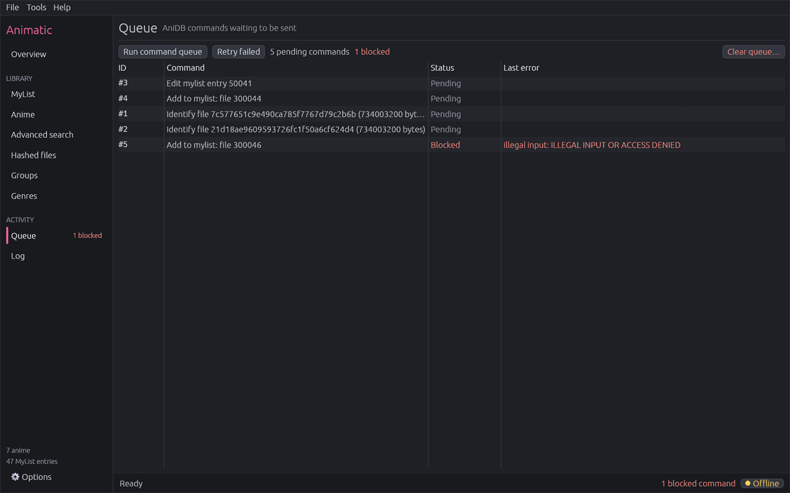

*The Queue page of the sample library: five commands, one of them **Blocked**: `Add to mylist: file
300046` with the last error `illegal input: ILLEGAL INPUT OR ACCESS DENIED`. The toolbar counts the
blocked command among the five.*

Expected results:

- The sidebar shows the number of pending commands next to **Queue**. A red `N blocked` appears
  instead when commands failed permanently.
- The button at the right of the status bar reads **Offline** and nothing is sent.
- On the **Overview**, **Needs attention** lists the same facts with buttons: `N hashed files are not
  identified by AniDB yet`, `N commands wait to be sent to AniDB (working offline)` with **Go
  online**, and so on.

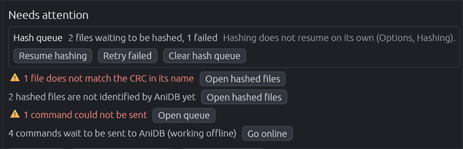

*The Needs attention list: queued commands wait, shown with **Go online** while you work offline.*

Commands stay in the queue until they succeed. Closing and reopening Animatic does not lose them. If
you stop here and only wanted to hash files, you are done; the rest of the tutorial needs your account.

## 7. Go online and run the queue

Do this when you have your AniDB account and want identification.

1. Open **Tools → Options…** and choose **AniDB account**.
2. Enter **Username** and **Password** (and, optionally, **API key (optional)**).
3. Untick **Work offline (keep commands queued)**.
4. Click **Save options**. The status bar button reads **Online**.
5. Leave **Run the command queue automatically** off. An automatic run sends the queue 30 seconds
   after new commands arrive and every 15 minutes; switch it on only after you have seen a manual run
   work ([Automatic runs](AniDB-Synchronization.md#automatic-runs-and-the-anidb-session)).
6. Choose **Tools → Run command queue** (`Ctrl+Shift+S`), or click **Run command queue** on the Queue
   page.

Expected results:

- The status bar shows the command being sent (for example `Identify file …`) with **Pause** and
  **Cancel** buttons; the **Log** starts with the line `Synchronizing with AniDB`. Animatic logs in
  when the first command needs it and logs out when the run ends.
- Each command takes a few seconds because of the request spacing. The **Log** shows what happened to
  each one: for example `known file F (anime A), mylist entry L`. A file AniDB does not know logs
  `file unknown to AniDB`; its command leaves the queue and the file stays **Not identified** (see
  [File and import problems](File-and-Import-Problems.md)).
- Finished commands leave the **Queue**. **Hashed files** now shows `fid N` in the **AniDB** column for
  identified files, and `In MyList · lid N` (or `Watched · lid N`) for files added to MyList.

If something fails:

- **A command is Blocked** (a permanent failure such as a wrong password): read **Last error**, fix the
  cause and use **Retry failed**. See [Failure handling](AniDB-Synchronization.md#failure-handling) and
  [Network and sync problems](Network-and-Sync-Problems.md).
- **The status bar says `AniDB sync paused until …`:** a cooldown is active. Wait; nothing can clear
  it, and clicking more does not help.
- **The Log shows `no reply to the AniDB login` or `cannot bind UDP port`:** see
  [Network and firewall](Network-and-Sync-Problems.md#network-and-firewall). A desktop firewall may
  ask whether Animatic may use the network; this guide has not recorded what it looks like.

## 8. See your library

Identification fills the local library with what AniDB told Animatic about each file: the anime,
its type, year and episode count, the episode number and name, and the release group. Look at it:

- **Overview** (`Ctrl+1`): **Your library** shows the number of anime, MyList entries, watched entries
  and the size on disk; `N of M hashed files identified by AniDB`. **Fetch MyList statistics** under
  **Your AniDB account** (or **Tools → Fetch MyList statistics**) queues AniDB's own account figures,
  which are shown apart from the local ones.

  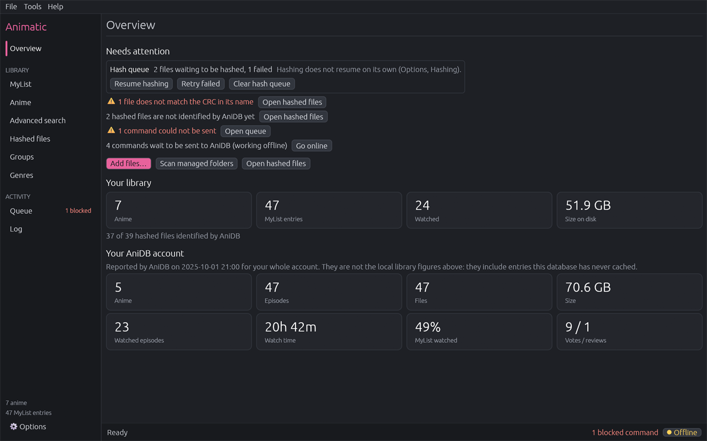

  *The Overview of the sample library after a time of use.*

- **MyList** (`Ctrl+2`): your entries grouped by anime. Click an arrow to open an anime and see its
  episodes, with the **State**, **Watched** box, size and any queued change in the **Queue** column.

  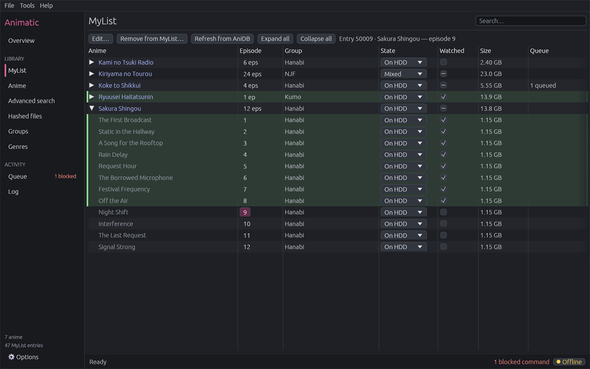

  *The MyList page with one anime expanded and an entry selected (shown in the toolbar).*

- **Anime** (`Ctrl+3`): every anime stored locally, with a **MyList** column such as `12 eps / 12 files`.
  Click a title to open its detail window.

  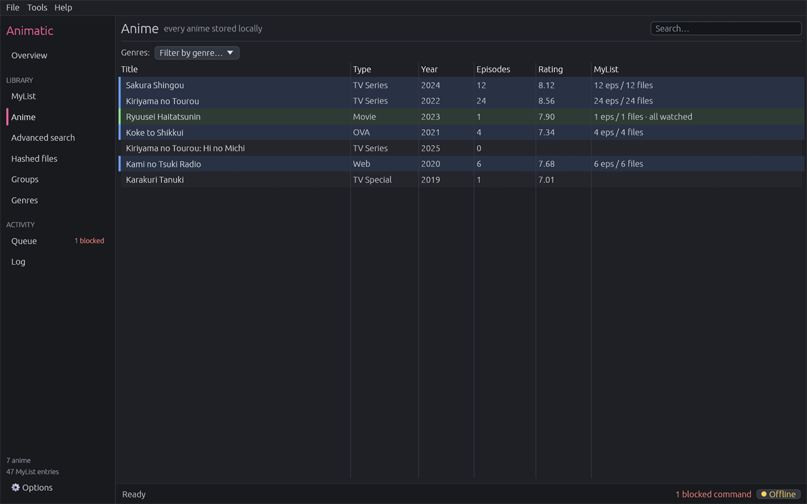

  *The Anime page. Anime that are not in MyList show a blank **MyList** column.*

An anime's description, episode list, genres and relations come from a separate refresh of that anime
(the **Refresh from AniDB** button in its detail window, or **Tools → Full update…**); identifying a
file stores only the basics. Note that **Tools → Full update…** and **Tools → Download anime titles**
also add AniDB's whole title list, so the **Anime** page and the sidebar count then include every anime
on AniDB, not only yours (see **Anime titles list** in the [Glossary](Glossary.md)). See also
[Library pages](Library-Pages.md) and [Managing MyList](Managing-MyList.md).

## 9. Rename a file

Renaming is manual and confirmed by you unless you switch on **Auto rename** for a folder. A file can
be renamed once it is **identified** (its **AniDB** column shows `fid N`). Planning uses only the local
library, so you can rename while working offline.

1. Open **Hashed files** and click the file's name (in the sample, `hanabi_paper_moon_radio_01_720p.mkv`;
   use one of your own identified files).
2. Click **Rename…**. The **Confirm rename** window shows the **Current path** and the **New path** the
   current naming convention produces. The default convention is `[Group] Title - episode [CRC]`, and
   the folder is the rename destination of the file's managed folder.

   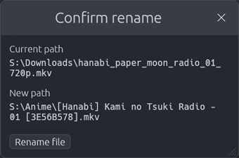

   *`S:\Downloads\hanabi_paper_moon_radio_01_720p.mkv` would become
   `S:\Anime\[Hanabi] Kami no Tsuki Radio - 01 [3E56B578].mkv`.*

3. Check the new path. Problems (an invalid name, missing anime or episode data) appear in the window
   and block **Rename file**. If a file or folder already exists at the new path, the window says
   `A file or folder already exists at the target path`, labels the path `(rename blocked)` and
   disables **Rename file**; rename the other file or choose another
   rename destination. If the window says the anime title or the episode number "has not been
   fetched yet" or "is not known yet", open the **Anime** page, click that anime's title and click
   **Refresh from AniDB** in its detail window (for a missing episode number use the **Refresh** button
   of that episode in the episode list), run the queue (step 7) and try again. A freshly identified file
   normally has both.
4. Click **Rename file**. The file moves, Animatic's record follows it, and the **Log** says
   `Renamed <old> to <new>`.

To rename several files at once, select them (`Ctrl`+click toggles, `Shift`+click extends) and use
**Rename N selected…**. To change the naming convention, use **Tools → Options… → Renaming**. See
[Renaming files](Renaming-Files.md) and [Rename targets and apply](Rename-Targets-and-Apply.md#built-in-naming-conventions).

## 10. Back up, then explore

Make your first backup now that the library holds something: choose **File → Back up library…** and keep
the file safe; it is as private as the library itself
([Backups and recovery](Backups-and-Recovery.md#backups-and-restore)). Then:

| I want to… | Read |
|---|---|
| Learn the window, searching, sorting and shortcuts | [Main window](Main-Window.md) and [Library pages](Library-Pages.md) |
| Edit MyList (state, watched, add, remove) | [Managing MyList](Managing-MyList.md) and [AniDB synchronization](AniDB-Synchronization.md#mylist-editing) |
| Scan folders on a schedule or rename automatically | [Managed folders and scans](Managed-Folders-and-Scans.md) and [Renaming files](Renaming-Files.md) |
| Bring in an AOM library | [Migrating from AOM](Migrating-from-AOM.md) |
| Download the whole MyList | [Full-account MyList import](AniDB-Synchronization.md#full-account-mylist-import) |
| Change a setting | [Options window](Options-Window.md) and [Settings reference](Settings-Reference.md) |
| Look up a word | [Glossary](Glossary.md) |
| Answer a quick question | [FAQ](FAQ.md) |
| Fix a problem | [Troubleshooting](Troubleshooting.md) |
| Keep Animatic up to date | [Updating Animatic](Updating-Animatic.md) |

## If something goes wrong

| Symptom | What to do |
|---|---|
| The library looks empty or settings look reset | You started Animatic with a different database or settings file. See [Which files is Animatic using?](Troubleshooting.md#which-files-is-animatic-using). |
| A scan hashes nothing | The rule needs **Hash new files** (or **Rehash changed files**) on, an existing **Path** and files with an extension from the list under **Options → Hashing**; the Default rule is never scanned. See [Scans and managed folders](File-and-Import-Problems.md#scans-and-managed-folders). |
| **Rename…** reports `The selected file is not identified by AniDB` | Identify the file first (steps 6 and 7). |
| Commands never leave the queue | **Work offline** is on, a cooldown is active, or the commands are blocked. Look at the right of the status bar, then the Queue page. |
| `login failed: wrong username or password` | Correct the credentials in **Options → AniDB account**, **Save options**, then **Retry failed**. |

## See also

- [First launch](First-Launch.md): the Getting started box, safe settings and AniDB client registration.
- [Hashing and identification](Hashing-and-Identification.md) and [AniDB synchronization](AniDB-Synchronization.md).
- [Glossary](Glossary.md) and [FAQ](FAQ.md).
- [Troubleshooting](Troubleshooting.md).
