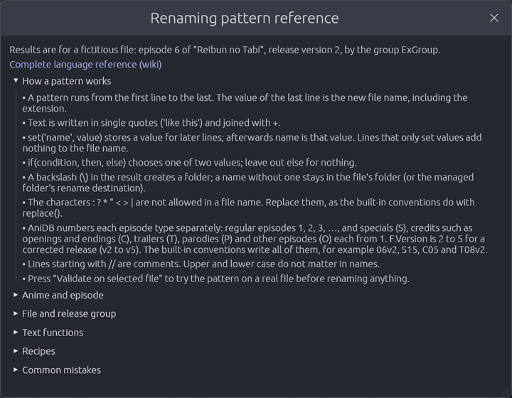

Animatic names and moves hashed files with a small expression language that follows the AniDB O'Matic (AOM) rename script. These pages document the language **as implemented in this repository**: syntax, values and coercion, every built-in function, every object property, how a result becomes a path, and what blocks a rename.

| Page | Covers |
|---|---|
| This page | Syntax, values and coercion, variables, user functions, limits, the in-app reference |
| [Functions and objects](Rename-Functions-and-Objects.md) | Every built-in function and every property of `A`, `E`, `F`, `G`, `H`, `M` |
| [Targets and apply](Rename-Targets-and-Apply.md) | From result to path, name validation, blocking rules, the built-in naming conventions |
| [Patterns](Rename-Patterns.md) | Worked examples, pitfalls, every diagnostic, self-test patterns, how to verify a pattern |
| [Renaming files](Renaming-Files.md) | The task guide: which button to click, previews, batch and automatic rename |

You do not need this page to rename files: the built-in conventions need no pattern knowledge. Read it when you want a custom pattern.

Statements in these pages were checked against the rename engine's source and its unit tests, and every worked example and self-test pattern was traced through the engine. Use **Validate on selected file** (see [Verify a pattern](Rename-Patterns.md#verify-a-pattern)) to confirm any pattern on your own build and data.

Compatibility with the legacy client is the implementation's stated goal, and the code keeps the legacy interpreter's quirks on purpose. Where these pages say "legacy", they only repeat what the source comments say; no AOM binary was run for them. Windows is the platform the implementation was exercised on. Linux runtime behavior has not been verified, so Linux-specific statements are reading of the code.

## What renaming does and does not do

| Capability | Status |
|---|---|
| Rename one selected, AniDB-identified hashed file after a preview and explicit confirmation (**Hashed files → Rename…**) | Implemented |
| Choose a built-in naming convention or write a custom pattern with an in-app reference and a live example, restore the replaced custom text and validate it on the selected file (**Tools → Options… → Renaming**) | Implemented |
| Per-folder rename destination (`base_path`, shown as **Rename destination** in Options) | Implemented, see [Base path](Rename-Targets-and-Apply.md#base-path-and-absolute-or-relative-results) |
| Rename several files in one action | Implemented: **Rename N selected…** on Hashed files previews every selected file and applies the valid ones with one confirmation, see [Renaming files](Renaming-Files.md#several-files-batch-rename) |
| Automatic renaming during or after a scan | **Opt-in per managed folder** (**Tools → Options… → Managed folders → Auto rename**: **Off**, **Dry run (log only)**, **On**; **Off** by default). Dry run only logs the plans; **On** renames identified files through the same verified worker job, and choosing **On** first shows a dry-run list to confirm. Collisions and blocked plans are skipped and logged, never overwritten. See [Automatic rename](Renaming-Files.md#automatic-rename-opt-in-per-managed-folder). |
| Renaming files that AniDB has not identified, or whose anime/episode rows are missing | Blocked with a message |
| Cleaning up folders left empty by a move | Optional, per managed folder (**Remove emptied folders**, `clear_empty_folders`): only completely empty folders below the managed folder, see [Managed folders](Managed-Folders-and-Scans.md#removing-folders-a-rename-emptied) |
| Undo, renaming a whole library in one action, numbering after a collision, telling AniDB the new name | Not implemented |

User-interface steps (which page, which button) are in [Renaming files](Renaming-Files.md); the stored field and its neighbors are in the [Settings reference](Settings-Reference.md). These pages cover the language and the rules behind the preview.

## The three stages

Renaming is deliberately split so that nothing touches the file system until the last step.

| Stage | What it does | Reads | Writes |
|---|---|---|---|
| **1. Evaluate** | Runs the pattern for one file | The pattern text, the file's records in the library (anime, episode, file, group, hash, MyList entry) and the stored titles for `at`, `et`, `atr`, `etr`, `getanime`, `getepisode` | Nothing. Produces a text result, variables and warnings. |
| **2. Plan** | Checks the pattern and the result and builds the new path | Everything stage 1 reads, the file's current path and its managed folder's **Rename destination**. A batch plan, and automatic rename, also look whether the new path is already taken on disk | Nothing. Produces the result text, a new path (or none), warnings and errors. |
| **3. Apply** | Moves the file, on the background worker, after **Rename file** or **Rename N files** | The file system (does the destination exist?) | Creates missing parent folders, renames or copies the file, then updates the library path |

- **Evaluate** never changes anything. It only reads the library.
- **Plan** adds validation: a syntax-checked pattern, the metadata rule for the built-in conventions, the empty/boolean result rules, warning blocking and path validation. A plan that is *allowed* to be applied has not been applied, and the destination may still exist: the single-file preview does not look for an existing target, so that error appears only when you click **Rename file** (the batch preview and automatic rename do look, and block the file earlier).
- **Apply** is the only stage that changes anything. It does nothing when old and new names are equal, refuses when the library no longer records the old path or the destination already exists (`destination already exists: <path>`), creates the destination's parent folders, renames the file (or copies, verifies and swaps it across drives), and **only after that succeeds** keeps the new library path. A failed move leaves the file and the library path unchanged.

Details worth knowing about apply:

- Folders created for the destination stay even if the following rename fails.
- **An existing destination is never replaced**, even one another program creates between the existence check and the rename: the rename itself refuses to replace (Windows: a move without the replace flag; Linux: a no-replace rename, or a hard link where the file system lacks it) and the file stays where it was. Linux behavior is reading of the code; Linux was not exercised.
- It is a plain rename on the same drive. When the operating system refuses because the target is on another drive, the file is copied, verified against the stored ED2K, swapped in and only then removed from the old place (see [Renaming files](Renaming-Files.md#what-applying-does)).
- The existence check compares the destination path, so a change that differs only in letter case on a case-insensitive file system may report the destination as existing.

For developers: the code entry points behind these stages are described in [rename-api.md](https://github.com/RetroHazard/animatic/blob/main/docs/rename-api.md).

## Language syntax

A pattern is text. It is turned into **one expression** and evaluated left to right. There are no statements, loops over lines or jumps; "lines" are a way to lay out one big concatenation.

### Preprocessing

Steps, in order:

1. Split the text into lines on `\r\n`, `\r` or `\n`.
2. Trim each line of every character at or below U+0020 (spaces, tabs and control characters) at both ends.
3. Drop lines that are empty after trimming, and lines that start with `//`.
4. Continuation: working from the last line backwards, a line whose last character is `_` has that `_` removed and the **next** line appended directly (no space is inserted). Chains of continuation lines work. A `_` at the end of the very last line is left in place.
5. Wrap every remaining line in parentheses and join the lines with ` + `.

So these four lines

```
// build the name
set('a', 'x')
'a' + _
'b'
```

become `(set('a', 'x')) + ('a' + 'b')`.

Consequences:

- **Comments are whole lines only**, starting with `//` after trimming. `//` in the middle of a line is not a comment; it is two division operators and a syntax error.
- Comment lines are removed *before* continuation, so a comment between two continued lines disappears and the first line joins the next real line.
- Because lines are concatenated with `+`, **every line contributes its value to the result**. `set(…)` returns an empty string, and the two-argument `if(cond, action)` returns an empty string when the condition is false, which is why those idioms are invisible. A line that evaluates to text, a number or a truth value is added to the name. See [Pitfalls](Rename-Patterns.md#pitfalls).
- A pattern that is only comments and blank lines compiles to nothing and evaluates to the truth value `False`; the plan then reports the boolean-result error.
- The preprocessed text is stored on the compiled pattern and exposed to the pattern as the variable `ACTIVEPATTERN`.
- Error positions refer to the preprocessed one-line text, not to your original line numbers. An unbalanced quote swallows following lines, so the reported position can be much later than the mistake.

### Tokens

Whitespace between tokens is **space, line feed and form feed only**. A **tab inside a line** (not at its ends, where trimming removes it) is an unknown character and ends the token stream, which produces a syntax error. Tabs are fine inside string literals.

Any character the scanner does not recognize ends the token stream without being consumed, so the parser reports a syntax error near it. This covers `&`, `%`, `!`, `;`, `[`, `{`, `#`, `@`, `!=`, `&&`, `||` and every non-ASCII character that is not inside a string literal. (`==` is not in this group: it is read as two `=` signs and fails with `Right part of expression missing!`.)

| Token | Spelling |
|---|---|
| Number | A run of ASCII digits and dots, for example `2`, `0.5`, `5.`. Text that does not parse as a number (for example `1.2.3`) becomes `0`. No sign, exponent, hex or leading `.5`. Always a `Double`. |
| String | `'…'` or `"…"`. See [String literals](#string-literals). |
| Boolean | `True`, `False` (case-insensitive) |
| Identifier | An ASCII letter followed by ASCII letters, digits or `_`. Case-insensitive everywhere (variables, objects, properties, functions). |
| Word operators | `and`, `or`, `xor`, `not`, `div`, `mod` (case-insensitive, reserved; they cannot be variable names) |
| Symbol operators | `+ - * / = <> < <= > >=` |
| Punctuation | `( ) , .` |

There is no `==`, `!=`, `&&`, `||`, `%` or `!`. Equality is a single `=`; inequality is `<>`.

### String literals

- Delimited by matching single or double quotes.
- **There are no escape sequences.** A backslash is an ordinary character: `'\'` is a one character string. This is why Windows paths and the default pattern's `replace(x, '\', ' ')` work as written.
- A literal cannot contain its own delimiter. To produce both quote kinds, concatenate: `"It's " + '"quoted"'`. The default pattern uses `"'"` for a single quote.
- A string that is never closed runs to the end of the text and is accepted by the lexer; the missing delimiter then usually breaks the parenthesis structure and surfaces as a syntax error.
- Literal strings are `WStr` values, which matters for truthiness. See [Values](#values-truthiness-and-coercion).

### Operators and precedence

From lowest to highest binding power:

| Level | Operators | Notes |
|---|---|---|
| 1 | `or` | Short-circuits; result is always a Boolean |
| 2 | `and` | Short-circuits; Boolean |
| 3 | `xor` | **Binds tighter than `and`**; evaluates both sides; Boolean |
| 4 | `=` `<>` `<` `<=` `>` `>=` | Boolean |
| 5 | `+` `-` | `+` concatenates or adds, see [coercion](#values-truthiness-and-coercion) |
| 6 | `*` `/` `div` `mod` | `/` gives a Double; `div` and `mod` give integers |
| 7 (unary) | `-x`, `+x`, `not x` | Apply to the *next primary only*, see below |

Two properties surprise most people:

1. **Every binary level is right-associative.** `10 - 3 - 2` is `10 - (3 - 2)` = `9`, and `a + b + c` is `a + (b + c)`. For string building this is harmless as long as a string sits somewhere to the right, but **two numbers at the end of a `+` chain are added first**: `'x' + 1 + 2` is `x3`, while `'x' + 1 + 2 + '.mkv'` is `x12.mkv`.
2. **Unary operators bind to the next primary only.** `not 1 = 2` is `(not 1) = 2`, not `not (1 = 2)`. Write `not (1 = 2)`. `-` is parsed as `False - x`, so `-5` is the number `-5`.

Parentheses group as usual. A parenthesized or called expression may not be followed by `.`: `getanime('B', 1).Name` is a syntax error.

### Calls and property access

- `name(arg, arg, …)` calls a built-in or user function. `name()` with no arguments parses.
- `A.Name` reads a property of a bound object. Only a bare object name can be the parent: `A.B.C` fails at evaluation with a "parent object not found" error.
- A call written with a parent (`x.fn(…)`) parses and the parent is ignored.
- `name` without parentheses is a **variable, object or property reference**, never a call.

### Compile errors

Compile errors carry the legacy messages, including the original spelling "parentesis", and the context decoration `In "<31 characters around the position>..." near "<next 16>"`.

| Message | When |
|---|---|
| `TRuleEvaluator.GetExpression7: tkParLeft: Missing right parentesis!` | `(` without matching `)`. Because every line is wrapped in parentheses, this is also the message for leftover tokens inside a line (`5abc`, `a b`) and for an unknown character, which ends the token stream |
| `TRuleEvaluator.GetExpression7: tkSymbol: Missing right parentesis!` | A call whose argument list does not end with `)` |
| `TRuleEvaluator.GetExpression7: tkSymbol: Property or method name missing!` | `.` not followed by a name |
| `TRuleEvaluator.GetExpression7: Right part of expression missing!` | An operand is missing (`'a' //`, `+` at the end of a line, `1 == 2`) |
| `TRuleManager.Compile: Syntax error!` | Tokens left over after the whole wrapped expression, for example an extra `)` as in `(1))` |
| `The pattern is nested too deeply (too many parentheses inside each other or too many lines).` | More than 1,000 parser levels (see [Evaluation limits](#evaluation-limits)). The context decoration is appended as for every compile error. |

In the application the text is shown as `The renaming pattern has a syntax error: <message>` with line breaks normalized. A blank pattern is reported separately as `The renaming pattern is empty. Choose a naming convention, or write a pattern whose last expression is the new file name.`

## Values, truthiness and coercion

The legacy interpreter used Delphi Variants, and its behavior depends on the exact variant type, so Animatic keeps the types distinct. In Animatic all strings are Unicode (UTF-8 in memory); the `AStr`/`WStr` distinction survives only for its effect on truthiness and coercion.

| Type | Examples | Truthy when |
|---|---|---|
| `Int` | `length(x)`, `E.EpisodeNo`, `F.Version`, `div`/`mod` results, object references | not `0` |
| `Double` | every number literal, results of `/`, `+ - *` that involve a Double | not `0` |
| `Bool` | comparisons, `not`, `and`, `or`, `xor`, `contains`, `start`, `numeric`, `in`, `E.IsSpecial` | `True` |
| `AStr` | `lc`, `uc`, `replace*`, a false two-argument `if`, string properties such as `F.Crc`, `A.Year` | not empty |
| `WStr` | string literals, `limit`, `pad*`, `substr`, `split` part, `trim`, `sc`, `tc`, `join`, `at`, `et`, user function parameters, text properties such as `A.Name` | **never** |
| `Int64` | `strtoint`, `A.Size`, `A.AirDate`, `F.Size`, `E.AirDate` | **never** |
| `Byte` | `count` | **never** |
| `Empty` | internal identity of `+` for user functions | never |

Practical rules that follow:

- Do not test a literal or a `limit`/`substr`/`trim` result with `if(x, …)`; it is always false. Test `length(x) > 0` instead. The same goes for `count(…)` and the Int64 properties: write `count(a, b) > 0`.
- An object name used as a value (`G`, `H`, `M`) evaluates to the non-zero integer `1` when the object is bound, so `if(G, …)` means "a group is known".
- Anything unknown evaluates to the Boolean `False`, see [Pitfalls](Rename-Patterns.md#pitfalls).

### Text conversion

Used for the final result and whenever `+` concatenates with a string:

| Value | Text |
|---|---|
| Integers | Decimal digits |
| `Double` | Delphi-style general format with up to 15 significant digits; whole numbers below 10^15 print without a fractional part (`2`), others trim trailing zeros (`0.333333333333333`); very large or small values use `E` notation (`1E20`) |
| `Bool` | `True` or `False` |
| `Empty` | empty string |

### `+`

1. If either operand is a string, the result is the concatenation of both operands' text. The result is an `AStr` if either operand was one, otherwise a `WStr`. Numbers and truth values are converted with the table above.
2. Otherwise the operands are added numerically (`Empty` is the identity). Integers stay integers (`Int64` if either is), anything else becomes a `Double`. `Bool` counts as `-1` for `True` and `0` for `False`.

### `-`, `*`, `/`, `div`, `mod`

- `-` and `*`: integers (including `Bool`, treated as `-1` for `True` and `0` for `False`, and `Empty` as `0`) stay integers; anything else becomes a `Double`. Strings are first parsed as numbers; text that is not a number is a **hard error** (`Could not convert variant of type (String) into type (Double): '…'`).
- `/` always gives a `Double`; division by zero is a hard error `Division by zero`.
- `div` and `mod` round both operands to the nearest integer (ties to even), then divide integers (truncating toward zero; the remainder of `mod` takes the sign of the left operand); the result is an `Int`. A zero divisor is the same hard error.

### Comparison

`=`, `<>`, `<`, `<=`, `>`, `>=` and `in(…)` use the same comparison:

| Operands | How they are compared |
|---|---|
| two integers (`Int`, `Byte`, `Int64`) | numerically |
| two strings | by their text, **case-sensitively**, in code-point order |
| two Booleans | `False` < `True` |
| Boolean and string | the string is parsed as `true`/`false` (any case) or a number; otherwise a **hard error** |
| Boolean and integer | `True` counts as `-1`, `False` as `0` |
| `Empty` and string | the string is compared with the empty text |
| string and number | the string is parsed as a number; text that is not numeric is a **hard error** |
| anything else | both sides converted to `Double`, `Bool` counting as `-1`/`0` |

Compare strings with strings and numbers with numbers. `A.Year = 2010` raises a hard error when the year text is empty or like `2010-2012`; compare the Int `A.StartYear` instead. A mistyped property name evaluates to `False`, so `F.Nme = 'x'` is a hard error rather than a silent mismatch.

### Argument conversion for functions

Functions convert their arguments in two ways. A failed conversion is a **warning**, not an error (see the next section), and the value `""` or `0` is used.

| Conversion | Rules |
|---|---|
| To string | `Bool` → `True`/`False`; integers → digits; strings unchanged. **`Double` and `Empty` are not convertible** (warning `PARSERUN: Syntax error, value can not be converted to a string.`) |
| To integer | `Bool` → `1`/`0` (note: not `-1`); integers unchanged; `Double` rounds to nearest, ties to even; strings parse like Delphi `StrToIntDef` (trimmed, optional sign, `$` prefix for hex, otherwise `0`); `Empty` is a warning (`PARSERUN: Syntax error, value can not be converted to an integer.`) |

The most common consequence: **a number literal or the result of arithmetic is a `Double`, so it cannot be passed where a function expects text.** `padl(5, 2, '0')` and `padl(E.EpisodeNo + 1, 2, '0')` both produce a warning and block the rename, while `padl(E.EpisodeNo, 2, '0')` is fine because `E.EpisodeNo` is an `Int`. Convert a Double to text by concatenating with a string, `'' + (E.EpisodeNo + 1)`, or avoid the Double with `(E.EpisodeNo + 1) div 1`. Number literals in *integer* positions (`limit(x, 90)`, `padl(x, 2, '0')`) are fine.

## Errors and warnings during evaluation

| Kind | Effect | Examples |
|---|---|---|
| **Hard error** | Evaluation stops; the plan has one error `The renaming pattern failed to run: <message>` and no result | `Division by zero`; a non-numeric string in arithmetic or in a comparison with a number; a Boolean/string comparison that cannot be parsed; reading a property of an object that is not bound; a bare name with no default object; `at`/`et` without the `A`/`E` object (`Function at: object A is not available`); a [limit](#evaluation-limits) reached |
| **Warning** (soft error) | Evaluation continues with a neutral value; the message is kept. **While any warning exists the plan cannot be applied**, even though a target path may still be shown | Wrong number of function arguments; `Double`/`Empty` passed as text; `Empty` passed as an integer; `set` with an invalid variable name |

Warnings use the legacy format `PARSERUN: Function <name>: <text>, found <n> parameters.` (for example `PARSERUN: Function lc: Lc must have 1 parameter, found 2 parameters.`). The function name and text come from the branch that detected the problem, so `min` reports as `max`, and a `getepisode` count error mentions `getaanime`. A `set` whose name does not start with a letter reports `PARSERUN: Function set: Set first parameter must be a valid identifier, found "<name>".`

Two evaluation failures that are **not** errors are the main source of bad names:

- A name that is not a variable, bound object, or property of the default object evaluates to `False` without any message.
- A call to an undefined function evaluates to `False` without any message (its arguments are not even evaluated).

## Variables, scope and user functions

### Variables

- `set('name', value)` creates or overwrites a variable and returns an empty string. The value keeps its type (a stored literal stays a falsy `WStr`).
- The first argument may be any string-valued expression. It must start with an ASCII letter, otherwise the call produces a warning and sets nothing. Only the first character is checked, so a name such as `a b` can be stored but never referenced.
- Names are case-insensitive. There are no scopes and nothing persists between files or between evaluations: every run starts with fresh variables and functions.
- A bare name is resolved in this order: variable; bound object (evaluates to `1`); property of the **default object**; otherwise `False`. The default object is the object named `self` if one was bound, otherwise the first bound object, which is `A`. Consequently a bare `Name`, `Year` or `Size` that you never set reads `A.Name`, `A.Year` or `A.Size`.
- `A.Name` always means the object property; a variable called `A` does not hide the object for property access.

Predefined variables (all `WStr`):

| Variable | Value |
|---|---|
| `PATH` | The file's current full path as recorded in the library |
| `BASEPATH` | The matching managed folder's **Rename destination**; empty when none |
| `ACTIVEPATTERN` | The preprocessed pattern text |

They are ordinary variables and can be overwritten with `set`.

### Control variables

`for('i', 1, 3, body)` sets `i` to each integer in turn, as an `Int`, and the variable remains set after the loop. `function(…)` parameters are stored as `param1`, `param2`, … and also remain set after the call. A later call with fewer arguments therefore still sees the old values of the higher `paramN`.

### User functions

```
function('label', '[' + param1 + ']')
set('x', label('ok'))
x
```

- `function('name', body1, body2, …)` needs a name and at least one body; the message `Function can only have 2 parameters` is misleading, more bodies are accepted.
- The bodies are **stored unevaluated** and evaluated at each call. The function line itself returns an empty string.
- A name that is already defined is ignored: the **first definition wins**.
- Built-in names are matched first, so a user function can never replace a built-in.
- A call evaluates its arguments, converts each to **text** (so a `Double` argument warns), and stores them in `param1`…`paramN` as `WStr`. Because they are `WStr`, **`if(param1, …)` is always false**; use `length(param1) > 0`.
- The result is the bodies added together with the raw `+` of the `for` loop: strings concatenate, and numbers are added.
- A function must be defined on an **earlier line** than its first call. Calling an undefined function yields `False`, silently.

### Evaluation limits

Evaluation is bounded so that a runaway pattern fails with an error instead of freezing or crashing Animatic. These limits are a deliberate difference from AOM.

| Limit | Value | Error text |
|---|---|---|
| Evaluation steps per run (every expression evaluated counts one) | 100,000 | `The pattern stopped after 100000 steps; a loop or a function that calls itself probably never ends.` |
| Expressions nested inside each other | 600 | `The pattern nests too deeply (more than 600 expressions or 200 function calls inside each other); a function probably calls itself without end.` |
| Function calls nested inside each other | 200 | the same message |
| Length of any text value (UTF-8 bytes) | 128 KiB | `The pattern built a text longer than 128 KiB.` |
| Parser nesting (parentheses, operators, lines) | 1,000 | `The pattern is nested too deeply (…)` as a [compile error](#compile-errors) |

All run-time limits end the run with a hard error, shown as `The renaming pattern failed to run: <message>`; nothing is renamed. Lines are joined into one nested expression, so each line adds one level: a pattern with a few hundred lines (500 lines are covered by a test) is fine, while one approaching 600 lines reaches the nesting limit (derived from the limits, not tested). Ordinary patterns, including the built-in conventions (about 30 lines), stay far below every limit.

### The in-app pattern reference

In **Tools → Options… → Renaming**, with **Custom pattern** chosen, **Pattern reference** opens the window **Renaming pattern reference**. It states that its results are for a fictitious file (episode 6 of `Reibun no Tabi`, release version 2, group `ExGroup`) and links to this page (**Complete language reference (wiki)**).



*The in-app reference. Sections open and close; every code sample shows the result the engine itself gives for the fictitious file.*

| Section | Content |
|---|---|
| How a pattern works | The last line is the file name; quotes and `+`; `set` and `if`; a backslash creates a folder; characters not allowed in file names; episode types and versions; comments |
| Anime and episode | `A.Name`, `at('x-jat')`, `at('en')`, `at('ja')`, `A.Year`, `A.CategoryStr`, `E.EpisodeNo`, `E.EpisodeStr`, `E.TypeId`, `E.IsSpecial`, `et('en')`, `et('x-jat')` |
| File and release group | `F.FileType`, `F.Version`, `F.Crc`, `F.ResolutionString`, `F.Quality`, `F.Source`, `G.Shortname`, `G.Name`, `H.Crc32` |
| Text functions | `uc`, `lc`, `tc`, `replace`, `limit`, `substr`, `length`, `trim`, `padl`, `join`, `in`, `contains` |
| Recipes | English title with fallback; optional group; a folder per anime; specials in a subfolder; openings and endings as `OP01`/`ED01`; year and resolution in the name |
| Common mistakes | Misspelled names become `False`; adjacent numbers are added; unset variables; stray lines; trailing comments |

Each entry shows what it is for (in bold), a **Copy** button that puts its code on the clipboard, the code, and the result as `→ <text>`. The window runs each code sample against the sample file when it is opened, which is why the results always agree with the engine (a sample that fails shows its error in red). This page and the following pages list the same things exhaustively. Properties the fictitious file does not carry (most of `A`, all of `M`) are not in the reference; they are fully listed in [Functions and objects](Rename-Functions-and-Objects.md#objects-and-properties).

## Differences from AOM and limits

Deliberate differences stated in the source and project rules:

- Strings are Unicode throughout, with no ANSI round trips.
- A relative result resolves against the **file's own folder**.
- The built-in conventions use a fixed two-digit counter; counts stored in the database do not influence it.
- Empty results, Boolean-only results, hard errors and any evaluation warning block the rename instead of producing or guessing a name.
- File-name validity uses the strictest rules on every platform (Windows reserved characters and device names including `¹ ² ³`), with a length unit that depends on the build platform.
- The built-in conventions need fetched title and episode data; a pending-title stand-in is never used to name a file with them.
- Evaluation is bounded (see [Evaluation limits](#evaluation-limits)): AOM had no limit, so a pattern that loops or recurses without end, or builds an enormous text, fails here instead of hanging.
- Renaming is manual and confirmed, except for a managed folder you explicitly set to **On** (opt-in per folder, off by default, never implicit; collisions are skipped, never overwritten).

Limits:

- Batch rename acts on the files you select and automatic rename on the identified files of the folders you switched on; there is no rename of a whole library in one action, and no automatic numbering or other name made up after a collision.
- No variable list, step trace or debugger in the application. (Developers can read the variables of a run through the code interface; see [For developers](#for-developers).)
- A target that already exists is refused (the file is skipped), never replaced and never given another name. Folders a rename leaves empty are removed only through the opt-in **Remove emptied folders** setting.
- Production AniDB behavior and Linux runtime were not exercised while documenting.

## For developers

The language is implemented in `crates/animatic-core/src/rename/` (lexer and parser, values, evaluator, bound objects, planning, the built-in convention texts and the in-app reference), applied by `file_manager.rs` and planned for automatic rename in `auto_rename.rs`. The code interface for planning renames is described in [rename-api.md](https://github.com/RetroHazard/animatic/blob/main/docs/rename-api.md); the behavior tests are in the same `rename/` folder.

## See also

- [Functions and objects](Rename-Functions-and-Objects.md), [Targets and apply](Rename-Targets-and-Apply.md) and [Patterns](Rename-Patterns.md).
- [Renaming files](Renaming-Files.md): the task guide.
- [Glossary](Glossary.md): AniDB ids, ED2K, CRC32.
