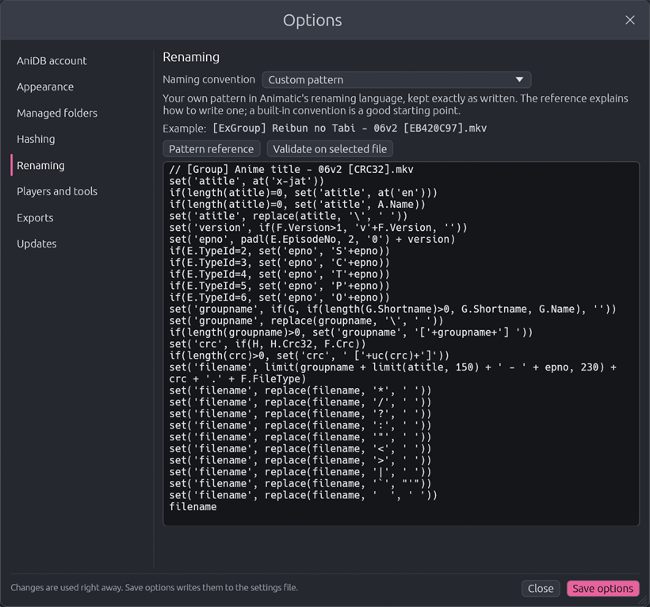

Worked patterns, common pitfalls, every diagnostic, self-test patterns, and how to check a pattern against one of your own files before applying it. You need this page only for a **custom pattern**; the built-in naming conventions work without it (see [Choosing how files are named](Renaming-Files.md#choosing-how-files-are-named)).

The language itself is in [Rename language](Rename-Language.md); every function and property is in [Functions and objects](Rename-Functions-and-Objects.md).

## Write your first custom pattern

A pattern runs from its first line to its last. The value of the **whole pattern** (all lines joined) is the new file name, extension included. A good way to start is to begin from a built-in convention and shorten it, or to build a short pattern up in small steps and read the **Example:** line after every step.



*Custom pattern in **Tools → Options… → Renaming**. The text in the editor is the default convention, which you can cut down.*

1. Open **Tools → Options… → Renaming** and choose **Custom pattern** in the **Naming convention** list.
2. Replace the editor text with a first version:

   ```
   A.Name + '.' + F.FileType
   ```

   The **Example:** line below the list shows `Reibun no Tabi.mkv` for the fictitious file. (`F.FileType` is the extension without the dot.)
3. Add the episode number, two digits wide:

   ```
   A.Name + ' - ' + padl(E.EpisodeNo, 2, '0') + '.' + F.FileType
   ```

   Example: `Reibun no Tabi - 06.mkv`.
4. Add the group only when the file has one, and the CRC:

   ```
   set('grp', '')
   if(G, set('grp', '[' + G.Shortname + '] '))
   grp + A.Name + ' - ' + padl(E.EpisodeNo, 2, '0') + '.' + F.FileType
   ```

   Example: `[ExGroup] Reibun no Tabi - 06.mkv`. Lines that only `set` a value add nothing to the name; only the last line makes text.
5. Select a real, identified file on **Hashed files** and press **Validate on selected file** (see [Verify a pattern](#verify-a-pattern)). For the sample library's *Sakura Signal* episode 3 by Hanabi you would see `[Hanabi] Sakura Shingou - 03.mkv`.
6. Click **Save options** (or keep working: Options changes take effect immediately).

The **Pattern reference** button next to the example opens a window with these basics and recipes (see [Rename language](Rename-Language.md#the-in-app-pattern-reference)).

## Working patterns

The examples use fictitious data only. **Reference file** (invented, in the style of the sample library; its release is a version 2 so the version examples have something to show):

| Item | Value |
|---|---|
| `A.Name` | `Sakura Shingou` (also its `x-jat` main title); its English official title is `Sakura Signal` |
| `A.Year` | `2024` |
| `E` | regular episode (`TypeId` 1), `EpisodeNo` 3, English title `A Song for the Rooftop`; the anime's special is `EpisodeStr` `S1` |
| `F` | `Version` 2, `Crc` `5a1d0c3e`, `FileType` `mkv`, `ResolutionString` `1920x1080` |
| `G` | `Shortname` `Hanabi`, `Name` `Hanabi Subs` |
| `H` | `Crc32` `5A1D0C3E` |

Results below are the text the pattern evaluates to; the path rules then apply. All examples are meant to be validated with the steps in [Verify a pattern](#verify-a-pattern).

### Unpadded, custom

```
A.Name + ' - ' + E.EpisodeNo + '.' + F.FileType
```

`Sakura Shingou - 3.mkv`. Padding to a fixed width is `padl(E.EpisodeNo, 3, '0')`, giving `Sakura Shingou - 003.mkv`.

### Dynamic version suffix

```
set('ver', '')
if(F.Version > 1, set('ver', ' v' + F.Version))
A.Name + ' - ' + padl(E.EpisodeNo, 2, '0') + ver + '.' + F.FileType
```

`Sakura Shingou - 03 v2.mkv`; with `Version` 1 it is `Sakura Shingou - 03.mkv`. Initializing `ver` on the first line matters: an unset variable would read as `False` and add the word `False` to the name. The default pattern uses the three-argument `if` for the same reason.

### Unicode

```
'桜信号 第' + padl(E.EpisodeNo, 2, '0') + '話 ' + E.Name + '.' + F.FileType
```

With the reference file the result is `桜信号 第03話 A Song for the Rooftop.mkv` (the kanji title is invented). Non-ASCII characters are fine **inside string literals and in data**; they are never valid as bare identifiers or operators. Names are Unicode all the way (no code page conversion), and length rules count UTF-16 units or UTF-8 bytes, see [Component validation](Rename-Targets-and-Apply.md#component-validation).

### Folder, sanitizer and a user function

For the sample library's anime titled `Kiriyama no Tourou: Hi no Michi` (a colon in the title), episode 1:

```
function('clean', replace(replace(replace(param1, ':', ' -'), '/', ' '), '?', ''))
set('series', clean(A.Name))
set('folder', series + '\')
set('ep', padl(E.EpisodeNo, 2, '0'))
folder + series + ' - ' + ep + '.' + F.FileType
```

`Kiriyama no Tourou - Hi no Michi\Kiriyama no Tourou - Hi no Michi - 01.mkv`. With no base path the new folder is created inside the file's current folder; with the Downloads rule's rename destination `S:\Anime` it is `S:\Anime\Kiriyama no Tourou - Hi no Michi\…`. Without `clean`, the colon in the title would be rejected (`":" is not allowed in a name`).

### Optional group and CRC

```
set('grp', '')
if(G, set('grp', ' [' + if(length(G.Shortname) > 0, G.Shortname, G.Name) + ']'))
set('crc', '')
if(H, set('crc', ' (' + uc(H.Crc32) + ')'))
A.Name + ' - ' + padl(E.EpisodeNo, 2, '0') + grp + crc + '.' + F.FileType
```

`Sakura Shingou - 03 [Hanabi] (5A1D0C3E).mkv`. Without a group the group part vanishes; without a local hash the CRC part vanishes. `G.Shortname` is only read when `G` is bound.

### Specials in a subfolder

```
set('sub', '')
if(E.IsSpecial, set('sub', 'Specials\'))
sub + A.Name + ' - ' + E.EpisodeStr + '.' + F.FileType
```

A regular episode 3 gives `Sakura Shingou - 3.mkv`; special 1 gives `Specials\Sakura Shingou - S1.mkv`. (`'Specials\'` is a valid literal because strings have no escapes.) `E.EpisodeStr` is unpadded; `E.EpisodeStrPadded` would change with the stored episode counts.

### Using extra titles and a pending-title guard

```
set('t', at('en'))
if(length(t) = 0, set('t', at('x-jat')))
set('filename', t + ' - ' + padl(E.EpisodeNo, 2, '0') + '.' + F.FileType)
if(length(t) = 0, '', filename)
```

Prefers the English title (`Sakura Signal - 03.mkv`), falls back to the romaji title, and returns an empty result (which blocks the rename with the empty-name error) when neither exists.

### Episode title and a tidy separator

```
join(' - ', A.Name, padl(E.EpisodeNo, 2, '0'), E.Name) + '.' + F.FileType
```

`Sakura Shingou - 03 - A Song for the Rooftop.mkv`. `join` skips empty values, so an episode without a stored title gives `Sakura Shingou - 03.mkv` with no dangling separator. Titles containing characters that file names cannot hold need `replace` first, as in the sanitizer example.

### Year and resolution in the name

```
A.Name + ' (' + A.Year + ') - ' + padl(E.EpisodeNo, 2, '0') + ' [' + F.ResolutionString + '].' + F.FileType
```

`Sakura Shingou (2024) - 03 [1920x1080].mkv`. `A.Year` can be a range such as `2010-2012`; it is only text here, which is fine. Do not compare it with a number.

### Sort by resolution or by group

```
if(F.ResolutionHeight >= 1080, 'HD', 'SD') + '\' + A.Name + ' - ' + padl(E.EpisodeNo, 2, '0') + '.' + F.FileType
```

`HD\Sakura Shingou - 03.mkv`. A folder per group is `if(G, G.Shortname, 'no group') + '\' + …`, giving `Hanabi\…`. Both create the folders under the rename destination (or the file's folder).

### A media-server style tree

```
set('s', replace(replace(A.Name, ':', ' -'), '/', ' '))
set('season', if(E.IsSpecial, '00', '01'))
s + '\Season ' + season + '\' + s + ' - S' + season + 'E' + padl(E.EpisodeNo, 2, '0') + '.' + F.FileType
```

`Sakura Shingou\Season 01\Sakura Shingou - S01E03.mkv`. Every episode that is not a regular one (specials, credits, trailers, parodies and other episodes) uses `Season 00`; a credit and a special with the same number would then collide, and a collision is refused (see [Collisions](Renaming-Files.md#collisions)). The built-in **Title - S01E06 - episode title (media servers)** convention names the credits `C05` instead, which avoids that.

### Openings and endings

AniDB has one credit type for both. This recipe, also in the in-app reference, tells them apart by the English episode title:

```
set('ep', E.EpisodeStr)
if(E.TypeId = 3, set('ep', if(contains('Ending', et('en')), 'ED', 'OP') + padl(E.EpisodeNo, 2, '0')))
A.Name + ' - ' + ep + '.' + F.FileType
```

A credit episode 2 titled `Ending` gives `Sakura Shingou - ED02.mkv`, `Opening 2` gives `Sakura Shingou - OP02.mkv`, and a trailer 2 keeps `Sakura Shingou - T2.mkv`.

## Pitfalls

Each item below follows from the implementation.

1. **Unknown names evaluate to `False`.** A misspelled variable, property or function does not fail; it yields the Boolean `False`, and joined with text it becomes the word `False`: `filenmae + '.mkv'` evaluates to `False.mkv`. The plan **accepts** that name, because the result is text. Only a result that is *entirely* a Boolean is rejected (`1 = 1`, or a final line such as `filenmae`). Always validate on a real file and read the result.
2. **Truthiness depends on type.** Literals, `limit`, `padl`, `substr`, `trim`, `split`, `join`, `sc`, `tc`, the `at`/`et` titles, user function parameters and text properties such as `A.Name` are falsy. `if('abc', 'a', 'b')` is `b`. Test `length(x) > 0` or compare explicitly. `count`, `strtoint` and Int64 properties (`A.Size`, dates) are falsy as well.
3. **`+` is right-associative.** Trailing numbers are added: `'S' + E.EpisodeNo + F.Version` (episode 3, version 2) is `S5`, not `S32`. Put a string at the end, or convert one number to text first (`'S' + padl(E.EpisodeNo, 1, '0') + F.Version` is `S32`).
4. **`not` binds to the next operand only**: `not 1 = 2` is `(not 1) = 2`. Write `not (1 = 2)`.
5. **Doubles cannot be text arguments.** Number literals and arithmetic results warn when passed to `lc`, `uc`, `padl(x, …)`, `replace` and similar, and any warning blocks the rename.
6. **Comparisons across types fail hard.** `A.Year = 2010` stops the pattern whenever the year text is empty or a range such as `2010-2012` (it works for `2024`), and comparing a mistyped property (`False`) with a text such as `'x'` stops it too. Compare same-typed values (`A.StartYear = 2010`).
7. **Whole-line comments only.** A trailing `// note` is a syntax error. A line ending with `_` is joined to the next line with no space; a name ending in `_` at the end of a line will be swallowed as a continuation.
8. **Tabs between tokens are syntax errors.** Indent with spaces, or not at all (leading tabs are trimmed).
9. **Every line is part of the name.** A stray line like `E.EpisodeNo > 1`, a lone `A.Name` or an unset variable adds `True`, `False` or text to the result. Use `set(…)` or `if(cond, set(…))` for work, and let only the last line produce the name.
10. **Unbound objects are hard errors.** `G.Shortname` for an ungrouped file stops the pattern (`…Attribute Shortname parent object not found!`). Guard with `if(G, …)`.
11. **User function parameters are falsy `WStr`s**, and a function must be defined before it is called; a call before the definition yields `False`.
12. **`replace` runs once.** Three spaces become two when replacing `'  '` with `' '`; `replacerepeat` does not change that.
13. **`lc` and `uc` are ASCII-only**, and `tc` capitalizes after spaces only.
14. **Sanitizing is manual.** `: ? * " < > |` in a result make the plan fail, with no automatic substitution. A backslash or slash in a *title* creates folders.
15. **An empty `F.FileType` loses the extension.** The result ends with `.`, which is trimmed.
16. **Custom patterns accept the pending-title stand-in.** See the guard under [Planning rules](Rename-Targets-and-Apply.md#planning-rules).
17. **`E.EpisodeStrPadded` is data dependent.** Its width follows the highest stored episode number of the type, so a fixed `padl(E.EpisodeNo, 2, '0')` is more stable.
18. **`H` media properties are mostly empty** for files Animatic hashed itself.
19. **`getanime` rebinding is ignored**; the first binding of a name wins.
20. **`for` bodies must produce strings**, and unset accumulator variables read as `False`.
21. **Runaway patterns stop with an error.** A loop over an enormous range, a function that calls itself without end, or a text that keeps growing ends the run with a hard error once it reaches the [evaluation limits](Rename-Language.md#evaluation-limits); nothing is renamed.
22. **The editor's Example line uses a fictitious file.** It has no MyList entry, so `M.Storage` there is an unbound-object error even though your real files have an entry; properties the fictitious file does not carry (for example `A.Size`) read `False` there. Use **Validate on selected file** for the real check.
23. **`F.Crc` is lower case, `H.Crc32` upper case.** Wrap either in `uc(…)` when the case matters, as the built-in conventions do.
24. **A name that already exists is never replaced.** Two files that would get the same name collide; the first is renamed and the other is blocked. Include something that differs (group, resolution, version) when you drop it from the pattern.

## Diagnostics reference

| Where it appears | Text (abridged) | Cause | Fix |
|---|---|---|---|
| Editor and preview | `The renaming pattern is empty. …` | Blank pattern | Write a pattern or choose a naming convention |
| Editor and preview | `The renaming pattern has a syntax error: …` | See [Compile errors](Rename-Language.md#compile-errors) | Fix the construct near the quoted position |
| Editor and preview | `The renaming pattern has a syntax error: The pattern is nested too deeply (…)` | More than 1,000 parser levels (a very large number of nested parentheses or lines) | Simplify the pattern |
| Preview | `The built-in naming convention needs the anime title, which has not been fetched yet. …` | Title missing or the stand-in | Fetch the anime from AniDB |
| Preview | `The built-in naming convention needs the episode number, which is not known yet. …` | Episode number 0 or unknown | Fetch the episode |
| Preview | `The renaming pattern failed to run: <message>` | Hard error (division by zero, bad conversion, unbound object, a [limit](Rename-Language.md#evaluation-limits), …) | Fix the expression; guard optional objects |
| Preview | `The pattern ended with the truth value "True"/"False" instead of a file name. …` | The whole value is a Boolean | Make the last line the name |
| Preview | `The pattern produced an empty file name; nothing would be renamed. …` | Empty result | Make the last line produce the name |
| Preview | `Renaming "<old>" to "<name>" would result in an invalid file name (<reason>); rename skipped!` | [Component validation](Rename-Targets-and-Apply.md#component-validation) | Sanitize in the pattern |
| Preview (yellow) | `The pattern reported warnings, so its result cannot be trusted. Renaming stays disabled until they are fixed:` followed by `• PARSERUN: …` lines | Wrong argument count, `Double` as text, bad `set` name | Fix each listed call ([argument counts](Rename-Functions-and-Objects.md#wrong-argument-counts)) |
| Preview | `No file entry for file <fid>!`, `Can't autorename file, Episode <eid> is missing for File <fid>!`, `Can't autorename file, Anime <aid> is missing for File <fid>!` | Library rows missing | Identify the file; fetch the anime/episode |
| Batch rename | `The file is not identified by AniDB` | The file has no `fid` | Identify it first |
| **Rename…**, Validate on selected file, batch rename | `A file or folder already exists at the target path` | The target is taken on disk | Change the pattern or move the other file |
| Batch rename | `<current path of the earlier file> would get the same name; only the first of the two can be renamed` | Two selected files get one name | Make the names differ |
| Validate on selected file | `Select a file identified by AniDB on the Hashed files page, then validate again.` | No file is selected | Click an identified file on **Hashed files** |
| Validate on selected file, **Rename…** | `The selected file is not identified by AniDB` | The selected row has no `fid` | Identify it first |
| **Rename…**, Validate on selected file | `The selected file is no longer in the list` | A new search hid the selected row | Clear the search |
| Apply (log, `Not renamed:`) | `destination already exists: <path>` and the other move messages ([list](Rename-Targets-and-Apply.md#how-a-file-is-moved)) | Apply found a destination that appeared after the preview, or a problem with the move | Change the pattern or move the other file |

## Self-test patterns

These patterns do not depend on the selected file's metadata. Paste one into the pattern editor, choose an AniDB-identified hashed file and press **Validate on selected file**. **Pasting replaces your pattern in the live settings**, and a normal exit saves them, so copy your own pattern text somewhere first and put it back (or use **Restore my custom pattern** if you chose a built-in convention) before closing the application.

| Pattern | Expected result | Plan |
|---|---|---|
| `'x' + 1 + 2` | `x3` | valid (no extension) |
| `'x' + 1 + 2 + '.mkv'` | `x12.mkv` | valid |
| `10 - 3 - 2` | `9` | valid |
| `'a' + 5 div 2` and `'n' + 7 mod 4` | `a2` and `n3` | valid |
| `if('abc', 'yes', 'no') + '.mkv'` | `no.mkv` | valid |
| `if(lc('abc'), 'yes', 'no') + '.mkv'` | `yes.mkv` | valid |
| `if(not 1 = 2, 'a', 'b') + '.mkv'` | `b.mkv` | valid |
| `if(not (1 = 2), 'a', 'b') + '.mkv'` | `a.mkv` | valid |
| `if(count('aaa', 'aa') = 2, 'ok', 'no') + '.mkv'` | `ok.mkv` | valid |
| `if(count('aaa', 'aa'), 'y', 'n') + '.mkv'` | `n.mkv` | valid |
| `if(in(2, 1, 2, 3), 'y', 'n') + '.mkv'` | `y.mkv` | valid |
| `if(numeric('03'), 'y', 'n') + '.mkv'` | `y.mkv` | valid |
| `replace('a  b   c', '  ', ' ') + '.mkv'` | `a b  c.mkv` | valid |
| `limit('abcdefgh', 5, '~') + '.mkv'` | `abcd~.mkv` | valid |
| `padl('7', 3, '0') + '.mkv'` | `007.mkv` | valid |
| `tc('hELLO wORLD') + ' ' + sc('hELLO wORLD') + '.mkv'` | `Hello World Hello world.mkv` | valid |
| `uc('abcé') + '.mkv'` | `ABCé.mkv` | valid |
| `substr('Sakura Shingou', 8, 3) + '.mkv'` | `Shi.mkv` | valid |
| `split('a-b-c', '-', 2) + '.mkv'` | `b.mkv` | valid |
| `join(' - ', 'a', '', 'b') + '.mkv'` | `a - b.mkv` | valid |
| `max(2.6, 1) + '.mkv'` | `3.mkv` | valid |
| `strtoint('$1F') + '.mkv'` | `31.mkv` | valid |
| `for('i', 1, 3, 'x' + i) + '.mkv'` | `x1x2x3.mkv` | valid |
| `set('x', 5)` then `x + 1 + '.mkv'` (two lines) | `51.mkv` | valid |
| `unknownname + '.mkv'` | `False.mkv` | **valid**: the engine cannot tell |
| `'ok.'` | `ok.` | valid; the target has no trailing dot |
| `1 = 1` | `True` | error: truth value |
| `if(1 = 2, 'x.mkv')` | empty | error: empty file name |
| `set('x', 'y')` | empty | error: empty file name |
| `lc('A', 'B') + '.mkv'` | warning `PARSERUN: Function lc: Lc must have 1 parameter, found 2 parameters.` | blocked |
| `lc(5) + '.mkv'` | warning `PARSERUN: Syntax error, value can not be converted to a string.` | blocked |
| `'bad:name.mkv'` | `bad:name.mkv` | error: `":" is not allowed in a name`. (`'a:b.mkv'` is **not** an error on Windows: `a:` is read as a drive root and the target is `a:\b.mkv`.) |
| `'NUL.mkv'` | `NUL.mkv` | error: reserved device name |
| `'a//b.mkv'` | `a//b.mkv` | error: empty folder or file name |
| `1 / 0` | none | error: `The renaming pattern failed to run: Division by zero` |
| `for('i', 1, 1000000, 'x')` | none | error: `The renaming pattern failed to run: The pattern stopped after 100000 steps; …` |
| `padl('x', 200000, '0')` | none | error: `The renaming pattern failed to run: The pattern built a text longer than 128 KiB.` |
| `'a' // note` | none | syntax error: `Right part of expression missing!` |
| `'x' + 'y' & 'z'` | none | syntax error: `Missing right parentesis!` |

Multi-line patterns (enter each on separate lines):

```
function('f', param1 + '!')
f('hi') + '.mkv'
```

Expected `hi!.mkv`.

```
// comment
'a' + _
'b' + '.mkv'
```

Expected `ab.mkv`.

## Verify a pattern

1. Open **Hashed files** and select a file that AniDB has identified (an identified file with its anime, episode and file rows in the library). A built-in convention also needs a stored anime title and a positive episode number; the identify reply normally provides both.
2. Open **Tools → Options… → Renaming** and choose **Custom pattern**. The example line shows the name for a fictitious file as you type, and a red syntax error appears while the text does not compile.
3. Press **Validate on selected file**. It runs the same planning as **Rename…** without touching any file: the evaluated result (`Result for the selected file:`), red errors, yellow warnings, and, when the plan could be applied or the file already has that name, `The pattern is valid for this file.`
4. Only **Hashed files → Rename…** followed by **Rename file** moves the file (or **Rename N selected…** for several files). Check the path in the dialog first; the new path and `Current path` are both shown in full.

Editing the text clears the previous validation result. Validation uses the pattern text currently in the editor, saved or not.

The behavior of the engine is covered by unit tests that run on every change (the built-in conventions' output, counter widths, Unicode, user functions, target paths, reserved names, length limits and the evaluation limits). For developers: see [Development](https://github.com/RetroHazard/animatic/blob/main/docs/development.md) and [rename-api.md](https://github.com/RetroHazard/animatic/blob/main/docs/rename-api.md).

## See also

- [Rename language](Rename-Language.md): syntax, values, limits, the in-app reference.
- [Functions and objects](Rename-Functions-and-Objects.md): every function and property.
- [Targets and apply](Rename-Targets-and-Apply.md): how the result becomes a path.
- [Renaming files](Renaming-Files.md): previews, batch and automatic rename.
