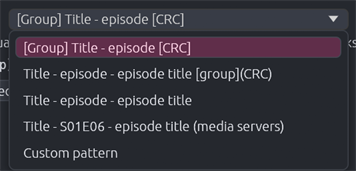

How a pattern's result becomes a target path, what blocks a rename, how a rename is applied, and the built-in naming conventions. For the click-by-click task see [Renaming files](Renaming-Files.md); for the language see [Rename language](Rename-Language.md).

## From result to target path

### Result normalization

The pattern's final value is converted to text, then **every `\r` and `\n` is removed** and every double backslash `\\` becomes a single `\`. Besides the text, a run reports:

- whether the final value was a Boolean (the text is then `True` or `False`, and planning rejects it),
- every variable after the run, as text (not shown by the application),
- the warnings (the soft errors).

### Planning rules

Planning applies these checks in order and stops at the first failure:

1. The pattern must not be blank and must compile. Otherwise one error, no result.
2. If the pattern is a [built-in naming convention](#built-in-naming-conventions), the anime title must be known and the episode number positive (see below).
3. The pattern runs. A hard error becomes `The renaming pattern failed to run: <message>`.
4. A **Boolean final value is an error**: `The pattern ended with the truth value "True" instead of a file name. Make its last expression the new name (for example a variable holding it).` Examples: `1 = 1`, a comment-only pattern, a bare unknown name.
5. An **empty or blank result is an error**: `The pattern produced an empty file name; nothing would be renamed. Its last expression must evaluate to the new name.` Examples: `''`, `set('x', 'y')`, `if(1 = 2, 'x.mkv')`.
6. The text is turned into a path (next sections). A bad component is an error.
7. A path equal to the current path means "already named": no target, no error.

Warnings do not stop the steps above, but any warning makes the plan non-applicable.

**Metadata rule.** Only the built-in conventions insist on fetched metadata: an anime title that is non-blank and not the `[Title not yet available]` stand-in, and an episode number greater than zero. Failing either gives `The built-in naming convention needs the anime title, which has not been fetched yet. Fetch the anime's information from AniDB first.` or `The built-in naming convention needs the episode number, which is not known yet. Fetch the episode's information from AniDB first.` (both are reported together when both are missing). Every other pattern is judged only by its own result. **A custom pattern that uses `A.Name` will happily produce `[Title not yet available]` in a file name.** Guard it if that matters:

```
set('title', A.Name)
// ... build 'filename' from title ...
if(title = '[Title not yet available]', '', filename)
```

The last line yields an empty string for a pending title, and the plan reports the empty-name error instead of renaming.

### Base path and absolute or relative results

Turning the result into a path is a pure string operation: it never looks at the disk. Both `\` and `/` are separators on every platform.

1. A blank result is an error (above).
2. If the managed folder's rename destination (**Move renamed files to another folder** → **Destination**, stored as `base_path`) is not empty, the result is **always appended to it**: its trailing separators are trimmed, then the result is joined. A result that starts with a separator is joined as is; otherwise the platform's separator is inserted.
3. The joined text is split into a root and components:
   - `\\server\share\rest`: a UNC root,
   - `X:` followed by anything (`X` any single ASCII letter, so also `a:`): treated as a drive root on every platform, with `rest` as components. **A result such as `a:b.mkv` is therefore accepted on Windows as drive `a:` plus the file `b.mkv`** (target `a:\b.mkv`), not rejected for its colon. Use a longer prefix (`bad:name.mkv`) to see the colon rule.
   - a single leading `\` or `/`: the root of the **current file's** drive (on POSIX, `/`),
   - anything else: **relative**, resolved against the file's own folder.
4. Every component is trimmed of trailing dots and spaces, then of all characters at or below U+0020 at both ends, then validated.
5. The components are pushed onto the root. If the path equals the current path, the result is "already named".

`base_path` is the rename destination of the managed folder the file belongs to: the folder whose path is the longest match for the file (subfolder inclusion respected). When no rule matches, the file is renamed in place (an empty base path keeps the file in its current folder). This longest-match rule is specific to the rename destination and post-hash MyList policy; scan discovery of hash/rehash candidates uses a different rule (first matching rule in list order). How rules match is in the [Settings reference](Settings-Reference.md) and [Managed folders and scans](Managed-Folders-and-Scans.md).

| Base path | Result | Target |
|---|---|---|
| *(empty)* | `new.mkv` | `<folder of the file>\new.mkv` |
| *(empty)* | `Show\new.mkv` or `Show/new.mkv` | `<folder of the file>\Show\new.mkv` (the subfolder is created on apply) |
| *(empty)* | `D:\Anime\new.mkv` | `D:\Anime\new.mkv` |
| *(empty)* | `\Anime\new.mkv` | `<drive of the file>\Anime\new.mkv` |
| *(empty)* | `\\server\share\dir\new.mkv` | Reaches the path step as `\server\share\dir\new.mkv` (doubled backslashes are reduced first, see [Result normalization](#result-normalization)), which is the root of the file's own drive, **not** a network share. A UNC path written in a pattern needs each backslash doubled again, for example `'\\\\server\\\\share\\\\dir\\\\new.mkv'`. |
| `D:\Anime` or `D:\Anime\` | `Show\new.mkv` | `D:\Anime\Show\new.mkv` |
| `D:\Anime` | `\Show\new.mkv` | `D:\Anime\Show\new.mkv` |
| `Anime` (relative) | `new.mkv` | `<folder of the file>\Anime\new.mkv` |
| `D:\Anime` | `E:\Other\new.mkv` | **error**: the joined text contains the component `E:`, which has a colon |

An absolute result and a non-empty base path therefore do not combine; with a base path every result must be relative. A relative base path is relative to the file's folder, not to the program's working directory. Drive-letter roots are recognized on every platform; on POSIX such a name is not meaningful (reading of the code: it would become a relative path whose first component is `D:`).

To send files to a network share, put the share in the managed folder's rename destination (**Move renamed files to another folder** → **Destination**, for example `\\server\share\Anime`): the destination is not reduced the way a pattern's result is, so it is read as a UNC root on Windows. On POSIX the backslashes are ordinary characters and the path would be read as a relative one (reading of the code; Linux was not exercised).

Sample library, built-in default convention, file `S:\Downloads\hanabi_paper_moon_radio_01_720p.mkv` in the Downloads rule (rename destination `S:\Anime`):

| Step | Value |
|---|---|
| Pattern result | `[Hanabi] Kami no Tsuki Radio - 01 [3E56B578].mkv` |
| Joined with the base path | `S:\Anime\[Hanabi] Kami no Tsuki Radio - 01 [3E56B578].mkv` |
| Components checked | `[Hanabi] Kami no Tsuki Radio - 01 [3E56B578].mkv` (brackets and spaces are fine) |
| Target | `S:\Anime\[Hanabi] Kami no Tsuki Radio - 01 [3E56B578].mkv` |

### Component validation

Checked for each component, on **every platform**, so a library stays portable. The first problem found is reported as `Renaming "<old path>" to "<joined name>" would result in an invalid file name (<reason>); rename skipped!`

| Rule | Detail |
|---|---|
| Not empty | `it contains an empty folder or file name`: doubled forward slashes (`a//b`), a trailing separator, and the components `.` and `..` (they trim to empty) are all rejected. A doubled backslash (`a\\b`) is reduced to one before this check, so it creates no empty name. |
| Forbidden characters | `<`, `>`, `:`, `"`, `?`, `*` and the vertical bar are rejected (`"<char>" is not allowed in a name`). The colon of a leading single-letter drive prefix is exempt because the root is split off first, which is why `a:b.mkv` is accepted as drive `a:` on Windows while `bad:name.mkv` is rejected. |
| Control characters | Characters below U+0020 inside a name are rejected (`it contains a control character`); at the ends they are trimmed first. U+007F is not checked. |
| Length | At most **255 per component**: in **UTF-16 code units** when the build targets Windows (`a name is longer than 255 UTF-16 units`), in **UTF-8 bytes** otherwise (`a name is longer than 255 bytes`). 130 `é` characters pass on a Windows build (134 units with `.mkv`) and fail on a POSIX build (264 bytes). The platform is fixed when the program is compiled. |
| Reserved device names | `CON`, `PRN`, `AUX`, `NUL`, `COM1`–`COM9`, `LPT1`–`LPT9`, compared case-insensitively against the text before the **first dot** with trailing spaces removed (`"<name>" is a reserved device name`), so `NUL.mkv` and `Com3.tar.gz` fail while `COM10.mkv` and `COM0` do not. The superscript digits `¹ ² ³` count as the digit for `COM`/`LPT`. |

Not checked: the total path length (Windows `MAX_PATH`), name collisions that differ only in case, Unicode normalization, or whether a folder exists. Nothing is replaced silently: a character that is not allowed makes the rename fail with a message. Sanitizing is the pattern's job, as the built-in conventions do. A trailing dot or space is the exception: it is removed from each component, so `Show.` becomes `Show`.

Because the built-in conventions limit titles by **characters** (for example `limit(atitle, 150)` and `230` for the whole name in the default, `90`, `200` and `235` in the AniDB O'Matic pattern), a title made of multi-byte characters can still exceed 255 **bytes** on a POSIX build, and the plan then reports a length problem. This is a reading of the code; Linux was not exercised.

### Invalid-filename policy in short

| Situation | Outcome |
|---|---|
| `: ? * " < >`, the vertical bar or a control character inside a name | The plan is blocked with the invalid-name message. |
| A backslash or slash in a title | Creates a folder level. The built-in conventions replace `\` in titles with a space and `/` (and the other characters) in the finished name, so they never produce folders from a title. |
| A trailing dot or space on a component | Removed silently. |
| A component over 255 | Blocked. |
| A reserved device name | Blocked. |

Nothing is ever substituted for you in a custom pattern; do it with `replace`, as the built-in patterns do.

## Plan, blocking rules and apply

Before any file is touched, Animatic builds a **plan** for each file. A plan holds:

| Part | Meaning |
|---|---|
| Result | The evaluated text, even when the plan is blocked later (empty when the pattern never ran) |
| New path | The new path, or none when an error stopped planning before a path was built or when the file already has that name. **A new path can be present while warnings exist** (for example `lc(5) + '.mkv'`); it is then only the path the pattern would produce. Only a plan without errors and warnings counts as approved, never the mere presence of a path. |
| Warnings | Soft evaluation problems |
| Errors | Hard problems: bad pattern, metadata gap, failed run, boolean/empty result, invalid target, missing database rows |

| Plan state | When |
|---|---|
| Ready to apply | a new path exists, **and** there are no errors, **and** there are no warnings |
| Already named | no new path, no errors and no warnings: the pattern is sound and the file already has that name |
| Blocked | anything else |

What each outcome looks like in the application:

| Situation | Preview dialog | **Rename file** |
|---|---|---|
| Target, no errors or warnings | `New path` | Enabled |
| Target but warnings | `Path the pattern would produce (rename blocked)` plus the warnings | Disabled |
| Any other error | The errors in red; no target path is shown | Disabled |
| Target, but a file or folder already exists there | `Path the pattern would produce (rename blocked)` plus the red error `A file or folder already exists at the target path` | Disabled |
| Already named | `The file already has the name the pattern produces; nothing to rename.` | Disabled |

With errors or warnings the dialog offers **Edit pattern in Options**. When **Rename…** is used the log also records `Rename not possible: <first error>` or `Rename blocked: the renaming pattern reported warnings`. Before the dialog opens, the selected row must still exist and be identified by AniDB (`The selected file is not identified by AniDB`, `The selected file is no longer in the list`); otherwise nothing is shown.

The **Rename…** dialog always uses the pattern text currently held in memory by the Options editor. Options edits take effect as you type: they are not held back until **Save options**, and the edited text is written to `settings.json` at the next explicit save or on a normal exit (the exit save is skipped only while the settings-recovery guard is active). See the [Settings reference](Settings-Reference.md) for the exact persistence rules.

On confirmation the application submits a **rename job** to the background worker with the planned path (see [The three stages](Rename-Language.md#the-three-stages)); the window stays usable meanwhile. For each file the job moves the file: on success it logs `Renamed <old> to <new>` (with ` (copied to the other volume and verified)` after a cross-volume move) and refreshes the library list; on failure it logs `Rename failed: <old>: <reason> (target <new>)` and the file and its library path are unchanged. The job ends with `Rename finished: N renamed, M not renamed`.

The single-file preview also checks whether the new path already exists (a file, a folder or a symbolic link): if it does, the dialog shows the error `A file or folder already exists at the target path`, **Rename file** is disabled and **Rename…** logs `Rename not possible: A file or folder already exists at the target path`. The batch preview and automatic rename make the same check. The apply-time failure `destination already exists: <path>` remains for a target that appears between the preview and the click.

### How a file is moved

Applying first checks that the library still records `<old>` for that file and that `<target>` does not exist (a dangling link counts as existing), and creates missing parent folders. Then:

| Case | Behavior |
|---|---|
| Same volume | One operating-system rename, then the stored path is updated. If the update fails the rename is reverted, so the library never names a missing file. |
| The operating system refuses a plain rename because the drives differ | The file is copied to `.animatic-move-*.tmp` in the target folder (keeping its modification time and permissions); the copy's size is compared; the copy is **re-hashed in one pass with the same ED2K variant the library uses and compared with the stored ED2K and size**; the temporary file is renamed into place without replacing anything; the library path is updated; only then is the source deleted. |

The verification read is deliberate: it doubles the I/O of a cross-volume move but is the only proof that the copy is the file the library knows. A file without a stored hash, or whose size differs from the stored size, is refused before anything is copied. Cancel acts while copying and verifying. Every failure before the swap removes the temporary file and leaves source and library untouched; a failed library update removes the new copy again. If the source cannot be deleted after a successful swap, the move still counts, the library points at the copy, and the Log says the old file remains.

Messages of a refused or failed move, as shown after `Not renamed:` in a batch and in the `Rename failed:` log line:

| Message | Meaning |
|---|---|
| `the file is no longer in the library` | The local file record was removed meanwhile. |
| `the library now records this file at <path>, not <path>` | The file's recorded path changed since the plan. |
| `destination already exists: <path>` | The target exists, or appeared after the preview was made or while moving. |
| `the library has no stored hash for this file, so a copy to another volume cannot be verified` | A cross-volume move needs the stored hash. |
| `the file changed since it was hashed; hash it again before moving it` | The file's size differs from the hashed size. |
| `the copy has a different size than the original (the file may have changed while it was copied); nothing was moved` | The file changed during the copy. |
| `the copy does not match the hash stored for this file; nothing was moved` | The verification read disagreed. |
| `the copy is in place and recorded, but <path> could not be removed: <reason>` | The move succeeded; the old file remains as an extra copy. |
| `Skipped: cancelled`, `Cancelled; the file and its library entry are unchanged` | **Cancel** was pressed before the file, or during its copy. |
| `Unable to open the library: <reason>` | The worker could not open the library. |

### Batch rename

The batch preview plans every selected file in the background, in table order, and adds two checks that need the whole list: a target that already exists on disk is an error (`A file or folder already exists at the target path`), and a target an earlier row already claims is an error (`<current path of the earlier file> would get the same name; only the first of the two can be renamed`; compared case-insensitively on Windows). A file that AniDB has not identified is blocked with `The file is not identified by AniDB`. One confirmation submits only the rows that are ready; blocked and already-named rows are listed but never sent. A row's outcome is `Renamed`, `Renamed (copied and verified)` or `Not renamed: <reason>`; a collision with a file created after the preview is reported as `destination already exists`. Chains inside one batch (file A to the current name of file B) are blocked, not ordered.

## Built-in naming conventions

The **Naming convention** list in **Tools → Options… → Renaming** offers four built-in patterns. Choosing one puts its text into the pattern setting (`renaming_pattern`); the setting stores only text, so a text equal to a convention (compared line by line after trimming, CRLF or LF) shows as that convention and anything else as **Custom pattern**.



*The list in **Tools → Options… → Renaming**. Hovering an entry shows its description.*

| Convention | Example (episode 6, version 2, group `ExGroup`) |
|---|---|
| **[Group] Title - episode [CRC]**, the default for new settings | `[ExGroup] Reibun no Tabi - 06v2 [EB420C97].mkv` |
| **Title - episode - episode title \[group\](CRC)**, AniDB O'Matic's default | `Reibun no Tabi - 06v2 - The Long Road [ExGroup](EB420C97).mkv` |
| **Title - episode - episode title** | `Reibun no Tabi - 06 - The Long Road.mkv` |
| **Title - S01E06 - episode title (media servers)** | `Reibun no Tabi - S01E06 - The Long Road.mkv` |

Shared rules: the series title is `x-jat`, else English, else `A.Name`; the episode title (where used) is English, else `x-jat`, else Japanese, else `E.Name`; the episode number is padded to [two digits](#fixed-two-digit-counter); the CRC is `H.Crc32`, else `F.Crc`, upper-cased; and the same clean-up as the default replaces characters that are not allowed in file names.

The same file under every convention, from the sample library (the Hanabi release of *Paper Moon Radio*, whose AniDB main title is `Kami no Tsuki Radio`, episode 1, version 1, local CRC `3E56B578`):

| Convention | Name |
|---|---|
| **[Group] Title - episode [CRC]** | `[Hanabi] Kami no Tsuki Radio - 01 [3E56B578].mkv` |
| **Title - episode - episode title \[group\](CRC)** | `Kami no Tsuki Radio - 01 - Static in the Hallway [Hanabi](3E56B578).mkv` |
| **Title - episode - episode title** | `Kami no Tsuki Radio - 01 - Static in the Hallway.mkv` |
| **Title - S01E06 - episode title (media servers)** | `Kami no Tsuki Radio - S01E01 - Static in the Hallway.mkv` |

Episode types and versions:

| AniDB episode | [Group] and AniDB O'Matic conventions | Title - episode - episode title | Media servers |
|---|---|---|---|
| Regular 10, version 2 | `10v2` | `10` | `S01E10` |
| Special 15 | `S15` | `S15` | `S00E15` |
| Credit (opening or ending) 5 | `C05` | `C05` | `C05` |
| Trailer 8, version 2 | `T08v2` | `T08` | `T08` |
| Parody 1 / other 2 | `P01` / `O02` | `P01` / `O02` | `P01` / `O02` |

The **[Group]** convention leaves out the group, including its brackets, when the file has no group, and the CRC when there is none. AniDB has a single credit type for openings and endings; the Pattern reference has a recipe that names them `OP01` and `ED01` from the episode title. The rename unit tests check every row above.

### Limits inside the conventions

| Convention | Title limit | Whole-name limit | Episode title limit |
|---|---|---|---|
| **[Group] Title - episode [CRC]** | 150 characters | 230 characters for the group, title and number (the CRC and extension are added after) | not used |
| **Title - episode - episode title \[group\](CRC)** | 90 | 200 up to the episode title, 235 up to the group | within the 200 |
| **Title - episode - episode title** | 120 | 230 for title, number and episode title | 100 |
| **Title - S01E06 - episode title (media servers)** | 120 | 230 | 100 |

All four then apply the same clean-up lines (see below). They differ in the group: **[Group] Title - episode [CRC]** writes `[Shortname] ` (full name when there is no short name) in front, nothing when there is no group, and ` [CRC]` after the number. The AniDB O'Matic convention writes `[no group]` for a file without a group record.

## The default convention: [Group] Title - episode [CRC]

New settings use this convention: `[group] title - number [CRC].extension`, with no episode title, and no group text at all when the file has no group. The listing is a copy for reading; the text built into the application is the source of truth.

```
// [Group] Anime title - 06v2 [CRC32].mkv
set('atitle', at('x-jat'))
if(length(atitle)=0, set('atitle', at('en')))
if(length(atitle)=0, set('atitle', A.Name))
set('atitle', replace(atitle, '\', ' '))
set('version', if(F.Version>1, 'v'+F.Version, ''))
set('epno', padl(E.EpisodeNo, 2, '0') + version)
if(E.TypeId=2, set('epno', 'S'+epno))
if(E.TypeId=3, set('epno', 'C'+epno))
if(E.TypeId=4, set('epno', 'T'+epno))
if(E.TypeId=5, set('epno', 'P'+epno))
if(E.TypeId=6, set('epno', 'O'+epno))
set('groupname', if(G, if(length(G.Shortname)>0, G.Shortname, G.Name), ''))
set('groupname', replace(groupname, '\', ' '))
if(length(groupname)>0, set('groupname', '['+groupname+'] '))
set('crc', if(H, H.Crc32, F.Crc))
if(length(crc)>0, set('crc', ' ['+uc(crc)+']'))
set('filename', limit(groupname + limit(atitle, 150) + ' - ' + epno, 230) + crc + '.' + F.FileType)
set('filename', replace(filename, '*', ' '))
set('filename', replace(filename, '/', ' '))
set('filename', replace(filename, '?', ' '))
set('filename', replace(filename, ':', ' '))
set('filename', replace(filename, '"', ' '))
set('filename', replace(filename, '<', ' '))
set('filename', replace(filename, '>', ' '))
set('filename', replace(filename, '|', ' '))
set('filename', replace(filename, '`', "'"))
set('filename', replace(filename, '  ', ' '))
filename
```

Reading it line by line:

| Lines | What they do |
|---|---|
| `atitle` | The series title: `x-jat`, else English, else `A.Name`; a backslash becomes a space so a title never creates a folder |
| `version`, `epno` | `v2` to `v5` for a corrected release; the episode number with at least two digits, then the type letter in front for `S`, `C`, `T`, `P`, `O` |
| `groupname` | `Shortname`, else full name, else nothing; written as `[Hanabi] ` with a trailing space |
| `crc` | `H.Crc32` when a local hash exists, else `F.Crc`, upper-cased in brackets after a space; none when both are empty |
| `filename` | `<group><title limited to 150> - <number>`, limited to 230 characters, then the CRC and `.` and the extension |
| Clean-up | `* / ? : " < >` and the vertical bar become spaces, `` ` `` becomes `'`, and each pair of adjacent spaces becomes one space |

Two details of the clean-up are easy to miss. The double-space replacement is a single pass, so three consecutive spaces become two, not one. Titles containing `\` are turned into spaces because the result would otherwise create folders (the title is cleaned before the whole name is built; a `/` in a title is cleaned with the rest of the name).

## The AniDB O'Matic pattern

This section lists AniDB O'Matic's own default, the `Title - episode - episode title [group](CRC)` convention. It shares every part described above except the layout: `title - number - episode title [group](CRC).extension`.

The listing is a copy for reading; the text built into the application is the source of truth.

```
set('atitle', at('x-jat'))
if(length(atitle)=0, set('atitle', at('en')))
if(length(atitle)=0, set('atitle', A.Name))
set('atitle', replace(atitle, '\', ' '))
set('etitle', et('en'))
if(length(etitle)=0, set('etitle', et('x-jat')))
if(length(etitle)=0, set('etitle', et('ja')))
if(length(etitle)=0, set('etitle', E.Name))
set('etitle', replace(etitle, '\', ' '))
set('version', if(F.Version>1, 'v'+F.Version, ''))
set('epno', padl(E.EpisodeNo, 2, '0') + version)
if(E.TypeId=2, set('epno', 'S'+epno))
if(E.TypeId=3, set('epno', 'C'+epno))
if(E.TypeId=4, set('epno', 'T'+epno))
if(E.TypeId=5, set('epno', 'P'+epno))
if(E.TypeId=6, set('epno', 'O'+epno))
set('groupname', if(G, if(length(G.Shortname)>0, G.Shortname, G.Name), 'no group'))
set('groupname', if(length(groupname)>0, '['+groupname+']'))
set('groupname', replace(groupname, '\', ' '))
set('crc', if(H, H.Crc32, F.Crc))
if(length(crc)>0, set('crc', '('+uc(crc)+')'))
set('filename', limit(limit(limit(atitle, 90) + ' - ' + epno + ' - ' + etitle, 200) + ' ' + groupname, 235) + crc + '.' + F.FileType)
set('filename', replace(filename, '*', ' '))
set('filename', replace(filename, '/', ' '))
set('filename', replace(filename, '?', ' '))
set('filename', replace(filename, ':', ' '))
set('filename', replace(filename, '"', ' '))
set('filename', replace(filename, '<', ' '))
set('filename', replace(filename, '>', ' '))
set('filename', replace(filename, '|', ' '))
set('filename', replace(filename, '`', "'"))
set('filename', replace(filename, '  ', ' '))
filename
```

What it does:

| Part | Behavior |
|---|---|
| Series title | `x-jat` title, else English, else `A.Name`; a backslash becomes a space |
| Episode title | English, else `x-jat`, else Japanese, else `E.Name`; backslash becomes a space |
| Episode number | `E.EpisodeNo` left-padded with `0` to **at least 2 digits**, followed by `vN` when the file version is above 1; special types add a prefix `S`, `C`, `T`, `P` or `O` in front (for example `S01v2`) |
| Group | `[Shortname]`, else `[Name]`; with no group the name is `no group`, giving `[no group]`; a group whose short and full names are both empty contributes no group text |
| CRC | `H.Crc32` when a local hash exists, else `F.Crc`, upper-cased in parentheses; none when both are empty |
| Name | `<title> - <number> - <episode title> <group><crc>.<extension>`, limited to 90 characters for the title, 200 up to the episode title, and 235 up to the group |
| Clean-up | `* / ? : " < >` and the vertical bar become spaces, `` ` `` becomes `'`, and each pair of adjacent spaces becomes one space |

For the fictitious sample file (`Reibun no Tabi`, episode 6, version 2, group `ExGroup`, CRC `EB420C97`) this pattern produces:

```
Reibun no Tabi - 06v2 - The Long Road [ExGroup](EB420C97).mkv
```

When the file has no episode title at all, this convention is left with a dangling ` - ` before the group (`… - 06 -  [ExGroup](EB420C97).mkv`), and the clean-up's double-space replacement turns the two spaces into one: `… - 06 - [ExGroup](EB420C97).mkv` (derived from the pattern text, not run). The other three conventions leave the separator out.

### The other two conventions

The **Title - episode - episode title** and media server conventions are the same pattern without the version, group and CRC parts. Their episode-number lines are:

| Convention | Number lines | Name line |
|---|---|---|
| Title - episode - episode title | `epno` = two digits, then `S`, `C`, `T`, `P` or `O` in front for non-regular types | `limit(limit(atitle, 120) + ' - ' + epno + limit(etitle, 100), 230) + '.' + F.FileType`, where `etitle` becomes ` - <episode title>` or stays empty when no title exists |
| Title - S01E06 - episode title | `S01E` + two digits for regular episodes, `S00E` + two digits for specials, `C`, `T`, `P` and `O` + two digits for the rest | the same line |

Both apply the same clean-up lines as the default, and both leave out the ` - ` before an episode title that does not exist.

### Fixed two-digit counter

The built-in patterns pad episode numbers to a **fixed minimum of two digits** (`padl(E.EpisodeNo, 2, '0')`), independent of any cached episode totals or per-type counts. Numbers of 100 or more keep all their digits (`100`, `1234`) and type prefixes are preserved (`S01`, `C12`, `O120`). The same episode therefore keeps the same name when AniDB totals change. The rename unit tests check this for several totals and counts.

### New patterns versus saved patterns

| Situation | Pattern text |
|---|---|
| New settings (no settings file) | The [Group] Title - episode [CRC] convention |
| A saved `settings.json` that contains `renaming_pattern` | Kept exactly as saved. The application never rewrites a saved pattern. |
| A saved file without `renaming_pattern` | The default fills the missing field |
| Imported AOM settings with a non-blank `general/renamingPattern` | That text, with `\r\n` converted to `\n`, replaces the pattern |
| Imported AOM settings with a blank pattern | The existing/default pattern stays |
| Choosing a built-in convention in Options | Replaces the text with the convention; a replaced custom text is kept in memory |
| **Restore my custom pattern** (appears after a custom text was replaced) | Puts the custom text back; used once |
| Choosing **Custom pattern** | Keeps the text and opens the editor, so a convention is the starting point |

Choosing a convention changes the in-memory settings immediately, like every other Options field; it is written by **Save options**, by a normal exit, or later. Animatic recognizes the text as follows:

| Kind | When |
|---|---|
| Empty | blank |
| Preset | the lines equal a built-in convention's lines (compared after trimming the whole text; CRLF versus LF makes no difference) |
| Custom | anything else, including a one-character edit of a convention |

A **Custom** pattern, including an old default whose counter width depended on cached totals, is never altered by the application.

## See also

- [Renaming files](Renaming-Files.md): the preview windows and the options.
- [Rename patterns](Rename-Patterns.md): custom patterns, pitfalls and diagnostics.
- [Managed folders and scans](Managed-Folders-and-Scans.md): the rename destination and **Remove folders a rename leaves empty**.
- [Settings reference](Settings-Reference.md): `renaming_pattern`, `base_path`, `auto_rename`.

For developers: the built-in convention texts are the `.txt` files in [crates/animatic-core/src/rename](https://github.com/RetroHazard/animatic/tree/main/crates/animatic-core/src/rename), and the Rust API is described in [rename-api.md](https://github.com/RetroHazard/animatic/blob/main/docs/rename-api.md).
