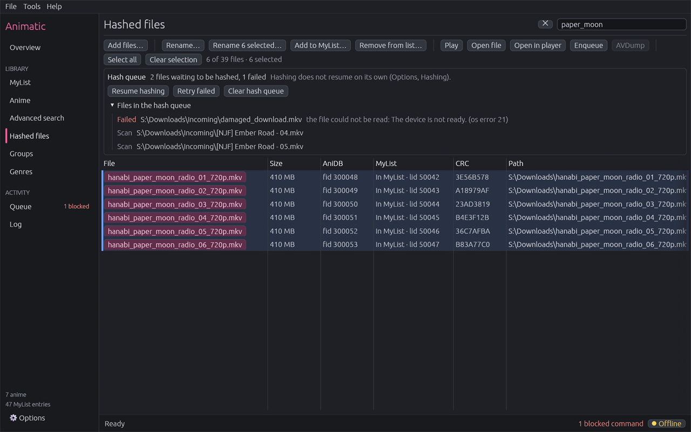
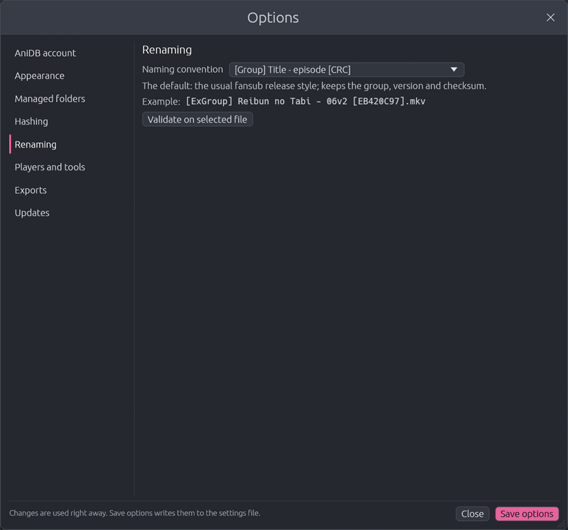
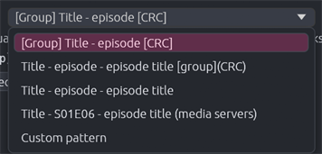
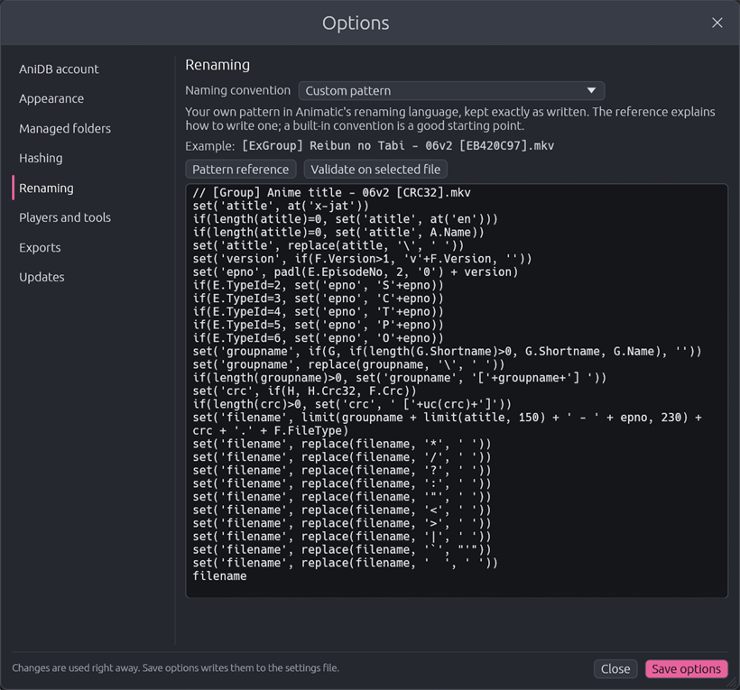
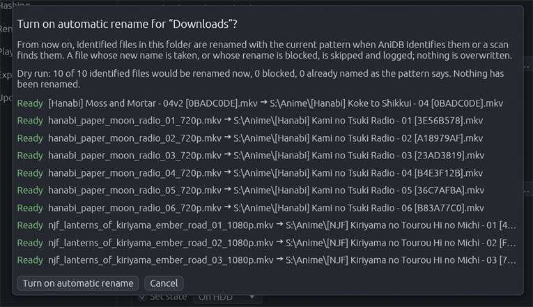

Animatic renames the files it has hashed and AniDB has identified, using a **naming convention** (a built-in one or your own pattern). Renaming is **manual and always confirmed**: one file, or several files at once with a single confirmation. The only exception is the opt-in [automatic rename of a managed folder](#automatic-rename-opt-in-per-managed-folder), which stays off unless you switch it on for that folder.

This page is the task guide. The language behind custom patterns is documented in [Rename language](Rename-Language.md), [Functions and objects](Rename-Functions-and-Objects.md), [Targets and apply](Rename-Targets-and-Apply.md) and [Patterns](Rename-Patterns.md).

## Before you start

A file can be renamed when all of these are true:

- It is on **Hashed files** (see [Hashing and identification](Hashing-and-Identification.md)).
- AniDB has **identified** it: its `AniDB` column shows a file id such as `fid 300048`.
- Animatic has the **anime and episode records** locally. The AniDB reply that identifies a file already carries the anime titles, the episode number and title, and the group name, so a freshly identified file can normally be renamed at once. The fuller records (other titles, episode counts, and so on) arrive with **Refresh from AniDB** or a queue run. If a stored record still lacks the title or the episode number, a built-in convention reports it (see [What blocks a rename](#what-blocks-a-rename)).
- Its [managed folder](Managed-Folders-and-Scans.md) has the rename destination you want (**Move renamed files to another folder** → **Destination**; unticked or empty keeps files in their current folder). See [Where the file goes](#where-the-file-goes).

Planning a rename uses only the local library: no network and no AniDB request. A batch plan (and the automatic rename check) only looks whether the new path is already taken on disk; it never changes a file. You can plan and rename while you **work offline**.

## Rename one file

The sample library has six files in `S:\Downloads` that still carry download names, such as `hanabi_paper_moon_radio_01_720p.mkv`. Renaming one of them:

1. Open **Hashed files** and click the file. It must be identified; otherwise **Rename…** reports `The selected file is not identified by AniDB`.
2. Optionally check the naming convention in **Tools → Options… → Renaming** ([Choosing how files are named](#choosing-how-files-are-named)).
3. Click **Rename…**. Animatic plans the rename from the local database and opens **Confirm rename**:

   ![The Confirm rename window showing the current path S:\Downloads\hanabi_paper_moon_radio_01_720p.mkv and the new path S:\Anime\[Hanabi] Kami no Tsuki Radio - 01 [3E56B578].mkv](images/rename-confirm.png)

   *Confirm rename for one file: the current path, the new path and the **Rename file** button.*

   The window shows **Current path**, the **New path** and, in red or yellow, every problem found.
4. Check the new path, then click **Rename file**. The window closes and the rename runs on the background worker (the status bar shows progress and **Cancel**). The result appears in the **Log**: `Renamed <old> to <new>`.

**Rename file** is enabled only when there is a new path **and** there are no errors **and** no warnings. The window also checks whether a file or folder already exists at the new path: if one does, it shows the error `A file or folder already exists at the target path` and **Rename file** is disabled, so nothing is ever replaced. (If the target appears after you opened the window, the rename still fails when you click it with `destination already exists` and moves nothing.) A batch rename and automatic rename check the same. What the window can show:

| Situation | Window text | **Rename file** |
|---|---|---|
| A valid new path | **New path** | Enabled |
| A path was produced but the pattern gave warnings | **Path the pattern would produce (rename blocked)** and the warnings in yellow | Disabled |
| An error (empty pattern, syntax error, missing metadata, unusable name, …) | The error in red, no new path | Disabled |
| A path was produced but a file or folder already exists there | **Path the pattern would produce (rename blocked)** and the red error `A file or folder already exists at the target path` | Disabled |
| The file already has the name the pattern produces | `The file already has the name the pattern produces; nothing to rename.` | Disabled |

When the window shows errors or warnings it also offers **Edit pattern in Options**: it closes the window and opens **Tools → Options… → Renaming**. `Esc` or the window's close button leaves everything unchanged.

Opening the window also writes a line to the **Log** when something is wrong: `Rename not possible: <first error>`, `Rename blocked: the renaming pattern reported warnings`, or `The file already has the name the pattern produces`.

The window always uses the pattern currently in the Options editor, saved or not (Options changes take effect as you type; **Save options** writes them to the settings file).

## Several files (batch rename)

Batch rename plans every selected file, shows the result in one list and renames the valid ones after a single confirmation.

1. On **Hashed files** select the files: click one, `Ctrl`+click to add or remove files, `Shift`+click to select a range. **Select all** selects every listed file, so it follows the search box; **Clear selection** clears the selection. It is the same selection **Add to MyList…** and **Remove from list…** use, and a file that a new search hides drops out of it.

   

   *Six files selected after searching for `paper_moon`.*

2. Click **Rename N selected…** (here **Rename 6 selected…**). **Batch rename** opens at once and shows `Planning the renames of N files…` while the plans are made in the background; the interface stays responsive however many files you selected.
3. Read the list. It has one line per file, in table order, and a headline `X of N files can be renamed, Y blocked, Z already named as the pattern says.`

   ![The Batch rename window listing six Ready lines, each from a download name to S:\Anime\[Hanabi] Kami no Tsuki Radio - 0N [CRC].mkv, with the Rename 6 files button](images/rename-batch.png)

   *Batch rename with six files ready.*

   | Status | Meaning |
   |---|---|
   | `Ready` (green) | The pattern gives a valid new path. The line reads `<file name> → <new path>`. |
   | `Blocked` (red) | The first problem is shown after the file name. Hover the line for the current path, the planned path, and every error and warning. |
   | `Already named` (gray) | The file already has the name the pattern produces. |

   A line is blocked for every reason a single rename is blocked, and also when:
   - its target path **already exists** on disk (`A file or folder already exists at the target path`),
   - an earlier line of the batch would get the same name (`<current path of the earlier file> would get the same name; only the first of the two can be renamed`; the first line keeps the name, and on Windows the comparison ignores letter case),
   - the file is not identified by AniDB (`The file is not identified by AniDB`).

   A file that would take the name another selected file has now is blocked, not ordered: Animatic never plans chains such as "A takes B's name, B takes C's".
4. Click **Rename N files** (or **Rename 1 file**). It is the one explicit confirmation: only the `Ready` lines are sent; blocked and already-named lines are skipped and nothing about them changes. The button is disabled when no line is ready. **Edit pattern in Options** (offered while some line is blocked) closes the window and opens **Tools → Options… → Renaming**. **Close** or `Esc` closes the list without renaming.
5. The same window now shows the outcome per line while the worker runs (`Waiting`, then `Renamed`, `Renamed (copied and verified)` or `Not renamed: <reason>`), and finally `Renamed N files, M not renamed.` Every file also gets its line in the **Log**, followed by `Rename finished: N renamed, M not renamed`.

**Cancel** in the status bar stops before the next file and, for a file on another drive, during the copy. Files not reached are reported as `Not renamed: Skipped: cancelled`; a file whose copy was interrupted reports `Cancelled; the file and its library entry are unchanged`.

## Choosing how files are named

**Tools → Options… → Renaming** has a **Naming convention** list. Pick one of the built-in conventions, or **Custom pattern** to write your own.

*The Renaming page of **Tools → Options…** with the default convention.*

Every choice shows a description and an **Example** of the name it gives to a fictitious file (episode 6, release version 2, group `ExGroup`). Hover a convention in the list to see the same description.

*The convention list.*

| Convention | Example for the fictitious file |
|---|---|
| **[Group] Title - episode [CRC]** (the default for new settings) | `[ExGroup] Reibun no Tabi - 06v2 [EB420C97].mkv` |
| **Title - episode - episode title \[group\](CRC)** (AniDB O'Matic's default) | `Reibun no Tabi - 06v2 - The Long Road [ExGroup](EB420C97).mkv` |
| **Title - episode - episode title** | `Reibun no Tabi - 06 - The Long Road.mkv` |
| **Title - S01E06 - episode title (media servers)** | `Reibun no Tabi - S01E06 - The Long Road.mkv` |

On the sample library, a Hanabi release of *Sakura Signal* (AniDB's main title `Sakura Shingou`) therefore becomes `[Hanabi] Sakura Shingou - 03 [CRC].mkv` with the default convention: the built-ins prefer the romanized main title (`x-jat`), then English, then the stored main name.

All four write every AniDB episode type. AniDB numbers regular episodes and each other type separately, and the conventions write the type letter in front of the number:

- Specials `S`, credits such as openings and endings `C`, trailers `T`, parodies `P` and other episodes `O`.
- A corrected release adds its version (`v2` to `v5`) in the two conventions that show it.
- Numbers have at least two digits; 100 and above keep all of theirs.
- The media server convention uses season 1 for regular episodes and season 0 for specials (`S00E01`). Credits, trailers, parodies and other episodes keep their letter (`C05`), so a media server treats them as extras.

The complete behavior, with a table per episode type, is in [Built-in naming conventions](Rename-Targets-and-Apply.md#built-in-naming-conventions).

### Write a custom pattern

Choose **Custom pattern**. The editor starts from the convention that was selected, so a convention is a good starting point; editing it makes it custom.

*Custom pattern: the editor shows the text of the convention you started from.*

- The **Example:** line follows your edits as you type. It uses the fictitious file, which only has the common values (for example `A.Name`, `E.EpisodeNo`, `F.Version`, `G.Shortname`); a property it does not carry reads as `False` there even though a real file has it. A red syntax error appears while the text does not compile; below the editor you also see the errors and warnings of the example.
- **Pattern reference** opens the in-app reference window (see [Rename language](Rename-Language.md#the-in-app-pattern-reference)). It is offered only for a custom pattern.
- **Restore my custom pattern** appears after you replaced a custom text by choosing a built-in convention. It puts the custom text back (once). A pattern that equals a convention (compared line by line, ignoring line endings and surrounding blanks) is shown as that convention; anything else, even one changed character, is **Custom pattern**.
- A saved pattern is **never changed by the application**, including an older default.

### Validate on selected file

**Validate on selected file** is a dry run on the file selected on **Hashed files**. Select a file there first; otherwise Animatic says `Select a file identified by AniDB on the Hashed files page, then validate again.` For a file AniDB has not identified it says `The selected file is not identified by AniDB`.

It runs the same planning as **Rename…**, without touching any file, with the text currently in the editor (saved or not). It shows `Result for the selected file:` with the evaluated name, red errors (including `A file or folder already exists at the target path`), yellow warnings and, when the plan could be applied or the file already has that name, `The pattern is valid for this file.` Editing the text clears the previous validation result.

Nothing is stored until **Save options**, but Options changes are active right away, so **Rename…** and automatic rename use what is in the editor now. The step-by-step check is in [Verify a pattern](Rename-Patterns.md#verify-a-pattern).

## What blocks a rename

A plan is blocked when:

- the pattern is empty or has a syntax error;
- the evaluation fails (a hard error such as division by zero, or reading a property of an object that does not exist for this file);
- it ends with a true/false value instead of text;
- it yields an empty name, or a name with an unusable part: the characters `< > : " | ? *`, control characters, empty folder names (`a//b`, a trailing separator, `.` or `..`), reserved device names such as `CON`/`NUL`/`COM1`, or a part over 255 characters (UTF-16 units on a Windows build, bytes elsewhere);
- any evaluation warning occurred (wrong number of arguments, a number passed where text is expected, …);
- a library row is missing: `No file entry for file <fid>!`, `Can't autorename file, Episode <eid> is missing for File <fid>!` or `Can't autorename file, Anime <aid> is missing for File <fid>!`. Identify the file (and fetch the anime and episode) if the library has no such row.

The **built-in conventions** additionally require the anime title and a positive episode number to be known locally:

- `The built-in naming convention needs the anime title, which has not been fetched yet. Fetch the anime's information from AniDB first.`
- `The built-in naming convention needs the episode number, which is not known yet. Fetch the episode's information from AniDB first.`

Use **Refresh from AniDB** (see [Library pages](Library-Pages.md)) and let the queue run, then plan again. A custom pattern is judged only by its own result: a custom pattern that uses `A.Name` can produce the stand-in `[Title not yet available]`; see [Planning rules](Rename-Targets-and-Apply.md#planning-rules) for a guard.

If the file already has the produced name, Animatic says nothing needs renaming. Every message, its cause and its fix are listed in [Diagnostics reference](Rename-Patterns.md#diagnostics-reference).

## Where the file goes

The destination is the matching managed folder's rename destination (**Move renamed files to another folder** → **Destination**) joined with the pattern's result:

| Destination | Pattern result | File ends up |
|---|---|---|
| `S:\Anime` | `[Hanabi] Kami no Tsuki Radio - 01 [3E56B578].mkv` | `S:\Anime\[Hanabi] Kami no Tsuki Radio - 01 [3E56B578].mkv` (the sample's Downloads rule) |
| empty | a plain name | the file's current folder, new name |
| `S:\Anime` | `Sakura Signal\Sakura Signal - 03.mkv` | `S:\Anime\Sakura Signal\Sakura Signal - 03.mkv` (the folder is created) |

Path separators in the result create or use subfolders; missing parent folders are created when the rename is applied. With a destination set, every result must be relative to it. The folder rule with the longest matching path decides which destination applies. All the path rules (absolute results, drive letters, network paths) are in [Base path and absolute or relative results](Rename-Targets-and-Apply.md#base-path-and-absolute-or-relative-results).

### Collisions

Animatic never replaces a file and never invents another name (no `(1)` suffix):

- A manual single rename whose target exists is blocked in the preview: `A file or folder already exists at the target path`, and **Rename file** is disabled. Only a target that appears between the preview and the click fails when applied: `Rename failed: <file>: destination already exists: <path> (target <path>)`.
- A batch rename and automatic rename check this as well and show the file as blocked or skipped.
- Two files that would receive the same name in one batch or automatic pass: the first keeps it, the others are blocked.
- A file another program creates at the target after the check is not replaced either; the move fails and is reported.

To resolve a collision, change the pattern (for example, include the group or the resolution) or move or delete the other file yourself.

## What applying does

Applying runs on the background worker, so the window stays usable and the status bar shows progress with **Cancel**. For every file Animatic checks that the library still records the old path (`the library now records this file at <path>, not <path>` otherwise) and that the destination does not exist, then:

- **Same drive or filesystem:** the file is renamed in place and the stored path updated. If the update fails the rename is undone.
- **Another drive or filesystem** (the operating system refuses a plain rename): the file is **copied** to a hidden temporary file (`.animatic-move-*.tmp`) beside the destination, the copy is **verified** — its size, then its ED2K hash, which reads the whole copy once more and is compared with the hash stored when the file was hashed — and only then moved into place, recorded in the library and finally removed from the old location. This takes about twice the time a copy alone would, which is deliberate: the extra read is the proof that the copy is the file your library knows. The file's modification time is kept so a scan does not rehash it. The file must have a stored hash and must not have changed since it was hashed; otherwise the move is refused (`the library has no stored hash for this file, so a copy to another volume cannot be verified`, or `the file changed since it was hashed; hash it again before moving it`).

Any failure or **Cancel** while copying or verifying removes the temporary file and leaves the original and its library entry untouched: the library never points at a missing file and the only copy is never deleted. If the verified copy is in place and recorded but the old file cannot be removed (for example a player holds it open), the rename counts as done and the log tells you that the old file remains as an extra copy you can delete yourself.

An existing destination is never replaced: the check happens before the move, and the move itself (an operating-system rename that refuses to replace, or for another drive a verified copy that is swapped in without replacing anything) fails if another program created a file there in between. A failure reports `Rename failed: <file>: <reason> (target <path>)` in the Log and may leave newly created empty folders. There is no undo and no AniDB notification: Animatic does not tell AniDB about file names.

### Clear empty folders

If the matching managed folder has **Remove folders a rename leaves empty** on, the folders a successful rename left empty are removed afterwards, and the Log says `Removed 2 empty folders` (`Removed 1 empty folder` for one). Only completely empty folders strictly below the managed folder's path are removed, never recursively, never the managed folder itself, and a folder holding even a hidden file stays. Failures are logged to the log file only. Details: [Removing folders a rename emptied](Managed-Folders-and-Scans.md#removing-folders-a-rename-emptied).

## Automatic rename (opt-in per managed folder)

Each managed folder rule has an **Auto rename** setting with three modes (**Tools → Options… → Managed folders**, see [Options window](Options-Window.md) and [Managed folders and scans](Managed-Folders-and-Scans.md)):

| Mode | What happens |
|---|---|
| **Off** (default) | Nothing is renamed automatically. |
| **Dry run (log only)** | The renames that *would* happen are written to the **Log** (`Automatic rename (dry run): <old> would be renamed to <new>`); no file is moved. |
| **On** | Identified files in that folder are renamed with the current pattern, through the same worker job, verified cross-drive move and **Cancel** as a manual rename. |

**Turning a folder On is confirmed.** Choosing **On** opens a window, `Turn on automatic rename for “<folder>”?`, that lists, as a read-only dry run, what would be renamed *now* in that folder (the same lines as **Batch rename**: `Ready`, `Blocked`, `Already named`) and says that nothing has been renamed.

*The preview for the sample library's Downloads folder: ten identified files would be renamed.*

Only **Turn on automatic rename** switches the folder to On (the Log notes `Automatic rename is on for “<folder>”; save the options to keep it`); **Cancel** (or `Esc`) leaves the mode unchanged. The choice is kept when you **Save options**. The window appears every time a folder changes to On, not only the first time, so a preview is always seen before any automatic move. A stored or AOM-imported `auto_rename` flag that was simply *true* loads as **Dry run**, never On; see [Settings reference](Settings-Reference.md#per-folder-keys).

**When it runs.** A pass is made when something may have made a file renameable, and once at start-up:

- a file was hashed (a [scan](Managed-Folders-and-Scans.md) found it, including a file the library already knows as identified);
- an AniDB reply changed the library (the identify reply of a queued file was applied);
- an AOM import finished;
- the folder modes, paths or pattern changed.

A pass runs only while no other task is running, and not while an import, a restore, a settings review or the settings recovery notice is open, or while the Options window is open. **Work offline** does not matter: planning and moving are local.

**What it renames.** Only a file that

- lies inside a managed folder with a non-empty path (the built-in **Default** rule, which matches everything else, never renames; the folder with the longest matching path decides, so a subfolder rule set to Off excludes its files),
- AniDB has identified **and** whose anime and episode records are cached (until then it is left alone without a note; the reply that completes it triggers a new pass),
- still exists on disk, and
- has a plan that is valid for **Apply** with the current pattern: a pattern that does not compile pauses the whole pass with one `Automatic rename is paused: the renaming pattern cannot be used (<problem>)` log line; warnings, a missing title or episode number (built-in conventions), an empty or true/false result or an unusable name block the file.

**Collisions and blocked plans are skipped and logged, never overwritten.** A file whose target already exists, or that would get the same name as another file of the same pass, is skipped with `Automatic rename skipped <path>: <reason>`. Each outcome is logged **once per file and state**: a scan or queue run that changes nothing neither repeats a note nor retries a failed move. A file is planned again when its path, its metadata, its folder mode or the pattern changes (or after Animatic restarts); a rename stopped by **Cancel** is tried again by the next pass. At most 20 notes are logged per pass, followed by `Automatic rename: N more note(s) not shown`. As with a manual rename, a file that appears at the target after the check is not replaced either; the move fails and is reported.

Moves are reported like manual ones (`Renamed <old> to <new>`, `Rename failed: …`) followed by `Automatic rename finished: N renamed, M not renamed`. There is no undo and no AniDB notification. Work that ran into trouble is easier to follow with the [Log](Library-Pages.md).

## If something goes wrong

| Symptom | Likely cause and fix |
|---|---|
| **Rename…** is greyed out | No file is selected on **Hashed files**. Click a row. |
| `The selected file is not identified by AniDB` | The file has no `fid`. Identify it first ([Hashing and identification](Hashing-and-Identification.md)). |
| Built-in convention needs the title or episode number | The stored record has no anime title or no episode number. Refresh from AniDB and let the [command queue](AniDB-Synchronization.md) run. |
| The name contains `False` | A misspelled name in a custom pattern; see [Pitfalls](Rename-Patterns.md#pitfalls). |
| `Rename failed: … destination already exists` | The target appeared after the preview was made. Change the pattern or move the other file. |
| Many lines `Blocked` in a batch | Hover a line for the reasons; fix the pattern with **Edit pattern in Options**. |
| A cross-drive rename is slow | It copies and re-reads the whole file to verify it. Let it finish or press **Cancel**; nothing is lost. |
| `the file changed since it was hashed; hash it again before moving it` | The file differs from the hashed one. Rehash it ([Hashing and identification](Hashing-and-Identification.md)), then rename. |
| Automatic rename never acts | Check the mode (**Off** is the default), that the file is identified and cached, and that the Options window is closed. See [File and import problems](File-and-Import-Problems.md#rename-problems). |

## See also

- [Options window](Options-Window.md): where **Renaming** and **Managed folders** live.
- [Managed folders and scans](Managed-Folders-and-Scans.md): rename destination, auto rename and **Remove folders a rename leaves empty** per folder.
- [Rename language](Rename-Language.md) and [Patterns](Rename-Patterns.md): write and verify a custom pattern.
- [Glossary](Glossary.md), [FAQ](FAQ.md) and [Rename problems](File-and-Import-Problems.md#rename-problems): terms and every rename message.
