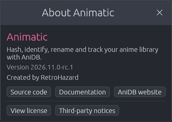

How to ask for help or report a bug without leaking credentials, file names or library data.
Sanitize first, then use the
[issue forms](https://github.com/RetroHazard/animatic/issues/new/choose). Issues are public.

## Before you report

1. Look up the message in the [index of recurring messages](Troubleshooting.md#index-of-recurring-messages)
   and the [symptom index](Troubleshooting.md#find-the-right-section). Most problems have a
   documented cause and fix.
2. Check the [FAQ](FAQ.md) and the [Feature parity](Feature-Parity.md) page: some AniDB O'Matic
   (AOM) features are intentionally not implemented, and a missing one is a feature request, not
   a bug.
3. Find the version you run (next section) and check whether a newer release fixes it
   ([Updating Animatic](Updating-Animatic.md)).
4. Collect what is needed, sanitized (see below).

## Find your version

Choose **Help → About Animatic**. The window shows the name, a one-line description, the line
`Version <number>` and buttons for the source code, the documentation, the AniDB website, the
license and the third-party notices.



*The About window. Copy the `Version` line into your report. Versions look like `2026.11.0`, or `2026.11.0-rc.1` for a beta.*

Also note your operating system and its version, and where Animatic came from: a **release
archive**, a **CI artifact** or a **local build**. The bug report form asks for all three.

## Which issue form to use

The repository offers four forms (blank issues are disabled):

| Form | Use it for |
|---|---|
| [Bug report](https://github.com/RetroHazard/animatic/issues/new/choose) | Something does not work as documented. Required: a confirmation that you removed private data, the version, build, operating system, area, steps to reproduce, what happened and what you expected. Optional: the state of **Work offline** and sanitized Log lines |
| Feature request | A new workflow or a missing AOM capability: the problem, the proposed behavior (including offline and on both Windows and Linux), how AOM behaved |
| Accessibility barrier | Something that blocks use with a screen reader, keyboard-only input, high contrast or display scaling |
| Documentation problem | A guide page is wrong, unclear, missing or disagrees with the application |

The form chooser also links to this guide. There is no separate form for security reports; see
the last section.

## What is sensitive

- **Settings and backups:** `settings.json`, `settings.json.bak` and any `.tmp` copy hold the
  AniDB password, API key and AVDump key in plain text whenever Options reports that no system
  keystore is available (otherwise they are empty there). Never attach or paste them.
- **The database** (`animatic.sqlite3` and its `-wal`/`-shm`), library backups, exports
  (statistics XML/INI, hash lists), MyList export files from AniDB and `animatic-legacy-import-*`
  temporary folders are personal data: viewing history, file paths and names, hashes, AniDB
  identifiers.
- **The Log page** is the only diagnostic channel, and it is kept in memory only (older lines
  are discarded as it grows, **Clear** empties it, and it is lost on exit; there is no log
  file and no export button). Lines include full file paths (which can contain your user and
  drive names and series titles), ED2K hashes, local and AniDB identifiers, server reply text
  and cooldown reasons. Animatic does not intentionally write credentials into log lines, but
  review every line you share.
- **Screenshots** of Animatic show your titles, file names, folder paths, account figures and
  the user name in places. Crop them to the part that matters, or redraw the case with the
  synthetic setup below.
- **Startup errors** print the database and settings paths, which often contain your user name.

## How to sanitize

1. Copy only the lines you need and replace: user and drive names in paths with `<user>`,
   `<root>`; titles and file names with `<file>`; ED2K hashes, `lid`/`fid`/`aid`/`gid`
   numbers and session text with `<id>`; any user name, password or API key with
   placeholders.
2. Keep exact message wording (for example `AniDB sync paused until <time>: <reason>`), the
   status-bar indicators (**Offline**, **N blocked command(s)**, **N commands not saved yet**),
   and what you clicked. Those usually identify the problem without any personal data.
3. Never post settings files or databases. If a settings detail matters, describe the field
   and value type (for example "`anidb.offline` is true"), not the file.
4. Include: the version shown in **Help → About Animatic**, the operating system, whether you
   ran a release archive, a CI artifact or a local build, and whether the settings were recovered
   (the **Settings recovered** window at start).
5. To reproduce, build a **synthetic** case instead of sharing yours: temporary database and
   settings paths (see [Portable and rehearsal setups](Data-Locations.md#portable-and-rehearsal-setups)),
   **Work offline** ticked, small generated files under a fictitious root such as
   `<temp>/animatic-test-root`, and the user name `animatic-test-user`.
6. Do not try to reproduce a problem by sending requests to AniDB, and never use made-up client
   names or credentials against it.

Example of a sanitized report:

```text
Animatic X.Y.Z, Windows (local build). Settings loaded normally.
Steps: Tools → Run command queue, offline unticked.
Result: Log "<time>  ERROR  <command>: authentication: login failed: wrong username or password"
        then "Command blocked: 3 queued commands blocked: authentication: ..."
Status bar: "3 blocked commands". Retry failed + Run command queue repeats the same error.
```

## Useful facts for specific problems

| Problem | Include |
|---|---|
| Queue or sync | **Work offline** state, the **Last error** text of the blocked rows (placeholders for ids), whether `AniDB sync paused until …` shows |
| Hashing or scan | The hash queue summary (`N files waiting to be hashed, M failed`), the failure reason, whether the folder is local, removable or a network share |
| Rename | The message (`Rename not possible: …`, `Rename failed: …`), whether the target is on another drive, the pattern text only if it holds no private names |
| Import | The `Imported N records from M collections` line and each `Legacy import warning: …` line, with collection names only |
| Update | The window's message, whether you used the Stable or Beta channel, how the executable was installed |
| Startup | The cause line of `Animatic could not start`, with paths replaced |

## Security problems

This page defines no security-reporting process, and the repository documents no private
channel (there is no `SECURITY.md`), so this guide cannot name one. If you believe you found a
vulnerability, do not publish details, credentials or private library data in a public issue or
anywhere else public.

## See also

- [Troubleshooting](Troubleshooting.md) for the symptom index and message index.
- [Backups and recovery](Backups-and-Recovery.md) before you try recovery steps on real data.
- [Data locations](Data-Locations.md) for portable and rehearsal setups.
- [FAQ](FAQ.md) for short answers.
