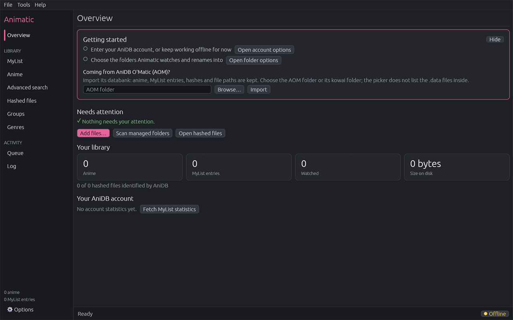

How to start Animatic from an extracted archive or a source checkout, what you should see, and
every command-line flag and environment variable with its precedence. Most people only need the
first section: double-click the program. The rest is for launching with files, keeping several
libraries and scripting. Where the files end up is in [Data locations](Data-Locations.md).

## Start Animatic

| You have | Start it with |
|---|---|
| A release archive on Windows | Double-click `animatic.exe` in the unpacked folder, or run it from PowerShell or `cmd.exe`. |
| A release archive on Linux | Open a terminal, `cd` into the unpacked folder (for example `cd animatic-v2026.11.0-linux-x86_64`, using your version) and run `./animatic` (the executable bit is already set). |
| A source checkout | `cargo run -p animatic` from the repository root. Arguments for the application go after `--`: `cargo run -p animatic -- --database /path/to/scratch/library.sqlite3` |
| A release build you made | `./target/release/animatic` (`.\target\release\animatic.exe` on Windows) from the repository root. |

Starting the program a second time (for example a second double-click) opens a second window on the
same library unless you pass media files; see [One window per database](#one-window-per-database).

To start Animatic with your usual options from a desktop shortcut, create a shortcut to the
executable and put the arguments after the program name in the shortcut's target field (Windows) or
command line. Quote paths that contain spaces.

### What you should see

A window titled "Animatic — AniDB library manager" opens on the **Overview** page. The status bar at
the bottom shows `Loading library…`, then `Ready`.

- **Size and position.** The first start opens 1280×800 points (minimum 900×600); later starts
  restore the size, position and maximized state you left it with (see
  [window and layout state](Settings-Reference.md#window-and-layout-state)). A saved position is
  used only if it keeps the title bar reachable.
- **Theme.** The saved theme (Dark, Light or Same as the system) and UI scale are applied at launch
  (see [Options window](Options-Window.md)).
- **No console.** On Windows the executable is a GUI program, so no console window opens with it.
  Started from a terminal, it attaches to that terminal, so `--help` and startup errors are printed
  there (the prompt may return before the text appears). Animatic writes no log file; the in-app
  **Log** page is the activity record for the session and is not saved to disk.
- **First time.** A brand-new profile shows the **Getting started** box on the Overview; see
  [First launch](First-Launch.md).



*The Overview with the **Getting started** box. The picture was taken with the sample's **Work
offline** turned on, so the status bar shows **Offline**; a real first start shows a green
**Online** button (see [First launch](First-Launch.md#first-launch)).*

### If startup fails

If startup fails (for example unreadable settings or an unknown option) the process reports the
cause on standard error as `Error: <message>` and exits with status 1; no main window appears.
Started without a terminal (Explorer, a shortcut), the same message is shown in an error dialog
titled "Animatic". It starts with `Animatic could not start` once, followed by the cause. Typical messages:

| Message | Meaning |
|---|---|
| `unknown option: <argument>` | An argument starting with `-` that Animatic does not know. See the [table below](#command-line-reference). |
| `--database requires a file name` | `--database` (or `-d`, `/database`) was the last argument. |
| `unable to determine the default application directory; use --database and ANIMATIC_SETTINGS` | The platform gave no home directory, so there is no default location. Name both files yourself. |
| `Animatic could not start (database: …, settings: …)` followed by the cause | The database or the settings file could not be opened or read. The message names both paths and never prints file contents. |
| `the window system failed: …` | The graphics or window system refused to start the window. |

See [Troubleshooting](Troubleshooting.md#startup-problems) for what to do next.

### Quitting

Close the window, choose **File → Quit** or **Quit** in the tray menu. On exit Animatic saves the
settings (unless they were recovered from a backup and you did not save, see
[Settings problems](Backups-and-Recovery.md#settings-problems)), tries once more to write any queued
commands that were "not saved yet", and, when an AniDB login is open (a kept session or a run in
progress), logs out (waiting at most about 8 seconds, and sending nothing when offline or cooling
down). Minimizing to the tray does not quit; see [System tray](Main-Window.md#system-tray).

## Command-line reference

Animatic reads its arguments from left to right. Matching is exact and case-sensitive.

| Argument | Meaning |
|---|---|
| `--database FILE`, `-d FILE`, `/database FILE` | Use `FILE` as the SQLite library database. The next argument is taken as the file name even if it starts with `-`. Missing value → error `--database requires a file name`. May repeat; the last one wins. |
| `--full-update`, `/fullupdate` | After startup, queue a full update: the title-list download plus one file lookup and one anime refresh for each file id and anime id that your **identified hashed local files** resolve to (not the whole local cache or title catalog). It leaves out what AniDB's limits do not allow yet (the title list and an anime requested within 24 hours, a file within 7 days; see [Request limits](AniDB-Synchronization.md#request-limits)) and the log says how many. Nothing is sent to AniDB until you run the queue. **Tools → Full update…** does the same after showing what it would queue. Queueing it twice adds nothing. |
| `--help`, `-h`, `/?` | Print `Animatic [--database FILE] [--full-update] [MEDIA FILES...]` and exit with status 0. Does not create directories, files or a window. |
| `/utf8`, `/ucs2` | Accepted and ignored (legacy compatibility). |
| any other argument starting with `-` | Error: `unknown option: <argument>`. Includes `--version`, `-v`, `--database=FILE` (there is no `=` form) and `--settings`. |
| anything else | A media file path. It is hashed in the background right after startup, as if added with **File → Add files…** If Animatic is already running with the same database, the paths go to that window instead; see [One window per database](#one-window-per-database). |

Details to know:

- **Order matters.** Arguments are processed left to right, so `--bogus --help` reports
  the unknown option instead of printing help; a media path before `--help` is simply
  discarded.
- **Case.** `/FullUpdate` or `--Database` are not options. Anything not starting with `-`
  (including `/FullUpdate`) is treated as a media file path and then fails to hash with an
  error in the **Log**.
- **No `--` separator.** A media file whose name begins with `-` cannot be passed
  directly. Prefix it with a directory (`./-clip.mkv`, `.\-clip.mkv`) so it no longer starts
  with `-`.
- **Media paths.** A file passed on the command line is queued in the persistent
  [hash queue](Hashing-and-Identification.md#hash-queue) and hashed even if *Work offline* is on,
  even if *Start hashing automatically* is off, and whatever *Restrict file extensions* says:
  command-line paths are never filtered. Relative paths are made absolute against the process
  working directory when they are queued; paths forwarded to a running window are made absolute
  first. Use absolute paths anyway: they do not depend on where the program was started.
  Directories are not expanded; list files explicitly (a directory is logged as a failed file).
  The hash queue panel labels these files with the source `Command line`.
- **Combining.** `--database`/`--full-update` and file arguments can be combined; the full update is
  queued first, then the files are hashed. With `--full-update` nothing is forwarded to an
  already-running window (see below), so the new process opens its own window and hashes the files
  itself.
- **Settings have no flag.** The settings file can only be redirected with the
  `ANIMATIC_SETTINGS` environment variable.
- **Failure output.** A parse error is reported like any startup failure: `Error: <message>` on
  standard error (an error dialog when no terminal started the program) and exit status 1. A
  successful run, `--help` and a launch that handed its files to a running window all exit with
  status 0.

### Quoting examples

Quote any path with spaces; the quoting is your shell's, not Animatic's.

```sh
# POSIX shell
animatic -d "$HOME/animatic demo/library.sqlite3" "/data/media/Example Show - 01.mkv"
```

```powershell
# PowerShell
.\animatic.exe -d "$env:TEMP\animatic demo\library.sqlite3" "D:\Media\Example Show - 01.mkv"
```

```bat
:: cmd.exe, legacy switch spelling
animatic.exe /database "%TEMP%\animatic demo\library.sqlite3" "D:\Media\Example Show - 01.mkv"
```

### Common recipes

| Goal | Command |
|---|---|
| Hash two files as the window opens | `animatic "D:\Downloads\Example Show - 01.mkv" "D:\Downloads\Example Show - 02.mkv"` |
| Keep a second, separate library | `animatic --database "D:\Libraries\second.sqlite3"` (and `ANIMATIC_SETTINGS` for separate settings, see below) |
| Queue a refresh of everything identified | `animatic --full-update` (then review the **Queue** page and run it when you are ready) |
| Try things without touching your real profile | See [Portable and rehearsal setups](Data-Locations.md#portable-and-rehearsal-setups) |
| Show the usage line | `animatic --help` |

### One window per database

Starting Animatic with media files while another Animatic already has **the same database**
open does not open a second window. The new process gives the files to the running one and
exits; the running window comes to the front and hashes them exactly as if they had been given
on its own command line (identification and MyList rules included). The log line is
`Hashing N file(s) from another launch`, and the hash queue labels them `Other launch`. This is
what makes the optional **Hash with Animatic** file-menu entry (see
[Options window](Options-Window.md#file-menu-entry)) usable when you select several files.

- **Same database** means the same file after resolving the directory and links, so
  `--database ./a.sqlite3` and `--database /full/path/a.sqlite3` match. A different
  `--database` (or `ANIMATIC_DB`) starts a separate window as before.
- **No files, or `--full-update`:** nothing is forwarded. A second launch without files
  opens another window as before. Never run two processes on the same settings file: they share
  temporary file names and are unsupported (see [Data locations](Data-Locations.md#where-data-lives)).
- **Mechanism.** The running window listens on `127.0.0.1` only, on a random port, and records
  the port and a random token in `<database file>.instance` next to the database (see
  [Data locations](Data-Locations.md#shell-entries-and-the-lock-file)). The new process needs that token to be
  accepted. The file is removed when the window closes. A file left behind by a crash is
  detected (nobody answers) and replaced.
- **If forwarding fails** for any reason (the lock directory is not writable, the window does
  not answer, a path is not valid Unicode) the new process starts normally.
- **Bringing the window forward** is best effort. Windows and some Linux window managers may
  only flash the taskbar entry instead of taking focus. A window hidden in the tray is shown.

## Environment variables

| Variable | Effect |
|---|---|
| `ANIMATIC_DB` | Path of the SQLite database. `--database` overrides it. |
| `ANIMATIC_SETTINGS` | Path of the settings file. Made absolute against the working directory at startup. There is no flag for it. |
| `PATH` | Searched for `ffprobe` by the media-properties detector (see [External tools](External-Tools.md#media-properties-ffprobe)). |
| `XDG_CONFIG_HOME`, `XDG_DATA_HOME`, `HOME` (Linux) | Used for the default locations when no override names the file; see [Where data lives](Data-Locations.md#where-data-lives). |

Animatic reads no other environment variables of its own. An empty variable is not treated as
unset; unset the variable instead of setting it to an empty string.

### Precedence

| Setting | Highest → lowest |
|---|---|
| Database file | `--database`/`-d`/`/database` → `ANIMATIC_DB` → `animatic.sqlite3` in the default data folder |
| Settings file | `ANIMATIC_SETTINGS` → `settings.json` in the default config folder |

The default folders ([Where data lives](Data-Locations.md#where-data-lives)) are looked up only for
a path that has no override. With both overridden, no default folder is consulted at all, so a
portable launch does not depend on a home directory. Both paths are made absolute before anything
opens them, so a restart after an update opens the very same files even if a file dialog changed the
working directory meanwhile.

## After an update

When you install an update from **Help → Check for updates…** and choose **Restart now**, the new
executable starts with `--database <path>` of the library that was open, plus `ANIMATIC_SETTINGS`
when you had set it (as the absolute path in use). Nothing else is passed on: not the media files
(they would be hashed again) and not `--full-update`. Animatic releases its single-instance lock
first, so the new process does not hand files to the old one. Details: [Updating Animatic](Updating-Animatic.md).

## See also

- [Data locations](Data-Locations.md): the default folders, companion files and portable profiles.
- [First launch](First-Launch.md) and [Quick start](Quick-Start.md): what to do once the window is open.
- [Hashing and identification](Hashing-and-Identification.md): what happens to files you pass in.
- [Troubleshooting](Troubleshooting.md#startup-problems): startup problems.
