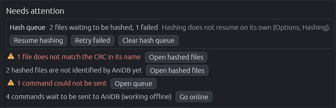
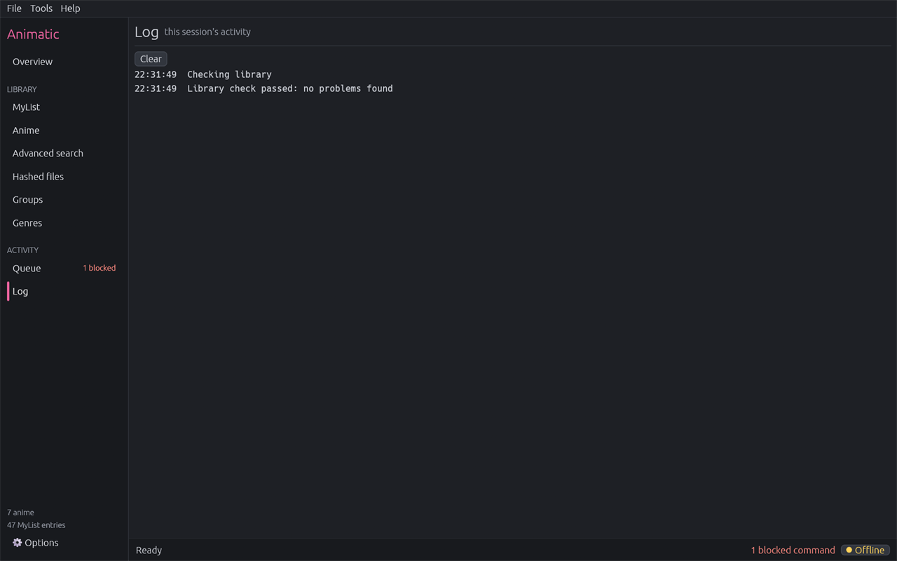

This page is the entry point when something goes wrong: a symptom index, the files Animatic
uses, startup failures and an index of every recurring message. The other support pages go
deeper: [Backups and recovery](Backups-and-Recovery.md),
[Network and sync problems](Network-and-Sync-Problems.md),
[File and import problems](File-and-Import-Problems.md) and
[Reporting problems](Reporting-Problems.md). Short answers to common questions are in the
[FAQ](FAQ.md). Message texts are quoted exactly as Animatic prints them so you can recognize
them; wording in your build can differ if the program has changed since.

## What Animatic does and does not do

Know the limits before you rely on a recovery path:

- **Backups are manual and there is no repair.** **File → Back up library…**, **File → Restore
  library…**, **Tools → Check library** and **Tools → Compact library…** exist (see
  [Back up and restore inside Animatic](Backups-and-Recovery.md#back-up-and-restore-inside-animatic)),
  but nothing backs the database up automatically, there is no rotation and no repair command
  in the application or the command line. A library backup does not include the settings. The
  only automatic copy is the single settings backup (`settings.json.bak`), described under
  [Settings problems](Backups-and-Recovery.md#settings-problems).
- **No hashes or verification of copies.** Nothing records or checks a hash of your
  database, settings or any backup you make.
- **Credentials.** The password, API key and AVDump key are kept in the operating-system keystore
  when one is available; if Options shows the settings-file notice, the settings file and its
  backup hold them in plain text instead. The database and backups are not encrypted.
- **Personal data in the database.** The SQLite library holds your viewing history, file
  paths, hashes and queued edits.
- **No media deletion, no trash.** Animatic never deletes a media file on its own account, and
  the interface has no recycle-bin or trash workflow. A rename moves a file inside the
  filesystem; when the destination is on another drive it copies the file, verifies the copy
  and only then removes the original, which is the one case where a file is deleted (see
  [Rename problems](File-and-Import-Problems.md#rename-problems)); there is no undo. The only
  folders Animatic removes are completely empty ones that a rename emptied inside a managed folder
  whose **Remove emptied folders** is on (off by default).
- **No direct account download.** Animatic does not fetch your complete AniDB MyList entry by
  entry; you request a MyList export from AniDB and import the file you download (see
  [The library is missing entries](Network-and-Sync-Problems.md#the-library-is-missing-entries)).
- **Little happens by itself, and most of it is opt-in.** Folder scans run from **Tools → Scan
  managed folders**, and by themselves only if you switch on **Scan managed folders when
  Animatic starts** or **Scan managed folders on a schedule** (both off by default, in
  **Tools → Options… → Managed folders**). The queue runs from **Tools → Run command queue** or
  **Run command queue** on the **Queue** page, or by itself only if you switch on **Run the command queue
  automatically** (off by default, see
  [Automatic runs](AniDB-Synchronization.md#automatic-runs-and-the-anidb-session)).
  Renaming is automatic only in a managed folder you set to **Auto rename: On**. Two things
  happen unasked by default: files still in the hash queue resume hashing at start
  (**Start hashing automatically**, on by default) and Animatic *checks* for a newer release on
  GitHub at start (**Check for updates at startup**, on by default); the check downloads and installs
  nothing. See [Update problems](Network-and-Sync-Problems.md#update-problems).
- **No log file.** Diagnostics are the in-memory **Log** page and the status bar. See
  [Privacy-safe support](Reporting-Problems.md).

Evidence limits: Linux runtime behavior and production AniDB behavior have not been exercised
by the project's recorded verification. Steps in these pages that refer to Linux paths or to AniDB's
replies follow the source code, not a recorded run.

## Find the right section

Start with the page that shows something is wrong. The **Overview** page has a **Needs attention**
section that lists what is waiting for you, with a button next to each line:

*Needs attention in the sample library: every line has a button that opens the page where you fix it.*

| Line on the Overview | What it means | Where to go |
|---|---|---|
| `N file(s) waiting to be hashed` / `N file(s) failed` / `N files waiting to be hashed, M failed` (the **Hash queue** panel, with **Resume hashing**, **Retry failed**, **Clear hash queue**) | Files are waiting, or could not be read | [Hashing large files](File-and-Import-Problems.md#hashing-large-files) |
| `⚠ N file(s) do not match the CRC in their name` (the Hashed files **CRC** column says **Mismatch**) | The CRC32 Animatic computed differs from the CRC32 AniDB has recorded for the identified file (the line's wording says "in their name", but the comparison is with AniDB's record) | [Files that are not identified or show a CRC mismatch](File-and-Import-Problems.md#files-that-are-not-identified-or-show-a-crc-mismatch) |
| `N hashed file(s) not identified by AniDB yet` | The identify command has not run yet, or AniDB does not know the file | [Files that are not identified or show a CRC mismatch](File-and-Import-Problems.md#files-that-are-not-identified-or-show-a-crc-mismatch) |
| `⚠ N command(s) could not be sent` | Blocked commands | [Queue states](Network-and-Sync-Problems.md#queue-states-blocked-deferred-and-unsaved) |
| `N command(s) wait to be sent to AniDB` (`working offline` when it is on; the button is **Go online** while working offline and **Run command queue** otherwise) | Normal while you work offline, or before you run the queue | [Credentials](Network-and-Sync-Problems.md#credentials-and-client-registration) |
| `N command(s) not saved yet; Animatic keeps retrying` | The database is busy | [Database busy](Network-and-Sync-Problems.md#database-busy-and-unsaved-commands) |

If the Overview shows `✓ Nothing needs your attention.` and something is still wrong, use the
table below.

### Symptom index

| Symptom | Likely cause | What to do | Details |
|---|---|---|---|
| Animatic does not open, or an error dialog titled "Animatic" appears | Database or settings cannot be opened or created | Read the cause line; check permissions, free space and overrides | [Startup problems](#startup-problems) |
| **Settings recovered** window at start | `settings.json` is unreadable; the backup was loaded and Animatic is offline | Review the values, then **Save options** | [Settings problems](Backups-and-Recovery.md#settings-problems) |
| An error naming `settings.json` and its backup, and no window | Both copies are unusable | Repair one, restore your own copy, or move both aside | [Error messages](Backups-and-Recovery.md#error-messages) |
| The library looks empty, or settings look reset | Started with a different database or settings file (shortcut, environment variable, `--database`) | Start the same way as before | [Which files is Animatic using?](#which-files-is-animatic-using) |
| Commands never leave the Queue | **Work offline** is on, nothing starts the queue, a cooldown is active, or commands are blocked | Look at the right of the status bar, then the Queue page | [Network and sync problems](Network-and-Sync-Problems.md) |
| `AniDB sync paused until …` | Network failure or a ban; Animatic stops all requests for a while | Wait; nothing can clear it | [Cooldowns and bans](Network-and-Sync-Problems.md#cooldowns-and-bans) |
| Red `N blocked` in the sidebar | Permanent failures such as wrong password or a refused client | Read **Last error**, fix, **Retry failed** | [Credentials](Network-and-Sync-Problems.md#credentials-and-client-registration) |
| `login failed: wrong username or password` | Wrong credentials | Correct them in **Tools → Options… → AniDB account** | [Credentials](Network-and-Sync-Problems.md#credentials-and-client-registration) |
| Timeouts, "cannot resolve", "no IPv4 address", "cannot bind UDP port" | DNS, firewall or another program using the local port | Allow outbound UDP; free the port | [Network and firewall](Network-and-Sync-Problems.md#network-and-firewall) |
| `N commands not saved yet` | The database is busy with another write | Wait; do not quit | [Database busy](Network-and-Sync-Problems.md#database-busy-and-unsaved-commands) |
| A scan hashes nothing | No **auto hash** rule, extension list, hidden or system files, folder missing | Work through the checklist | [Scans and managed folders](File-and-Import-Problems.md#scans-and-managed-folders) |
| Records disappeared after a scan | **auto remove** with a folder that exists but is empty (unmounted drive) | Restore a backup or rescan | [Offline drives](File-and-Import-Problems.md#offline-drives-and-automatic-removal) |
| Hashing is slow, was cancelled, or a file is shown as **Failed** | Slow disk or share; cancelled; file locked or gone | Resume, **Retry failed** | [Hashing large files](File-and-Import-Problems.md#hashing-large-files) |
| **Rename file** is greyed or a rename fails | Pattern warnings, missing title or episode data, invalid name, collision | Read the message | [Rename problems](File-and-Import-Problems.md#rename-problems) |
| The AOM import finished with fewer collections | A collection failed and was skipped | Read the `Legacy import warning` lines | [AOM import problems](File-and-Import-Problems.md#aom-import-problems) |
| Library check failed or the database is damaged | Disk problems or an unclean copy | Restore a backup | [Damaged database](Backups-and-Recovery.md#damaged-database) |
| Disk full, leftover temporary files | Interrupted jobs, low space | Free space; delete only safe leftovers | [Disk space, temporary files and leftovers](Backups-and-Recovery.md#disk-space-temporary-files-and-leftovers) |
| My library is missing entries from AniDB | Animatic never downloads the whole MyList entry by entry | Request a MyList export and import it | [The library is missing entries](Network-and-Sync-Problems.md#the-library-is-missing-entries) |
| Update check, download, install or restart failed; Animatic will not start after an update | GitHub unreachable, rate limit, permissions, interrupted install | See the table | [Update problems](Network-and-Sync-Problems.md#update-problems) |
| An external program does not start, or an export fails | Player, AVDump or destination path | See the list | [External tools and exports](File-and-Import-Problems.md#external-tools-and-exports) |
| Preparing a bug report | | Sanitize first | [Reporting problems](Reporting-Problems.md) |

## Which files is Animatic using?

Animatic stores a SQLite database and a JSON settings file. Which ones it opens depends on how
it was started:

| Setting | Highest → lowest priority |
|---|---|
| Database | `--database FILE` (also `-d`, `/database`), then `ANIMATIC_DB`, then the default |
| Settings | `ANIMATIC_SETTINGS`, then the default (there is no command-line option for settings) |

Defaults (the folders follow the operating system's per-user conventions; see
[Data locations](Data-Locations.md#where-data-lives)):

| | Windows | Linux |
|---|---|---|
| Settings | `%APPDATA%\AniDB\Animatic\config\settings.json` | `$XDG_CONFIG_HOME/animatic/settings.json`, else `~/.config/animatic/settings.json` |
| Database | `%APPDATA%\AniDB\Animatic\data\animatic.sqlite3` | `$XDG_DATA_HOME/animatic/animatic.sqlite3`, else `~/.local/share/animatic/animatic.sqlite3` |

On Windows these are in the **Roaming** application-data folder. The Linux paths follow the
source code; Animatic itself has not been recorded running on Linux.

Files you may find next to them:

| File | What it is |
|---|---|
| `animatic.sqlite3-wal`, `animatic.sqlite3-shm` | SQLite write-ahead-log companions. They exist while the database is open and may remain after exit |
| `settings.json.bak` | Copy of the previous valid settings, made on a save |
| `settings.json.tmp`, `settings.json.bak.tmp` | Transient files during a save |
| `animatic-legacy-import-*/` (system temporary folder) | Decrypted intermediates during an AOM databank import; a marker file inside identifies it, and Animatic offers to remove leftovers at the next start |

The backup and temporary names replace the settings file's extension: for
`ANIMATIC_SETTINGS=/x/custom.cfg` they are `/x/custom.json.bak` and `/x/custom.json.tmp`.
The database companions append `-wal` and `-shm` to the full database file name.

**The library looks empty or the settings look reset.** The most common cause is a different
start method. A shortcut that does not set `ANIMATIC_DB`/`ANIMATIC_SETTINGS` or `--database`
opens the default locations, while your usual session may use overrides (the environment
variables apply to every launch in the shell or session that has them). Compare how you
started, close Animatic, and start it again with the same overrides.

The paths are printed in the startup failure message. In the normal window only two places show
them: the **Settings recovered** window (the settings paths) and the **Import into a database that
has data?** window (the database path). Starting with a path that does not exist creates a fresh
empty database there, so an empty library is not proof that your data is gone.

A bare, non-option argument is a media file to hash at startup, and an unknown option
beginning with `-` is rejected with `unknown option: …`. `--help` prints one line and
creates no files.

## Startup problems

On Windows Animatic is a GUI program (it opens no console window), and a startup failure is reported
as `Error: <message>` on standard error when a terminal started it; started from Explorer or a
shortcut there is no terminal, so the same message is shown in an error dialog titled "Animatic"
("Animatic could not start" once, then the cause). Run it from a terminal to keep the text.

| Message | Cause and action |
|---|---|
| `Animatic could not start (database: <path>, settings: <path>)` followed by a cause | Startup opens the database and loads settings. Read the cause line: a SQLite error means the database cannot be opened or created; a `settings: …` error means the settings file is unusable, see [Error messages](Backups-and-Recovery.md#error-messages). In the error dialog the sentence appears twice (`Animatic could not start:` and then the message): it is one error |
| `I/O error: <os error>` | The database's parent folder could not be created (permissions, a file in the way, read-only or full disk). Fix it or choose another location with `--database` |
| `database error: unable to open database file…` | The path is not writable, the disk is read-only, or the path is a directory. Fix permissions or choose another location with `--database`. SQLite's exact wording can include more text |
| `database error: database is locked…` | Another process holds the database longer than the 30 s busy timeout (a second Animatic, a backup program, a sync client, antivirus). Close it and retry |
| `database error: database disk image is malformed` / `file is not a database` | The file is damaged or is not an Animatic database. Restore a backup ([Damaged database](Backups-and-Recovery.md#damaged-database)) |
| `unable to determine the default application directory; use --database and ANIMATIC_SETTINGS` | The platform did not provide a home or profile directory. Set both overrides |
| `--database requires a file name` | The option was last on the command line with no value |
| `unknown option: <text>` | An argument starting with `-` that Animatic does not know (`/utf8` and `/ucs2` are accepted and ignored) |
| `the window system failed: <error>` | The windowing or graphics layer could not start. This is outside Animatic's data; check the desktop session, display variables and graphics drivers. The project has not recorded Linux window-system behavior |

Permission checklist for the folders involved:

1. The database folder must allow creating and writing files (the database, `-wal` and `-shm`
   are created there); the system temporary folder must allow creating the import's work folder.
2. The settings folder must allow creating `settings.json.tmp`, `settings.json.bak.tmp`,
   `settings.json.bak` and `settings.json`, and renaming over existing files.
3. Security software with folder protection can block writes to profile folders; allow
   Animatic or choose a folder it permits with the overrides.
4. A read-only settings location lets Animatic load but never persist changes. The exit save
   is silent, so you learn about it from **Save options**, the **Online/Offline** indicator,
   **Go online** or **Hide** (`Could not save settings: …`).

Startup creates the database and its parent folder immediately; the settings folder is created
only when settings are first saved.

## Index of recurring messages

Animatic shows messages in three places: the **status bar** at the bottom of the window (the left
side shows the latest status, and an error there starts with `⚠` and opens the **Log** when you
click it), the **Log** page (this session's activity, in memory only) and, for some failures,
a window or the **Last error** column of the **Queue** page. The texts below are quoted from the
code. `<…>` marks a value that differs each time. The Log page looks like this:

*The Log page. Each line starts with the local time. Errors are colored; **Clear** empties the page.*

### Startup and settings

| Where | Text | What it means and what to do |
|---|---|---|
| Error dialog or terminal | `Animatic could not start (database: …, settings: …)` | The database or settings could not be opened. [Startup problems](#startup-problems) |
| Window | **Settings recovered** | `settings.json` was unusable, the backup was loaded and Animatic is offline. [The recovery window](Backups-and-Recovery.md#the-recovery-window) |
| Status bar, Log | `Could not save settings: <error>` | The save failed; the old file is untouched. [Save failures](Backups-and-Recovery.md#save-failures-and-leftover-files) |
| Status bar, Log | `Could not save settings, so Animatic was not restarted: <error>` | An update restart was cancelled because the settings could not be saved first. Fix the cause and use **Save options** |

### Library maintenance

| Where | Text | What it means and what to do |
|---|---|---|
| Log | `Library backed up to <path> (<size>)` | **File → Back up library…** finished |
| Status bar, Log | `Backup failed: <error>` | The destination is not writable, is the library itself, or the disk is full. Choose another folder. [Back up and restore](Backups-and-Recovery.md#back-up-and-restore-inside-animatic) |
| Log | `Library check passed: no problems found` | A healthy library |
| Status bar, Log | `Library check FAILED: <N> integrity problem(s), <M> foreign key violation(s)` followed by the first findings | The library is damaged. Nothing is repaired. Restore a backup. [Damaged database](Backups-and-Recovery.md#damaged-database) |
| Status bar | `Library check failed: <error>` | The check itself could not run (for example the file could not be opened) |
| Log | `Library compacted: <before> → <after>` | **Tools → Compact library…** finished |
| Status bar | `Compacting failed: <error>` | Usually a full disk. [Disk space](Backups-and-Recovery.md#disk-space-temporary-files-and-leftovers) |
| Status bar | `Library not backed up: <reason>`, `Library not restored: <reason>`, `Library not compacted: <reason>` | A job, an import, the review of imported settings, a restore or (for restore) unsaved commands block the action. The reason names it: `Wait for the running task to finish, or cancel it, first.`, `Confirm or cancel the import first.`, `An import is in progress.`, `Apply or cancel the imported settings first.`, `A library restore is in progress.`, `Some changes are not saved to the database yet.` |
| Status bar | `Restore refused, the current library was not changed: <error>` | The chosen file is damaged, is not an Animatic library, comes from a newer Animatic or is the current library |
| Status bar | `Library restore failed: <error>` | The files could not be swapped. The message names the kept `.before-restore-*` copy |
| Window | **Library unavailable** | The library could not be reopened after a restore. Quit and use the kept copy. [Back up and restore](Backups-and-Recovery.md#back-up-and-restore-inside-animatic) |
| Log | `Unable to refresh library: <error>` | A background snapshot failed. **File → Reload** (`F5`) usually works once contention ends. [Database busy](Network-and-Sync-Problems.md#database-busy-and-unsaved-commands) |

### AniDB and the command queue

| Where | Text | What it means and what to do |
|---|---|---|
| Status bar, Queue | `AniDB sync paused until <time>: <reason>` | A cooldown is active. [Cooldowns and bans](Network-and-Sync-Problems.md#cooldowns-and-bans) |
| Log | `AniDB sync is paused for another <time> (<reason>)` | A run was started during a cooldown and sent nothing |
| Log | `Cannot read the sync cooldown: <error>` | The database could not be read; the run stopped before sending anything (it fails closed) |
| Log | `Offline mode is enabled; commands remain queued` | **Work offline** is on. [Credentials](Network-and-Sync-Problems.md#credentials-and-client-registration) |
| Log | `Command blocked: <N> queued commands blocked: <message>` (after a refused login or client), `Command blocked: <command> blocked: <message>` (one command), `Command blocked: <command> blocked after 5 failed attempts`, `Command blocked: <N> queued HTTP commands blocked: <message>. Update Animatic, or report this if it is already the latest version.` (the HTTP API refused Animatic's client registration) | A permanent failure, each preceded by an `ERROR` line `<command>: <message>`. [Queue states](Network-and-Sync-Problems.md#queue-states-blocked-deferred-and-unsaved) |
| Status bar | `N blocked command(s)` (red link) and `blocked commands (refreshing)` | Open the **Queue** page |
| Log | `Database busy: queued command is NOT saved yet, retrying` | [Database busy](Network-and-Sync-Problems.md#database-busy-and-unsaved-commands) |
| Status bar | `N commands not saved yet` | Do not quit until it disappears |
| Log | `NOT queued: <command> (database busy and 1000 commands are already unsaved)` | The in-memory holding list is full. Wait for the database, then repeat the action |
| Queue, Log | `network error: …`, `no reply from AniDB (timeout)`, `no reply to the AniDB login (AUTH); …` | [Network and firewall](Network-and-Sync-Problems.md#network-and-firewall) |
| Queue, Log | `authentication: …`, `client version outdated …`, `AniDB refuses Animatic's built-in client registration …` | [Credentials and client registration](Network-and-Sync-Problems.md#credentials-and-client-registration) |
| Log | `file unknown to AniDB` | Normal for a file AniDB does not know. Not an error |
| Queue, Log | `AniDB server error <code>: <text>` | AniDB answered 600, 601, 602 or 604; syncing pauses (30 min, or 60 s for 604) and the command stays queued |
| Queue | `client banned by AniDB: <text>` | A ban (510, 555, HTTP 403 or HTTP error 500): 30-minute pause, nothing is blocked |
| Queue | `illegal input: <text>`, `unknown command`, `protocol error: …`, `XML error: …` | This one command can never succeed as queued, so it is blocked and the run continues. Read the text, then **Retry failed** or clear the queue |
| Log | `Retrying <N> failed commands`, `Could not retry failed commands: …`, `Could not clear the queue: …`, `Could not queue <command>: <error>` | **Retry failed** and **Clear queue…** on the **Queue** page and new commands. An error usually means the database is busy; repeat once it is free |
| Queue | `unexpected reply <code>: <text>` | AniDB answered with a code Animatic does not expect for that command, so the command is blocked and the run goes on. Read the text, then **Retry failed** if you expect a different answer, or see [Queue states](Network-and-Sync-Problems.md#queue-states-blocked-deferred-and-unsaved) |
| Log | `… allowed after <date time>`, `… skipped: …` | AniDB's request limits. [The library is missing entries](Network-and-Sync-Problems.md#the-library-is-missing-entries) |
| Log | `Full update failed: <error>` or `Full update preview failed: <error>` | The database could not be read to plan the update. Retry after the cause (usually a busy database) ends |
| Log | `MyList export not imported, the library was not changed: <reason>` | The downloaded export was refused whole. [The library is missing entries](Network-and-Sync-Problems.md#the-library-is-missing-entries) |

### Files, hashing and renaming

| Where | Text | What it means and what to do |
|---|---|---|
| Log | `<path>: <reason>. It stays in the hash queue until it is retried or cleared.` during a scan or hashing | One file could not be read; the next one continues. [Hashing large files](File-and-Import-Problems.md#hashing-large-files) |
| Log | `Scan deferred <N> file(s) that may still be written, the next scan retries them: …` | The files changed recently. Scan again later. [Scans and managed folders](File-and-Import-Problems.md#scans-and-managed-folders) |
| Log | `Hashing stopped; <N> file(s) stay in the hash queue` | You cancelled. **Resume hashing** continues |
| Log | `Queued <N> file(s) for hashing (<M> already queued)`, `Removed <N> file(s) from the hash queue`, `Removed <N> file(s) from the list`, `Settings saved` | Routine confirmations |
| Status bar | `Could not queue files for hashing: <error>` | The hash queue could not be written. Check the disk and the database |
| Status bar | `Hashing stopped: <error>` | The hash queue could not be updated. Check the disk and the database |
| Status bar | `Hash queue unreadable: <error>` | The hash queue table could not be read. Run **Tools → Check library** |
| Log | `Queued <N> failed file(s) again` | **Retry failed** on the hash queue panel |
| Status bar | `Could not retry failed files: …`, `Could not clear the hash queue: …` | The database was busy or damaged |
| Status bar | `Rename not possible: …`, `Rename blocked: …`, `Rename failed: …` | [Rename problems](File-and-Import-Problems.md#rename-problems) |
| Log | `Automatic rename skipped <path>: <reason>` or `Automatic rename failed: <error>` | A managed folder with **Auto rename** On. [Rename problems](File-and-Import-Problems.md#rename-problems) |
| Status bar | `Hash export failed: …`, `Statistics export failed: …` | [External tools and exports](File-and-Import-Problems.md#external-tools-and-exports) |

### Imports, covers and updates

| Where | Text | What it means and what to do |
|---|---|---|
| Log | `Legacy import failed: <error>` or `Legacy import warning: <collection>: <error>` | [AOM import problems](File-and-Import-Problems.md#aom-import-problems) |
| Status bar | `Could not import AOM settings: …` | The XML was not an AOM settings file. [Settings import](File-and-Import-Problems.md#settings-import) |
| Window | `Imported credentials will not connect to AniDB: offline mode remains enabled.` | Normal on the **Review imported AOM settings** window: an import always leaves Animatic working offline until you untick **Work offline** |
| Anime detail window (cover area) | `Cover not shown: the downloaded file is not a readable picture (<why>)`, `Cover not downloaded: …`, `Cover not available…` | AniDB sent something that is not a JPEG, PNG, WebP or GIF, downloads are off or paused, or the last try failed less than an hour ago. **Try again** asks once more when the limit allows it. See [Anime detail window](Library-Pages.md#anime-detail-window) |
| Menu bar button | `Update available: <version>`, `Update ready to install`, `Restart to finish updating`, `Update failed: see details` | Click it to open the Software updates window. [Update problems](Network-and-Sync-Problems.md#update-problems) |
| Status bar, Log | `Update check failed: <message>` | [Update problems](Network-and-Sync-Problems.md#update-problems) |

## See also

- [FAQ](FAQ.md) for short answers to common questions.
- [Glossary](Glossary.md) for terms such as cooldown, command queue and managed folder.
- [Reporting problems](Reporting-Problems.md) when nothing here helps.
