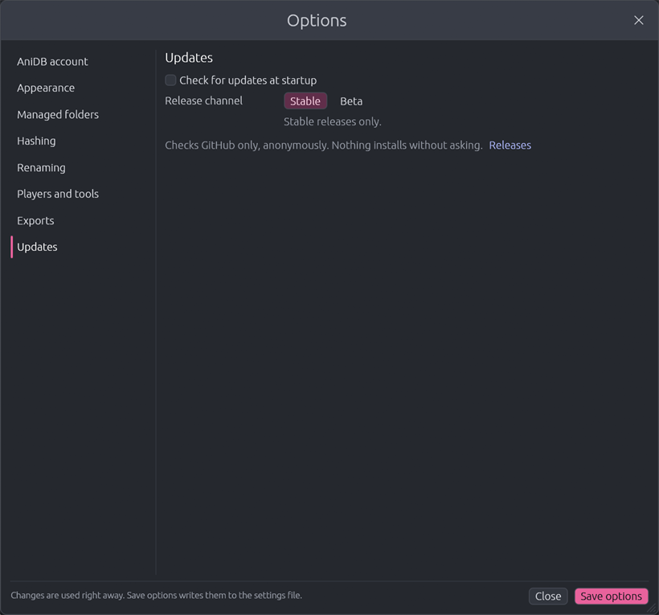

Animatic can replace **its own executable** with a newer release (stable, or beta if you choose
the Beta channel) published at <https://github.com/RetroHazard/animatic/releases>. This page is
for anyone who wants to update from inside the program, and for anyone who wants to know exactly
what an update does and does not touch. It is supported on Windows x86_64 and Linux x86_64 only;
elsewhere the update controls are disabled. Nothing is ever downloaded or installed unattended.
Linux runtime behavior of the updater has not been exercised by the project. Releases are
unsigned (see [Integrity and trust](#integrity-and-trust)).

## Update in four steps

1. **Check.** Choose **Help → Check for updates…**. The **Software updates** window opens and
   looks for a newer release. If one exists it shows `Version X is available`.
2. **Download and verify.** Click **Download and verify**. Animatic downloads the archive and
   checks its SHA-256 checksum. Nothing is installed yet.
3. **Install.** Click **Install**, read the question `Replace PATH with the new version?` (it names
   the file), then click **Confirm installation**.
4. **Restart.** Click **Restart now** (Animatic saves your settings, closes and starts the new
   version) or **Later** (the new version starts the next time you launch Animatic).

Every step needs a click. Your database, settings, backups and media are never touched; only the
program file is replaced.

## What counts as an update

It depends on the **release channel** (**Options → Updates → Release channel**; default
**Stable**).

*The **Updates** category of the Options window. The text under the channel buttons says what the choice offers: `Stable releases only.` or `Stable releases and betas. Betas may have bugs.` This sample profile has **Check for updates at startup** cleared so it never contacts GitHub; on a fresh install it is ticked.*

- On **Stable**, only a *published, non-draft, non-prerelease* GitHub release whose tag is a valid
  `vYYYY.M.PATCH` CalVer version is offered.
- On **Beta**, newer betas (GitHub prereleases `vYYYY.M.PATCH-rc.N`) are offered as well as stable
  releases. Any other prerelease form and drafts are never offered.
- Animatic reads the whole release list (up to 100 pages of 30), not just the API's first or
  "latest" entry, and takes the **highest version** of the channel. It is offered only when it is
  strictly newer than the running version, so an equal version or a downgrade is never offered.
- If the highest release is newer but incomplete (it lacks the archive or `SHA256SUMS` asset for
  your platform, or its metadata is invalid), the check fails with `the newest release TAG cannot be
  installed: REASON` instead of offering an older release.
- The assets Animatic looks for are `animatic-vVERSION-windows-x86_64.zip` or
  `animatic-vVERSION-linux-x86_64.tar.gz`, and `SHA256SUMS`.

**Betas and the Beta channel.** A beta is the same program with the same library and settings,
packaged exactly like a stable release, but its newest features may still have bugs. Switching
back to Stable never installs an older version: the next stable release newer than the running
version is offered. The channel buttons are disabled while a check or download runs (the hover
says `An update check or download is running; wait for it or cancel it in the Software updates
window first`) and after an install (`An update has been installed or attempted; restart Animatic
first`). Changing the channel discards an "available" or "up to date" result and a downloaded
update that is not installed yet, and the next check uses the new channel.

## The Software updates window

Open it with **Help → Check for updates…** (it also starts a check), or by clicking the notice in
the menu bar. It always shows `Installed version: <version>` and `Channel: Stable` or
`Channel: Beta` (hover: it is changed in **Tools → Options… → Updates**). If an update is already
available, downloading or ready, the window shows that instead of starting a new check.

The body depends on the stage. There is no screenshot of this window in this guide; here are the
stages in order, with the text and buttons you see:

| Stage | What the window says | Buttons |
|---|---|---|
| Not checked yet | `Not checked yet.` | **Check now** |
| Check failed | The error in red (see [If something fails](#if-something-fails)) | **Try again** |
| Checking | A spinner and `Checking GitHub…` | **Cancel** |
| Up to date | `Animatic is up to date.` | **Check again** |
| Update available | `Version X is available`, `(<size> download)`, a **Release notes** link to the release page on GitHub, and the warning `Releases are not code-signed. The checksum only catches a damaged download.` (hover for the full integrity explanation) | **Download and verify** (hover: `Downloads the archive and checks it against the release's SHA-256 checksum. Nothing is installed yet.`) |
| Downloading | `Downloading version X…` and a progress bar with a percentage | **Cancel** |
| Ready to install | `✓ Version X downloaded. Checksum matches.` in green, `SHA-256:` and the verified value, and the same code-signing warning | **Install**, **Discard download** |
| Confirm install | `Replace <path of the running executable> with the new version?` and `Your data stays as it is. Bundled docs stay at the old version.` | **Confirm installation**, **Back** |
| Installing | A spinner and `Installing… do not close Animatic.` | none |
| Installed | `Version X is installed.` and `Restart Animatic to start using it.` | **Restart now**, **Later** |
| Install failed | `The installation did not finish.` and instructions (see [If something fails](#if-something-fails)) | a **Release page on GitHub** link |

Every stage ends with the line `Checks GitHub only, anonymously. Nothing installs without asking.`
(hover for the privacy details) and a **Releases** link. On an unsupported platform the window shows
only `Updates are only available for 64-bit Windows and Linux builds.`

Only one update operation runs at a time, and it runs in the background, so the AniDB
queue, hashing and library refresh are unaffected. Closing Animatic during a check or download
cancels it; closing during the short install step waits for it to finish.

### The update notice in the menu bar

When the update flow has news, a button appears at the right of the menu bar. Click it to open the
window. It reads:

| Notice | Meaning |
|---|---|
| `Update available: X` | A check found a newer version |
| `Update ready to install` | A download is verified and waiting |
| `Restart to finish updating` | The update is installed; the old version is still running |
| `Update failed: see details` | The installation did not finish |

## The steps in detail

1. **Check.** **Help → Check for updates…** opens the window and starts a check (**Check now** /
   **Check again** repeat it; after a failed check the error is shown with **Try again**). The
   startup check does the same work but does not open the window: if it finds a newer release,
   the Log gets the note `Animatic X is available (Help → Check for updates…)` and the
   **Update available: X** button appears in the menu bar. A startup check that finds nothing or
   fails stays quiet (a failure is only written to the Log); a manual check always reports its
   result in the window. The check asks GitHub for the release list, with a 60 second deadline
   per request, and the Log notes the outcome (`No newer Animatic release found`).
2. **Download and verify.** First the `SHA256SUMS` file is fetched, then the archive (up to
   256 MiB; the whole download has a 30 minute deadline), and the archive's SHA-256 is compared
   with the one listed in `SHA256SUMS` (and with GitHub's own digest when GitHub lists one). The
   verified archive is then unpacked into a private temporary folder: only the executable,
   `LICENSE` and `NOTICES` are taken out; any other entry must be a known bundled document and is
   only validated. **Cancel** stops the download. Nothing in the installation folder changes yet.
   The Log notes `Update X downloaded and verified`. The verified SHA-256 is shown, and **Discard
   download** throws the staged files away.
3. **Install.** **Install** first asks `Replace PATH with the new version?`, naming the file that
   will be replaced, and says that your data and the bundled docs stay as they are; **Confirm
   installation** (or **Back**) is the confirmation. Only then are the staged files installed; see
   [What the install changes](#what-the-install-changes). The Log notes `Installing the update…`
   and then `Animatic X installed; restart to start using it`.
4. **Restart now or Later.** **Restart now** saves your settings, closes the window normally and
   starts the new executable afterwards; **Later** closes the window and leaves the running version
   untouched, so the new one starts the next time you launch Animatic. Until you restart, the
   running (older) program does not check for, download or install further updates.

## Automatic startup check

**Options → Updates → Check for updates at startup** (`updates.auto_check`, **on by default**)
makes one background check when Animatic starts. It is skipped when **Work offline** is on, when
the settings were recovered from a backup (recovery always starts offline), or when you turned the
option off (hover in Options: `Skipped in offline mode. Help → Check for updates… always works.`).
Because the factory default for **Work offline** is **off**, a fresh profile contacts GitHub at its
first start. To prevent that, place a settings file that sets `updates.auto_check` to `false` (or
`anidb.offline` to `true`) at `ANIMATIC_SETTINGS` before the first launch; see the
[settings reference](Settings-Reference.md#updates). The check only looks for a version and
never downloads an archive. The Help menu check ignores **Work offline** because you asked for
it explicitly.

## What the install changes

The executable is replaced with the operating system's own swap method (on Windows the running
executable is renamed aside and removed after it exits). For developers: this is done with the
maintained [`self-replace`](https://crates.io/crates/self-replace) crate.

After the swap Animatic replaces `LICENSE` and `NOTICES` **next to the executable** with the new
release's files, so the folder always has one of each, matching the installed version. They are
prepared beside the old files before the swap, so a failed swap leaves the old ones in place. A
folder or symlink with either name makes the install stop before anything changes. Copies named
`LICENSE-vVERSION` and `NOTICES-vVERSION`, which older versions of Animatic added instead, are
removed. If replacing one of these files fails after the swap, the update is still installed, the
log says which file was not updated, and that file's older copies are kept. Everything else is left
alone:

- The bundled `README.md`, `CHANGELOG.md` and `docs/` stay at the **old** version. They change
  only if you replace them from a newly downloaded archive yourself. The documentation you are
  reading may therefore describe an older version than the executable.
- Your database, settings, backups, profiles, queue, media and any files you have hashed are
  never touched.
- **About Animatic → View license** and **Third-party notices** show the texts built into the
  version you run, so after a restart they match the new files.
- Installing also creates an empty `.animatic-update.lock` file next to the executable. The
  operating system holds an advisory lock on it only while an install runs, so two Animatic
  processes cannot install at once; the file is harmless, may remain afterwards and can be
  deleted by hand while no Animatic is installing.

## What the installer refuses

**Install**, **Confirm installation** and **Restart now** are disabled, with the reason shown
under the buttons, while one of these holds:

| Reason shown | Meaning |
|---|---|
| `Wait for the running task to finish, or cancel it, first.` | Hashing, a scan, a queue run or another job is running |
| `An import is in progress.` | A settings import has started and its review is not finished |
| `Confirm or cancel the import first.` | The **Import into a database that has data?** question is open |
| `Apply or cancel the imported settings first.` | Imported AOM settings wait for review |
| `A library restore is in progress.` | A restore is running |
| `Some changes are not saved to the database yet.` | The status bar shows `N commands not saved yet`; wait until they are saved |
| `Animatic cannot tell where it is installed.` | Animatic could not identify its own executable at startup |
| `The settings were recovered from a backup. Save them first in Tools → Options…, so that restarting does not decide about the damaged settings file.` | Only **Restart now**: use **Save options** first |

A failed settings save keeps Animatic open instead of restarting (`Could not save settings, so
Animatic was not restarted: …`).

The folder of the executable must be writable by your account: there is **no privilege
elevation** and no administrator or `sudo` prompt. If the folder is read-only (for example a
system-wide installation), the install fails with `the installation location is not writable (…);
update manually from the release page`; update that copy the way you installed it. A copy run from
a source checkout (`target/debug` or `target/release`) can be replaced, but that only changes the
compiled binary, never the Rust source; rebuild or `git pull` instead. A copy installed by a
package manager should be updated by that manager, otherwise the next package upgrade will
overwrite or conflict with the replaced file.

## Restart safety

Restarting happens only after the window has closed and the library database and background jobs
have been released, so two Animatic processes never use the same files. The new process is started
with only the current `--database` path (as an absolute path). Original media paths and
`--full-update` are **not** repeated, so nothing is re-hashed or re-queued. The environment is
inherited; if you started Animatic with `ANIMATIC_SETTINGS`, the new process receives it as the
absolute path that was in use. If the new executable cannot be started, Animatic exits with an
error telling you to start it manually; nothing is retried.

## Integrity and trust

The check is that the archive's SHA-256 matches the `SHA256SUMS` file published in the same
release. This detects a corrupted or truncated download and a mismatched file; it is **not** a
digital signature and does not prove who published the release, because both files come from the
same GitHub release and are unsigned. Animatic displays the verified SHA-256 so you can compare it
with another source if you want to. Only install updates from a release page you trust.

Every download is size-bounded (release list 1 MiB per page, `SHA256SUMS` 64 KiB, archive 256 MiB,
unpacked 640 MiB, executable 512 MiB, at most 128 archive entries) and the archive is verified
before it is opened. Requests go only to `api.github.com` and `github.com` over HTTPS, and
redirects are followed only (exact host match, HTTPS, default port) to `github.com`,
`api.github.com`, `release-assets.githubusercontent.com` and `objects.githubusercontent.com`.

## Privacy

Update traffic goes to GitHub, not AniDB, and is anonymous. GitHub sees your IP address and
the request's `User-Agent`, which names Animatic and its version. No account, token, credentials,
library data or file names are sent, and there is no token or sign-in setting. See
[Storage and network](https://github.com/RetroHazard/animatic/blob/main/docs/storage-and-network.md#github-update-transport).

## If something fails

The window shows the reason in red, the status bar shows `⚠ …` and the Log has the line (`Update
check failed: …`, `Update download failed: …` or `Update installation failed: …`). What you may
read:

| Message (shortened) | Meaning |
|---|---|
| `network error: …` | No connection, DNS or timeout. Try again later |
| `GitHub refused the request (HTTP 403); this is usually the unauthenticated rate limit, try again later` (HTTP 429 gives the same text with 429) | Anonymous requests are rate-limited. Not retried automatically |
| `GitHub reports that the release data is not available (HTTP 404): …` | See [When the release feed is unavailable](#when-the-release-feed-is-unavailable) |
| `GitHub answered with HTTP status N` | Any other server answer |
| `invalid release metadata: …`, `the newest release TAG cannot be installed: …` | GitHub's data is malformed, or the highest release lacks what Animatic needs |
| `checksum verification failed: …` | The archive does not match `SHA256SUMS` (or GitHub's digest). Nothing was installed; the staged files are dropped |
| `the download of … was truncated or has an unexpected size …`, `… is larger than the allowed N bytes` | A damaged or oversize download |
| `invalid update archive: …` | The archive has an unexpected layout |
| `installation refused: …` | A pre-install check failed (the running executable is not the installed file, a different file is where a versioned license should go, …). Nothing was replaced |
| `another Animatic installer is already running for this installation` | Wait for the other Animatic, then try again |
| `Update check or download cancelled` (Log note) | You canceled a check or download |

Check, download, verification and most install refusals happen **before** the executable is
touched: nothing is replaced, the staged download is dropped and you must press **Download and
verify** again. Versioned license files may already be present next to the executable after such
a refusal or a later failure; they are harmless.

If the actual replacement of the executable was entered and failed, Animatic treats the
installation as possibly damaged: it stops offering check, download, install and restart for
the rest of the session, never restarts by itself, and the window says `The installation did not
finish.` and that the program files may be in an unknown state. First check that the executable
still starts. On **Windows**, where the swap is not transactional, Animatic first makes a
recovery copy `.animatic-recovery-<random>.exe` beside the executable and, after a failed swap,
restores the old executable to its original name **only if nothing exists there** (it never
overwrites a file that something else put there). The recovery copy is always kept after a
failure; the message names it and, if the restore did not happen, tells you which file to copy to
which name. On **Linux** the swap is a single atomic rename and the old executable should be
unchanged. A power loss or crash during the swap is not covered: Animatic promises no rollback, and
it never deletes dot-prefixed leftovers (`.animatic-recovery-*`, `.animatic-restore-*`, or helper
files created by the swap) automatically, because one of them may be the only intact copy.
Delete them by hand only after Animatic starts normally from its usual path. If it does not
start, see [troubleshooting](Network-and-Sync-Problems.md#update-problems) and install the archive from the
release page manually as described in [Releases](https://github.com/RetroHazard/animatic/blob/main/docs/releases.md#install-a-release).

## When the release feed is unavailable

Animatic reads GitHub's release feed **anonymously**; there is no token, sign-in or other credential
setting. Only releases that GitHub serves to anyone can be found. If GitHub answers HTTP 404 (which
is also what an anonymous client sees for a repository or releases that are not publicly readable,
and for a repository with nothing published), a manual check reports that the release feed is
unavailable or was not found. It never says "up to date" in that case. The update feature works once
the releases are publicly readable; until then, update by downloading the archive manually
([Releases](https://github.com/RetroHazard/animatic/blob/main/docs/releases.md#install-a-release)). This page does not state whether the repository is
currently public. A rate limit (HTTP 403 or 429) is reported separately and is not retried.

## See also

- [Installation](Installation.md): getting an executable the first time, and updating by hand.
- [Network and sync problems](Network-and-Sync-Problems.md#update-problems): update troubleshooting.
- [Settings reference](Settings-Reference.md#updates): `updates.auto_check` and `updates.channel`.
- [Data locations](Data-Locations.md#avoiding-the-startup-update-check): keeping a rehearsal profile off the network.
